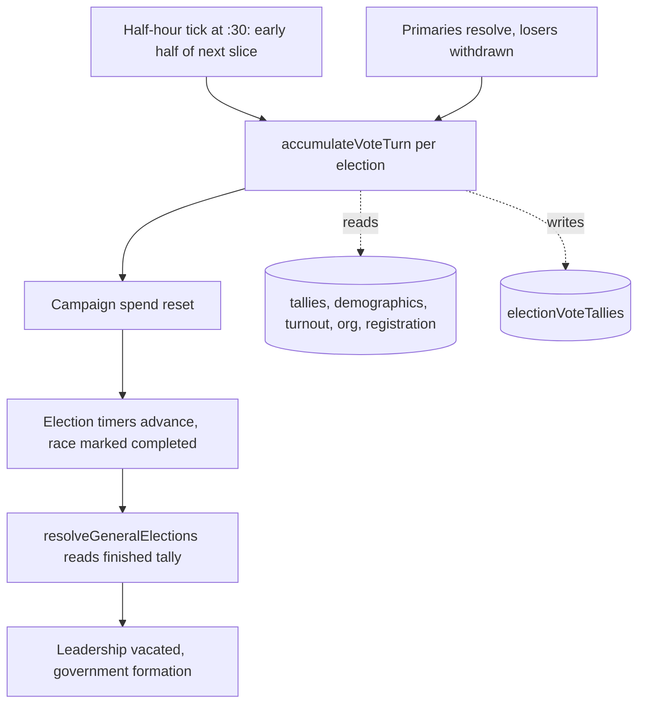

# Election Engine

## Summary

The Election Engine is the core vote calculation and tally management system for all elections in A House Divided. It handles vote distribution across demographic groups, vote accumulation over time, and election resolution.

Player guide: [Election Mechanics](https://www.ahousedividedgame.com/wiki/election-mechanics), [General Elections](https://www.ahousedividedgame.com/wiki/general-elections) and [Vote Factor Ledger](https://www.ahousedividedgame.com/wiki/vote-factor-ledger)

For the race lifecycle (types, durations, primaries, entry and withdrawal) see [Elections](./elections.md). For the election-night display layer see [Live Election Results](./live-election-results.md).

**Location:** `src/lib/electionEngine/`

**Key files:**

- `voteDistribution.ts` - Group-level competitive vote allocation (primaries; general-election fallback)
- `voteDistributionSwingFlow.ts` - Two-phase pairwise swing-flow allocation (default for general elections, §7.3.2)
- `tallyManagement.ts` - Vote accumulation and tally initialization
- `voteCalculations.ts` - Turn vote weight calculations (three-tier closing surge)
- `resolvedTurnout.ts` - Dynamic turnout resolution with GOTV/canvassing modifiers
- `candidateEnrichment.ts` - Candidate data enrichment with appeal calculations
- `constants.ts` - Tunable parameters (spoiler rate, NPP weight)

## Rules

### Vote distribution model

**Two distribution paths exist.** Primaries always use the **group-level competitive allocation** model in `voteDistribution.ts` (each demographic group votes as a bloc, splitting its vote pool among candidates by relative appeal). General elections default to the **swing-flow model** in `voteDistributionSwingFlow.ts` (`tallyManagement.ts` selects it whenever `isGeneralElection` is true, which is `isPrimaryEnded(election, turn)`); `distributeVotesByGroupLevelAllocation` remains available as a fallback/legacy path but is not the general-election default. The sections below describe the group-level model, which still governs primaries and is the basis the swing-flow model was built on top of.

**Key principles:**

1. Groups vote as blocs (not individual voters)
2. Candidates split each group's vote by relative appeal
3. Appeal is multi-factor: position alignment + directional bonus + reach (influence)
4. Turnout is dynamic per group (GOTV and canvassing modifiers)

### Vote distribution formula

```typescript
for each demographic group:
  groupContribution = statePopulation × (populationPct/100) × (turnoutPct/100) × (categoryWeight/100)
  groupShare = groupContribution / totalPool
  groupPool = effectiveTurnPool × groupShare

  for each candidate:
    appeal = calcAppeal(demoEP, demoSP, charEP, charSP, influence, includeInfluence)
    reach = normalizeNPI(politicalInfluence or nationalInfluence)
    approval = approvalScalar(effectiveFavorability)
    org = isGeneralElection ? orgVoteWeight(partyOrgByParty, party) : 1

    weight = appeal × reach × approval × org × nppPenalty

  candidate's group votes = groupPool × (candidate's weight / total weight)
```

### Appeal calculation

The appeal function (`calcAppeal()` in `src/lib/utils/demographicAppeal.ts`) calculates how well a candidate resonates with a demographic group. It is not a Gaussian falloff; it is a capped-linear position score plus a directional (tribal-voter) bonus, plus an optional influence term:

```typescript
positionRaw = max(0, 50 - |demoEP - charEP| × 5 - |demoSP - charSP| × 5)
// APPEAL_POSITION_EXPONENT = 1.5 is the live default (softened from the legacy
// squared curve, γ=2, which is still supported as a special case but not used).
// Endpoint-matched for any γ: positionRaw=0 → 0, positionRaw=50 → 25.
positionScore = 25 × (positionRaw / 50) ^ 1.5 + APPEAL_POSITION_FLOOR  // floor keeps appeal > 0

directionBonus = DIRECTION_BONUS_PER_AXIS × (directionFactor(EP) + directionFactor(SP))
// directionFactor rewards a candidate leaning the same way as the group's lean,
// ramping from a small center credit to full credit; suppressed to 0 if the
// candidate's lean conflicts in sign with their own party's position (party gate)

influenceScore = includeInfluenceInAppeal ? normalizeNPI(politicalInfluence) × 12.5 : 0
// Every live path (state general, presidential general, group-level allocation, polls)
// passes includeInfluenceInAppeal = false, so influence is reach only. The term remains
// in calcAppeal (default true) but is not used by the election engines.

appeal = positionScore + directionBonus + influenceScore   // capped at MAX_APPEAL = 50
```

Constants in `src/lib/utils/demographicAppeal.ts`: `MAX_APPEAL = 50`, `APPEAL_POSITION_FLOOR = 0.5`, `APPEAL_POSITION_EXPONENT = 1.5`, `DIRECTION_BONUS_PER_AXIS = 5`. Reach is `normalizeNPI(x) = sqrt(clamp(x, 0, 100) / 100)` (`src/lib/utils/normalizeNPI.ts`), floored at `VOTE_REACH_FLOOR = sqrt(1/100) = 0.1` so a candidate at zero influence is a steep disadvantage rather than erased (`electionFormulaFactors.ts`).

`useAveragedPositions` is a swing-flow-only option (`voteDistributionSwingFlow.ts`); the group-level allocation path (`voteDistribution.ts`) does not blend candidate and party positions.

### Effective favorability

Candidates receive approval bonuses based on archetype alignment:

```typescript
effectiveFav = clamp(favorability + (archetypeApproval × 0.5), 0, 100)  // calcEffectiveFavorability()
approvalScalar = clamp(effectiveFav / 100, 0, 1) ^ APPROVAL_SCALAR_EXPONENT  // APPROVAL_SCALAR_EXPONENT = 0.8, "If voters don't approve of you they won't vote for you."
```

### Party organization weight

**The old `partyOrgScalar` (1.0-1.6x standard, 1.0-2.5x presidential) was retired 2026-06-18.** General elections and polls now use `orgVoteWeight()` (`src/lib/electionEngine/electionFormulaFactors.ts`): a party's normalized share of statewide Org, raised to a sub-1 exponent for diminishing returns. Primaries use a uniform neutral `1×` (intra-party Org cancels out).

```typescript
// General elections
normalizedOrgShare = max(0, ownPartyOrg) / sum(max(0, orgByParty) for all parties)
orgVoteWeight = normalizedOrgShare ** ORG_WEIGHT_EXPONENT  // ORG_WEIGHT_EXPONENT = 0.2, diminishing returns
// No Org data anywhere → neutral fallback of 1

// Primaries
org = 1  // uniform; intra-party Org cancels
```

### Other swing-flow weight factors

The swing-flow per-group weight (`voteDistributionSwingFlow.ts`) multiplies several more factors on top of appeal, reach, approval and org. Each is neutral (1.0) when its input is absent.

| Factor | Value | Source |
| --- | --- | --- |
| Personal org floor | `0.1 × reach × approval`, used if above the party's Org weight | `PERSONAL_ORG_FLOOR_CAP = 0.1`, `electionFormulaFactors.ts` |
| Infamy multiplier | `1 - 0.05 × infamy/100` (0.95 at infamy 100) | `INFAMY_PENALTY_MAX = 0.05`, `src/lib/utils/infamy.ts` |
| Registration resistance | `1 + 0.3 × reg/100` (1.0 to 1.3) | `REG_RESISTANCE_MAX_BONUS = 0.3`, `electionFormulaFactors.ts` |
| Registration baseline (UK regions only) | `max(0.005, reg/100) ^ 0.5` | `REG_BASELINE_EXPONENT`, `REG_BASELINE_MIN_SHARE`, `electionFormulaFactors.ts` |
| Candidate Support mood | `0.6 + 0.8 × support/100` (0.6 to 1.4), applied to group votes after allocation | `SUPPORT_MOOD_FLOOR`, `SUPPORT_MOOD_CEILING`, `electionFormulaFactors.ts` |
| State org bonus | up to +15% general, +25% primary | `MAX_STATE_ORG_BONUS_GENERAL = 0.15`, `MAX_STATE_ORG_BONUS_PRIMARY = 0.25`, `constants.ts` |
| Home-state bonus | +5% general, +20% primary | `HOME_STATE_BONUS_GENERAL = 0.05`, `HOME_STATE_BONUS_PRIMARY = 0.2`, `constants.ts` |
| Personal-stat tenure erosion | influence and favorability lose 3% per consecutive term beyond the first, max 15% | `PERSONAL_STAT_TENURE_EROSION_PER_TERM`, `PERSONAL_STAT_TENURE_EROSION_MAX`, `electionFormulaFactors.ts` |
| Midterm opposition boost | 1.05 | `midtermOppositionBoost.ts` |

### NPP weight penalty

In general elections with human players, NPPs receive a weight penalty to reduce their structural advantage:

```typescript
nppPenalty = isNPP && hasPlayerInRace ? NPP_GENERAL_WEIGHT_MULTIPLIER : 1;
// NPP_GENERAL_WEIGHT_MULTIPLIER = 0.8 (20% penalty), src/lib/electionEngine/constants.ts
```

**Note:** This penalty applies only in general elections. Primaries use score-based handicapping instead (`NPP_PRIMARY_SCORE_MULTIPLIER = 0.5`).

### Spoiler effect (FPTP only)

In First-Past-The-Post systems, third-party candidates cause vote-splitting:

```typescript
if (isGeneralElection && votingSystem !== "rcv" && !isOnePartyState):
  for each third-party candidate:
    spoiled = thirdPartyVotes × FPTP_SPOILER_RATE  // × localOrgFactor if useOrgAwareSpoiler
    nearestMajorParty = findNearestMajorParty(thirdParty)
    transfer min(spoiled, nearestMajorPartyVotes) from nearest to thirdParty
```

**Constants** (`src/lib/electionEngine/constants.ts`):

- `FPTP_SPOILER_RATE = 0.04` (4% of a third-party candidate's own group-level allocation is drawn from the nearest major party)
- `PRESIDENTIAL_SPOILER_RATE = 0.02` (half the state-level rate; applied only when passed explicitly via `spoilerRate`, which the presidential engine does)
- Distance metric: `|EP_diff| + |SP_diff|` (Manhattan)

**Exemptions:** RCV elections skip the spoiler step entirely. One-party states also skip it. The regime multiplier already encodes ruling-vs-approved dominance by an order of magnitude, and "third party bleeds the major" doesn't describe that regime type.

### Turn vote accumulation

Elections accumulate votes over multiple turns. `voteCalculations.ts` no longer uses a bell curve; it uses a **three-tier closing surge** (`turnVoteWeight()`), turn-first and drift-immune when the election carries numeric `startTurn`/`endTurn` (falls back to a date-based window for legacy docs without turn fields):

```typescript
ELECTION_DAY_TURNS = 4  // sharp final-day spike band
RAMP_TURNS = 8          // gentle build-up band before it
EARLY_POOL_SHARE = 0.5
RAMP_POOL_SHARE = 0.2
FINAL_POOL_SHARE = 0.3  // shares must sum to 1

finalCount = ELECTION_DAY_TURNS
rampCount = min(RAMP_TURNS, totalTurns - finalCount)
earlyCount = totalTurns - finalCount - rampCount
// earlyCount == 0: the early share is folded into the ramp share so the window still sums to the pool

turnVotes =
  turnIndex in final band ? FINAL_POOL_SHARE × totalPool / finalCount :
  turnIndex in ramp band  ? RAMP_POOL_SHARE × totalPool / rampCount :
  /* early band */          EARLY_POOL_SHARE × totalPool / earlyCount
```

This front-loads half the pool into the early turns, then spikes to 30% of the pool in the last 4 turns: the opposite shape of a bell curve. Very short races (`totalTurns <= ELECTION_DAY_TURNS`) spread the pool evenly instead.

**Window resolution** (`resolveTurnWindow`, `voteCalculations.ts`): `totalTurns = max(4, endTurn - startTurn + 1)` when called with `inclusiveEnd: true` (all general accumulation), and `turnIndex = clamp(currentTurn - startTurn, 0, totalTurns - 1)`. The window is inclusive because the turn that reaches `endTurn` still accrues: timers complete the race after accumulation, so the window holds `endTurn - startTurn + 1` slices. Without the inclusive end the final turn clamped onto the last slice and released it twice (a 12-turn window paid 13 slices, about 7.5% of the pool over the top, which once certified a governor race at 102% turnout). The `startTurn` passed in must be the general-election start (`primaryEndTurn ?? startTurn`), not the overall election `startTurn`, or the final-turn share balloons (ticket #955).

### Turn pool scaling and ceilings

After `turnVoteWeight` the slice is scaled and capped before distribution (`tallyManagement.ts`):

```typescript
turnPool = turnVoteWeight(totalTurns, turnIndex, resolvedTotalPool)
strengthMultiplier = (1 + (approval/100 - 0.5) × LEGISLATIVE_APPROVAL_VOTE_SLOPE) × officeStrength
effectiveTurnPool = turnPool × strengthMultiplier × sliceFraction
effectiveTurnPool = capTurnSliceToElectorate(effectiveTurnPool, totalPool, electorate)
effectiveTurnPool = scalePoolToRegistered(effectiveTurnPool, registrationPool.unregistered)   // × (1 - unregistered%/100)
effectiveTurnPool = capTurnSliceToRemainingElectorate(effectiveTurnPool, alreadyCast, registeredElectorate)
```

- `LEGISLATIVE_APPROVAL_VOTE_SLOPE = 0.2`, `PRESIDENTIAL_APPROVAL_VOTE_SLOPE = 0.5` (`approvalVoteMultiplier.ts`). State approval (0-100, from [Government Approval](./government-approval.md); 50 when missing) is centred at 50 so 0% gives 0.9× and 100% gives 1.1× for state races, 0.75× to 1.25× for president.
- `officeStrength = getPartyStrengthWeight(countryId, officeKey)` from each country config (`partyStrengthWeight` in `src/lib/countries/<id>/institutionsFacts.ts`). US values: Governor 1.0, President 1.0, Vice President 1.0, Senate 0.8, House 0.9, State Senate 0.85. `snap_*` types use the regular type's weight. `PARTY_STRENGTH_BY_OFFICE` in `constants.ts` is deprecated; the presidential engine still reads its `president` entry (1.0).
- `sliceFraction` is 1 for a whole turn and 0.5 for each half of a split turn (see Timing).
- The registered-voter gate scales only the turn pool, never `totalPool`: the distributors normalise each group as `contribution / totalPool` and then multiply by the turn pool, so scaling both would cancel. Shares, seats and winners are unaffected, only magnitudes.
- The cumulative ceiling means ballots already cast plus this slice never exceed the registered electorate. The approval multiplier sits outside the earlier caps, so this last cap is what keeps turnout at or under 100%.
- A missing registration pool leaves the pool untouched (prior behaviour for most non-US worlds).

### Dynamic turnout resolution

Turnout is no longer static. The `resolveTurnout()` function combines static demographics with dynamic modifiers stored on a single `StateDemographicTurnout` document per region:

```typescript
for each demographic group:
  baselineTurnout = layer1Derived[groupId]        // US Layer-1 states: recomputed from race/age/education/wealth/ideology baselines + modifiers
                     ?? stateGroup.turnout          // stored archetype turnout
                     ?? group.defaultTurnout ?? 55

  // Sum modifiers across all category buckets in turnoutDoc.modifiers (groupId-keyed)
  modifier = sum(turnoutDoc.modifiers[category][groupId] for each category)

  finalTurnout = clamp(baselineTurnout + modifier, minTurnout, maxTurnout)  // default clamp 0-100
  groupContribution = population × (finalTurnout/100) × (categoryWeight/totalCategoryWeight)
```

**Data source:** `StateDemographicTurnout` (`src/lib/db/types/stateDemographicTurnout.ts`) stores one unified `modifiers: Record<categoryId, Record<groupId, number>>` map (percentage-point adjustments, ranged roughly -20 to +20, decaying 2%/turn), fed by party GOTV spending and player canvassing actions. There is no separate suppression field. `gotvEfforts`, `canvassingData`, and `suppressionData` do not exist in the codebase. The pool electorate is `states.votingEligiblePopulation ?? states.population`.

### Seat estimation (multi-seat races)

For multi-seat races, the system (`getMultiSeatMinShare()` in `src/lib/turn/election/rules/seatEligibility.ts`) projects seat allocations using the Hamilton method (largest remainder), grouping votes by party (independents grouped individually):

```typescript
1. Filter candidate/party groups meeting minimum vote share threshold (see below)

2. Calculate exact seats: exactSeats = (groupVotes / poolVotes) × totalSeats

3. Give everyone floor(exactSeats)

4. Distribute remaining seats by largest remainder
```

The per-turn estimate is `computeSeatEstimates` (`src/lib/elections/buildPollingData.ts`, re-exported from `resolveElection.ts`), and the allocator is `largestRemainderSeats` in `src/lib/turn/election/seatAllocation.ts`. An election carrying `allocationMethod` (frozen when the race opens) can route to other allocators (PR-STV, Sainte-Laguë, bloc list, AMS); those are country election systems and are documented on the country pages.

**Minimum share thresholds** (`src/lib/turn/election/rules/seatEligibility.ts`):

- US House: `clamp(1/(seats+1), 10%, 20%)` from the state delegation size. With no seat count it stays at 20%.
- Other House elections (for example the Nigerian House of Representatives) and any election type not listed below: a flat 20%.
- Flat 10% (`STANDARD_MULTI_SEAT_MIN_SHARE`): State Senate, UK Regional Council, DE Landtag, UK Commons and snap Commons, JP Shugiin and snap Shugiin, CN People's Congress, IE Dáil, Seanad and Local Council, FR Assemblée Nationale, IT Camera, ES Congreso, SE Riksdag, TR Millet Meclisi, AT Nationalrat, FI Eduskunta, GR Vouli, DD Volkskammer and the Land Assembly.

### Candidate enrichment

The `fetchEnrichedCandidates()` function enhances candidate records with calculated data:

```typescript
EnrichedCandidate {
  candidateId: string,
  party: string,
  isNPP: boolean,
  favorability: number,
  politicalInfluence: number,
  nationalInfluence: number,
  charEP: number,       // Candidate economic position
  charSP: number,       // Candidate social position
  partyEcon?: number,   // Party economic position
  partySocial?: number, // Party social position
  archetypeApprovals: { [groupId]: number }
}
```

**Data sources:**

- `characters` or `npps` collection (based on `isNPP`)
- `politicalParties` for party positions
- `archetypeApprovals` from pre-calculated demographic alignment

### Swing-flow driver modifiers

The swing-flow engine (`voteDistributionSwingFlow.ts`) layers several driver modules on top of the base appeal/reach/approval calculation. Each is optional (no-ops when its inputs are absent) and each has its own dedicated file under `src/lib/electionEngine/`.

#### Coattails (`coattailMagnitude.ts`, `govCoattail.ts`, `presidentialCoattail.ts`)

A sitting executive's approval swings a nominal-share multiplier for their own party in every eligible down-ballot general in scope, governor coattails at state scope, presidential coattails at national scope. Shared math (`coattailMagnitude.ts`):

```typescript
approvalCoattailMultiplier(approval) =
  1 + clamp((approval - BASE_APPROVAL) / COATTAIL_APPROVAL_SATURATION, -1, 1) × COATTAIL_MAX_BONUS
```

Constants (`constants.ts`): `COATTAIL_MAX_BONUS = 0.09` (+/-9%), `COATTAIL_APPROVAL_SATURATION = 25` points. `BASE_APPROVAL = 50` (`src/lib/utils/governmentApproval.ts`). An executive exactly at 50 contributes 1.0× (no-op); at 75 or above the party's races get the full +9%; at 25 or below, a full -9% drag.

`govCoattail.ts` resolves the sitting regional executive per state (preferring the damped stored `stateApprovalHistory` snapshot over a live recompute). It excludes the executive's own race (no self-coattail) and the head-of-government race itself.

`presidentialCoattail.ts` mirrors this at national scope, reading the sitting President's party and stored national approval. It is currently US-only (`HEAD_OF_GOVERNMENT_TYPE_BY_COUNTRY = { US: "president" }`), since non-US heads of government (UK PM, DE chancellor, JP shugiin) are not wired in yet.

Coattails apply as a **nominal-share multiplier**, not as a persuasion-driver component, so they are not double-counted against the incumbency driver below.

#### Median-voter driver (`medianVoter.ts`)

Replaces the policy-distance driver's old hard-coded `(0, 0)` centrism reference with the state's actual turnout-weighted median voter. `computeMedianVoter()` averages each demographic group's economic/social lean, weighted by `categoryWeight × populationPct × turnoutPct`. It is a weighted average, not a true statistical median, deliberately, since per-voter modeling is not part of this engine.

For US presidential races, `computeNationalEvWeightedMedian()` aggregates each state's median weighted by electoral votes (a 55-EV state pulls the national signal 55× harder than a 3-EV state) rather than by population, because campaigns court the Electoral College map. `usesEvWeightedNationalMedian()` gates this to US president only; other head-of-government races use the state/national default. Zero-weight or mirror-symmetric inputs return the neutral `{ ep: 0, sp: 0 }`.

#### Persuasion drivers (`persuasionDrivers.ts`)

`persuasionDrivers(pj, pi, ...)` sums four independently-budgeted components into a signed `[-1, +1]` contribution describing how much of `pi`'s marginal support swings toward `pj`:

| Component | Budget | Shape |
| --- | --- | --- |
| Candidate Support delta | `SUPPORT_DELTA_BUDGET = 0.30` | Linear on the Support-stat gap between the two parties' representative candidates |
| Policy distance | `POLICY_DISTANCE_BUDGET = 0.15` | Distance from the median voter (see above), normalized to the ±4 grid; closer-to-median party gets the positive side |
| Money | `MONEY_BUDGET = 0.20` | log10 ratio of campaign funds, saturating at a 10× advantage |
| Incumbency | `INCUMBENCY_BUDGET = 0.10` | See the 3-way split below |

Budgets sum to 0.75, deliberately under the `[-1, +1]` aggregate clamp so the clamp only activates on driver pile-on, not by structural design. The "representative candidate" for a party in multi-seat races is whichever candidate has the highest Support.

#### Term fatigue

Historical: the separate party-tenure fatigue module (`partyTenureFatigue.ts`) was removed. Term fatigue now lives in the economic referendum channel for executive own-races (`src/lib/electionEngine/economicReferendum.ts`), as a penalty-side multiplier rather than a subtraction from the incumbency budget.

#### Midterm opposition boost (`midtermOppositionBoost.ts`)

A modest nominal-share counterweight, `MIDTERM_OPPOSITION_MULTIPLIER = 1.05`, applied to every party **outside** national government (including independents) in elections eligible for it, currently gated to UK Regional Council midterms (`isUKRegionalCouncilMidterm()`). Coalition/confidence partners resolved as governing parties stay neutral; an unresolved or vacant government no-ops instead of boosting everyone. Applied as a `midtermOppositionModifierByParty` multiplier in `voteDistributionSwingFlow.ts`, alongside the coattail and reg-baseline/resistance tilts.

#### The 3-way incumbency split (`incumbentSeatShare.ts`, `persuasionDrivers.ts`)

The incumbency driver branches on race type, in priority order:

1. **Single-winner executive own-race** (`incumbentPartyId` set, governor, president, etc.): full-magnitude directional shield/drag scaled by the sitting executive's approval via the **executive approval curve**:
   ```typescript
   // executiveIncumbencyBudget(approval, pivot = 46), src/lib/government/rules/accountability.ts
   approval >= pivot
     ? min(0.10, (approval - pivot) × 0.01)
     : -min(0.20, min(0.10, shortfall × 0.01) + 0.10 × max(0, shortfall - 10) / max(1, pivot - 10))
   // shortfall = pivot - approval
   ```
   `INCUMBENCY_APPROVAL_PIVOT = 46` and `INCUMBENCY_SHIELD_MAX = 0.1` live in `persuasionDrivers.ts` (the pivot can be overridden per call through `incumbencyApprovalPivot`, which the replay harness uses); the slope (0.01), the drag cap (0.20) and the second drag term live in `accountability.ts` as literals (there are no `INCUMBENCY_DRAG_MAX` or slope constants). The shield caps at +10pp at approval 56. The drag is continuous down to zero approval: -6pp at approval 40, -10pp at 36, -20pp at 0. The pivot sits below the live national mean, so most incumbents get a smaller shield and only the weakest tip into drag. A missing or non-finite approval returns the full +10pp shield.
2. **Single-seat legislative own-race** (`legislativeIncumbentPartyId` set, US Senate): a flat, officeholder-based shield that ignores approval/favorability (already priced in elsewhere) and never becomes a drag: `LEGISLATIVE_INCUMBENCY_SHIELD = 0.06` (+6pp), decaying `LEGISLATIVE_TENURE_FATIGUE_PER_TERM = 0.01` per term beyond the first, floored at `LEGISLATIVE_INCUMBENCY_MIN = 0.01` (+1pp permanent floor).
3. **Multi-seat / legislature fallback** (`incumbentSeatShareByParty` map, from `incumbentSeatShare.ts`): the prior cycle's per-party seat-share (computed by `computeSeatShareFromTally()` from the last resolved tally on the same seat key) scales the shield linearly: `(shareJ − shareI) × INCUMBENCY_BUDGET`. Used for proportional/multi-seat races (US House, UK Regional Council, JP Shugiin/Sangiin, DE Bundestag). Single-seat races deliberately do NOT use this fallback, a two-candidate vote split isn't a meaningful "incumbent share" signal, and returns an empty map (⇒ 0 driver contribution) when there's no prior resolved election on the same seat key.

### Country system

The election engine uses country-aware party lookups:

```typescript
majorPartySet = getMajorPartiesForRegion(countryId, parentRegionId);
```

`getMajorPartiesForRegion()` has region-specific overrides (e.g. UK Scotland → SNP/Labour, UK Wales → Labour/Conservative, UK Northern Ireland → DUP/Sinn Féin, Japan Kansai → Ishin/LDP) and falls back to each country's configured `majorPartyIds` otherwise. There is no "CA" (Canada) country; the roster currently spans US, UK, JP, DE, DD, FR, IT, ES, SE, TR, AT, FI, GR, IE, CN, RU, PL, HU, RO, BG, YU, CS, NG, and BR.

### Constants and tunables

All defined in `src/lib/electionEngine/constants.ts` unless noted.

| Constant                        | Value | Purpose                                                                                |
| -------------------------------- | ----- | --------------------------------------------------------------------------------------- |
| `FPTP_SPOILER_RATE`              | 0.04  | Fraction of a third party's own group allocation spoiled from the nearest major party    |
| `PRESIDENTIAL_SPOILER_RATE`      | 0.02  | Spoiler rate for presidential elections (half the state rate)                            |
| `NPP_GENERAL_WEIGHT_MULTIPLIER`  | 0.8   | NPP penalty in general elections with a player in the race                               |
| `NPP_PRIMARY_SCORE_MULTIPLIER`   | 0.5   | NPP score penalty in primaries with a player in the same primary                         |
| `ORG_WEIGHT_EXPONENT`            | 0.2   | Diminishing-returns exponent on normalized Org share (`electionFormulaFactors.ts`)        |
| `APPEAL_POSITION_EXPONENT`       | 1.5   | Curve on policy distance (`src/lib/utils/demographicAppeal.ts`)                           |
| `APPEAL_POSITION_FLOOR`          | 0.5   | Keeps appeal above zero (`demographicAppeal.ts`)                                         |
| `DIRECTION_BONUS_PER_AXIS`       | 5     | Tribal direction bonus per axis (`demographicAppeal.ts`)                                  |
| `MAX_APPEAL`                     | 50    | Appeal ceiling (`demographicAppeal.ts`)                                                  |
| `APPROVAL_SCALAR_EXPONENT`       | 0.8   | Exponent on favorability (`demographicAppeal.ts`)                                         |
| `ELECTION_DAY_TURNS`             | 4     | Final band length (`voteCalculations.ts`)                                                 |
| `RAMP_TURNS`                     | 8     | Ramp band length (`voteCalculations.ts`)                                                  |
| `EARLY_POOL_SHARE` / `RAMP_POOL_SHARE` / `FINAL_POOL_SHARE` | 0.5 / 0.2 / 0.3 | Share of the pool per band (`voteCalculations.ts`)               |
| `LEGISLATIVE_APPROVAL_VOTE_SLOPE` / `PRESIDENTIAL_APPROVAL_VOTE_SLOPE` | 0.2 / 0.5 | Slope of the approval pool multiplier (`approvalVoteMultiplier.ts`) |
| `COATTAIL_MAX_BONUS`             | 0.09  | Max coattail swing (`constants.ts`)                                                       |
| `COATTAIL_APPROVAL_SATURATION`   | 25    | Approval points from 50 for full coattail (`constants.ts`)                                |
| `SUPPORT_DELTA_BUDGET`           | 0.30  | Persuasion budget: candidate Support (`persuasionDrivers.ts`)                             |
| `POLICY_DISTANCE_BUDGET`         | 0.15  | Persuasion budget: policy distance (`persuasionDrivers.ts`)                               |
| `MONEY_BUDGET`                   | 0.20  | Persuasion budget: money (`persuasionDrivers.ts`)                                         |
| `INCUMBENCY_BUDGET`              | 0.10  | Persuasion budget: incumbency and the flat fallback (`persuasionDrivers.ts`)              |
| `INCUMBENCY_APPROVAL_PIVOT`      | 46    | Approval at which shield turns to drag (`persuasionDrivers.ts`)                           |
| `INCUMBENCY_SHIELD_MAX`          | 0.10  | Executive shield cap (`persuasionDrivers.ts`)                                             |
| `LEGISLATIVE_INCUMBENCY_SHIELD`  | 0.06  | US Senate flat shield (`persuasionDrivers.ts`)                                            |
| `LEGISLATIVE_TENURE_FATIGUE_PER_TERM` | 0.01 | Senate shield loss per term beyond the first (`persuasionDrivers.ts`)              |
| `LEGISLATIVE_INCUMBENCY_MIN`     | 0.01  | Senate shield permanent floor (`persuasionDrivers.ts`)                                    |
| `MIDTERM_OPPOSITION_MULTIPLIER`  | 1.05  | Opposition nominal-share bump (`midtermOppositionBoost.ts`)                               |
| `PERSONAL_ORG_FLOOR_CAP`         | 0.1   | Personal org floor (`electionFormulaFactors.ts`)                                          |
| `VOTE_REACH_FLOOR`               | 0.1   | Minimum reach, `sqrt(1/100)` (`electionFormulaFactors.ts`)                                |
| `REG_RESISTANCE_MAX_BONUS`       | 0.3   | Registration resistance (`electionFormulaFactors.ts`)                                     |
| `SUPPORT_MOOD_FLOOR` / `SUPPORT_MOOD_CEILING` | 0.6 / 1.4 | Support mood range (`electionFormulaFactors.ts`)                       |
| `STANDARD_MULTI_SEAT_MIN_SHARE`  | 0.10  | Flat seat gate for listed chambers (`src/lib/turn/election/rules/seatEligibility.ts`)     |
| US House seat gate               | 10% to 20% | `clamp(1/(seats+1), 0.1, 0.2)`, 20% for non-US House and unlisted types (`seatEligibility.ts`) |

`MONETARY_LAG_TURNS` (12) is not an election-engine constant. It lives in `src/lib/budget/inflation.ts` and governs interest-rate change lag, unrelated to elections.

## Data

| Collection | Fields read | Fields written | Player-visible |
| --- | --- | --- | --- |
| `electionVoteTallies` | `totalVotes`, `candidateNames`, `candidateParties`, `turnSnapshots`, `primaryVotes`, `finalized`, `totalVotesByUnit` (president) | `totalVotes`, `candidateNames`, `candidateParties`, `turnSnapshots[]` (each: `turn`, `slicePart`, `recordedAt`, `cumulativeVotes`, `sharesPct`, `seatsEstimate`, `participation`), `seatsEstimate`, `updatedAt`; resolution adds `resolutionPath`, `resolvedSeatHolders`, `resolvedTotalSeats`, `primaryResults` | Totals, shares and seat projections on election pages and the results board |
| `elections` | `startTurn`, `endTurn`, `primaryEndTurn` (and Date twins), `electionType`, `countryId`, `state`, `cycle`, `allocationMethod`, `totalSeats` | none | Yes, race pages |
| `electionCandidates` | `status`, `party`, `isNPP`, `characterId`, `nppId`, `seatsRequested` | none (withdrawal cleanup writes the tally) | Yes, candidate lists |
| `characters`, `npps` | `favorability`, `politicalInfluence`, `nationalInfluence`, `infamy`, `economicPosition`, `socialPosition`, tenure | none | Stats shown on profiles |
| `politicalParties` | `economicPosition`, `socialPosition`, `sequentialId`, `countryId` | none | Yes |
| `states` | `population`, `votingEligiblePopulation`, `votingSystem`, lean | none | Partly |
| `stateDemographics`, `demographicCategories`, `demographicDefaults` | group population, turnout, leans, `categoryWeights` | none | Partly (state pages) |
| `stateDemographicTurnout` | `modifiers`, `campaignModifiers`, `campaignContactModifiers` | none here (written by GOTV, canvassing and decay) | No |
| `statePartyOrg` | `organization`, `registration` | none | Org and registration shown on state pages |
| `stateRegistrationPool` | `unregistered` | none | Partly |
| `campaigns`, `executiveEndorsements` | `spendThisTurn`, funds, endorsements | none | Partly |
| `gameState` | `preset`, `currentTurn` and reset-system versions (demographics v2 gate) | none | No |

Each `turnSnapshots` entry is the per-turn history that trend charts read. `sharesPct` is per candidate and the sum of `cumulativeVotes` is the running turnout.

## Configuration

There is no single engine config document. Behaviour is set by constants (listed above), country configs, world state and per-election stamps.

| Setting | Default | Where set |
| --- | --- | --- |
| Engine constants | see Constants and tunables | `constants.ts`, `electionFormulaFactors.ts`, `persuasionDrivers.ts`, `voteCalculations.ts`, `approvalVoteMultiplier.ts`, `src/lib/utils/demographicAppeal.ts` |
| `partyStrengthWeight` per office | US: 1.0, 0.8, 0.9, 0.85 (see above) | `src/lib/countries/<id>/institutionsFacts.ts` |
| `majorPartyIds` and region overrides | per country | `src/lib/constants/countries.ts` (`getMajorPartiesForRegion`) |
| `states.votingSystem` | `"fptp"` when unset | State document, changed by legislation. `"rcv"` skips the spoiler step. |
| `isOnePartyState` | from the country's government type | Country config. Skips the spoiler step. |
| `election.allocationMethod` | unset, then the country default allocator | Frozen when the race spawns, so later electoral reform only affects later races |
| `election.rulesetVersion` (US presidential) | unstamped = v1 | `src/lib/elections/presidentialRuleset.ts`. v3 sets `campaignStrengthMaxBonus` 0.25, `applyExplicitLeanMultiplier` false, `tacticalMovementRate` 0.05, `incumbentApprovalStateWeight` 0.5. |
| `election.campaignRulesVersion` | unset = legacy campaigning for the whole race | Stamped at spawn |
| Presidential engine constants | `INDEPENDENT_VOTE_PENALTY` 0.3, `STATE_LEAN_STRENGTH` 0.1, `DISTRICT_LEAN_STRENGTH` 0.3, `LEAN_MULT_MIN` 0.8, `LEAN_MULT_MAX` 1.2, `partyPositionWeight` 1/3 | `src/lib/presidentialElectionEngine.ts` |
| `gameState.preset` | per world | Chooses the apportionment and era behaviour (`1953-default`, `1991-default`, `2019-default`) |
| `gameState.fastMode` | off | Disables the half-hour results tick (turns already run every 30 minutes) |
| Demographics v2 | per country, from reset-system versions | `resetSystemVersionsForCountry`. When active the engine reads cell-based electorates and adds campaign-contact turnout. |

## Timing

One turn is one real hour (48 turns = 1 game year). Election vote accumulation runs once per turn in the **`electionResolutionAndGovernment`** phase of the turn-phase registry, which comments call "Group 7". It is strictly sequential, since reordering steps corrupts elections (drops final-turn votes, or resolves offices from stale tallies):

```typescript
// src/simulation/phases/turnPhaseRegistry.ts
// electionResolutionAndGovernment phase (sequential sub-phases):
0. withdrawInactiveCandidates - withdrawInactiveCandidates()
1. candidatePartySweep    - sweepPartyMismatchedCandidates()
2. primaryResolution      - resolvePrimariesIfNeeded()
3. voteAccumulation       - accumulateGeneralElectionVotes() (calls accumulateVoteTurn() per election)
4. campaignSpendReset     - processCampaignSpendReset() (after vote tallies read Campaign.spendThisTurn)
5. electionTimers         - advanceElectionTimers()
6. primarySnapshots       - recordPrimarySnapshots()
7. electionResolution     - resolveGeneralElections()
8. clearResolvedSupport   - processClearResolvedSupport()
9. leadershipVacate       - vacateLeadershipAfterElections() (only if generals resolved this turn)
// then: parliamentaryGovernmentFormation (government formation after resolution)
```

`resolvePrimariesIfNeeded`, `recordPrimarySnapshots`, and `accumulateGeneralElectionVotes` live in `src/lib/turn/primaryResolution.ts` (the snapshot function in `primarySnapshots.ts`); `resolveGeneralElections` lives in `src/lib/turn/electionResolution.ts`.



Order relative to related systems: primaries resolve before accumulation so eliminated candidates are never tallied. Accumulation runs before the campaign spend reset so the tally reads this turn's `Campaign.spendThisTurn`. Accumulation runs before timers advance so the last turn's votes are counted before the election is marked completed. Resolution reads the finished tally, never a stale one.

### Half-turn slices

Between hourly turns a half-hour tick (`runElectionHalfTick`, `src/lib/turn/elections/electionHalfTick.ts`) banks the early half of the coming turn's slice so results move every 30 minutes. `planTurnSlice` (`src/lib/electionEngine/rules/turnSlice.ts`) decides what a call may bank given the parts already recorded for that turn: a whole turn (`fraction` 1), an `early` half (0.5, when nothing is recorded yet) or a `rest` half (0.5, after an early half). Anything else returns nothing to count. The tick covers every general already counting and non-presidential primaries whose ballot window is open. It skips when the world is inactive or processing, or in `fastMode`. Vote totals, the closing surge and every race deadline are unchanged; campaign money, actions and presidential primary waves stay on the hourly turn.

### Preloading and caching

`accumulateVoteTurn()` accepts a `preload` option to batch database queries:

```typescript
options?: {
  approvalMap?: Map<string, number>;
  preload?: {
    stateMap: Map<string, State>;
    demographicsMap: Map<string, StateDemographics>;
    categories: DemographicCategory[];
    statePartyOrgsByState: Map<string, StatePartyOrg[]>;
  };
}
```

- Party org lookups use `Map<string, number>`
- Approval scalars pre-calculated in approvalMap
- Demographic categories fetched once per election
- The approval, enrichment and party-group favorability reads run in parallel for each election, since this path runs for every active election on every turn.

### Per-turn accumulation

Each turn, `accumulateVoteTurn()` is called:

1. Skip if this turn (or this half of it) is already recorded in `turnSnapshots`
2. Fetch tally, active candidates, election metadata
3. Load state demographics, categories, party orgs, turnout doc, registration pool
4. Resolve dynamic turnout with modifiers
5. Calculate turn vote weight (three-tier closing surge) over the inclusive general window
6. Apply party strength multiplier (approval slope × office strength), the slice fraction, then the electorate, registered and cumulative caps
7. Enrich candidates with appeal data
8. Distribute votes (swing-flow model for generals; group-level allocation for primaries)
9. Add new votes to cumulative totals
10. Calculate seat estimates for multi-seat races
11. Snapshot the turn's results

### Tally initialization

When an election starts, a blank tally is created:

```typescript
{
  electionId: ObjectId,
  state: string,
  totalVotes: { candidateId: 0, ... },
  candidateNames: { candidateId: "Name", ... },
  candidateParties: { candidateId: "Party", ... },
  turnSnapshots: [],
  primaryResults?: PrimaryResults,
  finalized: false
}
```

## Worked trace

One state general election in the US, final band, carried from pool to stored votes. The general window is 24 turns, so the engine window is 25 slices (13 early, 8 ramp, 4 final).

**Step 1: turn pool.** Resolved total pool (after turnout modifiers) is 1,000,000 ballots. Band sizes for 25 slices:

| Band | Turns | Share | Per turn | Of 1,000,000 |
| --- | --- | --- | --- | --- |
| Early | 13 | 0.5 | `0.5 / 13` = 3.846% | 38,462 |
| Ramp | 8 | 0.2 | `0.2 / 8` = 2.5% | 25,000 |
| Final | 4 | 0.3 | `0.3 / 4` = 7.5% | 75,000 |

The check: `13 × 3.846% + 8 × 2.5% + 4 × 7.5% = 50% + 20% + 30% = 100%`. This turn is in the final band, so `turnPool = 75,000`.

**Step 2: scaling.** State approval is 60%, a Governor race (office strength 1.0).

| Step | Computation | Result |
| --- | --- | --- |
| Strength multiplier | `(1 + (0.60 - 0.5) × 0.2) × 1.0` | 1.02 |
| Effective pool | `75,000 × 1.02` | 76,500 |
| Registered gate (10% unregistered) | `76,500 × 0.9` | 68,850 |
| Cumulative ceiling | ballots already cast plus 68,850 stay under the registered electorate | no change here |

**Step 3: group split.** One demographic group holds 20% of the total pool contribution, so `groupPool = 68,850 × 0.20 = 13,770`.

**Step 4: candidate weights inside the group.** Direction bonus, org, NPP and infamy factors are left out (equal or neutral) so the three live levers show.

| | Candidate A | Candidate B |
| --- | --- | --- |
| Group lean (econ, social) | 2, 1 | 2, 1 |
| Candidate position | 1, 1 (distance 1) | -1, 1 (distance 3) |
| `positionRaw = 50 - 5 × distance` | 45 | 35 |
| Position score `25 × (raw/50)^1.5 + 0.5` | 21.85 | 15.14 |
| Political influence, reach `sqrt(PI/100)` | 49 → 0.70 | 64 → 0.80 |
| Favorability, scalar `(fav/100)^0.8` | 60 → 0.665 | 70 → 0.752 |
| Weight (appeal × reach × approval) | 10.16 | 9.11 |
| Share of the group pool | 52.74% | 47.26% |
| Votes from this group | 7,262 | 6,508 |

A has the better policy fit by 44 percent but only a 5.5 point share edge, because B's higher reach and approval claw most of it back. Because approval multiplies the whole weight, a 10 point favorability swing on the last day moves more votes than the same swing in the early band. In the final 4 turns each turn carries 7.5% of the whole pool.

**Step 5: spoiler.** If a third candidate (Chen, Green) were also in the race and the group-level allocation gave Adams (Democrat) 400,000, Brooks (Republican) 450,000 and Chen 200,000 across all groups, the nearest major party to Chen by Manhattan distance is Adams. `spoiled = 200,000 × 0.04 = 8,000`. Adams ends at 392,000, Chen at 208,000, Brooks unchanged at 450,000. Under RCV or in a one-party state this step is skipped.

**Step 6: stored result.** The turn's per-candidate votes are rounded and added to `totalVotes`; the snapshot stores `cumulativeVotes` and `sharesPct`, and multi-seat races add `seatsEstimate`. The swing-flow model replaces Step 4 and 5 for generals but keeps the same pool, scaling and caps; this trace uses the group-level allocation because that is the shared foundation and what polls and primaries use.

## Edge cases and limits

- **Zero influence:** reach is floored at 0.1 (`VOTE_REACH_FLOOR`) so a fresh character is a steep disadvantage, not removed from the race.
- **Zero favorability:** the approval scalar is 0, so the candidate gets 0 votes. This is deliberate ("if voters do not approve of you they will not vote for you").
- **Zero Org in a populated state:** the party's Org weight is 0, but the personal org floor (`0.1 × reach × approval`) rescues a genuinely supported candidate. No Org data anywhere in the state is a neutral 1.
- **Pool is conserved:** the pool is split, never inflated. Missing demographics or a total weight of zero fall back to an equal split.
- **Short races:** if `totalTurns <= ELECTION_DAY_TURNS (4)` the pool is spread evenly. `resolveTurnWindow` floors `totalTurns` at 4. The window must start at the general-election start (`primaryEndTurn`), not the election `startTurn`, or the final-turn share balloons (ticket #955).
- **No early band:** a window of 12 turns or fewer has `earlyCount = 0`, so the early share folds into the ramp share and the window still sums to the pool.
- **Spoiler skipped for:** RCV states, one-party states, and any non-general election. The spoiler never transfers more than the nearest major party holds.
- **NPP penalty** applies only in generals with a human in the race; primaries use the 0.5 score multiplier instead.
- **Influence is not appeal:** influence feeds reach only, so it cannot be double-counted (see Appeal calculation).
- **Withdrawn candidates** are excluded from every share and their votes are removed from the tally, not redistributed.
- **Coattails** exclude the executive's own race and the head-of-government race. **Midterm boost** no-ops when government is unresolved or vacant.
- **Turnout** is clamped to 0 to 100 after modifiers, and ballots never exceed the registered electorate.
- **Single-seat races** never use the seat-share incumbency fallback, since a two-candidate split is not a meaningful incumbent share.
- **Missing executive approval** gives the full +10pp incumbency shield rather than a neutral zero.
- **Missing state document** or missing demographics: `accumulateVoteTurn` returns without writing, so that election keeps its prior tally for the turn.
- **Presidential lean multiplier** (`leanVoteMultiplier`) applies only to races on ruleset v1 or v2. Races on v3 set `applyExplicitLeanMultiplier` false and rely on the lean already priced into appeal.

## Invariants

| Invariant | Enforced by |
| --- | --- |
| Per-turn weights across the window sum to the pool, including with no early band | `voteCalculations.test.ts` ("all turns sum to approximately the total pool", "medium race with no early band still conserves the pool") |
| The final 4 turns carry about 30%, never about 66% | `voteCalculations.test.ts` (#955 regression) |
| The turn that reaches `endTurn` is its own slice and the window releases exactly the pool | `voteCalculations.test.ts` (inclusiveEnd), `tallyManagement.test.ts` ("counts the turn that reaches endTurn and releases exactly the pool across the window") |
| Cumulative ballots never exceed the electorate | `capTurnSliceToRemainingElectorate`; `resolvedTurnout.scalePool.test.ts`, `tallyManagement.test.ts` ("never carries cumulative ballots past the electorate", "caps the vote pool at the state's electorate") |
| Scaling the pool does not change shares, seats or winners | By construction; `resolvedTurnout.scalePool.test.ts` ("share-invariant"), `votingEligibility.f4.test.ts` |
| A stalled turn that is re-run never banks the same turn twice | Same-turn snapshot guard; `tallyManagement.test.ts` ("does not bank the same turn twice when a stalled turn is re-run") |
| Early plus rest halves equal one whole turn and repeats change nothing | `tallyManagement.halfTurn.test.ts`, `electionHalfTick.test.ts` |
| Seat estimates sum exactly to `totalSeats` | `tallyManagement.test.ts` ("produces seatsEstimate that sums exactly to totalSeats") |
| Swing-flow stays within 10 points per candidate of the legacy allocator | `voteDistributionSwingFlowDiff.test.ts`, `voteDistributionSwingFlowFamilies.test.ts` |
| Withdrawn candidates hold no votes | `tallyManagement.test.ts` ("excludes withdrawn candidates from totalVotes"), the cleanup cases in the same file |
| Sub-phase order in the registry | Documented in the registry; not enforced by a dedicated test |

## Failure and recovery

- **Missing demographics** gives an equal vote split for that election rather than a failure.
- **Zero total weight** gives an equal vote split.
- **Withdrawn candidates** are excluded from vote share calculations; tally cleanup (`removeWithdrawnCandidateFromTally()`) removes votes and data, including every presidential unit tally.
- **Missing state or tally document:** the turn returns early without writing; the next turn picks the election up again. A tally missing entirely is rebuilt by tally initialization when the election opens or the primary resolves.
- **A stuck or re-run turn:** the same-turn guard on `turnSnapshots` makes accumulation idempotent, so rerunning the turn does not double count.
- **Over-counted or corrupted tally:** repaired with a data heal of `electionVoteTallies` (and a rerun of the election resolution if the race already resolved from the bad tally). The tally is the single record of votes, so a corrected tally flows to results, seats and winners.
- **One race failing:** `accumulateGeneralElectionVotes` runs state elections with a bounded worker pool (`VOTE_ACCUMULATION_CONCURRENCY = 8`) and writes tallies in one bulk write. An error in one race is logged and the others continue; ranked-ballot PR-STV races rethrow instead. The code shows no catch-up for a missed slice, so a race that keeps failing is under-counted until the cause is fixed and the tally is healed.
- **Order violations** (for example a registry change that runs timers before accumulation) drop final-turn votes or resolve from a stale tally. There is no runtime guard, so this is caught only by review of the registry.

## Connections

**Driven by:**

- [Demographics](./demographics.md): group sizes, turnout and leans feed the pool and appeal (`StateDemographics`, `resolveTurnout()`).
- [Canvassing](./canvassing.md) and [Fundraising and Ads](./fundraising-ads.md): GOTV and canvassing write `StateDemographicTurnout.modifiers`, which `resolveTurnout()` reads each turn.
- [Campaign Strategy](./campaign-strategy.md): campaign and advertise actions raise influence and favorability, the two stats the engine reads in `fetchEnrichedCandidates()`.
- [Government Approval](./government-approval.md): state approval scales the turn pool (`tallyManagement.ts`), and executive approval drives coattails and incumbency (`govCoattail.ts`, `presidentialCoattail.ts`, `accountability.ts`).
- [NPP System](./npp-system.md): NPP entry decides which candidates exist; NPPs take the 0.8 general weight penalty.
- Voting system (`states.votingSystem`): FPTP or RCV decides whether the spoiler step runs.
- [Parties](./parties.md): party Org and registration feed the org and registration factors.

**Affects:**

- [Elections](./elections.md): tallies from `accumulateVoteTurn()` decide winners in `resolveGeneralElections()`.
- [Cabinet](./cabinet.md), [Parliamentary Government](./parliamentary-government.md) and [Congress Leadership](./congress-leadership.md): resolved elections change office holders, which triggers leadership vacating and government formation later in the same phase.
- [Live Election Results](./live-election-results.md): the results page reads these tallies and never feeds back.
- [Contingent Election](./contingent-election.md): a presidential Electoral College with no majority hands off to it.

Related code: `src/simulation/phases/turnPhaseRegistry.ts` (orchestrates election phases), `src/lib/turn/primaryResolution.ts` and `src/lib/turn/electionResolution.ts` (primary and general resolution), `src/lib/constants/countries.ts` (major party definitions).

## Tests

| Test file | Covers |
| --- | --- |
| `src/lib/electionEngine/voteCalculations.test.ts` | Effective favorability, vote potential, turnout, three-tier weights, window resolution |
| `src/lib/electionEngine/tallyManagement.test.ts` | Tally init, accumulation, ceilings, same-turn guard, window inclusivity, seat estimates, withdrawn cleanup |
| `src/lib/electionEngine/tallyManagement.halfTurn.test.ts` | Early and rest halves across every ballot engine |
| `src/lib/electionEngine/resolvedTurnout.scalePool.test.ts` | Registered gate and electorate caps |
| `src/lib/electionEngine/turnoutWiring.integration.test.ts` | Turnout modifiers wired into accumulation |
| `src/lib/electionEngine/voteDistribution.test.ts` | Group-level allocation, spoiler step |
| `src/lib/electionEngine/voteDistributionSwingFlow.test.ts`, `voteDistributionSwingFlowDiff.test.ts`, `voteDistributionSwingFlowFamilies.test.ts` | Swing-flow allocation, parity with the legacy allocator, race-family coverage |
| `src/lib/electionEngine/electionFormulaFactors.test.ts` | Org weight, reach floor, registration factors, Support mood, tenure erosion |
| `src/lib/electionEngine/persuasionDrivers.test.ts`, `medianVoter.test.ts`, `coattailMagnitude.test.ts`, `govCoattail.test.ts`, `presidentialCoattail.test.ts`, `midtermOppositionBoost.test.ts` | Driver modules |
| `src/lib/electionEngine/incumbentSeatShare.test.ts`, `singleSeatIncumbency.test.ts`, `economicReferendum.test.ts` | Incumbency branches and term fatigue |
| `src/lib/electionEngine/candidateEnrichment.test.ts` | Enrichment |
| `src/lib/turn/election/rules/seatEligibility.test.ts` | Multi-seat minimum shares |
| `src/lib/utils/demographicAppeal.test.ts`, `src/lib/utils/normalizeNPI.test.ts`, `src/lib/utils/infamy.test.ts` | Appeal, reach and infamy math |
| `src/lib/turn/elections/electionHalfTick.test.ts` | Half-hour tick |
| `src/lib/presidentialElectionEngine.test.ts` and its `leanMultiplier`, `campaignStrength`, `registration` siblings | Presidential engine |

Known gaps: `approvalVoteMultiplier.ts` and `rules/turnSlice.ts` have no dedicated test files (covered only through the accumulation tests); the sub-phase order of the registry has no test; no test pins the office-strength table per country.

## Known issues and history

- **Stale comment in code:** The doc comment on `resolveTurnWindow` still describes a "75/25 closing surge". The live behaviour is the 50/20/30 three-tier surge documented here.
- **Stale comment in code:** `calcCandidateVotePotential` (`voteCalculations.ts`) describes its appeal as "quadratic position only" with a 0 to 25 range; the live exponent is 1.5 and the ceiling is 50. That helper is a simplified estimator, not the live vote engine.
- **Contradiction recorded 2026-10-29 (election window in worked example):** the earlier version of this page (and the player page) computed the pool bands over a 48-turn general window, with 36 early turns at 1.389% each. The shipped general window is 24 turns (`DEFAULT_DURATIONS` in `src/lib/constants/electionDurations.ts`), so the engine window is 25 inclusive slices with 13 early turns at 3.846% each. The final band (7.5% per turn) and the ramp band (2.5% per turn) are unchanged. The player page's "1,389 votes against 7,500" example uses the 48-turn figure and does not match the live early band.
- **Contradiction recorded 2026-10-29 (pool scaling):** the earlier version did not describe the registered-voter gate or the cumulative electorate ceiling, both of which change reported magnitudes (not shares).
- **Contradiction recorded 2026-10-29 (lean multiplier):** the earlier Elections page presented the presidential state-lean multiplier as always on. It applies only to ruleset v1 and v2 races.
- **Presidential coattail** is US-only; other heads of government are not yet wired in.
- **Midterm opposition boost** is gated to UK Regional Council midterms only.
- **History:** the partyOrgScalar retired 2026-06-18 in favour of `orgVoteWeight`; swing-flow became the presidential vote model on 2026-06-18; the three-tier closing surge replaced the bell curve; ticket #955 fixed the window anchor; the inclusive final slice fixed the over-100% turnout case; half-turn slices and the half-hour tick are the most recent addition. Exact dates for the surge and the half-tick are not recorded in the code.

Last checked: 2026-10-29, version 1.18.0
