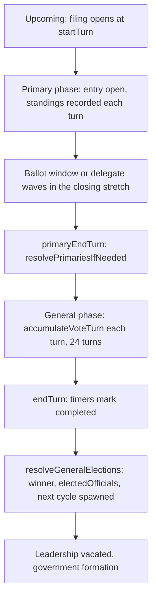

# Elections

## Summary

Elections run perpetually across five US race types: House, Senate, Governor, State Senate, and President (other countries add their own types, see [UK Elections](./uk-elections.md), [Germany Elections](./germany-elections.md) and [Japan Elections](./japan-elections.md)). Each election has a **primary phase** (intra-party competition) followed by a **general phase** (inter-party competition). One turn = one hour; timers advance each turn.

Player guide: [Election Mechanics](https://www.ahousedividedgame.com/wiki/election-mechanics), with [Primaries](https://www.ahousedividedgame.com/wiki/primaries) and [General Elections](https://www.ahousedividedgame.com/wiki/general-elections)

The vote math itself (appeal, reach, swing flow, drivers) is documented in [Election Engine](./election-engine.md); this page covers the race lifecycle, primaries, entry and withdrawal, and the presidential specifics.

## Rules

### Election types

| Type             | Seats                | Scope                    | Notes                               |
| ---------------- | -------------------- | ------------------------ | ----------------------------------- |
| **House**        | 435 total (by state) | Per state                | Multi-seat; proportional allocation |
| **Senate**       | 100 (2 per state)    | Per state, per class     | Single-seat; 3 staggered classes    |
| **Governor**     | 50 (1 per state)     | Per state                | Single-seat                         |
| **State Senate** | Varies               | Per state                | Multi-seat; proportional allocation |
| **President**    | 1 (national)         | National (`state: "US"`) | Electoral College; 270 to win       |

The seat counts are the modern map. Era presets use their own apportionment (`HOUSE_SEATS_1991`, a 48-state 1953 map with 531 electoral votes) through `getHouseSeats(preset)` and `getElectoralVotes(preset)` in `src/lib/constants/states.ts`.

### Seat identifiers

Each political seat has a stable `seatId` that persists across election cycles, enabling external systems (Discord bots, APIs) to reliably track races.

**Format**: `{countryId}-{electionType}-{localRegionId}[-{senateClass}]`

| Seat                        | seatId           |
| --------------------------- | ---------------- |
| Pennsylvania Senate Class 1 | `US-senate-PA-1` |
| Pennsylvania House          | `US-house-PA`    |
| California Governor         | `US-governor-CA` |
| U.S. President              | `US-president`   |
| London Commons              | `UK-commons-LON` |
| Scotland Commons            | `UK-commons-SCO` |

**Historical race IDs** append the cycle number: `US-senate-PA-1-c3` (third cycle).

The `seats` collection stores permanent seat documents with display names. Elections reference seats via the `seatId` field. Source: `src/lib/seats/seatId.ts`, `src/lib/db/types/seat.ts`.

Election routes accept either an election ObjectId or a seatId slug such as `US-president` in the `[id]` segment. A slug resolves to the active election for that seat, else the upcoming one, else the latest cycle (`resolveElectionRouteParam` in `src/lib/elections/electionParamResolution.ts`).

### Election phases

#### Primary phase

- **Purpose**: Select party nominee(s) for each office
- **Entry**: Players and NPPs declare candidacy during the primary phase (the primary has not ended: `isPrimaryEnded` is false)
- **Voting**: Presidential primaries run state-by-state waves that award delegates. Other primaries count real party ballots over the closing stretch of the primary (see Primary resolution). Before ballots open, standings are shown as a score.
- **Result**: One candidate per party advances to general (more for parliamentary and one-party-state legislatures); losers marked `withdrawn`
- **Resolution**: When the primary has ended (`primaryEndTurn <= currentTurn`, with the Date fields as a fallback), `resolvePrimariesIfNeeded()` runs

#### General phase

- **Purpose**: Select office holder(s) from party nominees
- **Voting**: Vote accumulation each turn via `accumulateGeneralElectionVotes()`
- **Result**: Winner(s) take office; `electedOfficials` updated; next cycle spawned
- **Resolution**: When `endTurn <= currentTurn`, election marked `completed`; `resolveGeneralElections()` runs

Phase boundaries are read turn-first with a Date fallback for un-backfilled documents (`hasElectionStarted`, `isPrimaryEnded`, `isElectionEnded` in `src/lib/elections/phases.ts`).

### Duration by race type

48 turns = 1 year in game time. The general phase is **24 turns** for every type in the table (`generalDurationHours` in `DEFAULT_DURATIONS`); the primary is the rest of the window.

| Type         | Total Duration      | Primary Duration | General Duration |
| ------------ | ------------------- | ---------------- | ---------------- |
| House        | 96 hours (2 years)  | 72 hours         | 24 hours         |
| Senate       | 288 hours (6 years) | 264 hours        | 24 hours         |
| Governor     | 192 hours (4 years) | 168 hours        | 24 hours         |
| State Senate | 192 hours (4 years) | 168 hours        | 24 hours         |
| President    | 192 hours (4 years) | 168 hours        | 24 hours         |

Commons, regional council, Bundestag, Landtag and snap or by-election types run 48 hours in total with a 24 hour primary and 24 hour general. Shugiin is 192/168/24 and Sangiin 144/120/24.

New elections use the canonical `DEFAULT_DURATIONS` and the canonical schedule, not the prior cycle's timers, so an admin timer edit does not drag the calendar. Source: `src/lib/constants/electionDurations.ts` (re-exported from `src/lib/turn/perpetualElections.ts`).

### Senate class stagger

Each state's two seats belong to two of three classes (`SENATE_CLASSES_BY_STATE` in `src/lib/constants/states.ts`). The first-cycle end turn of each class comes from the world's anchor year: under the 2019 default `senateClass3` is 2022, `senateClass1` 2024 and `senateClass2` 2026; under the 1991 default 1992, 1994 and 1996 (`src/lib/elections/cycleAnchorContext.ts`). Anchors are 2 game years apart, so the classes end 96 turns apart. Later cycles add `durationHours` (288) to the class anchor (`src/lib/elections/canonicalCycle.ts`).

### Primary resolution

When the primary has ended, `resolvePrimariesIfNeeded()` in `src/lib/turn/primaryResolution.ts`:

1. Finds elections that are past their primary but not yet ended (turn-first filters)
2. For each party with multiple candidates, ranks candidates by the path that applies:
   - **Presidential** (all countries except RU and BR): delegate totals from the stagger waves; if no delegates were awarded yet, the national sum of real per-state votes; if neither exists (admin-forced resolution), the presidential primary score. On a ruleset with `conventionEnabled` and every wave run, a no-majority nomination resolves through the convention (`resolveNominationForParty`).
   - **Down-ballot with ballots:** the cumulative primary ballots (`primaryVotes` on the tally) accrued turn by turn.
   - **Down-ballot with no ballots** (no registration figure for the party, or a legacy race mid-flight): the primary score below.
3. Takes the top N per party, where N comes from `getPrimaryWinnersForElection`: 1 for presidential races and single-winner executives, 3 for parliamentary legislatures, 7 for one-party states (CN, RU, DD). Others are marked `withdrawn`.
4. Writes `primaryResults` to the tally, sends win and loss notifications to player candidates, and initialises (or creates if missing) the general vote tally.

Resolution is idempotent: it is keyed on `tally.primaryResults`, so a past-primary race is resolved exactly once.

#### Primary score

Used every turn for the standings display, as the split for each turn's ballots, and as the fallback ranking. The raw score is multiplied by an **infamy penalty**, `1 − 0.05 × (infamy/100)`, for player characters (NPPs have no infamy), and by `NPP_PRIMARY_SCORE_MULTIPLIER = 0.5` for an NPP that shares a primary with a player.

**State-level races** (House, Senate, Governor, State Senate):

- **Alignment, state**: `25 − (|econ − stateEconLean| + |social − stateSocialLean|) × 1.25`, floored at 0, max 25 pts (when state cached lean is available)
- **Alignment, party**: `15 − (|econ − partyEcon| + |social − partySocial|) × 0.75`, floored at 0, max 15 pts
- **Favorability**: `(favorability / 100) × 35`, max 35 pts
- **Political Influence**: `normalizeNPI(politicalInfluence) × 25`, max 25 pts (sqrt curve, capped at 1.0 once PI reaches 100)
- **Fallback when state lean is missing**: alignment collapses to a single 40-pt party-only check (`max(0, 40 − (|econDiff_party| + |socialDiff_party|) × 2.0)`), preserving the pre-rework formula.

**Presidential** (national, no state-position component):

- **Alignment**: `40 − (|econ − partyEcon| + |social − partySocial|) × 2.0`, floored at 0, max 40 pts
- **Party Influence** (candidate's accumulated party clout): `normalizePartyInfluencePresidentialPrimary(partyInfluence) × 20`, weight 20 (`PRESIDENT_PRIMARY_PARTY_INFLUENCE_WEIGHT`). Linear and uncapped above the reference scale; party chairs get an effective party-influence boost (`effectivePartyInfluenceForPresidentialPrimary`).
- **National Influence**: `normalizeNationalReachPresidentialPrimary(nationalInfluence) × 15`, max 15 pts (`PRESIDENT_PRIMARY_NATIONAL_REACH_WEIGHT`, linear-up-to-cap, NPI ≥ 100 saturates at 1.0)
- **Favorability**: `(favorability / 100) × 25`, max 25 pts (`PRESIDENT_PRIMARY_FAVORABILITY_WEIGHT`)

Weights and clamps live in `src/lib/primaryScore.ts` (`calcPrimaryScore`, `calcPresidentPrimaryScore`, `scorePrimaryCandidate`) and `src/lib/utils/infamy.ts` (`INFAMY_PENALTY_MAX = 0.05`). The score is rounded to one decimal. Displayed share is a softmax of the scores, `exp((score - max) / 8)` normalised (`PRIMARY_SHARE_SOFTMAX_TEMPERATURE = 8`, one decimal). The softmax never reorders candidates, so it affects the number shown and the ballot split, not the ranking.

#### Primary ballots (down-ballot races)

Ballots accrue only over the closing stretch of the primary (`primaryBallotWindow`, `src/lib/turn/primaryBallots.ts`): the window starts at `primaryEndTurn - min(primaryLength, generalLength)`, so a standard race (24-turn general) counts primary ballots for the last 24 turns. Each party's electorate is the region's turnout pool times that party's registration share (`partyPrimaryPools`, `min(100, registration) / 100`); a party with no registration figure gets no pool. Each turn releases a slice of that pool using the same `turnVoteWeight` curve as the general, split among the party's candidates by that turn's softmax shares, with increments rounded to whole ballots (`accruePrimaryBallotTurn`). The cumulative count picks the nominee, so a sustained lead beats a late surge. Independents and the unregistered are outside every party pool.

#### Presidential primary waves

During the stagger window, states vote in six waves (Iowa, New Hampshire, Nevada plus South Carolina, a 14-state Super Tuesday, mid-March states, all remaining) modelled on the 2020 calendar (`PRIMARY_WAVES`, `src/lib/constants/primaryCalendar.ts`, delegate tables from `src/lib/countries/us/data/usPrimaryCalendar.ts`). The compressed schedule fits all six into the final `STAGGER_WINDOW_TURNS = 6` turns; the stretched schedule spaces them over `STAGGER_WINDOW_TURNS_STRETCHED = 41` turns. Which schedule a race runs is stamped by its ruleset (`primaryCalendar`, below). Delegate majority comes from `getDelegateMajority(family, preset)`.

### Vote accumulation (general phase)

Handled by the `src/lib/electionEngine/` module (`accumulateVoteTurn()` in `tallyManagement.ts`). The full pipeline, pool bands, caps and swing-flow drivers are in [Election Engine](./election-engine.md); this section keeps the lifecycle-level rules.

#### Model

- **Total pool**: State turnout derived from demographics (category weights, group populations, default turnout), scaled to registered voters and capped at the registered electorate
- **Per-turn weight**: A **three-tier closing surge**, not a flat split (`turnVoteWeight()` in `src/lib/electionEngine/voteCalculations.ts`):
  - **Early band**: `EARLY_POOL_SHARE = 0.5` of the pool, spread over every turn before the ramp band
  - **Ramp band**: the `RAMP_TURNS = 8` turns before election day get `RAMP_POOL_SHARE = 0.2` of the pool
  - **Final band**: the last `ELECTION_DAY_TURNS = 4` turns get `FINAL_POOL_SHARE = 0.3` of the pool
  - Shares sum to 1. Very short races (`totalTurns <= 4`) spread the pool evenly instead.
- **Party strength**: The turn pool is scaled by `(1 + (approval − 0.5) × 0.2) × officeStrength` for state races, `(1 + (approval − 0.5) × 0.5) × officeStrength` for president
- **Distribution**: Each turn, the **effective** pool is distributed proportionally to each candidate's **vote potential**

#### FPTP and RCV vote splitting

The voting system used by each state determines whether the **vote-splitting (spoiler) effect** is applied after the group-level allocation.

**First Past the Post (FPTP), default.** In FPTP states, third-party candidates create an explicit **spoiler effect**:

1. After group-level votes are distributed, for each third-party candidate in the race, **`FPTP_SPOILER_RATE` (4%) × the third party's own group-level allocation** is drawn from the ideologically nearest **major-party** candidate (per `getMajorPartiesForRegion(countryId, parentRegionId)`, e.g. Democrat/Republican in the US, Labour/Conservative in England, SNP/Labour in Scotland) and transferred to the third party.
2. "Nearest" is measured by Manhattan distance on the economic / social policy grid.
3. This models the real-world vote-splitting dynamic: a Green Party candidate on the left bleeds coalition voters from the Democratic candidate, potentially handing the race to the Republican.

**Political implications (design intent):**

- Major parties view nearby third parties as **existential threats**, a strong Green Party or Libertarian Party can flip a seat to the opposing major party.
- This creates a natural wedge between the major-party establishment and third-party movements.
- Third parties cannot easily win seats under FPTP even with significant support, they spoil the nearest major party's chances without securing victory themselves.
- This drives the third-party strategic goal: **advocate for states to adopt RCV**, where the spoiler dynamic disappears.

**Example (FPTP, Texas):**

| Candidate | Party      | Group-level votes | After FPTP spoiler   |
| --------- | ---------- | ----------------- | -------------------- |
| Adams     | Democrat   | 400,000           | 392,000 (−8,000)     |
| Brooks    | Republican | 450,000           | 450,000 (unaffected) |
| Chen      | Green      | 200,000           | 208,000 (+8,000)     |

_Green is ideologically near Democrat. 4% × 200,000 = 8,000 spoiled, drawn from Dem. Rep is unaffected._

The key outcome: Democrat loses 8,000 votes; Green gains 8,000, but Green still finishes second. Republican wins with the plurality. In a tighter race the 8,000-vote swing is enough to flip the seat.

**Ranked Choice Voting (RCV), optional (legislated per state).** In RCV states, **no vote-splitting adjustment is applied**. Third parties compete on equal footing with major parties:

- Voters can safely express a third-party first preference without harming their second-choice major-party candidate.
- A strong Green candidate in an RCV state does **not** bleed votes from the Democrat.
- Third parties can build genuine coalition support and grow their seat share without triggering the spoiler dynamic.
- States switch to RCV through legislation; switching back removes the advantage.

**Implementation:** `FPTP_SPOILER_RATE` is defined in `src/lib/electionEngine/constants.ts`. Major parties for the spoiler step come from `getMajorPartiesForRegion()` in `src/lib/constants/countries.ts`, the same helper used in `src/lib/electionEngine/voteDistribution.ts` and in-race poll math in `src/lib/actions/pollCalculations.ts` (invoked from `src/app/api/actions/poll/route.ts`). The voting system is stored per state in `states.votingSystem` (`"fptp"` | `"rcv"`, defaults to `"fptp"`). One-party states also skip the step.

#### Total appeal pipeline

**Two distribution paths exist.** Primaries and commissioned polls use the **group-level competitive allocation** model described below (each demographic group votes as a bloc, splitting its vote pool among candidates by relative appeal). General-election vote accumulation defaults to the **swing-flow model** (`distributeVotesBySwingFlow()` in `src/lib/electionEngine/voteDistributionSwingFlow.ts`, chosen in `tallyManagement.ts` whenever the race is in its general phase); group-level allocation remains available as a fallback/legacy path for generals but is not the live default. See [Election Engine](./election-engine.md) for the swing-flow driver stack (coattails, median-voter, persuasion, incumbency; term fatigue now lives in the economic referendum channel, `src/lib/electionEngine/economicReferendum.ts`). The appeal/reach/approval math below is the shared foundation both paths build on.

The full pipeline from candidate and state to votes per turn (shared with poll and NPP dropout via `src/lib/utils/demographicAppeal.ts`):

> **Stat used by race type:**
>
> - **State races** (House, Senate, Governor, State Senate): use **Political Influence** (`politicalInfluence`, capped 0-100)
> - **Presidential race**: use **National Political Influence** (`nationalInfluence`)

1. **Reach**, `normalizeNPI(influence)`: fraction of turned-out voters the candidate can reach. Sqrt curve, hard-capped at 1.0 once PI/NPI reaches 100. Both state and presidential general elections use this curve. Presidential primary reach uses the separate diminishing-return function `1 - exp(-NPI/45)`.
2. **Appeal (per demographic group)**, Position score `25 × (positionRaw/50)^1.5 + floor`, where `positionRaw = max(0, 50 − |econDiff|×5 − |socialDiff|×5)` and `APPEAL_POSITION_EXPONENT = 1.5` (`src/lib/utils/demographicAppeal.ts`), plus a directional (tribal-voter) bonus of up to `DIRECTION_BONUS_PER_AXIS = 5` per axis, plus an optional `normalizeNPI(influence) × 12.5` term. No live election path switches that term on (`includeInfluenceInAppeal` is false everywhere), so influence acts through reach only. Appeal is capped at `MAX_APPEAL = 50` and does NOT include favorability, that scales at the end. (γ=2, the legacy squared curve, is still supported as a special case but is not the live default.)
3. **Group-level competitive allocation**, Each demographic group contributes to the turn pool proportionally to its size. Within each group, candidates split that contribution by relative `(appeal × reach × approval × partyOrg × infamyMult)`. Groups vote as blocs; higher appeal with a group yields a larger share of that group's votes.
4. **Approval scalar**, `(favorability / 100)^0.8`: voters will not support candidates they do not approve of, while the exponent softens the middle of the curve. 0% approval = 0 votes.
5. **Party org scalar**, General elections: `normalizedOrgShare ^ ORG_WEIGHT_EXPONENT` (`ORG_WEIGHT_EXPONENT = 0.2`), the party's normalized share of statewide Org among all parties, with diminishing returns; no Org data anywhere falls back to a neutral 1×. Primaries use a uniform neutral 1× (intra-party Org cancels). This retired the older flat `0.5 + (org/100)×0.5` scalar (2026-06-18).
6. **Infamy scalar**, `1 − 0.05 × (infamy/100)`: player characters lose up to 5% of their per-group weight at infamy=100. NPPs leave infamy unset and are unaffected.
7. **Party strength modifier**, `(1 + (approvalDecimal − 0.5) × 0.2) × officeStrength` for state races (`× 0.5` in place of `× 0.2` for president, so presidential races feel state approval 2.5x more strongly):
   - **State government approval**: 0-100% from state metrics vs. national averages (see [Government Approval](./government-approval.md)). When metrics are missing, 50% is used. At 50% approval the modifier is 1.0x baseline regardless of office; state races swing ±10% (0% approval → 0.9x, 100% → 1.1x) before the office-strength factor, president swings ±25% (0.75x-1.25x).
   - **Office strength**: Governor 1.0, House 0.9, Senate 0.8, State Senate 0.85, President 1.0.
8. **Effective turn pool**, Base turn pool × party strength modifier. Same modifier for all candidates in that election; relative shares are unchanged.
9. **Distribution**, For each group, its share of the effective turn pool is split among candidates by relative (appeal × reach × approval × partyOrg × infamyMult). Votes per candidate are summed across all groups.

#### Factors affecting votes

| Factor                                 | Effect                                                                                                                                            |
| -------------------------------------- | ------------------------------------------------------------------------------------------------------------------------------------------------- |
| **Policy alignment**                   | Power curve, exponent 1.5: `25 × (positionRaw/50)^1.5 + floor`, `positionRaw = 50 − econDiff×5 − socialDiff×5`; closer = higher appeal            |
| **Political influence (PI)**           | State races only, reach (not appeal). Capped 0-100; max reach = 1.0                                                                              |
| **National Political Influence (NPI)** | Presidential race only, sqrt scaling via `normalizeNPI`, hard-capped at 1.0 once NPI reaches 100. Above 100 it saturates (no celebrity bonus).   |
| **Favorability (approval)**            | Final scalar: `(favorability/100)^0.8` (`APPROVAL_SCALAR_EXPONENT`); 0% approval = 0 votes                                                        |
| **Party org**                          | Final scalar in general elections: `normalizedOrgShare ^ 0.2` (`ORG_WEIGHT_EXPONENT`), a party's normalized share of statewide Org with diminishing returns. Primaries use a uniform neutral 1×. |
| **Government approval**                | Scales the turn pool by `1 + (approval - 0.5) × 0.2` (`× 0.5` for president), then by office strength; see the pipeline above                    |
| **Office strength**                    | Governor 1.0, House 0.9, Senate 0.8, State Senate 0.85, governor races most affected by approval                                                 |
| **Voting system (FPTP/RCV)**           | FPTP: third-party candidates gain `FPTP_SPOILER_RATE` × their own allocation drawn from nearest major party (spoiler effect). RCV: no adjustment. |

Campaign actions raise favorability and influence; ads raise recognition and favorability.

### Polls versus simulated votes

**State and general elections (House, Senate, Governor, State Senate, Commons, etc.):** Commissioned polls use the **group-level competitive allocation** and **FPTP spoiler** rules, including **region-aware major parties** and **per-archetype effective favorability** for opponents when that data exists (`src/lib/actions/pollCalculations.ts`, `src/lib/actions/electionOpponents.ts`). Turn-by-turn general-election vote accumulation itself defaults to the **swing-flow model** instead (see above); polls are an appeal-based projection and do not replay the swing-flow driver stack.

**Presidential:** Simulated votes are accumulated **per electoral unit** in `src/lib/presidentialElectionEngine.ts` (averaged party vs character positions, national influence for reach, influence kept out of appeal, state/district lean, independent penalty, swing-state ground game). The **FPTP spoiler step is applied at half rate** (`PRESIDENTIAL_SPOILER_RATE = 2%`) on the presidential distribution path to prevent fragmented fields from producing EC landslides via winner-take-all. Player polls remain **home-state** projections and do **not** replicate the national presidential model, treat poll topline and in-race breakdowns as **indicative for the character's state**, not as an Electoral College forecast.

### Multi-seat races (House, State Senate)

- **House**: Real seat distribution (e.g., CA 52, TX 38). See `HOUSE_SEATS` in `src/lib/constants/states.ts` and the preset selectors
- **Proportional allocation**: Largest-remainder method
- **Minimum share**: set per chamber by `getMultiSeatMinShare()` in `src/lib/turn/election/rules/seatEligibility.ts`. The US House gate scales with the state delegation, `clamp(1 / (seats + 1), 10%, 20%)`, so small delegations sit at 20% and large ones drop toward 10%. State Senate, Regional Council and most other legislatures use a flat 10% so smaller parties can win seats in larger districts. Chambers not listed there, and non-US House races (such as Nigeria's), keep 20%.
- **2-seat House special case**: Winner takes both seats unless at least one opponent reaches the minimum share threshold (the House gate above, 10% for State Senate)
- **Seats estimate**: Updated each vote turn using the Hamilton (largest remainder) method over party-pooled votes, see [Election Engine](./election-engine.md#seat-estimation-multi-seat-races)

### Senate elections

- **Staggered classes**: Class 1, 2, 3, each state has 2 senators in different classes
- **Elections**: One seat per class per state; single-winner
- **Continuity**: `ensurePerpetualElections` spawns a class slot when it has no live race and either it previously completed a race, no state has ever completed a Senate race (bootstrap), the state has other Senate races but this class is missing (recovery re-seed), or the state is in the roster with no Senate history at all (per-state init, for a state added mid-game)

### Governor elections

- **Scope**: One governor per state; single-seat, single-winner (like Senate).
- **Duration**: 192 hours total (4 years), 168 hours primary, 24 hours general (see the duration table).
- **Continuity**: Governor elections run perpetually. When a state has no active or upcoming governor race, a new one is spawned. **Bootstrap**: If no state has ever completed a governor election, one governor election is spawned per state so the first cycle exists; thereafter, replacement is spawned only after the previous governor election for that state completes.
- **Vote accumulation**: Uses the same appeal and party-strength rules as above, with office strength 1.0 (governor races are most affected by state government approval).

### Candidacy rules

- **One office at a time**: Players can only run for one office per election cycle
- **Home state only**: `homeState === election.state`; out-of-state returns 403. **Exception**: President (`state: "US"`), any state.
- **Party**: Characters run under their current party affiliation. Independents can run in the "independent" party primary, no penalty at entry, but general-election vote penalties apply (see [Presidential](#presidential-election)).
- **Declaration**: Must declare during primary phase. Independents run in the "independent" party primary like any other party, no general-phase exception.
- **House/State Senate**: Candidates may request multiple seats (`seatsRequested`)
- **Country restriction**: `character.countryId === election.countryId`; cross-country entry returns 403
- **Executive term limit**: a nationwide executive race rejects a candidate who has reached the country's limit, see [Executive Term Limits](./executive-term-limits.md)

### Election entry API

**Endpoint:** `POST /api/elections/[id]/enter` (`src/app/api/elections/[id]/enter/route.ts`)

**Validation** (the route also carries country-specific filing branches for Hungary, Bulgaria and Russia that are documented on the country pages):

| Check | Response |
| --- | --- |
| Election is `upcoming` or `active` | 400 "This election is not open for entry" |
| Primary not ended | 400 "The primary entry period has ended. You cannot join the race." |
| Country matches the character's | 403 "This election is for {X} characters only..." |
| Home state matches (President is national) | 403 "You can only run for office in your home state" |
| One-party state: ruling party only for executive offices, no banned or independent candidates | 403 |
| Executive term limit not reached (nationwide executive races) | 400 "This character has already served the maximum number of {office} terms." |
| Not already entered under the same party | 400 "You are already entered in this race" |
| Not previously withdrawn from this election (Hungarian and Bulgarian district filings exempt) | 403 "You withdrew from this race and cannot re-enter it." |
| No other blocking active candidacy (`findBlockingActiveCandidacy`) | 400 "You are already running in the {race}. Withdraw first before entering a new race." |

**Party switching:** If already entered under a different party, the old candidacy is auto-withdrawn before creating the new one and the campaign is carried across with its funds and levels (ticket #1313).

**Re-entry carry-over:** a withdraw and re-enter in the same live primary carries forward the one-rally-per-turn throttle and the one-per-cycle home-state surge gate, so re-entering cannot reset them.

**Achievement trigger:** Election entry triggers achievement checks via `checkElectionEntryAchievements()`.

### Withdrawal mechanics

**Endpoint:** `POST /api/elections/[id]/withdraw` (`src/app/api/elections/[id]/withdraw/route.ts`)

**Effects:**

1. Mark the candidate `withdrawn` with `withdrawnAt` and `withdrawnBy: "candidate"`
2. Remove votes from the tally (`removeWithdrawnCandidateFromTally`)
3. Archive the campaign document (`status: "archived"`, `archivedReason: "withdrawn"`). Hard deletion happens only when the election resolves.
4. Write an `election.withdraw` audit record

**Restrictions:**

- Cannot withdraw from completed, resolved, or cancelled elections
- Withdrawn candidates cannot re-enter the same election (Hungarian and Bulgarian district filings can refile until filing closes)
- Votes are permanently removed from the tally (not redistributed)

### Election continuity

All race types run perpetually:

- **House**: Next cycle spawned when the previous one resolves
- **Senate / Governor / State Senate**: `ensurePerpetualElections()` runs each turn after resolution; spawns replacement for any slot with no active or upcoming race
- **Governor bootstrap**: If no state has any completed governor election yet, one governor election is spawned per state so every state has an initial governor race; after that, governor is spawned only when that state's previous governor election has completed
- **President**: Spawned via canonical LARP schedule when no active/upcoming president election exists. Anchored to real-world presidential election years (2020, 2024, 2028…). A canonical cycle whose remaining primary and general windows fall under the 24h + 24h floor is skipped, so president only spawns in valid windows.
- New elections use canonical `DEFAULT_DURATIONS` from `src/lib/constants/electionDurations.ts`, not the prior cycle's durations. Admin timer edits do not drag the LARP calendar.
- Cycle counter increments on each spawned election
- Only electoral states with a seat in the active preset's apportionment get these races (DC and pre-statehood territories are excluded; territories keep a governor race). A territory admitted mid-game joins the roster on the next pass.
- **Admin**: "Spawn Missing Elections" in Admin → Elections → Manage triggers immediate continuity check

### Presidential election

- **Scope**: National (`electionType: "president"`, `state: "US"`). Any state can run; no home-state check.
- **Influence stat**: Uses **NPI** (`nationalInfluence`) exclusively, not `politicalInfluence`. NPI grows passively each turn (+state influence ÷ 100). Reach uses a sqrt curve hard-capped at 1.0 once NPI reaches 100; presidential primary scoring uses a separate linear-up-to-cap function on the same value.
- **Primaries**: One national primary per party, run as state-by-state delegate waves (see Primary resolution). Independents enter the "independent" primary like any party (see Candidacy rules) and pay the 0.3× vote penalty in the general.
- **General**: Per-state (and ME/NE district) vote accumulation; Electoral College resolution. 538 total EV and 270 to win on the modern map. The majority is era-aware: `electoralMajorityFor(totalEv) = floor(totalEv / 2) + 1`, so the 531-vote 1953 map needs 266.
- **Electoral College**: `ELECTORAL_VOTE_UNITS` in `src/lib/constants/states.ts`. ME and NE split by congressional district (ME: 2 at-large + CD1 + CD2; NE: 2 at-large + CD1 + CD2 + CD3). District lean proxies applied for ME/NE (see `UNIT_LEAN`).
- **Independent penalty**: 0.3× vote share in general (70% reduction).
- **Running mate (VP)**: After the nominee is set, each nominee selects a running mate where the country defines a `vicePresident` office (US, Brazil, Nigeria). The current President cannot be a running mate. Stored on `ElectionCandidate.runningMateId`.

**API:** `POST /api/elections/[id]/running-mate` (`src/app/api/elections/[id]/running-mate/route.ts`)

Validation, in the route's own order: the election is a presidential race and active; the caller is a candidate in it; the id is valid; the current President is refused; the character exists and passes the eligibility checks; not the caller themselves; same country; a term-limited character is refused where `blocksRunningMateSelection` is true; the character is not already a candidate in this election. The route accepts a character ObjectId or `""` to clear, and writes `runningMateId` and `updatedAt` on the candidate row.

- **Timing**: Spawned via canonical LARP schedule when no active/upcoming president election exists. Anchored to real-world presidential election years (2024, 2028, 2032 under the 2019-default preset; 1992, 1996, 2000… under the 1991-default preset). 48 turns = 1 year. `pickNextCanonicalCycle()` in `src/lib/elections/canonicalCycle.ts` returns the next cycle whose remaining primary AND general windows clear the 24h+24h floor at `currentTurn`.
- **Tie-breaker**: 269-269 EV tie resolved by deterministic coin flip (election ID + candidate IDs).
- **Vote accumulation**: `accumulatePresidentVoteTurn()` in `src/lib/presidentialElectionEngine.ts`; resolution in `electionResolution.ts`.
- **Vote-flow model**: Presidential general votes are distributed by `distributeVotesBySwingFlow()` in `src/lib/electionEngine/voteDistributionSwingFlow.ts`, the only model the presidential engine calls; there is no legacy/alternate path selectable at runtime.
- **Presidential vote weights**: Appeal position averages **candidate and party** via `partyPositionWeight` (`= 1/3` in `presidentialElectionEngine.ts`): `pos = (pw × party + candidate) / (pw + 1)` = `(party + 3×candidate) / 4`, roughly **75% candidate position, 25% party position**, so the candidate's own stance dominates. **State lean** applies a small tiebreaker multiplier on top of appeal (`leanVoteMultiplier()`): `1 + lean × sign × STATE_LEAN_STRENGTH`, with `STATE_LEAN_STRENGTH = 0.1` for states (`DISTRICT_LEAN_STRENGTH = 0.3` for ME/NE congressional districts), clamped to `[LEAN_MULT_MIN, LEAN_MULT_MAX] = [0.8, 1.2]`, at most a 1.5:1 swing. This multiplier runs only when the race's ruleset sets `applyExplicitLeanMultiplier` (v1 and v2 races; v3 turns it off, since lean is already priced into appeal through the swing-flow substrate).
- **Electoral map**: Presidential election detail shows `PresidentialElectoralMap` with per-unit EV allocation, state-level vote totals in tooltips, and EV lead summary.

#### Presidential rulesets

A presidential race is stamped with a ruleset version at spawn (`election.rulesetVersion`, `src/lib/elections/presidentialRuleset.ts`). Unstamped races resolve to v1 and an unknown future stamp falls back to the newest known ruleset. Current version: `CURRENT_PRESIDENTIAL_RULESET_VERSION = 3`.

| Field | v1 and v2 | v3 |
| --- | --- | --- |
| `campaignStrengthMaxBonus` | 1 (multiplier approaches 2x) | 0.25 (approaches 1.25x) |
| `applyExplicitLeanMultiplier` | true | false |
| `tacticalMovementRate` | 0 | 0.05 (share of nonviable candidates' new ballots that move in the closing turns) |
| `incumbentApprovalStateWeight` | 0 | 0.5 |
| `primaryCalendar` | `"compressed"` | `"stretched"` |
| `conventionEnabled` | false | true |
| `suspendTransferMode` | `"flat"` | `"affinity"` |
| `primaryMomentumCapPoints`, `endorsementOrgFraction`, `endorsementCoalitionCredibility` | 0 | 0 (identity until calibrated) |
| `vpSurrogateActionCap`, `vpTravelPresenceWeight` | 2, 1 | 2, 1 |

### NPP election participation

See [NPP System](./npp-system.md) for full documentation. NPPs autonomously enter and drop out of elections each turn via `processElectionEntry()` in `src/lib/turn/npp/electionEntry.ts`.

#### Entry

- **Eligibility**: Not retired, not on cooldown for that election, not already in an active race
- **Scope**: Home state for all regional races (House, Senate, Governor, State Senate, Commons, Shugiin, Sangiin, Regional Council, Bundestag). **NPPs are barred from presidential races in player-enabled countries**, so players always have the opportunity to contest the presidency without NPP auto-entry distorting the field. The bar is lifted in countries where NPP autonomy is active and there is no player to contest the presidency, and for the first round of Russian direct presidential ballots.
- **Types**: All race types except president (subject to the exceptions above)
- **Timing**: Only during primary phase
- **Priority order** (highest to lowest): State Senate → Regional Council → Sangiin → House → Senate → Shugiin → Governor → President → Commons
- **One NPP per party per primary**: Each primary gets exactly one NPP candidate per party to avoid splitting the party vote
- **Two-pass system**: Incumbents get first priority to defend their seats; non-incumbents fill remaining slots by party/state priority. Deterministic, no random chance.

#### Dropout and elimination

- NPPs are eliminated during **primary resolution** (same as player candidates) when they do not top their party's ranking
- Eliminated NPPs are marked `withdrawn` and receive a per-election cooldown; they cannot re-enter until the primary ends
- There is no separate "appeal-based" dropout pass, NPPs compete on the same ranking as players, with the 0.5 score multiplier when a player is in the same primary

#### Spawn (admin)

Admin → Elections → NPP Management: spawn 1-500 NPPs per party with weighting (`lean` / `members` / `both`).

### Presidential travel

Presidential candidates can travel to specific states to campaign in person.

- **Cost**: `getTravelActionCost()` scales with the target state's electoral votes: EV ≤ 5 → 3 actions, EV ≤ 10 → 5, EV ≤ 20 → 7, EV > 20 → 10 (small states are cheap, big states are expensive). EV counts are preset-aware.
- **Effect**: Traveling to a state is the eligibility requirement for the character's canvassing actions in that state. It also grants a travel presence bonus of +1.0 favorability each turn while a travel state is set (presidential, non-NPP candidates only). A running mate who is travelling adds a surrogate presence bonus on top (`ruleset.vpTravelPresenceWeight × 1.0`, `src/lib/turn/campaignTurn.ts`)
- **Visibility**: Travel state shown on the electoral map as a badge
- **Strategy**: Lets candidates focus campaign presence (canvassing) in swing states
- **Restrictions**: Only active, non-suspended presidential candidates in an `active` election can travel; one state at a time. The route does not check the phase, so travel is open in the primary as well as the general.

**API:** `POST /api/elections/[id]/travel` (`src/app/api/elections/[id]/travel/route.ts`). The action debit and the travel-state write are crash-safe: a keyed idempotent money-flow leg (header `Idempotency-Key`, issue #1672) means a crash between the writes reconciles instead of charging for a move that never landed. The route validates: the election is a presidential race and active; the caller is an active, non-suspended candidate; the state code is valid; the caller has enough actions; the state differs from the current travel state. It writes `travelState` and `traveledAt` on the candidate row.

Travel is a presidential-only mechanic. State-level races use standard campaign/ads actions instead.

### Campaign strategy

#### Building support

- **Campaign**: Raises **Political Influence** (up to +1% per action, diminishing returns above 50% PI), name recognition / reach. Cost scales with current PI and state GDP per capita.
- **Advertise**: Raises **Favorability** (+1-3 per action, diminishing returns above 70%). Cost scales with current favorability and state GDP.
- **Build Donor Network**: Increases donor base level (unlocks higher fundraising yields). One-time unlock; L0→L75 costs ~₳4.4M at national-average GDP.
- **Fundraise**: Converts donor base level into campaign funds. ₳50K floor + ₳2K per donor level, scaled by state PI.
- Policy alignment with demographics affects vote calculations
- Endorsements provide stat boosts

#### Attack strategy

- **Attack** (influence action): Reduces target Favorability by 1, costs 2 Infamy to attacker
- **Action-point cost**: priced dynamically per target in `src/lib/influence/simpleInfluence.ts` and `src/lib/influence/rules.ts`. A boost to another player costs the equivalent self-action quote plus a 1.25x premium (attack uses 1.5x), scaled by a distance multiplier for out-of-state targets, so the price is not a flat number. Favorability strikes compete with campaigning, fundraising and political operations for a player's turn.
- **Per-turn cap**: `MAX_NET_FAVORABILITY_SWING_PER_TURN = 12`, the net favorability change any one target can absorb from player support/attack actions in a single turn, in either direction. This is a backstop against extreme coordinated pile-ons, not the primary limiter (the AP cost is); it sits well above normal single-turn swings.
- **Failure chance**: an attack fails when a 0 to 999 roll is below `infamy × 10`, so the failure chance in percent equals the attacker's Infamy (`src/lib/influence/simpleInfluence.ts`). Failed attacks still cost 2 Infamy.
- **Infamy drain**: Infamy > 20% causes passive Favorability drain each turn (`(infamy − 20) × 0.05%`)
- **Cross-state cost**: Attacking out-of-state targets costs more action points, scaled by a distance multiplier

#### Geographic strategy

- Campaign costs scale with state GDP per capita
- Out-of-state campaigning costs more
- Different states have different demographic compositions

### Polling and display

- **No WebSocket**: Client-side polling on page load and after actions (see [Technical Architecture](./technical-architecture.md))
- **Primary snapshots**: Recorded each turn for elections in primary phase; used for trend graphs
- **General tally**: `electionVoteTallies` stores `totalVotes`, `turnSnapshots` (each with `sharesPct` and `seatsEstimate`), and `seatsEstimate`
- **API**: `GET /api/elections`, `GET /api/elections/[id]` return polling data and candidate lists

### Elections hub

`/elections` is a redirect shell to the player's country page, `/country/<code>/elections` (`src/app/elections/page.tsx`), which is the central listing of all elections across race types and states for that country.

- **Active Only toggle**: Filters the list to show only elections currently in primary or general voting phase (hides upcoming races not yet open for candidacy). Held in the URL as `?active=1` (`hideUpcoming` in `electionsUrlState.ts`).
- **Default state**: All elections shown
- **Compact campaign cards**: Each candidate entry links to their dedicated campaign page (`/campaign/[id]`)

### County and district maps

State-level results for presidential, governor and senate elections can be explored at `/elections/[id]/state/[stateId]`.

- **Visualization**: Interactive SVG map of sub-regions (county-level for US states, from the per-state files under `src/data/counties/`), with seat allocation by district where a state has districts.
- **Hover**: Tooltips showing candidate vote breakdown, margin, and partisan lean per sub-region
- **Algorithm**: Vote distribution is derived from sub-region partisan lean and population; more partisan sub-regions vote more heavily for aligned candidates (`distributeSubdivisionVotes` in `src/lib/utils/subdivisionResults.ts`)
- **API**: `GET /api/elections/[id]/state/[stateId]/subdivision-results` returns the sub-region distribution and seat-consistent winners. An optional `?turn=N` replays a concluded presidential race at that turn; a live race refuses it so past weeks cannot be read ahead of the screen.

### Constants

| Constant | Value | Source |
| --- | --- | --- |
| Election durations (total / primary / general hours) | House 96/72/24, Senate 288/264/24, Governor, State Senate, President 192/168/24 | `DEFAULT_DURATIONS`, `src/lib/constants/electionDurations.ts` |
| Turns per game year | 48 (one turn per real hour) | `src/lib/constants/electionDurations.ts` |
| Senate class stagger | 2 game years (96 turns), from the anchor years | `senateClass1` to `senateClass3`, `src/lib/elections/cycleAnchorContext.ts` |
| Vote pool bands | early 0.5, ramp 0.2 (8 turns), final 0.3 (4 turns) | `EARLY_POOL_SHARE`, `RAMP_POOL_SHARE`, `RAMP_TURNS`, `FINAL_POOL_SHARE`, `ELECTION_DAY_TURNS`, `src/lib/electionEngine/voteCalculations.ts` |
| FPTP spoiler rate | 0.04 state, 0.02 presidential | `FPTP_SPOILER_RATE`, `PRESIDENTIAL_SPOILER_RATE`, `src/lib/electionEngine/constants.ts` |
| NPP weights | 0.8 general, 0.5 primary score | `NPP_GENERAL_WEIGHT_MULTIPLIER`, `NPP_PRIMARY_SCORE_MULTIPLIER`, `constants.ts` |
| Position exponent / approval exponent | 1.5 / 0.8 | `APPEAL_POSITION_EXPONENT`, `APPROVAL_SCALAR_EXPONENT`, `src/lib/utils/demographicAppeal.ts` |
| Org exponent | 0.2 | `ORG_WEIGHT_EXPONENT`, `src/lib/electionEngine/electionFormulaFactors.ts` |
| Party strength modifier | `1 + (approval - 0.5) × 0.2` state, `× 0.5` president | `LEGISLATIVE_APPROVAL_VOTE_SLOPE`, `PRESIDENTIAL_APPROVAL_VOTE_SLOPE`, `src/lib/electionEngine/approvalVoteMultiplier.ts` |
| Office strength | Governor 1.0, President 1.0, House 0.9, State Senate 0.85, Senate 0.8 | `partyStrengthWeight`, `src/lib/countries/us/institutionsFacts.ts` |
| State primary score weights | alignment 25 state + 15 party (40 party-only fallback), favorability 35, influence 25 | `calcPrimaryScore`, `src/lib/primaryScore.ts` |
| Presidential primary score weights | alignment 40, party influence 20, national reach 15, favorability 25 | `PRESIDENT_PRIMARY_*_WEIGHT`, `src/lib/primaryScore.ts` |
| Primary share softmax temperature | 8 | `PRIMARY_SHARE_SOFTMAX_TEMPERATURE`, `src/lib/primaryScore.ts` |
| Infamy score penalty | up to 5% at infamy 100 | `INFAMY_PENALTY_MAX`, `src/lib/utils/infamy.ts` |
| Independent presidential vote penalty | 0.3 | `INDEPENDENT_VOTE_PENALTY`, `src/lib/presidentialElectionEngine.ts` |
| State lean tiebreaker | 0.1 per point (0.3 for ME/NE districts), clamped 0.8 to 1.2 (v1 and v2 rulesets only) | `STATE_LEAN_STRENGTH`, `DISTRICT_LEAN_STRENGTH`, `LEAN_MULT_MIN`, `LEAN_MULT_MAX`, `presidentialElectionEngine.ts` |
| Presidential position blend | `partyPositionWeight` 1/3, so 75% candidate and 25% party | `presidentialElectionEngine.ts` |
| Electoral votes | 538 total, 270 to win (modern map) | `TOTAL_ELECTORAL_VOTES`, `ELECTORAL_MAJORITY`, `src/lib/constants/states.ts` |
| Travel action cost | EV 5 or less: 3, 10 or less: 5, 20 or less: 7, above 20: 10 | `getTravelActionCost`, `src/lib/constants/states.ts` |
| Multi-seat minimum share | US House `clamp(1/(seats+1), 10%, 20%)`, 20% non-US House and unlisted types, 10% listed chambers | `getMultiSeatMinShare`, `src/lib/turn/election/rules/seatEligibility.ts` |
| Net favorability swing per target per turn | 12 | `MAX_NET_FAVORABILITY_SWING_PER_TURN`, `src/lib/influence/simpleInfluence.ts` |
| Attack cost | 2 infamy, -1 target favorability | `src/lib/influence/simpleInfluence.ts` |
| Campaign / advertise base fund cost | 20,000 / 100,000 (before tier and GDP scaling) | `CAMPAIGN_BASE_FUND_COST`, `ADVERTISE_BASE_FUND_COST`, `src/lib/actions/rules.ts` |
| Fundraise action cost | 3 action points | `FUNDRAISE_ACTION_COST`, `src/lib/actions/rules.ts` |
| Stagger window | 6 turns compressed, 41 stretched | `STAGGER_WINDOW_TURNS`, `STAGGER_WINDOW_TURNS_STRETCHED`, `src/lib/constants/primaryCalendar.ts` |

## Data

| Collection | Purpose | Key fields |
| --- | --- | --- |
| `elections` | Active, upcoming, completed elections | `countryId`, `electionType`, `state`, `seatId`, `senateClass`, `chamberClass`, `cycle`, `status` (`upcoming`, `active`, `completed`, `resolved`, `cancelled`), `startTurn`, `primaryEndTurn`, `endTurn` (and Date twins `startTime`, `primaryEndTime`, `endTime`), `durationHours`, `totalSeats`, `electionYear`, `rulesetVersion`, `allocationMethod`, `campaignRulesVersion`, `resolving` |
| `electionCandidates` | Candidates per election | `electionId`, `characterId`, `characterName`, `party`, `status` (active or withdrawn), `isNPP`, `seatsRequested`, `enteredAt`, `withdrawnAt`, `withdrawnBy`, `runningMateId`, `travelState`, `traveledAt`, `support` |
| `electionVoteTallies` | General-phase totals, snapshots, seats estimate, primary ballots | `totalVotes`, `candidateNames`, `candidateParties`, `turnSnapshots`, `seatsEstimate`, `primaryVotes`, `primaryResults`, presidential: `totalVotesByUnit`, `unitTurnSnapshots`, `primaryDelegates`, `primaryStateVotes`, `primaryWaveHistory`, `electoralVotesByCandidate`, `resolutionMode`; `finalized` |
| `primarySnapshots` | Hourly primary standings for trend display | `electionId`, `turn`, `slicePart`, `byParty[]` of `primaryScore` and `sharePct` per candidate |
| `seats` | Permanent seat documents | `seatId`, display name |
| `electedOfficials` | Current office holders, updated at resolution | office, holder, party |
| `campaigns` | Per-candidate campaign state | `electionId`, `candidateId`, `status` (archived on withdrawal), funds and levels |
| `characters` | Candidate stats read by scoring and entry | `favorability`, `politicalInfluence`, `nationalInfluence`, `partyInfluence`, `infamy`, `homeState`, `countryId`, `careerHistory`, `executiveTermsServed` |

Player-visible: election lists, candidate rosters, tallies and shares, primary standings, seat estimates, electoral maps and candidate travel badges. Not player-visible: `resolving`, `allocationMethod`, ruleset internals, `withdrawnBy`.

### Election engine module structure

The election vote calculation pipeline is implemented across two modules.

#### `src/lib/electionEngine/`, core vote calculation engine

| File                     | Purpose                                                                                                                                            |
| ------------------------ | -------------------------------------------------------------------------------------------------------------------------------------------------- |
| `voteDistribution.ts`    | Group-level competitive allocation: distributes votes by demographic blocs using appeal × reach × approval × partyOrg; applies FPTP spoiler effect. Used for primaries and polls; fallback/legacy path for generals |
| `voteDistributionSwingFlow.ts` | Two-phase pairwise swing-flow allocation; default vote model for general elections. Layers coattails, median-voter, persuasion, and incumbency drivers on top of the base appeal calculation |
| `tallyManagement.ts`     | Accumulates vote turns, initializes tallies, computes seat estimates for multi-seat races                                                          |
| `voteCalculations.ts`    | Turn vote weight formula (three-tier closing surge: 50% early / 20% ramp / 30% final 4 turns), state turnout calculation                            |
| `resolvedTurnout.ts`     | Combines static `StateDemographics.turnout` with dynamic `StateDemographicTurnout.modifiers` from GOTV and canvassing                      |
| `candidateEnrichment.ts` | Fetches character/NPP data and merges with candidate records for vote calculations                                                                 |
| `types.ts`               | `EnrichedCandidate`, `DistributeVotesOptions`, `AccumulateVoteTurnPreload`                                                                         |
| `constants.ts`           | `FPTP_SPOILER_RATE` (0.04), `PARTY_STRENGTH_BY_OFFICE` (deprecated, now in CountryConfig)                                                         |

#### `src/lib/elections/`, API helpers and election lifecycle

| File                         | Purpose                                                                                           |
| ---------------------------- | ------------------------------------------------------------------------------------------------- |
| `electoralVoteService.ts`    | Presidential Electoral College computation, per-unit EV allocation, map data, EV-by-turn tracking |
| `buildPollingData.ts`        | Poll computation using same group-level allocation as vote accumulation                           |
| `enrichElection.ts`          | Full election enrichment with candidates, tally, polling data                                     |
| `resolveElection.ts`         | General election resolution: winner determination, seat allocation, NPP influence updates         |
| `candidateEnrichment.ts`     | Alternative enrichment for API responses (includes party logos, campaign IDs)                     |
| `electionParamResolution.ts` | Resolves an election route segment (ObjectId or seatId slug) to an election                       |
| `voteTallyService.ts`        | Simple tally fetcher for API responses                                                            |
| `phases.ts`                  | Turn-first phase helpers (`hasElectionStarted`, `isPrimaryEnded`, `isElectionEnded`, `computeElectionPhase`) |
| `activeCandidacy.ts`         | Checks if a character has an active candidacy (for validation)                                    |
| `electionResponseTypes.ts`   | TypeScript types for API response shapes                                                          |

## Configuration

| Setting | Default | Where set |
| --- | --- | --- |
| Race durations | see Duration table | `DEFAULT_DURATIONS` in `src/lib/constants/electionDurations.ts` |
| Calendar anchors (Senate classes, president, other cycles) | per preset | `src/lib/elections/cycleAnchorContext.ts`, `src/lib/elections/canonicalCycle.ts` |
| `gameState.preset` | per world (`1953-default`, `1991-default`, `2019-default`) | Chooses apportionment, electoral map and anchors |
| `election.rulesetVersion` | unstamped = v1, new US presidential races stamp 3 | `src/lib/elections/presidentialRuleset.ts` |
| `election.campaignRulesVersion` | unset = legacy campaigning for that race | Stamped at spawn |
| `election.allocationMethod` | unset = country default | Frozen when the race opens |
| `states.votingSystem` | `"fptp"` | State document, changed by legislation |
| Office strength | see Constants | `partyStrengthWeight` per office in each country's `institutionsFacts.ts` |
| Presidential primary calendar | `"stretched"` on v3, `"compressed"` on v1 and v2 | Ruleset `primaryCalendar` |
| `gameState.fastMode` | off | Turns every 30 minutes; skips the half-hour results tick |

Primary-phase campaign constants (`src/lib/electionEngine/constants.ts`), used by the presidential primary waves and home-state tools:

| Constant | Value |
| --- | --- |
| `PRIMARY_PARTY_FIT_WEIGHT` | 0.3 (party-fit penalty strength in primaries) |
| `NPP_STAGGER_EXTRA_MULTIPLIER` | 0.6 (stacks with 0.8, combined 0.48) |
| `PRIMARY_CAMPAIGN_TICK_CAP` | 5 |
| `PRIMARY_HOME_SURGE_PCT` / cost | 15% / 25,000 funds and 3 actions |
| `MAX_PARTY_INFLUENCE_BONUS_PRIMARY` | 0.4 |
| `MAX_STATE_ORG_BONUS_PRIMARY` / `HOME_STATE_BONUS_PRIMARY` | 0.25 / 0.2 |
| `PRIMARY_STATE_ATTACK_DURATION_TURNS` | 8 |
| `PRIMARY_LOCAL_ATTACK_FAV_POINTS` / cost | 6 points / 40,000 funds and 4 actions |
| `PRIMARY_VOTE_SUPPRESSION_PCT` / cost | 10 / 70,000 funds and 5 actions |
| `PRIMARY_VOTE_SUPPRESSION_FLOOR` | 0.85 (no candidate loses more than 15% of a state's vote) |

The primary constants above are marked "first pass" in code comments and may be retuned.

## Timing

Election steps run once per turn as strictly sequential sub-phases of the `electionResolutionAndGovernment` phase in `src/simulation/phases/turnPhaseRegistry.ts`:

1. **Withdraw inactive candidates** (`withdrawInactiveCandidates`)
2. **Candidate party sweep** (`candidatePartySweep`), withdraws stale or ineligible candidacies after party switches
3. **Resolve primaries** (`primaryResolution`), eliminates losers when the primary ends; must run before vote accumulation
4. **Accumulate general election votes** (`voteAccumulation`), one turn of votes for all active general-phase elections (and the presidential stagger waves first); **must run before timer advancement**
5. **Campaign spend reset** (`campaignSpendReset`), clears `Campaign.spendThisTurn` after the tallies have read it
6. **Advance election timers** (`electionTimers`), marks elections "completed" when `endTurn` passes
7. **Record primary snapshots** (`primarySnapshots`), for elections still in primary phase (trend data and primary ballot accrual)
8. **Resolve completed general elections** (`electionResolution`), determines winners, updates `electedOfficials`, spawns next cycle
9. **Clear resolved support, vacate leadership** (`clearResolvedSupport`, `leadershipVacate`), removes leadership from members who lost/changed office
10. **Parliamentary government formation** (`parliamentaryGovernmentFormation`)

NPP behavior, bill lifecycle and the campaign turn (income, actions, maintenance) run in other phases. A half-hour tick between turns banks the early half of the next vote slice and primary ballots (see [Election Engine](./election-engine.md#half-turn-slices)); deadlines stay on the hour.

> **Critical ordering** (documented in the registry): primaries resolve → votes accumulate → timers advance → elections resolve. Reordering would lose final-turn votes or include eliminated candidates in tallies.

## Worked trace

### Primary score and ballots (state race)

**Score.** Candidate A: economic lean 1.0, social 0.5, favorability 60, political influence 49, infamy 20. State lean (1.5, 0.0), party position (2.0, 1.0).

- State alignment: `25 - (0.5 + 0.5) × 1.25 = 23.75`
- Party alignment: `15 - (1.0 + 0.5) × 0.75 = 13.875`
- Favorability: `60/100 × 35 = 21`
- Influence: `sqrt(49/100) × 25 = 17.5`
- Raw 76.125, times the infamy multiplier `1 - 0.05 × 0.20 = 0.99` gives **75.4**.

Rival B has alignment 30, favorability 70 (24.5), influence 64 (20) and no infamy: raw 74.5, score **74.5**. A leads by 0.9 points. Had A carried infamy 100 the multiplier would be 0.95 and A would score 72.3 and trail, so infamy matters mainly in close primaries.

**Shares.** Softmax at temperature 8: `exp(0) = 1` for A and `exp((74.5 - 75.4) / 8) = 0.8936` for B. A gets `1 / 1.8936 = 52.8%`, B 47.2%.

**Ballots.** The race is in its ballot window (the last 24 turns of the primary). The region's turnout pool is 500,000 and the party's registration share is 40%, so the party pool is 200,000. A 24-turn window has 12 early turns, 8 ramp turns and 4 final turns:

| Band | Per turn | A at 52.8% | B at 47.2% |
| --- | --- | --- | --- |
| Early (12 turns) | `0.5 × 200,000 / 12` = 8,333 | 4,400 | 3,933 |
| Ramp (8 turns) | `0.2 × 200,000 / 8` = 5,000 | 2,640 | 2,360 |
| Final (4 turns) | `0.3 × 200,000 / 4` = 15,000 | 7,920 | 7,080 |

If the standings held all window the cumulative count would be 105,600 for A and 94,400 for B (the 200,000 pool split 52.8 to 47.2), so A is nominated by ballots. A late rival surge in the final band moves at most the 30% share held by that band, which is why a sustained lead beats a late surge. At resolution the count, not the score, picks the nominee; the score ranking applies only if the party had no ballots.

### Presidential general under a v1 ruleset (lean multiplier)

A state with display lean `-2` and a candidate on the left (`epSign = -1`): `1 + (-2)(-1)(0.1) = 1.2`, inside `[0.8, 1.2]`, so that candidate's votes are multiplied by 1.2 and a right-leaning rival gets `1 + (-2)(+1)(0.1) = 0.8`. That is the 1.5:1 swing (1.2 / 0.8) the cap allows. For ME congressional district 1 (`UNIT_LEAN = -0.1`): `1 + (-0.1)(-1)(0.3) = 1.03`. On a v3 race neither multiplier runs.

### Electoral College

On the modern map `electoralMajorityFor(538) = floor(538 / 2) + 1 = 270`. Candidate A carrying states worth 270 EV wins outright. At 269 each the tie is broken by a deterministic coin flip derived from the election id and candidate ids, so a rerun of the resolution gives the same answer. If nobody has a majority the race goes to the [Contingent Election](./contingent-election.md).

### Travel

A candidate travelling to Wyoming (3 EV) pays 3 actions; to Pennsylvania (19 EV) pays 7; to California (54 EV) pays 10. While `travelState` is set the candidate gains +1.0 favorability each turn.

The general-phase vote chain (pool, caps, group split, spoiler) is traced with numbers in [Election Engine](./election-engine.md#worked-trace).

## Edge cases and limits

- **One race at a time.** `findBlockingActiveCandidacy` rejects a second entry, including races that have completed but not yet resolved. This keeps a player from splitting campaign effort and stats across races.
- **Home state only**, except President, which is national. Cross-country entry is rejected with 403.
- **Entry closes with the primary.** After the primary ends the enter route returns 400; there is no late entry.
- **Withdrawal is final.** The campaign is archived (deleted when the race resolves), tally votes are removed (not redistributed) and the candidate cannot re-enter that election. This stops candidates from banking votes and then dodging scrutiny. Hungarian and Bulgarian district filings can refile until filing closes.
- **Single-candidate primary.** A party with a single candidate has nobody to eliminate, so that candidate is the nominee.
- **Primary score floors.** Alignment terms are floored at 0, so a candidate far from the party still scores on favorability and influence. Influence and favorability are clamped to 0 to 100. A missing state lean falls back to the 40-point party-only alignment.
- **No ballots for a party.** A party with no registration figure has no primary pool, so its primary resolves on score.
- **Infamy** reduces scores by at most 5%, and NPPs have none.
- **Short general windows.** If a general lasts 4 turns or fewer the pool is spread evenly (see Election Engine). Commons and snap elections run 24h primary plus 24h general, so their bands are compressed. The ballot window is capped at the primary's own length.
- **Spoiler** is skipped for RCV and one-party states, and presidential races use half the rate to stop fragmented fields from producing Electoral College landslides.
- **Electoral College:** 269-269 is broken by a deterministic coin flip from the election and candidate IDs. Maine and Nebraska split by congressional district. The majority follows the era's map.
- **NPPs are barred from presidential races in player-enabled countries** so players always get the chance to contest the presidency. The bar lifts where no player contests it, and for the first round of Russian direct presidential ballots.
- **Running mate** cannot be the current President, the nominee, a candidate in the same race, or (where the country blocks it) a term-limited character. Only countries with a `vicePresident` office get a running-mate selector.
- **Travel** is presidential only and one state at a time; it needs an active, non-suspended candidacy.
- **Perpetual spawn:** a slot with an active or upcoming race is never spawned twice. Durations always come from `DEFAULT_DURATIONS`, so admin timer edits do not drag the schedule.
- **Admin-forced resolution** during the presidential stagger resolves on delegates if any were awarded, else on summed state votes, else on the score.

## Invariants

| Invariant | Enforced by |
| --- | --- |
| A character has at most one blocking active candidacy | `findBlockingActiveCandidacy` (`activeCandidacy.ts`); `activeCandidacy.test.ts` |
| A withdrawn candidate cannot re-enter the same election | Enter route check; `src/app/api/elections/[id]/enter/route.test.ts` ("refuses re-entry after the character withdrew") |
| A primary resolves exactly once per election | Idempotency keyed on `tally.primaryResults`; `primaryResolution.test.ts` (no re-initialise cases) |
| A stalled turn that is re-run does not bank a primary slice or a vote slice twice | Per-turn snapshot guard; `primaryResolution.test.ts`, `tallyManagement.test.ts` |
| Each general window releases exactly the pool and never more than the registered electorate | See Election Engine invariants |
| Sub-phase order: primaries, accumulation, timers, resolution | Registry comment only; not enforced by a test |
| Every seat has a stable `seatId` that is parseable back to its region | `src/lib/seats/seatId.test.ts` |
| Ruleset stamped at spawn never changes for a live race | Not enforced by a test; the stamp is only read, never rewritten, in the code paths reviewed |
| Voting system flag only switches the spoiler step | Not enforced by a dedicated test |

## Failure and recovery

- **Missing spawn.** A slot with no live race is refilled on the next turn by `ensurePerpetualElections`, and the admin "Spawn Missing Elections" action triggers the check immediately. Duplicate active races for one key are cleaned up first on every pass.
- **Spawn gated out by the 24h + 24h floor.** If an admin fast-forward leaves too little of the canonical window, that cycle is skipped to avoid a stub race. Repair is to let the next canonical cycle spawn or to fix the schedule through admin tools.
- **Primary resolved with the wrong nominee.** Resolution stamps `primaryResults` and withdraws the losers. A repair is a data correction of the candidate rows and tally (heal), then re-initialising the general tally.
- **Tally corruption or missing tally.** A missing general tally is created at primary resolution or on first accumulation; a corrupted one is healed in `electionVoteTallies` and the resolution rerun if the race already resolved.
- **Resolution interrupted.** `elections.resolving` is a guard to prevent concurrent resolution from corrupting office data. A race stuck with the guard set needs the guard cleared by a heal before it will resolve again.
- **Presidential seating retry.** A partially completed seating restores the office on retry without recording a second term (see [Executive Term Limits](./executive-term-limits.md)).
- **Stuck turn.** Diagnose through the turn tooling, then rerun; accumulation and ballot accrual are idempotent per turn.
- **Results display wrong after a bad resolution.** The results page follows the tally and the frozen snapshot; repairing the tally and, for presidential races, re-capturing the snapshot fixes the display ([Live Election Results](./live-election-results.md)).

## Connections

**Driven by:**

- [Demographics](./demographics.md): group sizes, turnout and leans set the vote pool and appeal (`resolveTurnout()`).
- [Government Approval](./government-approval.md): state approval scales the turn pool (`tallyManagement.ts`) and executive approval drives coattails and incumbency.
- [Campaign Strategy](./campaign-strategy.md) and [Fundraising and Ads](./fundraising-ads.md): campaign, advertise and fundraise actions raise influence, favorability and funds, read by the primary score and by `fetchEnrichedCandidates()`.
- [Canvassing](./canvassing.md): writes the turnout modifiers read during accumulation.
- [NPP System](./npp-system.md): `processElectionEntry()` in `src/lib/turn/npp/electionEntry.ts` fills fields with NPP candidates.
- States' `votingSystem` setting (FPTP or RCV), changed by legislation, switches the spoiler step on or off.
- [Parties](./parties.md): party positions, Org, registration and leadership feed primary alignment, primary ballot pools and general weights.
- [Executive Term Limits](./executive-term-limits.md): the enter and running-mate routes read the term limit.

**Affects:**

- [Election Engine](./election-engine.md): the per-turn tally this page's lifecycle schedules.
- [Cabinet](./cabinet.md), [Congress Leadership](./congress-leadership.md) and [Parliamentary Government](./parliamentary-government.md): `resolveGeneralElections()` updates `electedOfficials`, then leadership is vacated and governments form in the same phase.
- [Contingent Election](./contingent-election.md): a presidential race with no Electoral College majority.
- [Snap Elections](./snap-elections.md): spawn extra compressed elections using the same engine.
- [Live Election Results](./live-election-results.md): reads the tallies for the election-night display.
- [Executive Term Limits](./executive-term-limits.md): seating increments the counter.

Related documentation: [Core Systems](./core-systems.md) (turn structure, term cycles), [Technical Architecture](./technical-architecture.md) (implementation status), [Cabinet](./cabinet.md) (cabinet nominations use Senate confirmation, a related process).

## Tests

| Test file | Covers |
| --- | --- |
| `src/lib/turn/primaryResolution.test.ts` | Primary resolution, ballot-based nominee, NPP elimination, advancers per party, snapshots, accumulation entry points |
| `src/lib/turn/primaryBallots.test.ts` | Ballot window, party pools, accrual, share conversion |
| `src/lib/turn/primarySnapshots.test.ts` | Per-turn primary snapshots |
| `src/lib/primaryScore.test.ts` | State and presidential primary score |
| `src/lib/turn/perpetualElections.test.ts` and its country siblings | Spawning and continuity, including `presidentialRespawn`, `openImmediately`, `houseApportionment` |
| `src/lib/turn/electionTimers.test.ts`, `src/lib/turn/electionResolution.test.ts`, `src/lib/turn/election/generalResolution.test.ts` | Timer advance and resolution |
| `src/lib/elections/phases.test.ts`, `electionTiming.test.ts` | Phase helpers |
| `src/lib/elections/activeCandidacy.test.ts`, `entryEligibility.test.ts` | Candidacy rules |
| `src/app/api/elections/[id]/enter/route.test.ts`, `travel/route.test.ts` | Enter and travel routes |
| `src/lib/elections/presidentialRuleset.test.ts`, `presidentialGeneralRules.test.ts`, `src/lib/presidentialElectionEngine.test.ts` | Presidential rulesets and engine |
| `src/lib/elections/canonicalCycle.test.ts` | Canonical schedule |
| `src/lib/seats/seatId.test.ts` | Seat identifiers |
| `src/lib/elections/eraElectoralMajority.test.ts` | Era-aware electoral and contingent majorities |
| `src/lib/turn/election/rules/seatEligibility.test.ts` | Multi-seat minimum shares |

Engine-level coverage is listed in [Election Engine](./election-engine.md#tests). Known gaps: there is no test for the withdraw route (`src/app/api/elections/[id]/withdraw/`), none pins the `DEFAULT_DURATIONS` table, and the sub-phase order has no test.

## Known issues and history

- **Contradiction recorded 2026-10-29 (durations):** the earlier version of this page and the player page's "How long races last" table list a 48-hour general phase and primaries of 48, 240 and 144 hours. The shipped `DEFAULT_DURATIONS` give every type a 24-hour general (House 72h primary, Senate 264h, Governor, State Senate and President 168h). A commit titled "standardize general election phases to 24 turns" made the change. The code wins.
- **Contradiction recorded 2026-10-29 (primary resolution):** the earlier version said primaries have no vote accumulation and resolve on the primary score alone. Down-ballot races now count real primary ballots over the closing stretch and pick the nominee from the cumulative count; the score is the per-turn split and the fallback. The player page already describes ballots.
- **Contradiction recorded 2026-10-29 (senate stagger):** the earlier version said "Class 1 now, Class 2 +96h, Class 3 +192h" and cited a stagger constant in `perpetualElections.ts`. The stagger comes from anchor years in `cycleAnchorContext.ts` (class 3 first under the 2019 default, then 1, then 2, two game years apart).
- **Contradiction recorded 2026-10-29 (withdrawal):** the earlier version said the campaign document is deleted on withdrawal. The route archives it; deletion happens at resolution.
- **Contradiction recorded 2026-10-29 (travel):** the earlier version said travel is general phase only. The route requires only an active election and an active, non-suspended candidacy.
- **Contradiction recorded 2026-10-29 (lean multiplier):** presented as always on; it runs only for v1 and v2 rulesets.
- **Contradiction recorded 2026-10-29 (election param resolution):** the module table said `electionParamResolution.ts` resolves duration from config or the previous cycle. It resolves the election route segment (ObjectId or seatId). Durations come from `DEFAULT_DURATIONS`.
- **Contradiction recorded 2026-10-29 (maps API):** the earlier version listed `county-results` and `cd-results` routes. The shipped route is `subdivision-results`.
- **Stale comments and test names in code:** `calcPresidentPrimaryScore` comments still say "0-30", "0-20" and "0-10" for the three influence terms (live weights 20, 15 and 25); `primaryResolution.test.ts` is titled "applies 0.75x NPP penalty" while the constant and assertion logic use 0.5.
- **Primary constants** for state attacks, vote suppression and home-state surge are marked "first pass" in code comments and may be retuned; a turnout-suppression attack was designed, simulated and deliberately not shipped.
- **History:** the flat party-org scalar was retired 2026-06-18 (`orgVoteWeight`); swing-flow became the presidential vote model 2026-06-18; the presidential favorability weight was raised and party influence and reach lowered on 2026-08-19; the party-influence primary bonus was raised 0.2 to 0.4 on 2026-07-18. The ruleset seam (v1 to v3) keeps older presidential races on their original behaviour. The 1.18.0 check of this page found the corrections listed above.

Last checked: 2026-10-29, version 1.18.0
