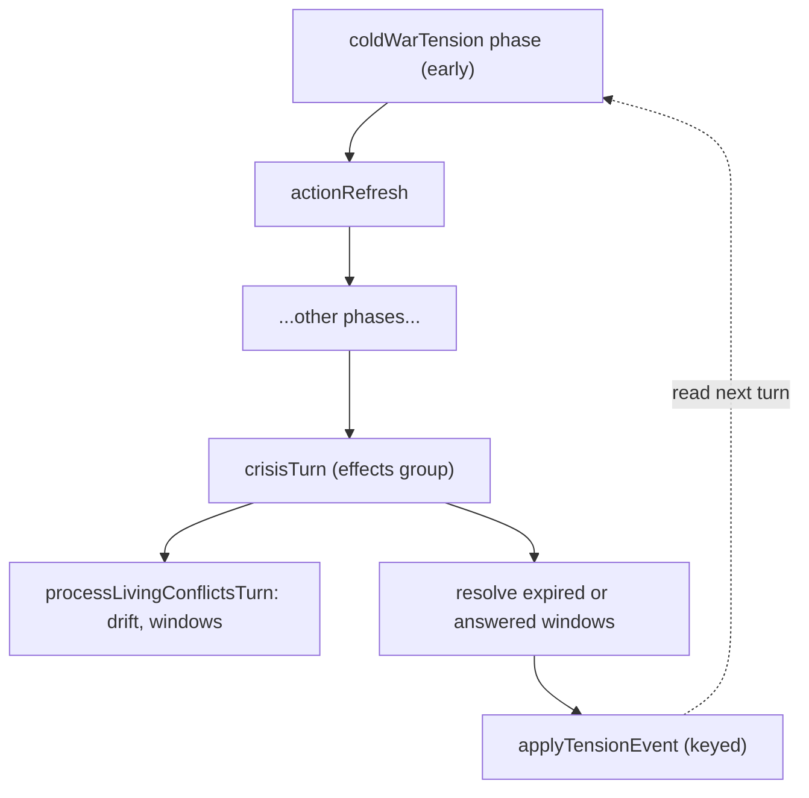

# Global response crises (as shipped)

## Summary

Release 1.3 replaces isolated historical crisis cards with a persistent international campaign layer. It sits between the ordinary `crises` decision system, the `livingConflicts` phase engine, shooting wars, Cold War tension, and national nuclear programs. The feature deliberately has no negotiation mini-game.

Player guide: [Global Response Crises](https://www.ahousedividedgame.com/wiki/global-response-crises)

### Player surfaces

- `/world/conflicts` is the combined strategic board: global tension, response campaigns, the shooting-war register, and links to Command and Situation boards.
- `/world/crises` and action cards carry open response windows.
- The Defence Office carries conventional doctrine and the nuclear program.
- Wire events and news carry campaign openings, stage changes, outcomes, and nuclear tests.

The combined board does not render an empty world map when there are no shooting wars. Its tension scale, pressure floor, driver cards, consequence bars, intensity markers, lean bars, and summary counts all carry inline help.

The International Response Desk on `/world/conflicts` lists every active crisis carrying a `globalResponse` definition. These records are often stored with `scope: "country"` because each eligible government owns a separate national decision. The National label therefore describes response ownership, not geographic reach. The desk explains that distinction, shows turn progress and participating governments, and links into the full response page. Ordinary domestic crises without a global-response definition, such as a national industrial strike, remain on the crises and actions surfaces rather than appearing on the strategic world board.

## Rules

### Module boundary

The deep module is `src/lib/livingConflict/`.

- `registry.ts` owns the authored campaign definitions.
- `engine.ts` owns the pure phase state machine.
- `driver.ts` owns persistence and one-turn advancement.
- `campaign.ts` owns campaign stages, country memory, capacity requirements, consequence drift, and commitment application.
- `globalResponse.ts` owns capability snapshots and player-facing briefing projection.
- `processTurn.ts` materializes response windows into the ordinary crisis system.
- `vietnamCompat.ts` migrates the legacy Vietnam ladder into the generic engine.
- `defs/` holds the authored families, registered in `registry.ts`: Vietnam, pandemic, Northern Ireland, transnational terrorism, Yugoslavia, Arab uprisings, global financial crisis, Russia-Ukraine, Berlin, Congo, Suez aftermath, oil disruption, and nuclear incident. Berlin, Congo, Suez aftermath, oil disruption, and nuclear incident are built in `defs/globalResponseCatalog.ts`.

The ordinary crisis resolver remains the command boundary for submitting a response. This keeps treasury debits, expiry defaults, response idempotency, and role authorization in one path.

### Campaign state and country memory

The campaign state contains:

- Stage: `posture`, `mobilization`, `operations`, `settlement`, or `aftermath`.
- Turns in stage and campaign cycle.
- Consequences: civilian strain, refugees, infrastructure damage, arms proliferation, regional spillover, casualties, and settlement momentum.
- Per-country memory: credibility, war weariness, military commitment, humanitarian commitment, covert exposure, last response id, last response turn, and last commitment kind.

`recordCampaignCommitment` rejects duplicate response ids. It changes only the responding country's memory, plus any consequence deltas the commitment carries. Consequence values and country-memory values are clamped from 0 to 100 and rounded to one decimal. Memory starts at credibility 50 and every other value 0.

What each memory value does to the numbers (`recordCampaignCommitment`, `src/lib/livingConflict/campaign.ts`):

| Memory | Moves by |
| --- | --- |
| Credibility | the commitment's `credibilityDelta` |
| War weariness | the commitment's `warWearinessDelta` |
| Military commitment | + `scale` when the commitment kind is military |
| Humanitarian commitment | + `scale` when the kind is humanitarian |
| Covert exposure | + `covertExposureRisk / 4` when the kind is covert |

Why: the memory makes a government's history count. Repeated military commitments build a different position from relief or staying out, and covert exposure is the pressure that later makes hidden moves public.

### Stage drift

`advanceCampaignTurn` applies slow motion between response windows:

| Stage | Per-turn drift |
| --- | --- |
| Posture | No automatic consequence change |
| Mobilization | Arms proliferation +0.4, regional spillover +0.2 |
| Operations | Civilian strain +0.7, refugees +0.4, infrastructure damage +0.45, casualties +0.6, regional spillover +0.25, settlement momentum +0.15 |
| Settlement | Civilian strain -0.35, refugees -0.15, settlement momentum +0.5 |
| Aftermath | Civilian strain -0.5, refugees -0.25, infrastructure damage -0.15, regional spillover -0.2, settlement momentum -0.25 |

Authored outcomes can move stages, begin a new cycle, or apply additional consequence deltas (`applyCampaignOutcome`). An outcome applies exactly once per resolution id, increments the cycle, and resets turns-in-stage when the stage changes. If the outcome names no next stage the stage is inferred (`inferredStage`, `campaign.ts`), in this order:

1. A campaign already in aftermath stays in aftermath.
2. Settlement momentum 80 or more while in settlement goes to aftermath.
3. Settlement momentum 55 or more goes to settlement.
4. Casualties 50 or more, or arms proliferation 60 or more, goes to operations.
5. Posture goes to mobilization.

Aftermath is therefore recovery state, not deletion of campaign history.

### Capability requirements and information

An authored option may require a stage plus minimum military readiness, logistics, domestic support (shown as domestic mandate), or intelligence confidence. Treasury is not a gate: response costs go through `spendFromTreasury`, which spends any surplus first and finances the rest as debt, so a cash-balance check would contradict the real payment path. Legacy crisis documents may still carry `minTreasuryPctGdp`, which is ignored. `assessCampaignRequirement` is shared by read and command paths. The server checks requirements again during submission, so stale client eligibility cannot authorize a response.

Briefings are asymmetric. `projectCampaignBriefing` uses the country's role, live capability snapshot, and campaign exposure to decide which intelligence notes and consequence detail it may see. Covert commitments raise `covertExposure`; they do not create a separate negotiation or secret-deal system.

### Global tension

`src/lib/coldwar/tension.ts` stores one `coldWarTension` row keyed `current`. The current value is 0 to 100, with bands:

| Range | Band |
| --- | --- |
| 0 to below 15 | Detente |
| 15 to below 35 | Calm |
| 35 to below 60 | Elevated |
| 60 to below 80 | Crisis |
| 80 to 100 | Brink |

Discrete events apply immediate deltas and enter a ledger that keeps the 24 newest items (`planTensionEvent`, `src/lib/coldwar/rules/tensionEvent.ts`). Between events, `runTensionTurn` moves the value toward a standing floor. The floor is:

```text
TENSION_BASELINE (12)
+ min(30, Vietnam escalation level * 4)
+ min(12, active international response crisis count * 3)
+ min(18, sqrt(total world warheads) * 1.2)
+ wars
```

The wars term is zero with no active wars. Conventional wars add `0.12` times their summed intensity, capped at 45. If any war has nuclear-armed countries on opposing sides (a country counts as nuclear-armed when its program holds at least one warhead), the term starts at a minimum of 48 (`NUCLEAR_WAR_MINIMUM_TENSION` 60 minus the baseline 12, so the floor reaches CRISIS before anything else is counted) and adds `0.15` times the nuclear war intensity plus `0.12` times the other war intensity, capped at 70. All of this is `tensionPressureBreakdown` in `src/lib/coldwar/tension.ts`.

Public alarm slowly normalizes around a long limited war (`warAcclimationMultiplier`). The reduction starts after `WAR_ACCLIMATION_GRACE_TURNS` = 12 turns below hot intensity, grows to at most `WAR_ACCLIMATION_MAX_REDUCTION` = 40% over another `WAR_ACCLIMATION_TURNS_TO_MAX` = 40 turns, and fades out as intensity climbs from `WAR_ACCLIMATION_FULL_INTENSITY` = 70 to `WAR_ACCLIMATION_HOT_INTENSITY` = 85 (at 85 or more there is no reduction). A nuclear-opponent war can ease only to a residual of `NUCLEAR_WAR_RESIDUAL_PRESSURE` = 30. The reduction changes pressure, never the war's combat intensity. The multiplier scales each war's intensity before it enters the sums: `pressureIntensity = intensity x multiplier` (`warPressures`).

Declaring a war applies an immediate spike (`warDeclarationTensionDelta`): +20 for a war between nuclear-armed sides, +10 for any other interstate war, +5 for the rest.

The relaxation fraction is `TENSION_RELAXATION` = 0.08 of the gap to the floor per turn (`stepTension`). If the value is at or below the floor, it moves straight to the floor (it never sits below the floor, and it does not climb gradually). Values are clamped 0 to 100 and rounded to one decimal.

`src/lib/coldwar/dials.ts` derives the displayed dials. From tension alone: DEFCON is 5 below 45, 4 from 45, 3 from 65, 2 from 85, and tension alone never reaches DEFCON 1; the procurement multiplier is `1 + max(0, tension - 12) * 0.005`; the detente goodwill penalty is `round(max(0, tension - 35) * 0.75)`. When the Vietnam ladder is also live, each dial takes the tighter of the two readings.

Global response outcomes call `applyTensionEvent` (`src/lib/livingConflict/globalResponse.ts`), so campaign decisions can raise or reduce the shared reading. A negative delta cannot push the value below the current standing floor (`minimumValue`): relief never crosses the floor, so a hot world never reads calm. Keyed events are applied once, so a retried outcome cannot duplicate or omit a shock. The page shows the current reading, band, floor, direction, each floor component, derived dials, and recent event ledger.

### Nuclear integration

`src/lib/military/nuclearProgram.ts` owns the program tree. Device nodes are public tests and delivery nodes are quiet adoptions. The conventional `Nuclear Delivery` doctrine node gates program actions. Deterrence is zero without both warheads and at least one delivery node.

Nuclear mechanics connect to the crisis layer in three places:

1. A device test applies an immediate global-tension event.
2. Total world warheads raise the standing tension floor.
3. The `nuclear_incident` living conflict cannot open until `nuclearStandoffPossible` finds at least two credible programs. A calendar year alone cannot create a bilateral nuclear alert.

Warhead counts are game-scaled balance units, not literal historical inventories. `seedColdWarFoundations` inserts missing era-appropriate programs for the United States, Soviet Union or Russia, and United Kingdom. It sets production to zero, so later buildup remains a player budget decision. It also inserts or completes the `Nuclear Delivery` doctrine prerequisite where absent. Existing program rows are never overwritten.

### Vietnam compatibility

Vietnam remains the first full authored family. Its existing ladder is imported into the generic campaign state. The United States and Soviet Union receive independent country-scoped response windows. At the air campaign rung the engine can open a real North Vietnam versus South Vietnam conflict while the superpowers remain patrons. Dropping below that rung winds the front down, and reaching zero ends the family without allowing a restart.

Missed response windows resolve through the authored cautious default. An inactive office holder cannot freeze the campaign.

## Data

| Collection | Fields read and written | Shown to players |
| --- | --- | --- |
| `livingConflicts` | One row per authored definition: `defKey`, `hasOpened`, `status`, `phaseLevel`, `intensity`, `pressure`, and the optional `campaign` object (stage, `stageTurns`, `cycle`, the seven consequences, `countryMemory` per country). `normalizeCampaignState` fills legacy rows. Written by `driver.ts`, `campaign.ts` and `processTurn.ts`. | Stage, consequence bars and the briefing through `projectCampaignBriefing`; covert memory only once exposed |
| `crises` | One response window per eligible government, carrying a `globalResponse` definition and a living-event key. Submission, treasury debit and expiry go through the ordinary crisis resolver. | Yes, on `/world/crises` and action cards |
| `coldWarTension` | One row, `_id: "current"`: `value`, `pressureFloor`, `updatedTurn`, `events` (24 newest, each with `turn`, `kind`, `label`, `delta`, `at`), `appliedEventIds` (replay receipts for keyed events), `updatedAt`. | Value, band, floor, floor components, dials and event ledger |
| `nuclearPrograms` | Program nodes, warheads, production; read for the arsenal term and `nuclearStandoffPossible`. Seeded only where missing. | Defence Office (own program), warhead totals feed the tension page |
| `gameState` | Flags `conflictsEnabled`, `livingConflictsEnabled`, `coldWarEnabled`, `currentTurn`. | No |
| Treasury (`federalBudget`) | Debited through `spendFromTreasury` when a response carries a cost. | Through the national budget |

`recordCampaignCommitment` writes only the responding country's memory entry and any consequence deltas. `applyTensionEvent` writes the `coldWarTension` row with a compare-and-set when an event id is supplied.

## Configuration

| Setting | Default | Where set | Effect |
| --- | --- | --- | --- |
| `gameState.livingConflictsEnabled` | `true` | `DEFAULT_GAME_STATE_FLAGS` in `src/lib/seeds/reference/featureFlagDefaults.ts` | Gates `processLivingConflictsTurn` inside `crisisTurn` (`src/lib/turn/crisisTurn.ts`) |
| `gameState.coldWarEnabled` | `true` | same file | Gates the `coldWarTension` phase and the dials |
| `gameState.conflictsEnabled` | `true` | same file | Shooting wars and the wars term of the floor |
| `windowTurns` per authored event | 24 for most families, 12 for the pandemic, 8 for the Northern Ireland negotiation and ratification windows | `src/lib/livingConflict/defs/*.ts` | Length of a response window before the cautious default resolves it |
| Tension constants | Baseline 12, relaxation 0.08, ledger length 24 | `src/lib/coldwar/tension.ts`, `src/lib/coldwar/rules/tensionEvent.ts` | See Rules |
| Era presets | Arsenals and starting programs scale with the era | `seedColdWarFoundations` (`src/lib/admin/seed/`) | Starting warheads and programs |

### Seeding

Fresh worlds call `seedColdWarFoundations` after `initializeGameState`. The operation is idempotent and guarantees that every world has:

- The conflict, cold war and living-conflict flags enabled. `DEFAULT_GAME_STATE_FLAGS.livingConflictsEnabled` is true (`src/lib/seeds/reference/featureFlagDefaults.ts`).
- One closed baseline row for every authored living-conflict definition.
- Complete campaign state on legacy conflict rows. The release seeding writes normalized state onto legacy rows so live data does not depend on a later read to heal.
- Era-scaled nuclear program rows where missing, without changing existing programs.
- The nuclear doctrine prerequisite, without replacing other doctrine choices or points.
- A `coldWarTension/current` row, initialized at the arsenal pressure floor.

## Timing

The tension and campaign layers run in different parts of the hourly turn (`src/simulation/phases/turnPhaseNames.ts`):



1. `coldWarTension` runs near the start, right after the income tax bases and before `actionRefresh`. It reads standing pressure and relaxes the value toward the floor, so every later phase reads the current temperature. It is skipped when `coldWarEnabled` is not true, and a re-run of the same turn is a no-op (`updatedTurn >= turn`).
2. `crisisTurn` runs in the effects group, after regional budgets and before `intelligenceTurn` and ministerial orders. It runs `processLivingConflictsTurn` (phase machine, campaign drift, window materialization) and resolves expired or answered global response windows, which can apply tension events.

Discrete tension events from outcomes land in `crisisTurn`, so the standing-floor relaxation sees them on the next turn's `coldWarTension` phase. Player response submissions run immediately through the crisis resolver, outside the turn.

## Worked trace

### Campaign drift and a commitment

A campaign starts in Posture with all consequences at 0, then an outcome moves it to Mobilization for 2 turns and to Operations.

| Step | Event | Result |
| --- | --- | --- |
| 1 | 2 turns of Mobilization drift | arms proliferation 0.8, regional spillover 0.4 |
| 2 | Outcome moves stage to Operations | `stageTurns` resets to 0, `cycle` rises by 1 |
| 3 | 10 turns of Operations drift, nobody responds | civilian strain 7.0, refugees 4.0, infrastructure damage 4.5, casualties 6.0, regional spillover 0.4 + 2.5 = 2.9, settlement momentum 1.5, arms proliferation 0.8 |
| 4 | A country makes a military commitment with `scale` 10, `credibilityDelta` -5, `warWearinessDelta` 4, casualties +2 | credibility 50 - 5 = 45, war weariness 4, military commitment 10, casualties 8.0 |
| 5 | The same response id arrives again | ignored, state unchanged |

Casualties reach 50 after about 84 turns of Operations drift alone (50 / 0.6), so in practice outcomes and commitments, not drift, push a campaign between stages.

### Tension floor and relaxation

The Vietnam ladder is at rung 3, 2 international response crises are open, the world holds 400 warheads, and there are no wars:

| Term | Calculation | Value |
| --- | --- | --- |
| Baseline | constant | 12 |
| Vietnam | min(30, 3 x 4) | 12 |
| Response crises | min(12, 2 x 3) | 6 |
| Arsenal | min(18, sqrt(400) x 1.2 = 24) | 18 |
| Wars | none | 0 |
| Floor | sum | 48 |

A reading of 70 relaxes to 70 + (48 - 70) x 0.08 = 68.2 next turn, which is Crisis, DEFCON 3. The dials at 68.2: procurement multiplier 1 + (68.2 - 12) x 0.005 = 1.281, detente goodwill penalty round((68.2 - 35) x 0.75) = round(24.9) = 25.

A relief event of -30 at reading 70 would give max(48, 70 - 30) = 48, because relief cannot cross the floor. A reading of 30 under the same floor moves straight to 48 on the next turn.

### A nuclear-opponent war and acclimation

Add one fresh war between opposing nuclear powers at intensity 60 to a quiet world with 100 warheads: arsenal 1.2 x 10 = 12, wars min(70, 48 + 0.15 x 60 = 57) = 57, floor 12 + 12 + 57 = 81, which is Brink.

For a conventional-only war at intensity 50 and age 30 turns (acclimation turns 30 - 12 = 18), the multiplier is 1 - min(1, 18 / 40) x 0.4 = 0.82, so pressure intensity is 41 and the wars term is 0.12 x 41 = 4.9 instead of 6.0. At age 52 turns or more the multiplier floors at 0.6.

## Edge cases and limits

- Consequence and memory values clamp to 0 to 100; tension clamps to 0 to 100.
- A missed window resolves through the authored cautious default for that role, so the campaign never freezes. The window length is set per authored event (`windowTurns`, for example 24 for the Russia-Ukraine and Arab uprisings families).
- Only countries with a role in the campaign's `roleByCountry` map get a window. Other governments are bystanders and receive no decision, but still feel the shared tension reading.
- A duplicate response id is ignored, and an outcome applies once per resolution id.
- Legacy rows without campaign state are normalized on read, and seeding also writes the normalized state.
- Tension relief cannot cross the standing floor; a nuclear-opponent war holds the floor at CRISIS or higher while it burns.
- Nuclear alert campaigns need at least two credible programs (`nuclearStandoffPossible`), so a calendar year alone cannot create a standoff. Deterrence is zero without both warheads and a delivery node.
- Unknown or non-finite consequence values fall back to the range minimum.
- The keyed-event receipt list holds at most 10,000 ids; beyond that `applyTensionEvent` throws rather than risk a duplicate shock. A keyed write retries its compare-and-set 3 times, then throws.
- Aftermath never advances on its own through outcome inference; it only decays.
- The combined board shows no map when there are no shooting wars; it is not an error state.

## Invariants

| Invariant | Enforced by |
| --- | --- |
| Consequence and memory values stay in 0 to 100 and one decimal | `clamp` in `campaign.ts`; `src/lib/livingConflict/campaign.test.ts` |
| A response id changes memory once; an outcome applies once per resolution id | `campaign.test.ts` ("records national commitments once", "applies aggregate outcomes once") |
| Tension value stays in 0 to 100 and never sits below the standing floor after the turn step | `stepTension`; `src/lib/coldwar/tension.test.ts` ("is a fixed point exactly at the floor", "clamps to [0, 100]") |
| Relief events cannot cross the floor | `planTensionEvent`; `tension.test.ts` |
| The tension turn runs once per turn number | `runTensionTurn` (`updatedTurn` check); `src/lib/turn/coldWarTensionTurn.test.ts` |
| Ledger keeps at most 24 events | `planTensionEvent` slice; no dedicated test |
| Requirement checks agree on read and command paths | shared `assessCampaignRequirement`; `src/lib/livingConflict/globalResponse.test.ts` |
| Response cost never blocks on cash balance | not enforced by a separate check; behavior of `spendFromTreasury`, covered by `campaign.test.ts` ("lets treasury-funded responses borrow through an existing deficit") |

## Failure and recovery

- **Legacy or partial rows.** A world created before campaign depth has conflict rows with no campaign object. Reads normalize them, and the seeding pass writes the normalized state, so the repair is a rerun of the idempotent seed.
- **Missing tension row.** `getColdWarTension` returns an empty state at the baseline when the row is absent. The next `coldWarTension` phase writes the real floor, and a legacy low reading is lifted to the floor in one turn.
- **Stuck or retried outcome.** Outcomes and keyed tension events are replay-safe, so a crashed `crisisTurn` can simply rerun without double-applying a shock or a consequence delta.
- **Unanswered windows.** Never a failure: the authored cautious default resolves them at expiry.
- **Keyed-event contention.** If two writers collide three times, the call throws and the turn retries it.
- **Wrong or drifted data.** Repairs go through the heal tooling with a plan, apply and rollback step, not by editing rows by hand.

## Connections

**Driven by:**

- [Conflict system](./conflict-system-as-shipped.md): active wars and their intensity feed the wars term of the floor via `src/lib/coldwar/standingPressure.ts`.
- [Crisis system](./crisis-system.md): response windows are ordinary crises, so submission, treasury debit and expiry go through the crisis resolver.
- [Defence procurement](./defence-procurement.md): nuclear programs and warhead stockpiles feed the arsenal term.

**Affects:**

- [Defence procurement](./defence-procurement.md): the tension reading sets the strategic procurement multiplier (`src/lib/coldwar/dials.ts`).
- [Conflict system](./conflict-system-as-shipped.md): campaign stage can open or wind down shooting wars (Vietnam at the air campaign rung).
- [National budget](./national-budget.md): response costs are spent from the treasury through `spendFromTreasury`, financed as debt when no surplus exists.

## Tests

| Area | Test file |
| --- | --- |
| Stage drift, memory, requirements, briefing asymmetry | `src/lib/livingConflict/campaign.test.ts` |
| Role menus, outcome selection, requirement refusal, catalog authoring | `src/lib/livingConflict/globalResponse.test.ts` |
| Window materialization and turn processing | `src/lib/livingConflict/processTurn.test.ts`, `src/lib/livingConflict/livingConflict.test.ts` |
| Tension floor, bands, acclimation, relaxation, keyed events | `src/lib/coldwar/tension.test.ts` |
| Dials | `src/lib/coldwar/dials.test.ts` |
| Standing pressure inputs | `src/lib/coldwar/standingPressure.test.ts` |
| Tension turn phase | `src/lib/turn/coldWarTensionTurn.test.ts` |
| Foundation seeding | `src/lib/admin/seed/seedColdWarFoundations.test.ts` |
| Nuclear program tree | `src/lib/military/nuclearProgram.test.ts` |

Gaps: the 24-event ledger cap and the 10,000-id receipt limit have no dedicated test, and there is no end-to-end test that runs `coldWarTension` and `crisisTurn` back to back across several turns.

## Known issues and history

- **Player page contradicts the code on relaxation.** The player page says tension moves toward the floor "doubled when the floor is above the reading" and its worked example climbs from 30 toward 48 at 16% per turn. The code (`stepTension`) moves a reading at or below the floor straight to the floor in one turn, and only relaxes downward at 8% of the gap. The code wins; the player page needs correcting.
- Release 1.3 introduced the campaign layer, replacing the isolated historical crisis cards; Vietnam was the first family moved onto it.
- The `minTreasuryPctGdp` field on legacy crisis documents is ignored by design; treasury is not a gate.
- Warhead counts are game-scaled units, not historical inventories (by design).

Last checked: 2026-10-29, version 1.18.0
