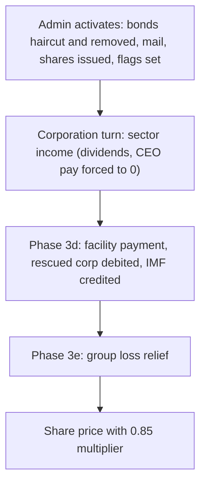

# IMF corporate bailout (admin rescue)

## Summary

**Status: shipped.** The corporate IMF rescue is an admin tool that restructures a distressed corporation's bonds into one amortizing IMF facility, dilutes the existing shareholders in favour of the IMF, and restricts the corporation until the facility clears. It is a separate mechanism from the [sovereign IMF facility](./imf-sovereign-facility.md): different debtor (a `Corporation` document, not a country budget), different trigger (admin action, not a sovereign crisis) and different capture numbers.

Player guide: [Corporate IMF Restructuring](https://www.ahousedividedgame.com/wiki/imf)

## Rules

### Constants

| Constant | Value | Source |
| --- | --- | --- |
| `IMF_BAILOUT_DEFAULT_INCOME_CAPTURE_FRACTION` | 0.35 (35% of per-turn income) | `src/lib/imf/constants.ts` |
| `IMF_BAILOUT_INCOME_FRACTION_CAP` | 0.45 (hard ceiling on capture) | `src/lib/imf/constants.ts` |
| `IMF_BAILOUT_SHARE_PRICE_MULTIPLIER` | 0.85 (applied to the final rounded share price) | `src/lib/imf/constants.ts` |
| Default bond retention | 0.7 (holders keep 70% of face, 30% haircut) | `src/app/api/admin/corporations/[id]/imf-bailout/route.ts` |
| `bondHaircutRetention` range | 0.01 to 1 | `src/lib/api/schemas/adminImfBailout.ts` |
| `targetOwnershipPercent` range | 1 to 90 | `src/lib/api/schemas/adminImfBailout.ts` |
| `annualRatePercent` range | 0 to 80 | `src/lib/api/schemas/adminImfBailout.ts` |
| `amortizationTurns` range | 24 to 960 integer (preview default 240, preview rate default 6) | `src/lib/api/schemas/adminImfBailout.ts`, `.../imf-bailout/route.ts` |
| `incomeCapturePercent` range | 1 to 45, clamped to the 0.45 cap again server-side | `src/lib/api/schemas/adminImfBailout.ts`, `.../imf-bailout/route.ts` |
| `TURNS_PER_YEAR` | 48 (annual rate divided by this gives the per-turn rate) | `src/lib/constants/calendar.ts` |
| Fallback amortization turns | 48 if the stored value is missing | `src/lib/turn/imfBailoutTurn.ts` |
| `BOND_UNIT_FACE_VALUE` | 1,000 (retained face is rounded down to whole units) | `src/lib/constants/bonds.ts` |
| Sentiment pulse | initial impact -0.2, decay rate 0.75, event type `imf_bailout` | `src/lib/corporations/sentimentEvents.ts` |

### Facility payment formula

All in anchor currency (₳). Kernel: `computeImfFacilityPaymentTurn` in `src/lib/imf/imfFacilityMath.ts`, shared with the sovereign facility.

- Per-turn rate `r = annualRatePercent / 100 / 48`.
- Scheduled payment (level annuity) `P * r * (1+r)^n / ((1+r)^n - 1)`, with `P` the outstanding principal and `n` the remaining turns (at least 1). If `r` is 0 it is `P / n`.
- Income cap `= max(0, turnIncome) * min(0.45, storedCaptureFraction)`.
- Actual payment `= min(scheduled, incomeCap)`.
- Interest paid `= min(actual, P * r)`; principal paid `= actual - interestPaid`; interest shortfall `= P * r - interestPaid`.
- New principal `= max(0, P - principalPaid + interestShortfall)`. Unpaid interest is capitalized.
- Remaining turns drop by 1 only when there is no interest shortfall; otherwise the clock stands still. The facility is treated as cleared at `newPrincipal <= 1e-6`.

`turnIncome` is the rescued corporation's snapshot `income` from the same turn, the figure the corporation turn already computed.

### Activation transaction (`POST /api/admin/corporations/[id]/imf-bailout`)

1. Principal is the sum over unmatured bonds of `roundFaceToBondUnits(totalIssued * retention)`. Existing bond rows and their history are deleted, not left as live bonds, so coupons and the facility never double-pay.
2. Character bondholders receive a system mail from "IMF Restructuring" stating the retained percentage.
3. New shares go to the IMF corporation. With `O` the pre-rescue `totalShares` and `p` the target fraction, the target IMF share count is `floor(p * O / (1 - p))`; the shares issued are that minus any shares the IMF already holds. `totalShares` becomes `O + newShares`. If `totalShares` is missing it is treated as 10,000,000.
4. `dividendRate` and `ceoSalary` are set to 0.
5. State written: `imfBailoutActive`, `imfBailoutImfCorporationId`, `imfBailoutTargetOwnershipPercent`, `imfBailoutStartedAt`, `imfFacilityPrincipalOutstanding`, `imfFacilityAnnualRate`, `imfFacilityAmortizationTurnsRemaining`, `imfFacilityIncomeCaptureFraction` (fields on `Corporation`, `src/lib/db/types/corporation.ts`).
6. A sentiment pulse fires (`fireImfBailoutPulse`, `src/lib/corporations/sentimentEvents.ts`).

### Restrictions while active

- Share price: final price is `round(clampedPrice * 0.85, 2)` (`sharePriceFormula.ts`).
- Dividends and CEO pay: zeroed at activation; the turn computation forces them to 0 while `imfBailoutActive` (`sectorCalculations.ts`). `POST /api/corporations/[id]/dividends` rejects a positive rate and `updateCorporationSettings` rejects a positive `ceoSalary` (`src/lib/corporations/commands/capitalOperations/updateCorporationSettings.ts`). Dividend and salary are not restored when the bailout ends.
- New corporate bonds: `POST /api/corporations/[id]/bonds` returns 400.
- Bond-default refinance: `POST /api/corporations/[id]/bond-default/refinance` returns 400.
- Parent bond payoff: `POST /api/corporations/[id]/parent-bond-payoff` returns 400 for a rescued target ("bonds are managed by the IMF facility").
- Auto-resolution: `autoResolveLingeringDefaults` skips bailed-out corporations (`src/lib/turn/bondTurnAutoResolve.ts`).
- The IMF may sell its stake through the ordinary corporate portfolio order flow; no special path exists.

## Data

| Collection | Fields | Read or written | Shown to players |
| --- | --- | --- | --- |
| `corporations` (rescued corp) | `imfBailoutActive`, `imfBailoutImfCorporationId`, `imfBailoutTargetOwnershipPercent`, `imfBailoutStartedAt`, `imfFacilityPrincipalOutstanding`, `imfFacilityAnnualRate`, `imfFacilityAmortizationTurnsRemaining`, `imfFacilityIncomeCaptureFraction`; also `totalShares`, `shareholders`, `dividendRate`, `ceoSalary`, `lastDividendChange`, `liquidCapital` | Written on activation and each turn | The corporation page shows the rescue state; `GET /api/corporations/[id]/bonds` returns a facility summary (principal, rate, turns remaining, capture percent) |
| `corporations` (IMF institution, `imfInstitution: true`) | `liquidCapital` (credited in its own currency); its own `shareholders` and `totalShares` are untouched | Written each payment | Receivable and net worth on the IMF portfolio |
| `bonds`, `bondHistory` | Rows for the corporation deleted on activation | Deleted | Bond holders see the position vanish and receive a mail |
| `characters` | Read to address the bondholder mail | Read | Mail only |
| Mail (system mail) | One per bondholder character, sender "IMF Restructuring" | Written | Yes |
| Sentiment pulses | One `imf_bailout` pulse per activation | Written | Indirectly, through the share price |
| `corporationHistory` | Last income read for the admin preview | Read | No |
| FX rates (via `loadFxRatesByCurrency`) | Currency conversion of the ₳ payment | Read | No |

The IMF stake is shown to admins in ₳ as `imfShares * sharePrice` and net of attributed par debt, `imfShares * sharePrice - imfShares / totalShares * totalParDebt`. Display only, not market enterprise value.

## Configuration

| Setting | Default | Where set |
| --- | --- | --- |
| Bond retention | 0.7 | Request body `bondHaircutRetention`, default in the admin route |
| Target IMF ownership | none, required (1 to 90) | Request body `targetOwnershipPercent` |
| Annual rate | none, required (0 to 80); preview defaults to 6 | Request body `annualRatePercent` |
| Amortization turns | none, required (24 to 960); preview defaults to 240 | Request body `amortizationTurns` |
| Income capture | 35%, hard cap 45% | `src/lib/imf/constants.ts`, request body `incomeCapturePercent`, later `PATCH` |
| Share price multiplier | 0.85 | `src/lib/imf/constants.ts` |

There is no `gameConfig` flag, era preset or country override for this system. It exists only on corporations an admin has activated, and it needs a seeded IMF institution corporation (`getImfCorporation`, lookup by `imfInstitution: true`; seeded by `src/lib/imf/seedImfInstitution.ts`).

## Timing

- Payments run in the corporation turn as "Phase 3d", via `processImfBailoutPayments` (`src/lib/turn/imfBailoutTurn.ts`, called from `src/lib/turn/corporation/index.ts`). It runs after sector processing and supply-agreement settlement, so `income` and `liquidCapital` already contain this turn's operating results, and before the group loss relief step (Phase 3e).
- Dividend and CEO salary suppression runs inside `src/lib/turn/corporation/sectorCalculations.ts` earlier in the same corporation turn.
- The share price multiplier is applied during price computation in `src/lib/corporations/sharePriceFormula.ts` after clamping and rounding inputs, last step before rounding to 2 decimals.
- Activation, deactivation, capture changes and forced liquidation are admin API calls and take effect at the next turn read.

## Worked trace

A corporation has 1,000,000 face of bonds and 10,000,000 shares. Admin sets retention 0.7, rate 6%, 240 turns, target 40%, default capture 35%.

**Activation.**

- Principal `= 1,000,000 * 0.7 = 700,000` (already a whole number of 1,000 units).
- Shares to the IMF `= floor(0.4 * 10,000,000 / 0.6) = 6,666,666`; total becomes 16,666,666, so the IMF holds 39.99996%.
- Stored: capture 0.35, rate 6, remaining turns 240, dividend 0, CEO salary 0.

**Turn 1, income 8,000.**

- `r = 0.06 / 48 = 0.00125`; `(1+r)^240 = 1.3496`; scheduled payment `= 700,000 * 0.00125 * 1.3496 / 0.3496 = about 3,378`.
- First-turn interest due `= 700,000 * 0.00125 = 875`.
- Cap `= 8,000 * 0.35 = 2,800`. Payment `= min(3,378, 2,800) = 2,800`: 875 interest, 1,925 principal.
- Principal 698,075; clock 239. The rescued corporation's `liquidCapital` falls by the payment converted to its home currency; the IMF's rises by the payment converted to USD.

**Alternative turn 1, income 2,000.**

- Cap `= 700`, below the 875 interest. Payment 700 (all interest), shortfall 175.
- Principal becomes `700,000 - 0 + 175 = 700,175`; clock stays 240.

**Share price.** If the formula yields 40.00 before the multiplier, the stored price is `round(40.00 * 0.85, 2) = 34.00`.

## Edge cases and limits

- Cannot target the IMF institution itself, a national corporation (`countryOwnerId` set), or a corporation with no outstanding bond principal (400 in each case). Activating twice returns 400.
- Dilution rounds down. If it rounds to fewer than 1 new share and the IMF holds none, activation is rejected ("raise target %"). If the IMF already holds more than the target, no shares are issued.
- The 45% cap is enforced three times: schema, route clamp and the turn processor, so a legacy stored fraction above 0.45 is still clamped at payment time.
- A corporation with zero or negative income pays 0; if interest is then uncovered, principal grows. The admin preview flags `principal_rising` when principal exceeds 1.25 times the starting value after 48 turns, and stops simulating at 100,000 turns.
- Facility cleared: `imfBailoutActive` goes false, rate set to 0, IMF link, target and capture fields removed. The IMF keeps its shares.
- Admin deactivation (`active: false`) removes the facility fields but does not sell the IMF's equity and does not restore bonds.
- `PATCH` changes capture only while active (1 to 45%).
- Payments are debited from the rescued corporation's `liquidCapital` in its home currency and credited to the IMF in USD, both converted from the ₳ amount (`anchorToCorpLiquidCapital`, `src/lib/currency/corporationCapital.ts`). The corporation snapshot is adjusted in memory so later phases see the post-payment balance.
- Debit is floored in the snapshot at zero (`Math.max(0, ...)`), but the stored `liquidCapital` is decremented by the full amount; payment is not limited by the corporation's cash.
- Forced liquidation: `POST /api/admin/corporations/[id]/force-liquidate` (admin, body `{confirm: true}`) runs the same settlement as a CEO bond-default dissolution without needing defaulted bonds or a cooldown (`executeCorporationBondDefaultDissolution`, `src/lib/bonds/`). Refused for the IMF institution; 409 if a settlement is already running.

## Invariants

| Invariant | Enforced by |
| --- | --- |
| Payment never exceeds `min(scheduled, income x min(0.45, fraction))` | `computeImfFacilityPaymentTurn`; `src/lib/imf/imfFacilityMath.test.ts` |
| Principal rises only by capitalized interest; the clock only stops when interest is short | same kernel; `imfFacilityMath.test.ts` ("computes payment with cap and capitalization") |
| Dividend and CEO pay are 0 while active | `sectorCalculations.ts`; `src/lib/turn/corporation/sectorCalculations.test.ts`, `src/app/api/corporations/[id]/dividends/route.test.ts`, `updateCorporationSettings.test.ts` |
| Share price carries the 0.85 multiplier while active | `sharePriceFormula.ts`; both `sharePriceFormula.test.ts` files |
| Payment debit and credit are the same ₳ amount converted per currency | `imfBailoutTurn.ts`; `src/lib/turn/imfBailoutTurn.test.ts` |
| Bond rows are removed so coupons and facility never double-pay | route logic; `src/app/api/admin/corporations/[id]/imf-bailout/route.test.ts` |
| Activation is atomic across bonds, mail, shares and flags | not enforced (see Failure and recovery) |

## Failure and recovery

- **Partial activation.** Activation performs several writes in sequence (mail, bond and history deletes, then the single corporation update that issues shares and sets flags). A crash between them can leave bonds deleted and mail sent but the rescue flags unset. Because the bond rows are deleted, they cannot be recreated by a rerun; the repair is to inspect the corporation, finish the activation by hand (shares and flags) or deactivate it, and compensate holders through a heal plan. No automatic rollback exists.
- **Missing IMF institution.** Activation returns 400 until the institution corporation is seeded; payments no-op silently when it is absent.
- **Income cannot cover interest.** Not a failure: principal grows. The admin preview warns with `principal_rising`. Fix is a capture change (`PATCH`), deactivation, or forced liquidation.
- **Bad terms entered.** Admin deactivation clears the facility but does not undo dilution or bond deletion, so wrong terms are corrected by a heal plan, not by toggling.
- **Stale snapshot.** The in-memory snapshot is adjusted after each payment so later phases do not reuse pre-payment cash.

## Connections

**Driven by:**

- Admin action (`requireAdmin` routes under `src/app/api/admin/corporations/[id]/`).
- Corporate bond state: principal is built from the corporation's bonds, see [corporate bond defaults](./corporate-bond-defaults.md).
- Per-turn corporation income, see [corporations](./corporations.md).

**Affects:**

- Share price and stock market: 0.85 multiplier in `sharePriceFormula.ts`, see [stock market](./stock-market.md).
- Bondholders: haircut and mail; bond rows deleted.
- Dividends and CEO pay: forced to 0.
- IMF portfolio: facility shown as a receivable (`src/lib/corporations/imfPortfolioReceivables.ts`) and counted in net worth (`src/lib/corporations/netWorth.ts`); the lender's per-turn receipts also feed earnings in `sectorCalculations.ts` (`lenderReceiptsAnchorByCorpId`).
- Shareholders: dilution.
- Compare with the [sovereign facility](./imf-sovereign-facility.md), which shares the payment kernel.

## Tests

| Area | Test file |
| --- | --- |
| Payment kernel and payoff simulation | `src/lib/imf/imfFacilityMath.test.ts` |
| Per-turn processor | `src/lib/turn/imfBailoutTurn.test.ts` |
| Admin activate, preview, patch | `src/app/api/admin/corporations/[id]/imf-bailout/route.test.ts` |
| Share price multiplier | `src/lib/corporations/sharePriceFormula.test.ts`, `src/lib/turn/corporation/sharePriceFormula.test.ts` |
| Dividend and pay suppression | `src/lib/turn/corporation/sectorCalculations.test.ts`, `src/app/api/corporations/[id]/dividends/route.test.ts`, `src/lib/corporations/commands/capitalOperations/updateCorporationSettings.test.ts` |
| Bond-default surface | `src/app/api/corporations/[id]/bond-default/route.test.ts` |
| Portfolio valuation of the receivable | `src/lib/corporations/portfolioAnchorValuation.test.ts`, `src/lib/turn/portfolioSnapshot.test.ts` |

Gaps: no test for the bonds route 400, the parent-bond-payoff 400, or `autoResolveLingeringDefaults` skipping rescued corporations, and none for a crash partway through activation.

## Known issues and history

- Activation is not atomic (see Failure and recovery).
- Deactivation unsets the facility fields, but `imfBailoutStartedAt` is left on the document; a cleared facility sets principal and rate to 0 rather than unsetting them. Cosmetic.
- Dividend and CEO pay are not restored when the rescue ends; the owner must set them again.
- The code comment in `imfBailoutTurn.ts` flags JPY and GBP home-currency rescued corporations as the ones to test, since EUR is not a good proxy for the active forex path.
- No contradiction with the player page was found: its 0.85, 35% and 45% figures match the code.

Last checked: 2026-10-29, version 1.18.0
