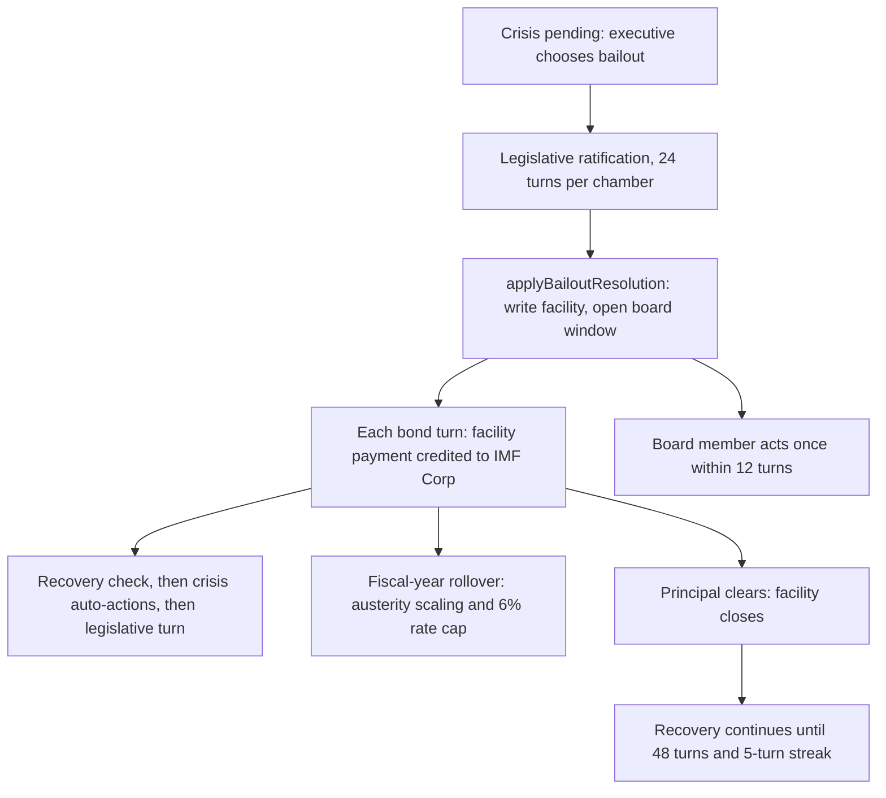

# IMF Sovereign Facility

## Summary

The IMF sovereign facility is the "bailout" resolution path for a sovereign debt crisis. When a country enters a crisis (failed bond auctions, unsustainable debt/GDP) and the executive chooses **bailout** instead of restructure or repudiate, the country's rollover need and deficit are consolidated into a single amortizing loan from the IMF Corp. The facility is repaid over time out of the country's own revenue, capped at a fraction of per-turn income, exactly like the corporate IMF bailout caps payments at a fraction of income, but the sovereign version uses federal revenue instead of corporate operating income, and the borrower is a country's `federalBudget` row rather than a `Corporation` document.

Player guide: [IMF Sovereign Facility](https://www.ahousedividedgame.com/wiki/imf-sovereign-facility)

This is a separate system from the [corporate IMF bailout](imf-corporate-bailout.md). Both borrow the same IMF Corp entity and the same annuity-with-income-cap math (`imfFacilityMath.ts`), but they apply to different debtors and are triggered by different subsystems (sovereign default vs. corporate bond default).

## Rules

### Constants

All values live in `src/lib/sovereignDefault/constants.ts` unless noted.

| Constant | Value | Meaning |
| --- | --- | --- |
| `IMF_SOVEREIGN_DEFAULT_RATE` | 0.06 | Fixed annual facility rate (6%) |
| `IMF_SOVEREIGN_AMORTIZATION_TURNS` | 240 | Amortization horizon |
| `IMF_SOVEREIGN_INCOME_CAPTURE_MIN` / `DEFAULT` / `CAP` | 0.1 / 0.2 / 0.3 | Share of per-turn revenue captured |
| `IMF_BOARD_OVERRIDE_WINDOW_TURNS` / `_HOURS` | 12 / 12 | Board window (turns first, wall-clock fallback) |
| `IMF_BOARD_RATE_DELTA_BOUND` | 0.02 | Max board rate change, 2 percentage points |
| `IMF_BOARD_CAPTURE_DELTA_BOUND` | 0.1 | Max board capture change, 10 points |
| `IMF_BOARD_PUBLIC_TRUST_DELTA` | 0.02 | Trust shift from endorse or criticize |
| `FAILED_AUCTION_COUNT_FOR_CRISIS` | 3 | Failed annual auctions that trigger the crisis |
| `DEMAND_UNDERSUBSCRIBED_THRESHOLD` | 0.7 | Demand below 70% of offering is a failed auction |
| `EXECUTIVE_DECISION_TURNS` | 12 | Executive window before auto-repudiate |
| `LEGISLATIVE_VOTE_TURNS_PER_CHAMBER` | 24 | Legislative vote window per chamber |
| `MONETIZE_GATE_INFLATION` | 0.08 | Monetize blocked at or above 8% inflation |
| `DEFAULT_MARGIN_PENALTY_BAILOUT` | -0.045 | Sector margin penalty on the bailout path |
| `DEFAULT_MARGIN_FULL_PENALTY_TURNS` / `DEFAULT_MARGIN_DECAY_TURNS` | 48 / 24 | Full-strength window, then linear decay |
| `RECOVERY_FLOOR_TURNS` | 48 | Minimum turns in recovery |
| `RECOVERY_DISCIPLINE_REQUIRED_STREAK` | 5 | Fiscal-discipline streak needed to exit |
| `RECOVERY_CREDIBILITY_BONUS_TURNS` / `RECOVERY_CREDIBILITY_RATE_DISCOUNT` | 100 / 0.5 | After a clean exit, the sovereign coupon rate is 0.5 points lower for 100 turns |
| `TURNS_PER_YEAR` | 48 | Annual to per-turn conversion (`src/lib/constants/calendar.ts`) |

### Trigger: sovereign default crisis

A country enters a sovereign crisis (`sovereignCrisisState: "crisisPending"`) through `crisisDetection.ts`, driven by debt/GDP penalties on bond demand and a failed-auction counter:

- `DGDP_PENALTY_FLOOR = 0.6`, `DGDP_PENALTY_RATE = 0.3`, demand starts penalized above 60% debt/GDP.
- `DGDP_CLIFF_FLOOR = 2.0`, `DGDP_CLIFF_RATE = 0.4`, a steeper demand cliff above 200% debt/GDP.
- `DEMAND_UNDERSUBSCRIBED_THRESHOLD = 0.7`, an auction is "failed" when demand falls below 70% of the offering.
- `FAILED_AUCTION_COUNT_FOR_CRISIS = 3`, three consecutive failed annual auctions trigger `crisisPending`.

Once in `crisisPending`, the executive has `EXECUTIVE_DECISION_TURNS = 12` turns to choose repudiate, restructure, **bailout**, or **monetize**. Monetize is blocked at 8% inflation or above. If no executive decision lands in time, `crisisAutoAction.ts` automatically selects Repudiate.

A submitted choice does not take effect at once. `POST /api/country/[code]/sovereign-resolution` opens a legislative ratification on the decision row and the response status is `awaitingLegislativeRatification`; each chamber has `LEGISLATIVE_VOTE_TURNS_PER_CHAMBER = 24` turns. When the final chamber passes, `processSovereignLegislativeTurn` calls `applyBailoutResolution`. If the orchestrator refuses (for example the IMF Corp is missing), the legislative turn falls back to Repudiate so the country never sticks in `crisisResolving`.

### Applying the bailout: `applyBailoutResolution`

`src/lib/sovereignDefault/resolution/bailout.ts` runs when the bailout choice is ratified. It:

1. Requires a `federalBudget` row (otherwise `no-budget`).
2. Requires `sovereignCrisisState` to be `crisisPending` or `crisisResolving`; otherwise returns `not-in-crisisPending`.
3. Requires a seeded IMF Corp (`imfInstitution: true` on the `corporations` collection); otherwise returns `no-imf-corp`.
4. Computes facility terms via `computeSovereignBailoutTerms` (see below).
5. Writes facility state onto the country's `federalBudget` document and sets `sovereignCrisisState: "recovering"`.
6. Opens a 12-turn IMF Board override window.
7. Emits bailout-granted news, applies executive political impact, and emits a civil-unrest event chain for the "bailout" path.

### Facility terms: `computeSovereignBailoutTerms`

`src/lib/sovereignDefault/imfSovereignFacility.ts`. Pure math, no DB access.

```typescript
const rollover = Math.max(0, inputs.rolloverFaceValue);
const deficit = Math.max(0, inputs.annualDeficit);
const principal = rollover + deficit;
```

- **Principal** = next-12-turn bond rollover face value (`calculateSovereignRolloverAmount`, bonds maturing in the next 12 turns) plus the projected annual deficit (`Math.max(0, -budget.surplus)`). Both inputs are floored at 0; a country in surplus with a failed-auction crisis can still get a bailout sized to its rollover need alone.
- **Annual rate**: `IMF_SOVEREIGN_DEFAULT_RATE = 0.06` (6% annual), fixed, not risk-adjusted. Stored as the percent value 6.
- **Amortization horizon**: `IMF_SOVEREIGN_AMORTIZATION_TURNS = 240` turns.
- **Income capture fraction**: clamped between `IMF_SOVEREIGN_INCOME_CAPTURE_MIN = 0.1` and `IMF_SOVEREIGN_INCOME_CAPTURE_CAP = 0.3`, defaulting to `IMF_SOVEREIGN_INCOME_CAPTURE_DEFAULT = 0.2` (20% of per-turn revenue). Because the default is a constant inside the band, setup always yields 0.2.

### Per-turn payment: `processSovereignImfFacilityPayments`

`src/lib/sovereignDefault/imfSovereignFacilityTurn.ts`, run every turn against every `federalBudget` with `imfSovereignBailoutActive: true`. Same annuity-with-income-cap kernel as the corporate facility (`computeImfFacilityPaymentTurn` in `src/lib/imf/imfFacilityMath.ts`):

1. Per-turn revenue is approximated as `budget.revenue.total / TURNS_PER_YEAR`.
2. The scheduled payment is a level annuity on the outstanding principal at the per-turn rate (`annualRatePercent / 100 / TURNS_PER_YEAR`) over the remaining amortization turns.
3. Actual payment = `min(scheduledPayment, perTurnRevenue * incomeCaptureFraction)`.
4. If the cap binds and doesn't cover full interest, the interest shortfall is **capitalized onto principal** and the amortization clock does not advance that turn (the country gets more time, but the loan grows).
5. When principal clears (`newPrincipal <= 1e-6`), `imfSovereignBailoutActive` is set back to `false`.

The payment itself is not deducted from the country's budget metrics: the processor only credits the IMF Corp and decrements the facility principal (the code comment says budget-revenue netting was deferred to later calibration). The facility does reach the budget through two other paths, listed under Connections.

#### FX conversion

The country's revenue is in its local currency; the IMF Corp's `liquidCapital` is in its own `liquidCurrencyCode` (typically USD). Each turn's payment is converted local currency to anchor (`corpCapitalToAnchor`) to IMF Corp currency (`anchorToCorpLiquidCapital`), and the anchor amount is also accumulated into `imfSovereignFacilityCumulativePaidAnchor` on the budget row in the same write.

### IMF Board override window

`POST /api/imf/board/override` (`src/app/api/imf/board/override/route.ts`). Any character who is a shareholder of the IMF Corp (`isImfBoardMember`) can act once, within the window opened by `applyBailoutResolution` (`IMF_BOARD_OVERRIDE_WINDOW_TURNS = 12` turns / `IMF_BOARD_OVERRIDE_WINDOW_HOURS = 12` as the wall-clock fallback):

- `modify-terms`: adjust `imfSovereignFacilityAnnualRate` by a clamped delta (`IMF_BOARD_RATE_DELTA_BOUND = 0.02`, i.e. plus or minus 2 percentage points) and `imfSovereignFacilityIncomeCaptureFraction` by a clamped delta (`IMF_BOARD_CAPTURE_DELTA_BOUND = 0.1`).
- `endorse` / `criticize`: posts a public board statement and applies a cross-country trust hit of `IMF_BOARD_PUBLIC_TRUST_DELTA = 0.02` (positive for endorse, negative for criticize) via `applyCrossCountryTrustHit`.
- `no-action`: records the window as actioned with no term or trust change.
- Guarded by an atomic `updateOne` filtered on `imfBoardOverrideAt: null` so two board members racing to act in the same window can't both apply (loser gets HTTP 409).
- Only one override action total is allowed per bailout grant, not one per action type.

### Recovery after bailout

Entering the facility puts the country into `sovereignCrisisState: "recovering"`. The bailout path applies no direct flat GDP penalty in the resolution code (`src/lib/sovereignDefault/resolution/bailout.ts`); its cost is the ongoing income capture plus a temporary sector-margin penalty (`DEFAULT_MARGIN_PENALTY_BAILOUT = -0.045` in `src/lib/sovereignDefault/constants.ts`). The other two resolution paths do apply a direct GDP penalty: `REPUDIATE_GDP_PENALTY = 0.12` (12%, over `REPUDIATE_GDP_PENALTY_TURNS = 3` turns) and `RESTRUCTURE_GDP_PENALTY = 0.06` (6%, over `RESTRUCTURE_GDP_PENALTY_TURNS = 2` turns).

Recovery requires `RECOVERY_FLOOR_TURNS = 48` turns minimum plus a `RECOVERY_DISCIPLINE_REQUIRED_STREAK = 5`-turn streak of fiscal discipline. Good standing is a primary surplus: `revenue.total >= spending.total - spending.debtInterest` (`isInGoodFiscalStanding`, `src/lib/sovereignDefault/recovery/fiscalStanding.ts`). `processSovereignRecoveryTurn` evaluates it every turn: a good turn adds 1 to the streak, a bad turn resets it to 0. On exit the state returns to `normal`, the rating resets to BBB, and `recoveryCredibilityBonusUntilTurn` is stamped at the exit turn plus 100.

The sector-margin penalty is scaled per sector (`DEFAULT_MARGIN_SECTOR_MULTIPLIERS`): financial 1.5, manufacturing, retail, vehicles, chemicals, real estate and construction 1.3, technology, telecoms, healthcare, media, logistics and defense 1.0, energy, extraction and agriculture 0.7.

### Read surfaces

- `GET /api/imf/overview` (`src/app/api/imf/overview/route.ts`): IMF Corp balance, board members (IMF Corp shareholders with a linked character), all countries with `imfSovereignBailoutActive: true` (principal, rate, amortization turns remaining, capture fraction, cumulative paid), lifetime total received across every country that has ever paid in, and pending board-override windows still open.
- `GET /api/country/[code]/sovereign-status` (`src/app/api/country/[code]/sovereign-status/route.ts`): per-country crisis state, recovery progress, and `imfSovereignBailoutActive` flag, consumed by `SovereignRecoveryProgressPanel.tsx` on the country page. That panel shows recovery-floor progress against `RECOVERY_FLOOR_TURNS = 48` and fiscal-discipline streak against `RECOVERY_DISCIPLINE_REQUIRED_STREAK = 5`, plus an "IMF bailout facility active" badge when the flag is set. It does not show facility principal, rate, or capture fraction, that detail lives only in the `/api/imf/overview` payload.

## Data

All facility state lives on the country's `federalBudget` row (`FederalBudget`, `src/lib/db/types/budget.ts`).

| Field | Meaning | Shown to players |
| --- | --- | --- |
| `imfSovereignBailoutActive` | Facility is live | Badge on the country page |
| `imfSovereignFacilityPrincipalOutstanding` | Remaining principal (₳) | `/api/imf/overview` |
| `imfSovereignFacilityAnnualRate` | Annual rate, percent | `/api/imf/overview` |
| `imfSovereignFacilityAmortizationTurnsRemaining` | Turns left on the amortization clock | `/api/imf/overview` |
| `imfSovereignFacilityIncomeCaptureFraction` | Fraction of per-turn revenue captured | `/api/imf/overview` |
| `imfSovereignFacilityImfCorporationId` | IMF Corp receiving payments | No |
| `imfSovereignFacilityCumulativePaidAnchor` | Lifetime anchor (₳) paid into the facility | `/api/imf/overview` |
| `sovereignCrisisState`, `crisisChoice`, `crisisChoiceAt`, `lastDefaultTurn` | Crisis state machine, set to `recovering` and `bailout` | Crisis and recovery panels |
| `recoveryStartedAt`, `recoveryFiscalDisciplineStreak`, `recoveryCredibilityBonusUntilTurn` | Recovery progress and the post-exit rate discount | Recovery panel |
| `imfBoardOverrideWindowEndAt`, `imfBoardOverrideAt`, `imfBoardOverrideBy`, `imfBoardOverrideKind`, `imfBoardOverrideRateDelta`, `imfBoardOverrideCaptureDelta`, `imfBoardPublicStatement` | Board window and the one action taken | Open windows and the public statement through the overview |
| `crisisAutoActionAt`, `crisisLegislativeDeadlineAt` | Cleared when the bailout is applied | No |

Other stores touched:

| Collection | Use |
| --- | --- |
| `corporations` (IMF Corp) | `liquidCapital` credited each payment; read to find the board (shareholders) |
| `sovereignCrisisDecisions` | The executive choice, legislative phases and ratification state; the proposing character is read for the political impact |
| `bonds` | Read by `calculateSovereignRolloverAmount` for bonds maturing in the next 12 turns |
| Characters | Executive favorability and infamy hit (`-10` and `+5`, `executivePoliticalImpact.ts`) |
| News and unrest events | One bailout-granted news item and one civil-unrest event |

## Configuration

| Setting | Default | Where set |
| --- | --- | --- |
| Facility rate, term, capture default, min, cap | 6%, 240 turns, 20%, 10%, 30% | `src/lib/sovereignDefault/constants.ts` |
| Board window and bounds | 12 turns, 2 points, 10 points, trust 0.02 | same file |
| Crisis trigger (3 failed auctions, 70% demand threshold, debt/GDP penalty bands) | see Rules | same file |
| Executive window, legislative window per chamber | 12 and 24 turns | same file |
| Recovery floor, streak, credibility bonus | 48 turns, 5 turns, 0.5 points for 100 turns | same file |
| Margin penalty and sector multipliers | -0.045, 48 full turns then 24 decay | same file |
| `gameConfig` flag, era preset, country override | none | The facility has no switch; it runs for any `federalBudget` with the active flag. Whether a country can enter the crisis path at all depends on the crisis-detection gates (for example non-player countries are normally excluded from the failed-auction trigger, see comments in `constants.ts`) |

The system needs a seeded IMF institution corporation (`src/lib/imf/seedImfInstitution.ts`, `getImfCorporation`).

## Timing

- Facility setup runs when the bailout resolution is ratified, from the sovereign legislative turn (`src/lib/sovereignDefault/legislative/legislativeTurn.ts`) via `applyBailoutResolution`.
- Payments run inside the bond turn (`src/lib/turn/bondTurn.ts`): after bond market pool processing, before `processSovereignRecoveryTurn`, then the crisis auto-actions (auto-repudiate on a lapsed executive window) and the sovereign legislative turn.
- Austerity scaling runs at fiscal-year rollover (`src/lib/budget/fiscalYear.ts`), only when no financial-crisis austerity is already in force; the rate cap applies wherever debt service or the marginal rate is computed (`src/lib/budget/debt.ts`, `src/lib/budget/rules/sovereignDebtService.ts`).
- The board window is turn-first, so it freezes while the game is paused.



## Worked trace

A country has 480,000 annual revenue, so per-turn revenue is `480,000 / 48 = 10,000`. Bonds maturing in 12 turns are 900,000 and the projected annual deficit is 300,000.

**Setup.** Principal `= 900,000 + 300,000 = 1,200,000`. Rate 6% gives `r = 0.06 / 48 = 0.00125`; `(1+r)^240 = 1.3496`. Stored: rate 6, 240 turns, capture 0.2, state `recovering`, board window ends at the grant turn plus 12.

**Turn 1.**

- Scheduled payment `= 1,200,000 * 0.00125 * 1.3496 / 0.3496 = about 5,790`. Interest due `= 1,200,000 * 0.00125 = 1,500`.
- Capture 20% gives a cap of `10,000 * 0.2 = 2,000`. Payment `= min(5,790, 2,000) = 2,000`: 1,500 interest, 500 principal. Principal 1,199,500, clock 239.
- The payment is converted to anchor and then USD; the IMF Corp's `liquidCapital` rises by that amount and `imfSovereignFacilityCumulativePaidAnchor` rises by the anchor amount.

**Turn 2.** Interest `= 1,199,500 * 0.00125 = 1,499.4`; the cap is still 2,000, so principal falls to 1,198,999.4 and the clock to 238.

**If revenue falls to 240,000 (5,000 per turn).** The cap is 1,000. Interest shortfall 500 is capitalized: principal 1,200,500, clock stays 240.

**Board action.** With the maximum modify-terms nudge of +10 points of capture the fraction is 0.3 and the cap is 3,000; with a -2 point rate nudge the rate is 4%, interest due is 1,000, and a turn-1 payment of 3,000 would be 1,000 interest and 2,000 principal. Only one such action is allowed per grant.

**Exit.** If good fiscal standing holds on 5 consecutive turns and at least 48 turns have passed since `recoveryStartedAt`, the state returns to `normal` and the coupon discount starts. The loan can outlast recovery: the facility clears only when principal reaches zero.

## Edge cases and limits

- Principal inputs are floored at 0 each, so a surplus country is sized on rollover alone, and a country with nothing maturing and a surplus gets a zero-principal facility.
- Capture is clamped to 10-30% at setup. A board nudge is clamped to its delta bounds (rate 2 points, capture 10 points); the resulting value is not re-clamped to the 10-30% band, though from the 0.2 default a single nudge cannot leave it.
- Interest shortfall is capitalized and the clock does not advance, so a low-revenue country can see principal grow. There is no payment holiday and no cap on growth.
- A bailout is refused if the country has no budget row, is not in `crisisPending` or `crisisResolving`, or if no IMF Corp exists.
- One board action per grant, enforced atomically (`imfBoardOverrideAt: null` filter); the loser of a race gets HTTP 409, as does anyone acting after the window or a second time.
- Zero or missing revenue means a zero cap, so no payment and full capitalization.
- Facility cleared at principal `<= 1e-6`: active flag goes false. The country stays in `recovering` until the recovery gates pass.
- No flat GDP penalty exists on this path. Repudiate (12% over 3 turns) and restructure (6% over 2 turns) carry one; the bailout trades it for the margin penalty and the ongoing capture.
- Austerity scaling is skipped in a year where financial-crisis austerity is already in force.

## Invariants

| Invariant | Enforced by |
| --- | --- |
| Principal is rollover plus deficit, both floored at 0 | `computeSovereignBailoutTerms`; `src/lib/sovereignDefault/__tests__/imfSovereignFacility.test.ts` |
| Payment never exceeds `min(scheduled, revenue per turn x capture)` | `computeImfFacilityPaymentTurn`; `src/lib/imf/imfFacilityMath.test.ts` |
| The clock advances only when interest was fully paid | same kernel; `imfSovereignFacilityTurn.test.ts` ("when income cap binds, does not advance amortization") |
| Active flag clears when principal reaches about 0 | `imfSovereignFacilityTurn.test.ts` |
| Only one board action per grant | atomic filter in the route; `src/app/api/imf/board/override/__tests__/route.test.ts` ("409 when concurrent updateOne races") |
| Board rate and capture deltas stay within their bounds | route `clamp`; same test file ("clamps deltas") |
| The facility rate cap on debt service is 6% | `sovereignStockServiceRate`, `calculateInterestRate`; `src/lib/budget/rules/sovereignDebtService.test.ts` |
| Resulting capture stays in 10-30% after a board nudge | not enforced (holds only because setup starts at 0.2) |
| Payment is netted from the country's budget | not enforced (deferred, see Known issues) |

## Failure and recovery

- **Facility never clears.** A zero-principal facility is skipped each turn before the clearing check, so its active flag stays set (see Known issues). Repair: a heal that clears the flag and the facility fields.
- **Orchestrator refusal.** If ratification finds no IMF Corp or the wrong crisis state, the legislative turn falls back to Repudiate; reseeding the IMF institution fixes the root cause for later crises.
- **Missing IMF Corp at payment time.** `processSovereignImfFacilityPayments` returns without paying; principal then stops moving until the corporation is seeded.
- **Crash between the two payment writes.** The budget row is updated before the IMF Corp credit, so a crash in between loses one credit while principal has already fallen. A heal compensates the IMF Corp.
- **Race on the board window.** The losing request gets a 409 and nothing is applied.
- **Wrong terms.** Repaired by a heal plan on the budget row, not by hand edits.

## Connections

**Driven by:**

- Sovereign crisis detection (`crisisDetection.ts`) and the executive's choice, see [sovereign bonds](./sovereign-bonds.md) and [crisis system](./crisis-system.md).
- Annual revenue and deficit from the [national budget](./national-budget.md) (`budget.revenue.total`, `budget.surplus`).
- Rollover size from `calculateSovereignRolloverAmount` (`src/lib/bonds/sovereign.ts`).

**Affects:**

- IMF Corp cash: credited each turn in its own currency (`bondTurn.ts` to `imfSovereignFacilityTurn.ts`), and so IMF shareholders' wealth.
- Debt service: while `imfSovereignBailoutActive`, the effective rate on the stock is capped at 6% (`sovereignStockServiceRate`) and the annual interest-rate calculation takes `min(tier rate, 6%)` (`calculateInterestRate`).
- Spending: at fiscal-year rollover, spending above projected revenue is scaled down proportionally (`applyAusterityCap`, `src/lib/sovereignDefault/austerity.ts`).
- Sector margins: -4.5% penalty path (`DEFAULT_MARGIN_PENALTY_BAILOUT`): full for `DEFAULT_MARGIN_FULL_PENALTY_TURNS = 48` turns, then decaying over `DEFAULT_MARGIN_DECAY_TURNS = 24` (both in `constants.ts`).
- Politics: executive favorability and infamy hit (-10 and +5), one civil-unrest event, cross-country trust from board statements.
- Compare the [corporate bailout](./imf-corporate-bailout.md), which shares the payment kernel.

### Contrast with the corporate IMF bailout

|              | Sovereign facility                                                         | Corporate bailout                                        |
| ------------ | -------------------------------------------------------------------------- | -------------------------------------------------------- |
| Debtor       | Country `federalBudget` row                                                | `Corporation` document                                   |
| Trigger      | Failed-auction sovereign crisis, executive chooses bailout                 | Admin-initiated restructuring of a distressed corp       |
| Rate         | Fixed 6% annual (`IMF_SOVEREIGN_DEFAULT_RATE`)                             | Design-tunable per corp (`imfFacilityAnnualRate`)        |
| Amortization | 240 turns (`IMF_SOVEREIGN_AMORTIZATION_TURNS`)                             | Term set at bailout time                                 |
| Payment cap  | Income-capture fraction 10-30%, default 20%, of per-turn revenue           | 45% of per-turn corporate income                         |
| Equity       | None, no ownership dilution                                                | IMF receives new shares up to a target ownership percent |
| Oversight    | IMF Board 12-turn override window (rate/capture nudge or public statement) | Admin-only controls, no board mechanic                   |
| Math kernel  | Shared `computeImfFacilityPaymentTurn` (`src/lib/imf/imfFacilityMath.ts`)  | Same shared kernel                                       |

### Key files

- `src/lib/sovereignDefault/imfSovereignFacility.ts`, `computeSovereignBailoutTerms` (principal, rate, amortization turns, capture fraction)
- `src/lib/sovereignDefault/imfSovereignFacilityTurn.ts`, `processSovereignImfFacilityPayments`, per-turn credit to IMF Corp
- `src/lib/sovereignDefault/resolution/bailout.ts`, `applyBailoutResolution`, entry point when the bailout resolution is ratified
- `src/lib/sovereignDefault/constants.ts`, all `IMF_SOVEREIGN_*` and `IMF_BOARD_*` constants, plus crisis-trigger and resolution-path constants
- `src/lib/sovereignDefault/crisisDetection.ts`, debt/GDP and failed-auction trigger into `crisisPending`
- `src/lib/sovereignDefault/recovery/recoveryTurn.ts`, `computeTransition.ts`, `fiscalStanding.ts`, recovery gates
- `src/lib/imf/imfFacilityMath.ts`, `computeImfFacilityPaymentTurn`, `imfLevelPaymentPerTurn`, `imfPerTurnInterestRate` (shared with the corporate facility)
- `src/lib/imf/resolveImfCorporation.ts`, `getImfCorporation`, singleton lookup by `imfInstitution: true`
- `src/lib/bonds/sovereign.ts`, `calculateSovereignRolloverAmount`, `getNationalBudgetId`
- `src/app/api/imf/overview/route.ts`, `GET /api/imf/overview`
- `src/app/api/imf/board/override/route.ts`, `POST /api/imf/board/override`
- `src/app/api/country/[code]/sovereign-status/route.ts`, `GET /api/country/[code]/sovereign-status`
- `src/components/country/SovereignRecoveryProgressPanel.tsx`, recovery-progress UI panel
- `src/lib/db/types/budget.ts`, `FederalBudget` type, `imfSovereign*` and `imfBoardOverride*` fields

## Tests

| Area | Test file |
| --- | --- |
| Terms | `src/lib/sovereignDefault/__tests__/imfSovereignFacility.test.ts` |
| Per-turn payment | `src/lib/sovereignDefault/__tests__/imfSovereignFacilityTurn.test.ts` |
| Resolution guards and happy path | `src/lib/sovereignDefault/resolution/__tests__/bailout.test.ts` |
| Shared kernel | `src/lib/imf/imfFacilityMath.test.ts` |
| Legislative ratification | `src/lib/sovereignDefault/legislative/__tests__/legislativeTurn.test.ts` |
| Board override | `src/app/api/imf/board/override/__tests__/route.test.ts` |
| Overview and status routes | `src/app/api/imf/overview/__tests__/route.test.ts`, `src/app/api/country/[code]/sovereign-status/route.test.ts` |
| Austerity and fiscal year | `src/lib/sovereignDefault/__tests__/austerity.test.ts`, `src/lib/budget/fiscalYear.test.ts` |
| Debt service cap | `src/lib/budget/rules/sovereignDebtService.test.ts` |
| Crisis detection and recovery scenarios | `src/lib/sovereignDefault/__tests__/crisisDetection.test.ts`, `src/lib/sovereignDefault/__tests__/phase10E2eScenarios.test.ts` |

Gaps: no test for a zero-principal facility clearing, none for the board nudge leaving the 10-30% band, and no test for the crash window between the budget write and the IMF Corp credit.

## Known issues and history

- **Zero-principal facility never clears.** `computeSovereignBailoutTerms` allows principal 0 (a surplus country with nothing maturing), and a test confirms it. The payment processor skips any facility at or below the epsilon before it can clear the active flag, so `imfSovereignBailoutActive` stays true: the 6% rate cap and the austerity scaling then persist indefinitely.
- **Payment is not netted from the budget.** The code comment says budget-revenue netting was deferred to a later calibration phase; the facility's cost to the country is the capture accounting on the IMF side plus austerity and the margin penalty.
- **Board nudge is not re-clamped to the 10-30% capture band** (see Edge cases).
- **Old design doc contradicted the code on ratification.** It said executive submission auto-ratifies without the bicameral gate (a stale Phase 5 comment still in `bailout.ts`). Current code opens legislative ratification on submission and only calls `applyBailoutResolution` from the legislative turn.
- **Recheck cadence is wrong in the old doc and on the player page.** Both say the discipline streak is rechecked every 5 turns and the old doc named a `RECOVERY_DISCIPLINE_RECHECK_TURNS` constant. No such constant exists; the streak is evaluated every turn and needs 5 consecutive good turns.
- The fiscal-standing check ships the primary-surplus branch only; the debt-ratio branch from the original design is deferred.
- The board route's header comment says "12h window"; the real window is 12 turns first, with 12 hours as a wall-clock fallback.

Last checked: 2026-10-29, version 1.18.0
