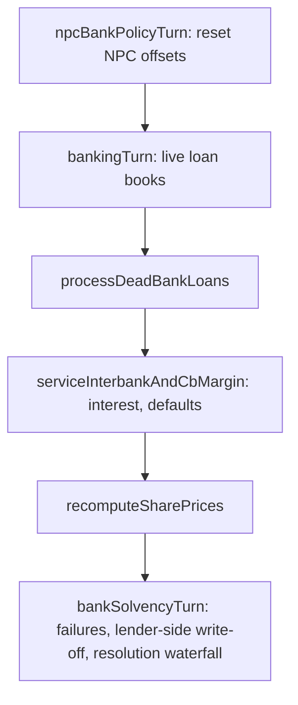

# Interbank Lending and Bank Resolution

## Summary

This covers three related pieces of the private banking system: the interbank market and central-bank margin line (`src/lib/banking/interbank.ts`), what happens to a bank's outstanding loan book after it fails (`src/lib/banking/deadBankLoans.ts`), and the NPP-run banks that seed into every eligible country (`src/lib/banking/npcBanks.ts`). All three sit inside the wider private banking system in `src/lib/banking/`, which also covers charters, deposits, reserves, capital adequacy, the discount window, and deposit insurance (not documented here). Every path in this doc is gated behind the `privateBankingEnabled` flag on `gameConfig` (`src/lib/banking/featureFlag.ts`), with the exception of NPC bank seeding (see Configuration).

Player guide: [Interbank Lending](https://www.ahousedividedgame.com/wiki/interbank-lending) (NPC banks and the wider banking system: [Private Banking](https://www.ahousedividedgame.com/wiki/private-banking))

## Rules

### Constants

| Constant | Value | Source |
| --- | --- | --- |
| `INTERBANK_MAX_SHARE_OF_LENDABLE` | 0.5 (provisional) | `src/lib/banking/rules/decide.ts` |
| `CB_MARGIN_SPREAD_PP` | 1.5 percentage points over prime (provisional) | `src/lib/banking/rules/decide.ts` |
| `CB_MARGIN_COLLATERAL_FRACTION` | 0.5 of prop book mark value (provisional) | `src/lib/banking/rules/decide.ts` |
| `ARREARS_DEFAULT_TURNS` | 8 | `src/lib/banking/rules/loans.ts` |
| `TURNS_PER_YEAR` | 48 | `src/lib/constants/calendar.ts` |
| `NPC_BANKS_PER_COUNTRY` | 2 (provisional) | `src/lib/banking/npcBanks.ts` |
| `NPC_BANK_CAPITAL_BUFFER_MULTIPLIER` | 3 (provisional) | `src/lib/banking/npcBanks.ts` |
| NPC deposit-offset target | lower quartile of the corridor: `min + 0.25 * (max - min)` | `src/lib/banking/npcBanks.ts` (`corridorDepositTarget`) |
| NPC lending-offset target | corridor midpoint | `src/lib/banking/npcBanks.ts` |
| Interbank rate | chosen by the lender per loan, at least 0 (no maximum in the schema) | `src/app/api/corporations/[id]/bank/interbank/loans/route.ts` |
| Float tolerance for cap and payment comparisons | `1e-9` | `interbank.ts`, `rules/interbankServicing.ts` |

### Interbank lending (`interbank.ts`)

A deposit-taking bank (retail or universal charter) lends non-reserved cash to a bank running a prop book (investment or universal charter). This is separate from a retail bank's ordinary loan book: interbank loans are not part of `totalLoans` and are tracked on their own `InterbankLoan` documents plus a running `bankCharter.interbankDebt` on the borrower.

#### Eligibility

- Lender must have an active retail or universal charter (`isDepositTakingCharter`).
- Borrower must have an active investment or universal charter (`isPropBorrowerCharter`).
- Lender and borrower charter currencies must match.
- A bank cannot lend to itself.

#### Sizing constraints

```
INTERBANK_MAX_SHARE_OF_LENDABLE = 0.5   // provisional, src/lib/banking/rules/decide.ts
```

Lendable headroom is computed via `getLendableHeadroom(lenderCharter, reserveRatio)` (`src/lib/banking/rules/reserves.ts`), which is `max(0, cashBackedDeposits x (1 - reserveRatio) - totalLoans)`, with `reserveRatio = getReserveRequirement(db, currency)`. Only cash-backed deposits count: player pointer balances never arrived as cash. The lender may place at most `0.5 x headroom` on the interbank market, checked as a running total across all of that lender's current interbank loans (`sumLenderInterbankOutstanding`, summed over `status: "current"`). A new loan is rejected if it alone exceeds the cap, or if adding it to already-outstanding interbank lending would exceed the cap. Separately, the lender must have enough liquid `cashReserves` to cover the amount.

#### Origination (`lendInterbank`)

Cash moves lender reserves to borrower reserves. An `InterbankLoan` document is created:

```ts
{
  lenderCorporationId, borrowerCorporationId, currency,
  principal, outstanding, ratePercent, originatedTurn,
  status: "current"
}
```

The write sequence is: insert loan, debit lender `bankCharter.cashReserves` (conditioned on `cashReserves >= amount`), credit borrower `cashReserves` and increment `bankCharter.interbankDebt`. Each step is guarded and the function unwinds (deletes the loan doc, refunds the lender) if a later step's conditional update fails to match, since the code notes standalone Mongo has no transactions. A `bank_interbank_lend` transaction is emitted via `emitTx`.

#### Repayment (`repayInterbank`)

Repays principal only, capped at `min(amount, loan.outstanding)`. Cash moves borrower to lender; `bankCharter.interbankDebt` and `loan.outstanding` both decrease by the repaid amount. If the lender-credit step fails after the borrower has already been debited, the code compensates by crediting the cash and debt back onto the borrower rather than losing it. Loan status flips to `"repaid"` once `outstanding <= 0`; `arrearsTurns` resets to 0 on any repayment.

#### Interest servicing (turn-phase)

`serviceInterbankAndCbMargin` (`src/lib/turn/bankingInterbankTurn.ts`) runs every banking turn (idempotent via `lastProcessedTurn !== turn`), independent of whether any deposit-taking bank needs a servicing pass. It processes every `InterbankLoan` (collection `interbankLoans`) with `status: "current"`, and only when prop trading is enabled.

Per loan (`serviceOneInterbankLoan`, `src/lib/banking/serviceInterbankLoan.ts`; the pure decision is `decideInterbankService` in `src/lib/banking/rules/interbankServicing.ts`). Cash legs and the loan-record update land together as one journaled transition keyed per loan per turn (`interbank-interest:<loanId>:<turn>`), so a retried turn cannot pay twice:

```
interestDue = outstanding x (ratePercent / 100) / TURNS_PER_YEAR   // perTurnInterestOn, TURNS_PER_YEAR = 48
payment = min(interestDue, borrower's available cashReserves)
```

- If `payment` covers `interestDue` (within 1e-9), full interest is paid borrower to lender via `payInterbankInterest`, `arrearsTurns` resets to 0.
- If not, the shortfall is a partial payment: whatever cash is available is paid, `arrearsTurns` increments by 1.
  - If `arrearsTurns >= ARREARS_DEFAULT_TURNS` (= 8, in `src/lib/banking/rules/loans.ts`, same constant used for player loan defaults), the loan is written off: no cash moves for the remaining principal, the borrower's `bankCharter.interbankDebt` is reduced by the outstanding amount, and loan status becomes `"defaulted"`.
  - Below that threshold, only `arrearsTurns` and `lastProcessedTurn` update; the loan stays `"current"`.

Interest moves cash from the borrower's to the lender's `bankCharter.cashReserves`. Principal is never collected here, only through `repayInterbank`.

#### Lender-side failure (`bankSolvencyTurn.ts`)

If the LENDER on an interbank loan fails, `writeOffLenderSideInterbankOnFailure` marks every `InterbankLoan` where that corp is `lenderCorporationId` and `status: "current"` as `"defaulted"`. The code is explicit that the borrower keeps the cash and the loss is absorbed as an unrecoverable write-off on the failed lender's estate; chasing the borrower for early repayment is treated as compounding one failure into a second. This function does NOT touch claims against the failed bank (i.e. where it is the borrower), those are settled separately, in priority order, by `returnDepositBook` during the resolution sweep (household book and central bank first, then lenders pro rata, per `interbankResolution.test.ts`).

### CB margin line

A separate facility: prop-book-collateralized borrowing directly from the country's central bank, available to the same investment/universal charters.

```
CB_MARGIN_SPREAD_PP = 1.5                 // provisional, src/lib/banking/rules/decide.ts
cbMarginRatePercent(primeRate) = max(0, primeRate + 1.5)

CB_MARGIN_COLLATERAL_FRACTION = 0.5       // provisional, src/lib/banking/rules/decide.ts
maxDebt = 0.5 x propBookMarkValue
```

CB margin interest is serviced in the same pass: each turn the bank pays `cbMarginRatePercent(prime)` on its interest-bearing margin debt (margin debt minus any liquidity advance, `interestBearingCbMarginDebt`, `src/lib/banking/rules/facilityInterest.ts`), and the discount window facility is serviced alongside it, from the bank's available cash.

`drawCbMargin`: collateral check is `cbMarginDebt + cbMarginArrears + amount <= maxDebt`, i.e. unpaid interest arrears count against the line's headroom too (the code notes this is deliberate, a bank that cannot service the margin loses headroom rather than silently borrowing its own arrears). On draw, cash is CREATED into `bankCharter.cashReserves` (`+amount`) and `bankCharter.cbMarginDebt` increases by the same amount; the country's `centralBanks.netMoneyCreatedLifetime` increases correspondingly. This mirrors the discount window: originating the loan does not debit any CB pool.

`repayCbMargin`: repay amount is `min(amount, cbMarginDebt, cashReserves)`. Cash is DESTROYED from the bank's reserves (mirror of creation on draw) and `netMoneyCreatedLifetime` decreases by the same amount.

Both draw and repay emit `bank_cb_margin_draw` / `bank_cb_margin_repay` transactions with the counterparty recorded as `"{country} central bank"`.

### API surface

- `POST /api/corporations/[id]/bank/interbank/loans`, originate a loan (CEO of lender only). Body: `{ borrowerCorporationId, amount, ratePercent }`, with `amount` positive and finite and `ratePercent` non-negative and finite. Gated by `isBankPropTradingEnabled`; returns 404 if off.
- `POST /api/corporations/[id]/bank/interbank/margin`, `{ action: "draw" | "repay", amount }` (CEO only). Same gate.
- `GET /api/banking/corporation/[id]` also surfaces interbank state as part of the general bank read model.

### Dead bank loans (`deadBankLoans.ts`)

Handles loans a FAILED or REVOKED bank made as a LENDER that were never resolved when the charter died. The module's own comment states the prior behavior explicitly: the banking turn only services banks with an `active` charter, so once a bank's charter left that state its outstanding loan book simply stopped being serviced, borrowers stopped paying, the asset sat at full value on a dead charter forever, and any recovery reached nobody.

#### Which banks qualify

`findDeadBanksWithLoans` selects every corporation with `bankCharter.status` in `["failed", "revoked"]`, plus the archived charter snapshots in the charter history whose status was failed or revoked (a bank that failed and was chartered again leaves its old book behind under the earlier epoch). Each is marked `resolved: true` when its lifecycle stage allows `windDownEstate` (`src/lib/banking/rules/lifecycle.ts`), i.e.:
- `bankCharter.status === "revoked"` (a revoked charter has already run the resolution waterfall on its way out), or
- a failed charter with `bankCharter.depositorsResolvedTurn` set to a number (the resolution sweep has stamped it).

One recovery owner is kept per originating charter epoch, preferring the resolved snapshot.

#### Where recovered cash goes (`recoveryTargetFor`)

- **Archived snapshot** (a history document with a `historyId`): paid into the `depositInsuranceFunds` document for that currency, since no live waterfall will ever distribute a snapshot's reserve balance.
- **Not yet resolved**: payment lands in the dead bank's own `bankCharter.cashReserves`, i.e. the estate. This makes the resolution waterfall (which distributes that cash) bigger if a recovery arrives before it runs.
- **Resolved**: the dead bank's depositors were already made whole by deposit insurance / the treasury backstop, and the owner already took any residual. A late recovery is treated as subrogation and is paid into the `depositInsuranceFunds` document for that currency (`balance` field), not to the bank or its owner. `ensureFund` is called first to guarantee the currency's insurance fund document exists before crediting it.

#### Servicing loop (`processDeadBankLoans`, called from `src/lib/turn/bankingTurn.ts`)

For all dead banks it reads `bankLoans` in one query for their `bankCorporationId`s, covering character, corporation and `npcBulk` (household tranche) borrowers, `status` in `["current", "arrears"]`, and `lastProcessedTurn !== turn` (idempotency guard). If there are matching loans, it resolves the target (estate or insurer) and then services each loan SERIALLY within that bank (not in parallel), because two loans from the same borrower must see each other's debit exactly as the live per-bank servicing path does. The actual per-loan collection math (interest, arrears, principal) is injected as a `serviceLoan` callback from `bankingTurn.ts` rather than owned by this module, specifically so this file does not depend on the turn file that depends on it.

A whole epoch's book is serviced in at most two journaled moves: named loans and household tranches share one, and construction loans take a second because they hold a lease and a loan lock. Loans neither move can carry (an untagged legacy loan, a borrower with no document, a corporation whose book spans currencies, anything another receipt still owns) fall back to the per-loan path. Every move uses a deterministic per-turn key, so a retried turn cannot charge a borrower twice.

Returned summary: `{ loansServiced, recoveredToEstate, recoveredToInsurer }`, all zero if there are no dead banks with loans.

### NPC banks (`npcBanks.ts`)

NPP-owned (non-player-party) retail banks seeded into eligible countries to give the private banking system counterparties and market depth without requiring player-run banks in every country.

#### Seeding (`seedNpcBanks`)

```
NPC_BANKS_PER_COUNTRY = 2                        // provisional
NPC_BANK_CAPITAL_BUFFER_MULTIPLIER = 3            // provisional
```

For every country in `ALL_COUNTRY_IDS`:
- Skipped (counted as `skippedIneligible`) if the country has no configured NPP capital HQ state (`NPP_CAPITAL_STATES`), no mapped currency, a configured HQ state that is missing from the world preset or belongs to another country (also reported in `excludedMissingState`), a planned economy blocked from private enterprise (`loadPrivateEnterpriseBlockedCountries`), or if the country's legal charter types (`getLegalCharterTypes`) do not include `"retail"`.
- Otherwise, up to 2 bank slots are seeded, keyed deterministically by `npcBankSeedKey(countryId, index)` = `"npc-bank:{countryId}:{index}"` for idempotency.
- Starting capital is `getCharterCapitalRequirement(currency) x 3`: one multiple is posted into the charter itself, the remaining two are described as the working treasury buffer.
- Bank names are drawn from era-flavored template lists (`COUNTRY_HISTORICAL_NAMES` / `COUNTRY_MODERN_NAMES`, keyed by country, falling back to generic defaults), selected by whether the era's `loadWorldEraUnitScale(db) > 1` (historical vs. modern naming). The code comments emphasize these are generic patterns, not real institution names.
- Each new corp is spawned via `spawnNppCorporation` (type `"financial"`) and then chartered via `issueCharter(db, corpId, "retail", currency, { skipFlagCheck: true })`. Charter failures are counted separately from corp-creation failures.
- There is a name+country fallback lookup (`ceoType: "npp", type: "financial"`) for corps that exist without the seed key from a prior run, which backfills the key and issues a charter if one isn't already active.

Seeding itself is NOT gated on `privateBankingEnabled` (comment: "gameConfig is never mutated", the bypass is scoped to charter issuance only, not a flag flip). Runtime turn behavior is gated (see below).

#### Runtime rate policy (`runNpcBankPolicy` / `processNpcBankPolicyTurn`)

Turn-phase entry point `processNpcBankPolicyTurn` (registered as phase `npcBankPolicyTurn` in `src/simulation/phases/turnPhaseRegistry.ts`) no-ops with a zero summary (`{ banksChecked: 0, banksUpdated: 0 }`) if `isPrivateBankingEnabled()` is false. It does NOT seed banks; seeding is a separate admin/bootstrap-time operation (`src/lib/admin/seed/seedNpcBanks.ts`, `src/lib/admin/bootstrapGameWorld.ts`).

When enabled, `runNpcBankPolicy` iterates every corp with `ceoType: "npp"`, active `bankCharter`, and charter type `retail` or `universal`. For each, it fetches the country's rate corridors (`getRateCorridors`) and computes the targets: the deposit offset goes to the lower quartile of its range (`min + 0.25 * (max - min)`, so incumbents price deposits lazily and leave room for player banks to win share), the lending offset to the midpoint. If the current `depositOffset`/`lendingOffset` has drifted from either target by more than `1e-9`, both are reset via `setBankRates`. It does not set the reserve-holding or loan-book behavior, which the comment says comes from `bankingTurn`'s NPC flows (not covered by this file).

## Data

| Collection | Fields | Read or written | Shown to players |
| --- | --- | --- | --- |
| `interbankLoans` | `lenderCorporationId`, `borrowerCorporationId`, `currency`, `principal`, `outstanding`, `ratePercent`, `originatedTurn`, `status` (`current`, `defaulted`, `repaid`), `arrearsTurns`, `lastProcessedTurn` | Written on origination, repayment, servicing, default | Interbank state through the bank read model (`GET /api/banking/corporation/[id]`), to the bank's own CEO |
| `corporations` (`bankCharter`) | `cashReserves`, `interbankDebt`, `cbMarginDebt`, `cbMarginArrears`, liquidity-advance portion of `cbMarginDebt`, `status`, `depositorsResolvedTurn`, `insuranceResolutionTurn`, `depositOffset`, `lendingOffset`, `npcBankSeedKey` (on the corporation) | Read and written | Own bank page; NPC offsets shape public rates |
| `bankLoans` | `bankCorporationId`, `borrowerType`, `status`, `outstanding`, `lastProcessedTurn` | Read and updated by dead-bank servicing | Borrower sees their own loan |
| `depositInsuranceFunds` | `balance` per currency | Credited by late dead-bank recoveries (`ensureFund` first) | Insurance fund balance |
| `centralBanks` | `netMoneyCreatedLifetime` | Raised by margin draws, lowered by repayments | Money supply views |
| Charter history | Archived failed or revoked charter snapshots | Read to find old loan books | No |
| `bankMoneyMoves` | Journal of money moves keyed per loan or batch per turn | Written | No |
| `gameConfig` (`_id: "default"`) | `privateBankingEnabled`, `bankPropTradingEnabled`, `bankContagionEnabled` | Read | No |
| Transactions | `bank_interbank_lend`, `bank_cb_margin_draw`, `bank_cb_margin_repay` | Written | Own transaction history |

## Configuration

`src/lib/banking/featureFlag.ts` defines three flags read off `gameConfig._id: "default"` (resolved through the banking policy snapshot in `src/lib/banking/rules/policy.ts`):

| Flag | Default | Effect |
| --- | --- | --- |
| `privateBankingEnabled` | disabled; only an explicit `true` turns it on | Master switch |
| `bankPropTradingEnabled` | enabled when absent, requires banking on | Gates interbank lending and the CB margin line |
| `bankContagionEnabled` | enabled when absent, requires banking on | Gates failure contagion (not covered by the three files here) |

`lendInterbank`, `repayInterbank`, `drawCbMargin`, and `repayCbMargin` all check `isPrivateBankingEnabled() && isBankPropTradingEnabled()` and return an error if either is false. The two interbank API routes (`bank/interbank/loans`, `bank/interbank/margin`) separately gate on `isBankPropTradingEnabled()` and return 404 if off. Flag-off is a read-only freeze, not a drain: existing books stay as they are.

NPC bank seeding (`seedNpcBanks`) is explicitly NOT gated on `privateBankingEnabled`, charters are issued through the real `issueCharter` path with a `skipFlagCheck` bypass, so NPC banks exist in the world regardless of the flag. Runtime NPC bank behavior (`processNpcBankPolicyTurn`, the turn-phase entry point) IS gated: it no-ops and returns a zero summary when private banking is off.

Other settings that change behaviour:

| Setting | Where set |
| --- | --- |
| World preset and era unit scale (which countries seed, bank naming) | `loadWorldPreset`, `loadWorldEraUnitScale` in `src/lib/currency/gdpAnchorRate.ts` |
| Country HQ state for NPC banks | `NPP_CAPITAL_STATES` in `src/lib/admin/spawnNppCorporation.ts` |
| Legal charter types per country and command-economy gating | `src/lib/banking/separationLaw.ts` |
| Reserve requirement per currency (sets lendable headroom) | `bankReserveRequirement` on the central bank, era default otherwise (`getReserveRequirement`) |
| Rate corridors (NPC offset targets) | `getRateCorridors` |

There are no per-scenario overrides for the three provisional constants; they are code defaults.

## Timing

Order within a turn (`src/simulation/phases/turnPhaseRegistry.ts`):

1. `npcBankPolicyTurn` runs first, before `bankingTurn`, so corrected NPC rate offsets price this turn's deposits and loans.
2. `bankingTurn` (`src/lib/turn/bankingTurn.ts`): live-bank loan books, then dead-bank loans (`processDeadBankLoans`), then `serviceInterbankAndCbMargin`.
3. `recomputeSharePrices`, then `bankSolvencyTurn` (`src/lib/turn/bankSolvencyTurn.ts`): failure detection, contagion and the lender-side interbank write-off, so prop-book marks use fresh prices.



Player actions (originate, repay, draw, repay margin) run immediately on the API call, outside the turn. NPC bank seeding happens only at bootstrap or by admin action.

## Worked trace

### Interbank loan

A retail bank has cash-backed deposits of 12,000,000 with a 10% reserve requirement and 9,800,000 of loans: headroom is `12,000,000 x 0.9 - 9,800,000 = 1,000,000`, so its interbank cap is 500,000. It already has 200,000 out.

- A new 350,000 loan is refused (200,000 + 350,000 = 550,000 is over the cap). 300,000 is allowed.
- At 8% annual, the 300,000 loan owes `300,000 x 0.08 / 48 = 500` per turn.
- If the borrower has only 300 cash, it pays 300 and arrears becomes 1. On the eighth consecutive shortfall the loan defaults: 300,000 is written off, no cash moves, and the borrower's `interbankDebt` falls by 300,000.
- If instead the lender itself fails on turn 5, the loan is set to `defaulted` at once and the borrower keeps the 300,000.

### CB margin

Prime rate 4% gives a margin rate of 5.5%. A prop book marked at 2,000,000 gives a debt ceiling of `0.5 x 2,000,000 = 1,000,000`. With 600,000 drawn and 50,000 of interest arrears, the most the bank can draw is `1,000,000 - 600,000 - 50,000 = 350,000`. Each turn's interest on 600,000 is `600,000 x 0.055 / 48 = 687.50`. Drawing 350,000 creates 350,000 of cash in the bank's reserves and raises `netMoneyCreatedLifetime` by the same amount; repaying 350,000 later destroys it.

### Dead-bank recovery

A borrower owes a failed bank 1,000 of interest this turn. If the bank's estate is not yet resolved, 1,000 lands in its `bankCharter.cashReserves` and the pending waterfall distributes it. If the bank is resolved or revoked, the same 1,000 is credited to the currency's `depositInsuranceFunds.balance`. The summary reports `recoveredToEstate: 1000` or `recoveredToInsurer: 1000`.

### NPC bank

If a country's charter capital requirement is C, each of its two NPC banks starts with `3C`, of which `C` is posted in the charter. For an illustrative corridor of offsets from -1.0 to 3.0, the deposit offset target is `-1.0 + 0.25 x 4.0 = 0.0` and the lending offset target is the midpoint `1.0`.

## Edge cases and limits

- Interbank cap compares the single new loan and the running total against `0.5 x headroom`, with a `1e-9` tolerance. Headroom of zero means no lending.
- Repayment is capped at the outstanding balance; partial repayments reset `arrearsTurns` to 0.
- The borrower defaulting never sends cash back. Writing off is bookkeeping only, because chasing a failed counterparty would convert one failure into two.
- A lender failing defaults all its current loans and leaves the borrower with the cash; claims against a failed bank as borrower go through the deposit-book waterfall instead.
- CB margin repayment is limited to `min(amount, cbMarginDebt, cashReserves)`; a bank with no cash cannot repay.
- Margin arrears count against the collateral limit so a bank that cannot service the line cannot borrow more to hide it.
- Interbank and margin actions are blocked when prop trading is off; existing books are frozen, not unwound. Dead-bank servicing and NPC seeding do not depend on prop trading.
- A revoked charter is treated as resolved immediately; a failed one only after `depositorsResolvedTurn` is stamped.
- NPC seeding skips countries with no configured capital HQ state, no currency, a missing or mismatched HQ state in the preset, a blocked planned economy, or no legal retail charter.
- The interbank rate has no upper bound in the API schema, so a lender can price a loan the borrower can never service; it then defaults after 8 missed turns.

## Invariants

| Invariant | Enforced by |
| --- | --- |
| Money is conserved across lend, repay, interest, failure and resolution | `src/lib/banking/__tests__/conservation.test.ts`, `src/lib/banking/rules/invariants.ts` (`balanced_transfer`, `guarded_debit`), `src/lib/banking/rules/invariants.test.ts` |
| Interbank outstanding per lender never exceeds `0.5 x headroom` | `decide.ts` and `lendInterbank`; `src/lib/banking/__tests__/interbank.test.ts` ("caps lend amount") |
| Margin debt plus arrears never exceeds `0.5 x prop mark` on a draw | `drawCbMargin`; `interbank.test.ts`, `src/lib/banking/__tests__/cbMarginArrears.test.ts` |
| Margin draw creates exactly the cash it adds to debt, and repayment destroys it | `interbank.test.ts` ("destroys cash on repay", "mirrors netMoneyCreatedLifetime") |
| A loan is serviced once per turn and cannot be paid twice on retry | per-loan journal key; `interbank.test.ts` ("once per turn"), `src/lib/banking/__tests__/journalCrashInjection.test.ts` |
| A dead bank's loan is serviced once per turn, serially per bank | `lastProcessedTurn` guard; `src/lib/banking/__tests__/deadBankLoans.test.ts`, `deadBankLoans.batch.test.ts` |
| NPC seeding is idempotent | `npcBankSeedKey`; `src/lib/banking/__tests__/npcBanks.test.ts` ("is idempotent") |
| `bank_accounting_identity`: assets equal liabilities plus equity | `invariants.ts`, `invariants.test.ts` |
| Defaulting never moves cash | by construction in `decideInterbankService`; `interbank.test.ts` ("writes off to lender (no cash recovery)") |

## Failure and recovery

- **Half-applied origination or repayment.** Each step is conditional and unwinds on a mismatch (loan removed, lender refunded; borrower made whole when the lender credit fails). Per-turn interest and dead-bank servicing go through the money-move journal, which finishes or reverses a half-applied move on the next pass; origination and repayment rely on their own compensating writes.
- **Stuck dead-bank book.** A dead bank's loans stop earning if the servicing loop errors. Reruns are safe because of the per-turn key; a loan that cannot join a batch falls back to the per-loan path.
- **Recovery landing in the wrong place.** The routing depends on the charter lifecycle stage. A charter stuck in the middle of resolution counts as unresolved, so recoveries go to the estate; finishing the resolution (recover-resolution step) moves later recoveries to the insurer.
- **Missing insurance fund document.** `ensureFund` recreates it before a credit.
- **NPC banks missing in a world.** Rerun the idempotent seed; it backfills seed keys and charters existing keyless banks. Excluded countries are reported with a reason rather than failing.
- **Drifted NPC rates.** The next `npcBankPolicyTurn` resets both offsets to target.
- **Flag turned off mid-life.** Books freeze and nothing is unwound; turning it back on resumes servicing.
- **Money-supply drift.** Repaired with a compensating heal plan, verified against the conservation checks.

## Connections

**Driven by:**

- Prime rate from the country's central bank, see [money supply and QE](./money-supply-and-quantitative-easing.md) and [monetary system](./monetary-system-as-shipped.md).
- Prop book marks (share prices from [stock market](./stock-market.md)) set the margin ceiling.
- Reserve requirement (`getReserveRequirement`, `src/lib/banking/reserves.ts`) sets lendable headroom.
- Charter and deposit state from the wider private banking system.

**Affects:**

- Money supply: margin draws create reserves and raise `centralBanks.netMoneyCreatedLifetime`; repayments destroy them.
- Deposit insurance: late dead-bank recoveries refill `depositInsuranceFunds`.
- Bank failure and contagion: unpaid margin and interbank defaults feed `bankSolvencyTurn` (`sumInterbankDefaultsLastTurn`).
- Borrowers of a dead bank: loans are still serviced and recovery routed to the estate or insurer.
- Savers and households: NPC banks set deposit and lending pricing pressure on player banks.

### Key files

- `src/lib/banking/interbank.ts`, interbank lending/repayment, CB margin draw/repay
- `src/lib/banking/deadBankLoans.ts`, dead-bank loan discovery and recovery routing
- `src/lib/banking/npcBanks.ts`, NPC bank seeding and rate-corridor policy
- `src/lib/banking/featureFlag.ts`, `privateBankingEnabled` / `bankPropTradingEnabled` / `bankContagionEnabled` gates
- `src/lib/turn/bankingTurn.ts`, turn-phase orchestration and `processDeadBankLoans` invocation
- `src/lib/turn/bankingInterbankTurn.ts`, `serviceInterbankAndCbMargin`
- `src/lib/banking/serviceInterbankLoan.ts` and `src/lib/banking/rules/interbankServicing.ts`, per-loan servicing. `ARREARS_DEFAULT_TURNS = 8` is defined in `src/lib/banking/rules/loans.ts`
- `src/lib/turn/bankSolvencyTurn.ts`, `writeOffLenderSideInterbankOnFailure`, `sumInterbankDefaultsLastTurn`
- `src/lib/db/types/bank.ts`, `InterbankLoan`, `BankLoan`, `DepositInsuranceFund` type definitions
- `src/simulation/phases/turnPhaseRegistry.ts`, registers `npcBankPolicyTurn` phase
- `src/lib/admin/seed/seedNpcBanks.ts`, `src/lib/admin/bootstrapGameWorld.ts`, seed-time invocation of `seedNpcBanks`
- `src/app/api/corporations/[id]/bank/interbank/loans/route.ts`, POST originate interbank loan
- `src/app/api/corporations/[id]/bank/interbank/margin/route.ts`, POST draw/repay CB margin

## Tests

| Area | Test file |
| --- | --- |
| Interbank origination, repayment, margin, servicing and default | `src/lib/banking/__tests__/interbank.test.ts` |
| Lender failure and estate settlement order | `src/lib/banking/__tests__/interbankResolution.test.ts` |
| Margin arrears shrink the line | `src/lib/banking/__tests__/cbMarginArrears.test.ts` |
| Interbank income in the banking turn | `src/lib/turn/__tests__/bankingTurn.interbankIncome.integration.test.ts` |
| Dead-bank discovery, routing, batching | `src/lib/banking/__tests__/deadBankLoans.test.ts`, `deadBankLoans.batch.test.ts`, `deadBankLoans.shapes.test.ts` |
| NPC seeding and policy | `src/lib/banking/__tests__/npcBanks.test.ts`, `src/lib/banking/__tests__/npcBankPresetMatrix.test.ts` |
| Solvency phase | `src/lib/turn/__tests__/bankSolvencyTurn.test.ts` |
| Money conservation and crash recovery | `src/lib/banking/__tests__/conservation.test.ts`, `journalCrashInjection.test.ts` |
| Pure rules | `src/lib/banking/rules/decide.test.ts`, `facilityInterest.test.ts`, `invariants.test.ts` |

Gaps: no test file targets `serviceInterbankAndCbMargin` or `decideInterbankService` directly (they are exercised through `interbank.test.ts` and the banking-turn integration test), and the interbank rate has no upper-bound test because there is no bound.

## Known issues and history

- The three headline constants (`INTERBANK_MAX_SHARE_OF_LENDABLE`, `CB_MARGIN_SPREAD_PP`, `CB_MARGIN_COLLATERAL_FRACTION`) and both NPC constants are marked provisional in code and have not been calibrated against play. `interbank.test.ts` asserts they are exported as provisional.
- Before the dead-bank loop existed, loans on a failed or revoked charter were never serviced again, so borrowers stopped paying and the asset sat at full value forever. The loop now routes recoveries to the estate or the insurer (per the module's own history comment).
- The old version of this doc described resolution only through `depositorsResolvedTurn`; the code decides it from the charter lifecycle stage and also handles archived epochs. The doc now matches the code.
- The interbank rate is unbounded above, and interbank interest is simple, interest-only, with no compounding or fees.
- The player page's worked example (20,000,000 deposits, 10% reserve, 8,000,000 loans) agrees with the code's headroom formula. No contradiction with the player page was found.

Last checked: 2026-10-29, version 1.18.0
