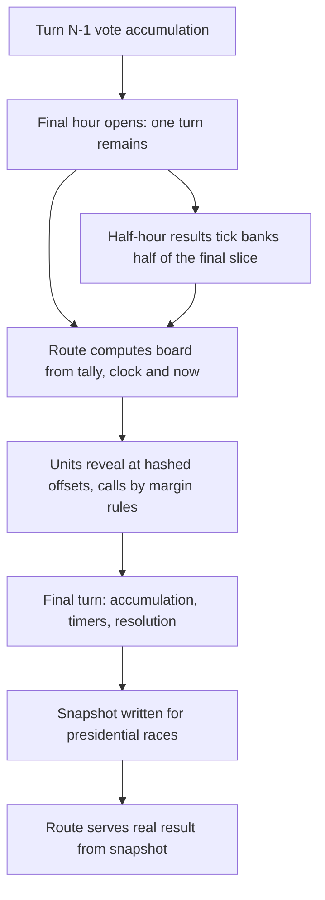

# Live Election Results

## Summary

Election night turns a finished count into a public evening: regions report in over the last hour of a race and are called one at a time, while the turn engine stays the only authority on who actually won.

Player guide: [Live Election Results](https://www.ahousedividedgame.com/wiki/live-election-results)

Election-night results page and polling facade: `/elections/[id]/results` and its polling endpoint `GET /api/elections/[id]/results` (`src/app/api/elections/[id]/results/route.ts`). Feature-flagged. Source: `src/lib/elections/liveResults/` (`featureFlag.ts`, `types.ts`, `computeResults.ts`, `electionNight.ts`, `electionNightChrome.ts`, `buildResultsPayload.ts`, `presidentialNight.ts`, `primaryNight.ts`, `captureResultSnapshot.ts`).

Everything in `computeResults.ts` is display-only and deterministic on its inputs (including `now`), so every viewer sees the same drip-fed reveal and tests can pin exact behavior. A unit being "called" here is a UI projection; the turn engine remains the sole authority on the actual election outcome.

Three display models share the module:

| Model | Used for | File |
| --- | --- | --- |
| Generic drip | Every race except a US presidential final hour | `computeResults.ts` |
| US presidential night | A US presidential general in its final hour, tally not yet finalized | `presidentialNight.ts` |
| Primary night | Presidential primary waves, in the primary detail views | `primaryNight.ts` |

## Rules

### Feature gate

`isLiveElectionResultsEnabled(gameState)` reads `gameState.liveElectionResultsEnabled === true` (`featureFlag.ts`). The check is strict, so an unset flag is off. The world-defaults seed (`src/lib/seeds/reference/featureFlagDefaults.ts`) sets it to `true`, so new worlds start with election night on and an operator can switch it off per world. When the flag is off, the results route returns HTTP 403 to everyone except admins, who always pass.

### Election-type classification

| Set | Purpose | Members |
| --- | --- | --- |
| `WESTMINSTER_STYLE_TYPES` | Gets majority/hung-parliament call copy | `commons`, `snap_commons`, `holyrood`, `senedd`, `dail`, `shugiin`, `snap_shugiin`, `sangiin`, `bundestag`, `landtag`, plus beta-country lower chambers: `assembleeNationale`, `cameraDeputati`, `congresoDiputados`, `riksdag`, `milletMeclisi` |
| `NATIONAL_AGGREGATION_TYPES` | Sibling region elections summed into one national seat board | `house`, `commons`, `snap_commons`, `shugiin`, `snap_shugiin`, `sangiin`, `npcDelegate`, `peoplesCongress`, `bundestag`, `dail`, plus the same beta-country lower chambers |

`CHAMBER_LABELS` maps each election type to a display name (House of Representatives, House of Commons, Bundestag, Shūgiin, Dáil Éireann, National People's Congress, Riksdag, etc.).

`isElectionNightType(electionType)` is true iff the type is in `NATIONAL_AGGREGATION_TYPES`. `electionNightStyle(electionType)` is `"westminster"` or `"generic"`. `electionNightTitle(electionType)` is `"Election Night · {chamber}"` or a bare `"Election Night"` fallback. These live in `electionNightChrome.ts` so a list page can use them without loading the seat aggregation.

### Final-hour drip window

`computeFinalHour(input, windowMs = 3600000)` returns the wall-clock interval between the second-to-last and final turn of an active election. It returns `null` unless `status === "active"`, `endTurn` and `nextScheduledTurn` are set, `pausedAt` is unset (a frozen clock must not drip), and 0 or 1 turns remain. `progress` is the 0..1 fraction of the final hour elapsed, `1 - msRemaining / windowMs` clamped; `endsAt` is `nextScheduledTurn`.

The route passes `windowMs = MS_PER_TURN` (60 minutes), or `MS_PER_TURN / 2` (30 minutes) when `gameState.fastMode` is set (`buildResultsPayload.ts`).

`unitRevealOffset(electionId, unitId) = 0.06 + hashFraction(electionId:unitId) × 0.88`, a deterministic position in the final hour where a given unit (state, region) reveals. `hashFraction` is an FNV-1a hash to `[0,1)`. Same key always yields the same offset, so every viewer watches the same units declare in the same order, and the first and last minutes of the hour always have something happening.

### Reporting percentage

`computeBaselineReportingPct(input)` is the turn-based mid-campaign estimate: `round(elapsed / span × 100)` where `generalStart = primaryEndTurn ?? startTurn ?? endTurn`, `span = endTurn - generalStart` and `elapsed` is `currentTurn - generalStart` clamped to the span, capped at `PRE_FINAL_REPORTING_CAP = 88`. With no `endTurn` or a zero span it returns 88. There is no stored expected-turnout figure, so elapsed general-phase turns stand in for it.

`computeUnitResult(input)` ramps a unit's `reportingPct`:

- `0` if the unit has zero votes.
- `100` once ended or revealed.
- During the final hour before reveal: `round(baseline + (98 - baseline) × min(1, progress / revealOffset))`, so it climbs toward, never past, 98.
- Mid-campaign: `min(88, round(baseline × jitter))` with a deterministic per-unit jitter of `0.9 + hashFraction(electionId:unitId:jitter) × 0.2` (0.9 to 1.1), so the board doesn't read as one uniform number.

### Generic call rules

These rules cover the generic path in `computeResults.ts`. US presidential finals use `presidentialNight.ts` and primaries use `primaryNight.ts`, both described below.

`CALL_MARGIN_PCT = 5` is the margin (percentage points of the unit's counted vote) a leader needs before a unit is called.

A unit is `called` when it is not tied, has votes, has a leader, and either the election has ended or (the unit has been revealed by the drip AND `leaderMarginPct >= CALL_MARGIN_PCT`). `leaderMarginPct = (leaderVotes - runnerUpVotes) / totalVotes × 100`. Mid-campaign nothing is called, only leads are shown. Ties are never called.

`computeElectoralTotals(units)` sums `weight` (EV for President, region seat count for multi-seat races) into `calledEv` (from called units) and `leadingEv` (from uncalled, untied leading units).

### National projection

`computeNationalProjection(parties, majorityThreshold, style)`:

| Condition | `kind` |
| --- | --- |
| No seats projected anywhere yet | `"tooEarly"` |
| Top party's projected seats at or above the threshold | `"majority"`, `margin = top - threshold + 1` (seats of cushion counting the threshold seat) |
| Below threshold, `style === "westminster"` | `"hung"` |
| Below threshold, `style === "generic"` | `"largest"` (`margin` = lead over runner-up) |

`majorityThreshold(totalSeats) = floor(totalSeats / 2) + 1`.

### National aggregation

`buildNationalElectionNight(db, election, partyMap, finalHourProgress, isEnded)` (`electionNight.ts`) builds the country-wide seat board across sibling elections of the same `countryId`, `electionType` and `cycle` with status `active`, `upcoming`, `completed` or `resolved` (plus the same `chamberClass` for Sangiin half-elections):

1. Returns `null` if `electionType` is not in `NATIONAL_AGGREGATION_TYPES`, or fewer than 2 sibling elections exist.
2. Loads each sibling's `ElectionVoteTally`. The seat split is `resolvedSeatsEstimate(tally, computeSeatEstimates(...))`: a finalized tally's allocation is authoritative, anything earlier is a fresh projection from the current roster (ticket #1277), because `accumulateVoteTurn` rewrites `seatsEstimate` every turn.
3. Each region "declares" (`declared: true`) once the board is ended, its own election status is in `ENDED_STATUSES` (`completed`, `resolved`, `cancelled`), or the drip's `finalHourProgress` passes that region's `unitRevealOffset`.
4. Sums seats by party across all regions (`projectedSeats`) and across declared regions only (`declaredSeats`).
5. For a class-staggered chamber (JP Sangiin), adds the class not up tonight from `electedOfficials` as already-decided seats in both totals. A vacant seat counts toward `totalSeats` but for no party.
6. Returns a `NationalResults` object: `style`, `chamberLabel`, `totalSeats`, `majorityThreshold`, `regionsDeclared`, `totalRegions`, `parties[]`, `regions[]`, `projection`.

`pickElectionNightAnchor(elections)`, for country-page embeds, prefers an active national multi-seat race, falling back to a completed or resolved one.

### Result shape and winner naming

`ElectionResultsResponse` (`types.ts`): `election` (meta including `evNeeded`/`totalEv` for President, `finalHour` drip state), `candidates[]` (with `electoralVotes`/`leadingElectoralVotes` for President, `seatsProjected` for multi-seat), `units[]` (per-region call/reporting detail), `national` (the aggregation above, or `null` for single-seat races), `summary` (`totalVotes`, `unitsReporting`, `unitsCalled`, `projectedWinner`), `isAdmin` (unlocks simulation controls client-side), `lastUpdated`, and an optional `simulated` flag set only on client-generated simulated frames, never by the API.

`summary.projectedWinner` follows race-specific rules in `buildResultsPayload.ts`: a resolved US Electoral College race names whoever the engine seated (the House contingent winner when no one had an EV majority); a US college race that has ended but is not yet resolved names nobody; a Brazil presidential race names a winner only when `brazilPresidentialResult.outcome === "won"`; any other ended single-winner race names the top vote-getter.

The client (`src/app/elections/[id]/night/useNightBroadcast.ts`) polls every 10 seconds (`NIGHT_POLL_MS`) while election night is on or the result is resolving, and every 30 seconds (`IDLE_POLL_MS`) while it waits for the night to open.

### US presidential night

`presidentialNight.ts` is a pure function of (election id, tally, schedule, now), so every viewer and a late joiner see the same board. It models the final-hour window as an evening with real poll-closing order (`src/lib/countries/us/data/usPollClosing.ts`, Eastern clock hours per state). It applies only to a US presidential race inside its final hour with an unfinalized tally. Non-US presidents keep the generic drip.

| Constant | Value |
| --- | --- |
| `NIGHT_FIRST_CLOSE_FRACTION` | 0.06 |
| `NIGHT_LAST_CLOSE_FRACTION` | 0.7 |
| `NIGHT_CLOSE_JITTER` | 0.008 (plus or minus, window fraction) |
| `NIGHT_RAMP_FRACTION` | 0.24 (scaled by a per-state speed of 0.85 to 1.15) |
| `REPORTING_CURVE_EXPONENT` | 2.2 |
| `NIGHT_REPORTING_CAP_MIN` / `NIGHT_REPORTING_CAP_MAX` | 90 / 97 (per-state cap, percent) |
| `NIGHT_COUNTING_FLOOR` | 1 |
| `NIGHT_LEADER_FLOOR` | 8 |
| `NIGHT_NOISE_MAX` | 0.08 |
| `NIGHT_CALL_SAFETY` | 1.05 |
| `NIGHT_CALL_REPORTING_MIN` / `NIGHT_CALL_REPORTING_MAX` | 25 / 75 (percent) |
| `NIGHT_TOO_CLOSE_BAND` | 0.03 (fraction of counted vote) |
| `NIGHT_TOO_CLOSE_REPORTING` | 50 (percent) |

- A state closes at `NIGHT_FIRST_CLOSE_FRACTION + (hour - FIRST_CLOSE_ET_HOUR) / (LAST_CLOSE_ET_HOUR - FIRST_CLOSE_ET_HOUR) × (NIGHT_LAST_CLOSE_FRACTION - NIGHT_FIRST_CLOSE_FRACTION)` of the window, by its real closing hour, with a hash jitter of up to plus or minus 0.008.
- After closing, reporting climbs along `cap × (1 - (1 - x)^2.2)` where `x` is the fraction of the state's ramp elapsed. Each state has its own cap between 90 and 97, so reporting never reads 100 inside the window.
- Status ladder: polls open, counting (below `NIGHT_COUNTING_FLOOR`), too early (below `NIGHT_LEADER_FLOOR`), then leaning, too close or called.
- Displayed shares carry seeded noise `0.08 × (1 - q)^2` (`q` = reporting divided by the cap) that shrinks to zero at the cap, and a called state's noise is bounded to a quarter of its margin so the shown leader never contradicts the call.
- A state is **called** only when its counted margin survives the worst-case final turn. The worst case is every remaining vote going to the runner-up, priced as `finalTurnVoteRatio` from the real turn weights, times `NIGHT_CALL_SAFETY`. Needed margin is `finalTurnVoteRatio × 1.05`. A state that clears it is called at reporting `clamp(75 - 10 × (margin / needed - 1), 25, 75)` percent: blowouts early, narrow clears late. A state is "too close" when the margin is under 0.03 with at least 50 percent in.
- The tally used is the real cumulative tally from before the final turn. The final turn is not counted inside the window. Once the race resolves, the route serves the real final result exactly, with every state called at 100%.
- The national feed counts states like a news desk: 50 states and DC. Maine and Nebraska district units carry their EVs but are not counted as extra states.

`finalTurnVoteRatio(totalTurns) = turnVoteWeight(n, n-1, 1) / sum of turnVoteWeight(n, i, 1) for i < n-1`. For any window of 5 or more turns the last slice is `0.3 / 4 = 7.5%` of the pool, so the ratio is `0.075 / 0.925`, about 8.1% of the counted vote, and a state needs a counted margin above about 8.5% (8.1% times 1.05) to be called at all. A window of 4 turns or fewer spreads the pool evenly, which makes the last turn bigger and calls rarer. The window is the engine's general window, `primaryEndTurn` to `endTurn` inclusive ([Election Engine](./election-engine.md#timing)).

### Primary night

`primaryNight.ts` gives each presidential primary wave an evening. A wave's states vote at once when the turn runs, so their final numbers already sit in the tally. Primary night spreads the reveal over `PRIMARY_NIGHT_HOURS = 8` real hours after the wave. It is consumed by the primary detail view (`src/lib/elections/primaryPartyDetail.ts`) and the presidential primary display (`src/lib/elections/enrichPresidentialPrimaryDisplay.ts`), not by the results route.

| Constant | Value |
| --- | --- |
| `PRIMARY_NIGHT_FIRST_CLOSE` / `PRIMARY_NIGHT_LAST_CLOSE` | 0.04 / 0.6 of the night |
| `PRIMARY_NIGHT_SAME_HOUR_SPREAD` | 0.8 |
| `PRIMARY_NIGHT_RAMP` | 0.38 of the night |
| `PRIMARY_NIGHT_REPORTING_CAP` | 0.99 |
| `PRIMARY_NIGHT_COUNTING_FLOOR` / `PRIMARY_NIGHT_LEADER_FLOOR` | 1 / 8 |
| `PRIMARY_NIGHT_NOISE_MAX` | 0.08 |

- States close in real poll-closing order, with states sharing a closing hour given their own seeded slots within it.
- A state is called at reporting `primaryCallFloor(margin) = clamp(95 - 4 × marginPp, 12, 95)` where `marginPp` is the final margin in points.
- Display only: nothing here feeds resolution, delegates or momentum. Callers serve a state's real numbers only once `isPrimaryStateSettled` is true.

## Data

Read only by the route, except the one snapshot write at resolution.

| Collection | Fields | Used for |
| --- | --- | --- |
| `elections` | `electionType`, `countryId`, `state`, `cycle`, `status`, `startTurn`, `primaryEndTurn`, `endTurn`, `totalSeats`, `chamberClass`, `allocationMethod`, `brazilPresidentialMode` | Race identity, drip window, sibling lookup |
| `electionCandidates` | `status`, `characterName`, `party` | Candidate roster (an ended race's roster comes from tally participation, because resolution marks every candidate withdrawn) |
| `electionVoteTallies` | `totalVotes`, `totalVotesByUnit`, `candidateNames`, `candidateParties`, `candidateIsNPP`, `seatsEstimate`, `finalized`, `electoralVotesByCandidate`, `resolutionMode`, `contingentResult`, `brazilPresidentialResult` | Vote inputs and resolved outcome (`primaryWaveHistory` is read by the primary night consumers, not by the results route) |
| `politicalParties` | name, abbreviation, colour | Party identity on the board (unknown party shows as Independent) |
| `states` | `_id`, `name` | Unit display names |
| `electedOfficials` | `party`, `seatsHeld`, `chamberClass`, `characterId` | Sangiin holdover seats |
| `gameState` | `currentTurn`, `currentYear`, `nextScheduledTurn`, `pausedAt`, `fastMode`, `preset`, `liveElectionResultsEnabled` | Clock, window length, apportionment era, gate |
| `electionResultSnapshots` | `electionId`, `schemaVersion`, `capturedAt`, `capturedAtTurn`, `totalEv`, `evNeeded`, `totalSeats`, `candidates`, `units`, `national`, `summary` | Frozen result of a finished presidential race. Written once with `$setOnInsert`, uniquely keyed on `electionId`. |

All of the response fields are player-visible. The snapshot deliberately omits per-request fields (`currentTurn`, `finalHour`, `isAdmin`, `lastUpdated`), which are recomputed on every read.

A finished race (`completed`, `resolved`, `cancelled`) is served from its snapshot when `schemaVersion` equals `ELECTION_RESULT_SNAPSHOT_VERSION` (1). The snapshot exists because recomputing a finished race would rebuild the electoral map from the current game year and read party names and colours live, so an old race would be scored against a map that was never in force. A race with no snapshot, or an unreadable version, falls back to live computation.

`captureElectionResultSnapshot` is called from the US, Nigeria and Brazil presidential resolvers (`src/lib/turn/election/presidentResolution.ts`, `ngPresidentResolution.ts`, `src/lib/countries/br/resolvePresidentialElection.ts`). Non-presidential races are always computed live.

## Configuration

| Setting | Default | Where set |
| --- | --- | --- |
| `gameState.liveElectionResultsEnabled` | `true` in new worlds, off when unset | World defaults in `src/lib/seeds/reference/featureFlagDefaults.ts`, flipped from the admin Feature Gates panel (`/api/admin/feature-gates`). Attribution fields `liveElectionResultsEnabledBy` and `liveElectionResultsEnabledAt` are cleared on world reset (`src/lib/admin/resetGameWorld.ts`). |
| `gameState.fastMode` | off | Halves the drip window to 30 minutes |
| `gameState.preset` | per world | Picks the electoral map and era thresholds through `loadApportionment` |
| `ELECTION_RESULT_SNAPSHOT_VERSION` | 1 | `src/lib/db/types/electionResultSnapshot.ts` |
| `NIGHT_POLL_MS` / `IDLE_POLL_MS` | 10,000 / 30,000 ms | `src/app/elections/[id]/night/useNightBroadcast.ts` |
| Scoring constants | see Rules | `computeResults.ts`, `presidentialNight.ts`, `primaryNight.ts` |

There are no per-country overrides: the call margins and windows are the same everywhere. The only country variants are the type sets (Westminster style versus generic) and the US-only presidential night.

## Timing

Live results run outside the turn processor. Nothing is written during the turn phases except the snapshot at presidential resolution, and the engine resolves the election in `electionResolution` of the `electionResolutionAndGovernment` phase ([Election Engine](./election-engine.md#timing)). The results route computes everything on request from the stored tally, the turn clock (`nextScheduledTurn`, `currentTurn`, `pausedAt`) and `now`. The drip window opens when exactly one turn remains and closes at resolution, at which point the real result replaces the projection.

The hourly turn is not the only writer of votes. A half-hour tick (`runElectionHalfTick`, `src/lib/turn/elections/electionHalfTick.ts`) banks half of the coming turn's slice at :30 (see the Election Engine page). The results code does not read the slice markers, so the board's description of the tally as "before the final turn" is not literally true for the second half of the final hour. The consequence is covered under Known issues and history.

## Worked trace

### Generic board

A national board with three regions in an election whose final-hour window is 60 minutes. Reveal offsets: A 0.20, B 0.55, C 0.90. Baseline reporting is 80 (elapsed general turns over general span). Final margins: A leads by 8 points, B by 3, C by 12.

| Drip progress | A reporting, status | B reporting, status | C reporting, status |
| --- | --- | --- | --- |
| 0.10 (6 min in) | 89, lead | 83, lead | 82, lead |
| 0.20 (12 min) | 100, **called** (8 >= 5) | 87, lead | 84, lead |
| 0.55 (33 min) | 100, called | 100, lead only (3 < 5) | 91, lead |
| 0.90 (54 min) | 100, called | 100, lead only | 100, **called** (12 >= 5) |

Reporting follows `round(80 + (98 - 80) × progress / offset)` until the unit's offset, then 100. For A at progress 0.10: `80 + 18 × 0.10 / 0.20 = 89`. For B at progress 0.20: `80 + 18 × 0.20 / 0.55 = 86.5`, shown as 87. After the election ends, B is called for its leader at any margin, because every untied unit is called once the election has ended. Mid-campaign (before the final hour) reporting for each unit sits at 80 times a per-unit jitter of 0.9 to 1.1 and never above 88.

For the national top line, if the three regions carry 650 seats between them, `majorityThreshold(650) = floor(650 / 2) + 1 = 326`. A party projected at 331 seats gets `kind: "majority"` with `margin = 331 - 326 + 1 = 6`. At 320 seats in a Westminster-style chamber the result is `"hung"`, and in a generic chamber `"largest"` with the lead over the runner-up.

### US presidential night, one state

The election has a 24-turn general, so the engine window is `endTurn - primaryEndTurn + 1 = 25` slices and the final slice is 7.5% of the pool.

| Step | Computation | Result |
| --- | --- | --- |
| Worst-case final turn | `0.075 / (1 - 0.075)` | 0.0811 of the counted vote |
| Needed margin | `0.0811 × 1.05` | 0.0851 |
| State counted margin | 56% to 44% at the penultimate tally | 0.12 |
| Clears the bar? | `0.12 > 0.0851` | yes |
| Cushion | `0.12 / 0.0851` | 1.4095 |
| Call reporting floor | `75 - 10 × (1.4095 - 1)` | 70.9 percent |

Assume the state's hash gives a cap of 94 and a speed of 1.0 (real values come from `hashFraction` and fall in 90 to 97 and 0.85 to 1.15). The call needs `70.9 / 94 = 0.7543` of the cap, so the curve fraction is `x = 1 - (1 - 0.7543)^(1 / 2.2) = 0.4717`. The ramp lasts `0.24 × 1.0 = 0.24` of the window, so the call lands `0.4717 × 0.24 = 0.1132` of the window after the state closes: about 6.8 minutes into a 60-minute window. If this state closes at window fraction 0.40 (24 minutes), it is called at about 30.8 minutes. A state with a counted margin of 0.07 would never be called inside the window, because `0.07 < 0.0851`.

### Primary night, one state

A state's final margin is 10 points. `primaryCallFloor(10) = clamp(95 - 40, 12, 95) = 55`, so it is called when reporting passes 55 percent. At margin 3 the floor is 83, and at margin 30 it clamps to 12.

## Edge cases and limits

- **Paused clock:** `pausedAt` set means no drip window, so nothing reveals while the clock is frozen, and the presidential night does not open.
- **Zero votes:** a unit with no votes reports 0% and is never called.
- **Ties:** never called, even after the election ends. The reveal changes nothing about a tie.
- **Mid-campaign:** nothing is called, only leads are shown, and reporting is capped at 88 (`PRE_FINAL_REPORTING_CAP`). Calls wait for the final hour or the end. This keeps the final hour dramatic without hiding the standing.
- **Reveal offsets are bounded** to 0.06 to 0.94 of the hour, so something is always happening in the first and last minutes.
- **Fewer than 2 sibling elections:** no national board (`null`), only unit results.
- **No stored expected turnout:** elapsed general-phase turns stand in for reporting progress.
- **Display only:** a call here is a UI projection and never feeds resolution. The route serves the real final result after resolution, so a late call never conflicts with the outcome.
- **US presidential calls** use the worst-case margin test above, not the 5 point rule, because the final turn is heavy (the last 4 turns carry 30% of the vote pool). Other races keep the 5 point rule.
- **Non-US presidents** keep the generic drip, with regions as units and weight 0.
- **Era maps:** the electoral total and the votes needed come from the apportionment for the world's preset and year (`electoralMajorityFor(totalEv)`, so 538 gives 270 and an era map of 531 gives 266).
- **Gate off:** non-admins get 403 (the check runs before the election lookup, so it applies to finished races too).

## Invariants

| Invariant | Enforced by |
| --- | --- |
| The route never changes an election outcome or any vote | Read-only handler except the one-shot snapshot write; not enforced by a test beyond the route tests |
| The board is identical for every viewer at the same instant | `computeResults.test.ts` (deterministic hash), `presidentialNight.test.ts` ("identical for every viewer"), `presidentialNightPayload.test.ts` (same instant, same payload) |
| Reporting, called set, EV and feed only grow during the night | `computeResults.test.ts` ("monotonic in drip progress"), `presidentialNight.test.ts` ("monotonic night"), `primaryNight.test.ts` |
| A presidential call is never reversed by the final turn | `presidentialNight.test.ts` ("fuzz: a called leader still leads after the worst-case final turn", "every in-window call matches the resolved result") |
| Reporting never reads 100 inside the presidential window | `presidentialNight.test.ts` ("never hits 100% reporting inside the window") |
| Displayed counts do not leak the real tally while counting | `presidentialNight.test.ts` ("does not leak the real tally in displayed totals while counting") |
| A snapshot is served only when its version matches and the race is finished | `route.snapshot.test.ts` |
| Ties are never called | `computeResults.test.ts` |

## Failure and recovery

- **Snapshot missing or capture failed.** Capture runs after resolution and a failure is logged without blocking resolution, so the route falls back to live computation. The finished race then renders against the current game year's map, which can differ from the map in force for old races. Repair is a re-capture for that election.
- **Snapshot schema change.** A bumped `ELECTION_RESULT_SNAPSHOT_VERSION` makes old snapshots unreadable, and the route computes live until they are rewritten.
- **Board stuck on a paused or stalled clock.** With `pausedAt` set or `nextScheduledTurn` missing the final hour returns `null`, so the board shows leads with no drip. It resumes when the clock does. A stalled turn is a turn-processing incident, not a results fault.
- **Wrong seat totals on a national board.** Seat splits come from the stored `seatsEstimate` of a finalized tally or a fresh projection. A bad tally is repaired at the engine level (rerun of the election resolution), after which the board follows.
- **Flag off by mistake.** Players see 403. Re-enabling the gate restores the page without a deploy.

## Connections

**Driven by:**

- [Election Engine](./election-engine.md): the stored `ElectionVoteTally` and `seatsEstimate` (`tallyManagement.ts`) are the only vote inputs, and the engine's turn-weight function (`turnVoteWeight`) prices the worst-case final turn for presidential calls.
- [Elections](./elections.md): election status, `endTurn`, `primaryEndTurn` and the turn clock set the drip window.
- Operator feature flag (`liveElectionResultsEnabled`) decides whether a world shows the board.
- [Contingent Election](./contingent-election.md): a presidential race with no majority moves to the contingent process after the board shows it.

**Affects:**

- The election results page and country-page embeds (`pickElectionNightAnchor`) only. Nothing flows back into resolution, offices, [Parliamentary Government](./parliamentary-government.md) or any economy system.
- The frozen `electionResultSnapshots` row, which later reads of a finished race use instead of the live tally.

## Tests

| Test file | Covers |
| --- | --- |
| `src/lib/elections/liveResults/computeResults.test.ts` | Hash determinism, final-hour window (including fast mode and pause), baseline reporting, call rules, ties, electoral totals, national projection |
| `src/lib/elections/liveResults/electionNight.test.ts` | Type helpers, anchor selection, national board including Sangiin class holdovers |
| `src/lib/elections/liveResults/presidentialNight.test.ts` | Final-turn pricing, poll closing order, fog of war, no reversed calls, monotonic night, news-desk tallies |
| `src/lib/elections/liveResults/presidentialNightPayload.test.ts` | Payload for US versus non-US presidents, paused clock, resolved winner naming, admin simulation |
| `src/lib/elections/liveResults/primaryNight.test.ts` | Primary night schedule, call floor, hidden unsettled states |
| `src/lib/elections/liveResults/buildResultsPayload.test.ts` | Brazil certified results, snapshot capture and restore |
| `src/app/api/elections/[id]/results/route.test.ts`, `route.integration.test.ts`, `route.snapshot.test.ts` | Gate (403 for non-admins, admins pass), payload shape, snapshot serving and fallback |
| `src/app/elections/[id]/night/NightBroadcast.test.tsx`, `nightModel.test.ts` | Client broadcast view |

Known gaps: no test covers the interaction with the half-hour results tick, and the presidential night payload test only runs with `fastMode: false`. Route tests cover the 403 gate for a running race, not a finished one.

## Known issues and history

- **Half-tick and the penultimate tally (from code reading, not reproduced live).** Both `buildResultsPayload.ts` and `presidentialNight.ts` describe the tally as the penultimate-turn tally with the final turn uncounted. The half-hour tick banks half of the final slice at :30, so in the second half of the final hour the stored tally already holds half the last slice. Calls stay safe because the remaining swing is smaller than the priced worst case, but the board's totals move earlier than the comment says.
- **Player page gap.** The player page describes the 5 point rule for all calls. For a US presidential final hour the code uses the worst-case margin test, so the player page's "Lead needed for a call during the final hour" does not hold there. The code wins; the player page does not mention presidential night or primary night.
- **Flag default.** The comment in `featureFlag.ts` says "Default off", which is true for an unset flag. New worlds are seeded on, so in practice the board is on by default.
- **Earlier version of this page** documented the aggregation as taking a majoritarian-bonus ranking argument. The current signature has no such argument; finalized tallies are authoritative instead (#1277). It also described `margin` for a majority as seats past the threshold, while the code returns one more than that.
- **Snapshots:** frozen result snapshots for finished presidential races are a later addition, introduced to stop old races being re-scored against the current game year's map.

Last checked: 2026-10-29, version 1.18.0
