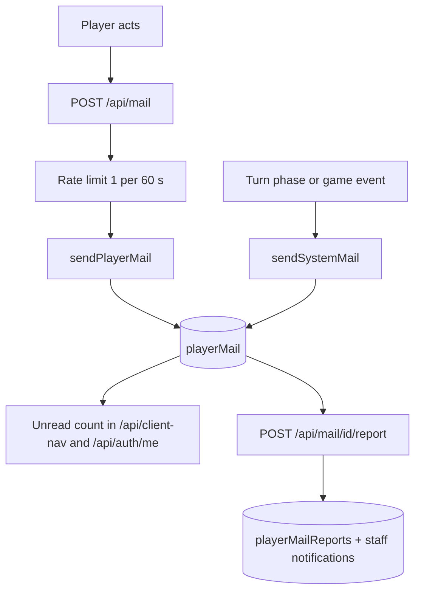

# Player Mail

In-game messaging between player characters. Players can send, receive, and report mail from character profile pages and the Notifications page. Game systems (forex notices, loan decisions, party whips) also deliver system mail into the same inbox.

## Summary

Mail is private one-to-one messaging with a subject and body. It is request driven, not part of the turn processor. Each message is one `playerMail` document with two independent soft-delete flags. A recipient can report a message, which writes a `playerMailReports` document holding a snapshot of the text for moderators.

Player guide: [Mail](https://www.ahousedividedgame.com/wiki/mail)

## Rules

### Sending Mail

- **Access**: Click "Send Mail" on any character's profile page, which opens the Mail Composer Modal
- **Fields**: Subject 1 to 80 chars, body 1 to 1000 chars (`sendMailSchema` in `src/app/api/mail/route.ts`)
- **Rate limit**: 1 message per 60 seconds per sending character, in-memory limiter keyed `api/mail:<characterId>` (`src/app/api/mail/route.ts`, `checkRateLimit` in `src/lib/api/rateLimit.ts`). It exists to stop flooding.
- **Requirement**: Both sender and recipient must have characters (`requireAuthWithCharacter`; the recipient is looked up by `toCharacterId`)
- **Refused sends** (`sendPlayerMail` in `src/lib/mail/commands/playerMail.ts`): mailing yourself (400), subject or body that trips the slur filter `containsSlur` (400), unknown recipient (404), and a recipient who is banned or has blocked the sender (400, with the same message in both cases so a blocked sender is not told)

### Inbox and Sent Box

The Mail tab on the Notifications page (`/notifications`) provides two views:

- **Inbox**: All received mail, newest first. Unread messages highlighted. Expanding a message auto-marks it as read.
- **Sent**: All sent mail, newest first. Senders can delete their copy independently.

The client groups inbox and sent mail into threads keyed by counterpart and subject with any leading `Re:` prefixes stripped (`groupMailIntoThreads` and `normalizeMailSubject` in `src/lib/inbox/mailThreads.ts`).

Both views are paginated via the API: default 20 per page, maximum 50, minimum 1, offset floored at 0 (`src/app/api/mail/route.ts`, `src/app/api/mail/sent/route.ts`). Mail from a sender the recipient has blocked is hidden from the inbox while the block lasts (`blockedByRecipient` flag, set and cleared by `blockPlayer` and `unblockPlayer` in `src/lib/safety/playerSafety.ts`; a player can block up to `MAX_BLOCKED_USERS` = 500 users).

System mail (`sendSystemMail` in `src/lib/mail/systemMail.ts`) has no sender character, defaults the sender name to "Forex Market", and cannot be replied to or deleted from a sent box because it has none.

### Unread Count

Unread mail count is returned by both `/api/client-nav` and `/api/auth/me` as `unreadMailCount`. The navbar badge combines unread notifications + unread mail into a single count. The count is `toUserId` = viewer, `read: false`, `deletedByRecipient: false`, `blockedByRecipient` not true.

### Deletion

Mail uses **dual-sided soft-delete**:

- Recipient deletes → sets `deletedByRecipient: true`; mail disappears from their inbox but remains in sender's sent box
- Sender deletes → sets `deletedBySender: true`; mail disappears from their sent box but remains in recipient's inbox
- When the second side deletes, the document is hard-deleted at once (`deleteReceivedMail` and `deleteSentMail` in `src/lib/mail/commands/playerMail.ts`). An admin "Delete" action hard-deletes immediately regardless of flags.

Mark-read and both delete routes are limited to 30 requests per minute per user (`src/app/api/mail/[id]/route.ts`, `src/app/api/mail/sent/[id]/route.ts`).

### Reporting

Any received message that the recipient has not deleted can be reported for abuse. Reports go to the staff mail reports queue.

- **Player action**: "Report" button on expanded inbox messages
- **Creates**: `PlayerMailReport` document with status `"pending"` and a `mailSnapshot` copy of the message, so the report survives if both sides later delete the mail or a world reset drops `playerMail`
- **One report per mail**: Duplicate reports on the same message are rejected with 409
- **Rate limit**: 10 reports per minute per user (`src/app/api/mail/[id]/report/route.ts`)
- **Notification**: every admin and moderator receives a "New Mail Report" system notification
- **No block or mute from mail alone**: stopping a sender is done with the player block list (see above), which also hides existing mail from that sender

### Admin Mail Reports

Mail Reports tab in the admin or moderator panel (routes use `requireModerator`, so moderators and admins both have access). Filterable by status: pending, dismissed, actioned; the list is newest first, default 20 per page, maximum 50 (`src/app/api/admin/mail-reports/route.ts`). The detail view loads the full conversation thread (`src/lib/mail/queries/mailReportDetail.ts`).

Each report shows the full message body, sender/recipient links, and four actions. The API action names are `dismiss`, `delete_mail`, `warn`, `ban` (`src/app/api/admin/mail-reports/[id]/route.ts`):

| Action      | API value     | Effect                                                       |
| ----------- | ------------- | ------------------------------------------------------------ |
| **Dismiss** | `dismiss`     | Sets status to `"dismissed"`; no player impact               |
| **Delete**  | `delete_mail` | Hard-deletes the mail document; sets status to `"actioned"`  |
| **Warn**    | `warn`        | Sends a system notification to the sender; sets `"actioned"` |
| **Ban**     | `ban`         | Bans the sender's user account; sets `"actioned"`            |

All actions accept an optional admin note (max 500 chars). Ban stores the note as `banReason` (default "Banned via mail moderation"), records the CEO corporations for share release, withdraws the user's candidacies, and cleans up party elections, leadership and membership.

### Shareholder Address

CEOs can broadcast a message to all current shareholders of their corporation.

- **Access**: Corporation page > CEO Office > Admin subtab
- **Cooldown**: 12 hours per corporation, `SHAREHOLDER_ADDRESS_COOLDOWN_MS` in `src/app/api/corporations/[id]/shareholder-address/route.ts` (enforced via `lastShareholderAddressAt` on the `Corporation` document)
- **Limits**: body 1 to 1000 chars; only the corporation's CEO may send it (same file)
- **Delivery**: Sent as system notifications (not mail) to each shareholder with shares above zero, so it never appears in the Mail inbox and cannot be reported through the mail flow. The cooldown starts when the request is accepted, even if there are no shareholders to notify.
- **Composer**: Uses the same Mail Composer Modal in `shareholder-address` mode

### API Routes

| Method   | Path                           | Description                            |
| -------- | ------------------------------ | -------------------------------------- |
| `GET`    | `/api/mail`                    | Inbox (paginated, excludes deleted and blocked) |
| `POST`   | `/api/mail`                    | Send mail (rate-limited 1/min)         |
| `PATCH`  | `/api/mail/[id]`               | Mark as read                           |
| `DELETE` | `/api/mail/[id]`               | Soft-delete from inbox                 |
| `GET`    | `/api/mail/sent`               | Sent box (paginated, excludes deleted) |
| `DELETE` | `/api/mail/sent/[id]`          | Soft-delete from sent box              |
| `POST`   | `/api/mail/[id]/report`        | Report a message for abuse             |
| `GET`    | `/api/admin/mail-reports`      | List reports (filterable by status)    |
| `GET`    | `/api/admin/mail-reports/[id]` | Report detail with conversation thread |
| `PATCH`  | `/api/admin/mail-reports/[id]` | Admin action (dismiss/delete_mail/warn/ban) |
| `POST`   | `/api/corporations/[id]/shareholder-address` | CEO broadcast (notifications, not mail) |

### Constants

| Constant | Value | Source |
| --- | --- | --- |
| Subject length | 1 to 80 | `sendMailSchema`, `src/app/api/mail/route.ts` |
| Body length | 1 to 1000 | `sendMailSchema`, `src/app/api/mail/route.ts` |
| Send rate | 1 per 60,000 ms per character | `src/app/api/mail/route.ts` |
| Page size default / max | 20 / 50 | `src/app/api/mail/route.ts`, `src/app/api/mail/sent/route.ts` |
| Report rate | 10 per 60,000 ms per user | `src/app/api/mail/[id]/report/route.ts` |
| Read and delete rate | 30 per 60,000 ms per user | `src/app/api/mail/[id]/route.ts`, `src/app/api/mail/sent/[id]/route.ts` |
| `MAX_BLOCKED_USERS` | 500 | `src/lib/safety/playerSafety.ts` |
| Admin note | max 500 | `mailReportActionSchema`, `src/app/api/admin/mail-reports/[id]/route.ts` |
| Default system sender | "Forex Market" | `src/lib/mail/systemMail.ts` |
| Welcome mail sender / subject | "Game Guide" / "Your first moves" | `src/lib/onboarding/welcomeMail.ts` |
| Shareholder address cooldown | 12 hours | `src/app/api/corporations/[id]/shareholder-address/route.ts` |

## Data

### `playerMail` collection

Written by `sendPlayerMail` and `sendSystemMail`/`sendSystemMails` (`src/lib/mail/`), plus two direct inserts for currency trade offers in `src/app/api/forex/direct/route.ts` and `src/app/api/forex/direct/[requestId]/route.ts`. Type: `src/lib/db/types/playerMail.ts`. All fields are visible to the two parties through `serializePlayerMail` (`src/lib/mail/dto/playerMailView.ts`), which turns ids into strings and `createdAt` into an ISO string; staff see the same fields in the report detail view.

| Field                       | Type       | Description                   |
| --------------------------- | ---------- | ----------------------------- |
| `_id`                       | `ObjectId` | Document ID                   |
| `fromCharacterId`           | `ObjectId?` | Sender character; absent on system mail |
| `fromCharacterName`         | `string`   | Sender display name           |
| `fromCharacterSequentialId` | `number?`  | Sender sequential ID; absent on system mail |
| `toUserId`                  | `ObjectId` | Recipient user                |
| `toCharacterId`             | `ObjectId` | Recipient character           |
| `toCharacterName`           | `string`   | Recipient display name        |
| `toCharacterSequentialId`   | `number`   | Recipient sequential ID       |
| `subject`                   | `string`   | Subject line (max 80 chars)   |
| `body`                      | `string`   | Message body (max 1000 chars) |
| `read`                      | `boolean`  | Has recipient read it         |
| `deletedByRecipient`        | `boolean`  | Recipient soft-delete flag    |
| `deletedBySender`           | `boolean`  | Sender soft-delete flag       |
| `blockedByRecipient`        | `boolean?` | Set while the recipient has the sender blocked; hides it from the inbox and unread counts |
| `createdAt`                 | `Date`     | Send timestamp                |

The index `playerMail_toUserId_read_deleted` on `{ toUserId, read, deletedByRecipient }` serves the unread count that runs on every `/api/auth/me` call (`src/lib/admin/seed/indexes/performance.ts`).

### `playerMailReports` collection

Written by `reportReceivedMail` and the admin PATCH route. Not shown to players; read by moderators.

| Field               | Type        | Description                 |
| ------------------- | ----------- | --------------------------- |
| `_id`               | `ObjectId`  | Document ID                 |
| `mailId`            | `ObjectId`  | Reference to reported mail  |
| `mailSnapshot`      | `object?`   | Copy of the message at report time (absent on reports filed before snapshots existed) |
| `reportedByUserId`  | `ObjectId`  | User who filed the report   |
| `status`            | `string`    | `"pending"`, `"dismissed"` or `"actioned"` |
| `adminNote`         | `string?`   | Admin notes (max 500 chars) |
| `reviewedAt`        | `Date?`     | When admin reviewed         |
| `reviewedByAdminId` | `ObjectId?` | Admin who reviewed          |
| `createdAt`         | `Date`      | Report timestamp            |

### Other documents touched

| Collection | Field | Access |
| --- | --- | --- |
| `users` | `blockedUserIds`, `isBanned` | Read on send (`sendPlayerMail`); `blockedUserIds` written by `blockPlayer` and `unblockPlayer`; ban fields written by the admin `ban` action |
| `characters` | `userId`, `name`, `sequentialId` | Read to resolve the recipient and the report sender |
| `corporations` | `lastShareholderAddressAt`, `shareholders` | Shareholder address cooldown and recipients |
| `notifications` | system rows | Staff "New Mail Report", sender "Warning from Admin", shareholder address |

## Configuration

Mail has no `gameConfig` field, era preset or country preset. Every limit above is a code constant. The settings that change behaviour:

| Setting | Default | Where | Effect |
| --- | --- | --- | --- |
| `onboardingChecklistEnabled` on the `gameState` singleton | `true` in fresh worlds, fail-closed (only an explicit `true` enables it) | `src/lib/onboarding/featureFlag.ts`, seeded by `src/lib/seeds/reference/featureFlagDefaults.ts`, flipped from the admin Feature Gates panel | Controls whether a welcome system mail ("Game Guide") is sent at character creation (`src/app/api/auth/character/route.ts`) |
| Player block list | empty | `users.blockedUserIds`, cap `MAX_BLOCKED_USERS` | Hides and refuses mail from blocked users |
| User ban | false | `users.isBanned` | Banned recipients refuse mail |

The in-memory rate limiter is per server process, so its counters reset on restart and are not shared between instances.

## Timing

Mail is not part of the turn processor. Everything is request driven: sending, reading, deleting and reporting run when the player acts. The turn-time and event writers of system mail are listed below; each inserts through `sendSystemMail` or `sendSystemMails` during its own phase or request.

| Sender name | Trigger | Source |
| --- | --- | --- |
| Forex Market | "FX Intervention Failure" to a central bank chair when reserves cannot defend a currency commitment, during the forex turn phase | `src/lib/turn/forexTurn.ts` |
| Forex Market | "Limit Order Filled" when a limit order fills | `src/lib/turn/forexLimitOrders.ts` |
| The bank's name | Loan approval decisions | `src/lib/banking/loanApproval.ts` |
| Game Guide | Character creation, if the onboarding checklist flag is on | `src/app/api/auth/character/route.ts` |
| Party Whip | Hard whip issued to a party's members | `src/app/api/country/[code]/parties/[id]/whip/route.ts` |
| `<caucus name> Caucus` | Hard whip issued by a caucus | `src/app/api/country/[code]/parties/[id]/caucuses/[slug]/whip/route.ts` |
| IMF Restructuring | Bondholder haircut in an IMF bailout | `src/app/api/admin/corporations/[id]/imf-bailout/route.ts` |

Currency trade offers (`src/app/api/forex/direct/route.ts`) are inserted directly as player-style mail from the proposing character, not through `sendSystemMail`.

Unread counts are computed on each `/api/client-nav` and `/api/auth/me` call, not cached.

## Worked trace

Character A (user UA) mails character B (user UB). B has 45 inbox rows, 12 of them unread, and has not blocked A.

1. A submits subject "Joint fundraiser, Saturday" (26 chars) and a 200 char body. Both fall inside 1 to 80 and 1 to 1000, so `sendMailSchema` passes.
2. The limiter key `api/mail:<A>` is new: count 1, `1 > 1` is false, so the send proceeds and the window resets at now + 60,000 ms.
3. `sendPlayerMail`: recipient differs from sender, `containsSlur` is false, B's character exists, B is not banned and A is not in `blockedUserIds`. One `playerMail` row is inserted with `read: false`, `deletedByRecipient: false`, `deletedBySender: false`, `createdAt` now.
4. At t = 20 s A tries again: count becomes 2, `2 > 1`, so the route returns 429 with `retryAfter = ceil((60,000 - 20,000) / 1000) = 40` seconds. The slot is consumed before `sendPlayerMail` runs, so a send refused later (for instance by the slur filter) still uses up the minute.
5. B now has 46 inbox rows and 13 unread. `GET /api/mail?offset=0&limit=20` returns 20 rows, `total` 46, `unreadCount` 13, and `hasMore` is true because `0 + 20 < 46`. A request with `limit=200` is clamped to 50; `limit=0` becomes 1; `limit=abc` falls back to 20.
6. B deletes the message: `deletedByRecipient` becomes true, `deletedBySender` is false, so the row stays and A's sent box still shows it.
7. A deletes the sent copy: `deleteSentMail` reads the row (`deletedByRecipient` true), sets `deletedBySender` true, and because the other side had already deleted it, calls `deleteOne`. The document is gone.

Block variant: if B had blocked A before step 1, step 3 throws 400 "Cannot send mail to this player", the same text a banned recipient produces. If B blocks A after step 3, `setMailHiddenFrom` sets `blockedByRecipient: true` on every row from A's characters to B, so B's inbox total falls and the unread count drops by the unread rows from A. Unblocking unsets the flag and the rows return.

## Edge cases and limits

- **No block inside mail, but a global block list exists.** Blocking a user hides their mail and rejects new sends from them. Mail the blocked user already sent stays stored.
- **Offline recipients.** Mail is stored until read; there is no expiry and no retention limit in code.
- **Reported mail.** The report holds a snapshot of the reported message, and the detail view loads the surrounding thread, so staff see context. If the live message is gone, the list and detail views fall back to the snapshot and mark the message deleted.
- **Banned recipient.** Sending to a banned user is refused.
- **Retired characters and NPPs.** `sendPlayerMail` has no explicit check for either; it refuses only when no `characters` row matches `toCharacterId` (404). NPPs are not characters, so they cannot be addressed.
- **Mail and world resets.** `playerMail` is world state and is dropped on reset; report snapshots outlive it.
- **System mail.** No sender character, so no sent-box copy and no reply target. It can still be reported by its recipient.
- **Warn or ban after the mail is gone.** Both actions look up the live mail document for the sender; if it was already hard-deleted, nothing happens to the sender, but the report is still marked `"actioned"`. The snapshot is not used to find the sender.
- **Warn or ban on system mail.** There is no `fromCharacterId`, so no sender is resolved and the report is marked `"actioned"` with no player effect.
- **Pagination bounds.** Offset below 0 becomes 0; unparsable offset or limit use 0 and 20.
- **Rate limit window.** Fixed window, not sliding: the first send opens a 60 s window and any second attempt inside it is refused.

## Invariants

| Invariant | Enforcement |
| --- | --- |
| A message is hard-deleted exactly when both `deletedByRecipient` and `deletedBySender` are true, or an admin deletes it | Code in `deleteReceivedMail` and `deleteSentMail`; no dedicated test |
| A message has at most one report | `reportReceivedMail` checks for an existing report by `mailId` (409). There is no unique index, so two simultaneous reports could both pass; not enforced at the database |
| A report keeps a copy of the message text it was filed on | `reportReceivedMail` writes `mailSnapshot`; covered by `src/lib/mail/commands/playerMail.test.ts` |
| Messages containing slurs are never stored from the player send path | Filter runs before any database write; covered by `src/lib/mail/commands/playerMail.test.ts` |
| A blocked sender's mail is absent from the inbox and unread count, and the block cannot be detected by the sender | `src/lib/safety/playerSafety.mongo.test.ts` ("hides existing mail, refuses new mail, and restores on unblock") |
| The block list never exceeds 500 | Atomic filtered update in `blockPlayer`; `src/lib/safety/playerSafety.mongo.test.ts` |
| System mail has no sender id | `sendSystemMail` omits `fromCharacterId`; `src/lib/mail/systemMail.test.ts` |
| Pending reports survive a world reset | `playerMailReports` is in the preserved seed manifest (`src/lib/admin/seed/seedManifestPreserved.ts`, `src/lib/admin/seed/seedManifest.test.ts`) |

## Failure and recovery

- **Send refused with 429.** The in-memory limiter was hit. It clears on its own after the window; a server restart also resets it.
- **Unread badge wrong.** The count queries filter on `blockedByRecipient` and `deletedByRecipient`. The player-info panel in `src/app/api/pip/standard/route.ts` counts unread mail without the `blockedByRecipient` filter, so it can show a higher number than the navbar after a block (see Known issues).
- **Mail missing after a block or unblock.** The flag is set or unset in bulk when the block list changes. If it drifts, the rows are still stored; a repair is a data fix that resets `blockedByRecipient` to match `users.blockedUserIds`.
- **Report cannot find its message.** The detail view falls back to the snapshot. Reports filed before snapshots existed show the message as deleted with no text.
- **A bulk system mail insert fails.** The hard-whip routes catch the error and carry on with notifications; recipients then get the notification but no mail. There is no retry.
- **Welcome mail missing.** It is best-effort and wrapped in a try/catch at character creation; when the checklist flag is off it is never sent. It is not resent.

## Connections

- **Driven by:** forex notices and loan decisions (`sendSystemMail` callers in `src/lib/turn/` and `src/lib/banking/`), party and caucus hard whips, IMF bailouts, character creation (welcome mail), currency trade offers (`src/app/api/forex/direct/route.ts`), and the player block list (`src/lib/safety/playerSafety.ts`).
- **Affects:** the navbar unread badge (`unreadMailCount` in `src/app/api/client-nav/route.ts`) and the moderation queue and ban flow (`src/app/api/admin/mail-reports/[id]/route.ts`).
- [Getting Started](./getting-started.md) - Overview of player features
- [Corporations](./corporations.md) - Shareholder Address feature
- [Core Systems](./core-systems.md) - News system (similar player-content system)

## Tests

| File | Covers |
| --- | --- |
| `src/app/api/mail/route.test.ts` | Inbox and send routes, including the 429 path |
| `src/app/api/mail/[id]/route.test.ts` | Mark read and delete |
| `src/app/api/mail/[id]/report/route.test.ts` | Report route |
| `src/app/api/mail/sent/route.test.ts` | Sent box |
| `src/app/api/mail/sent/[id]/route.test.ts` | Sent-box delete |
| `src/lib/mail/commands/playerMail.test.ts` | Report snapshot, slur refusal |
| `src/lib/mail/systemMail.test.ts` | Bulk system mail, empty batch |
| `src/lib/mail/queries/mailReportDetail.test.ts` | Snapshot fallback in the report detail view |
| `src/app/api/admin/mail-reports/route.test.ts` | Report list |
| `src/lib/safety/playerSafety.mongo.test.ts` | Block hides and restores mail, block cap |
| `src/app/api/client-nav/route.test.ts` | Unread mail count in navbar data |

Gaps: no test for the admin action route (`PATCH /api/admin/mail-reports/[id]`), no test for the shareholder address route, and none for the duplicate-report race.

## Known issues and history

- `src/app/api/pip/standard/route.ts` counts unread mail without the `blockedByRecipient` filter, unlike `/api/client-nav` and `/api/auth/me`.
- Currency trade offer mail (`src/app/api/forex/direct/route.ts`) is inserted directly, so it skips the send rate limit, the slur filter and the block check. Its text is system-generated, but it appears from a player character, so a blocked player's offer is not refused at this step.
- The `warn` and `ban` report actions need the live mail row; a report on mail already deleted by both sides cannot be actioned against the sender (see Edge cases).
- The rate limiter is in-memory and per process.
- Mail reports keep a message snapshot so that a world reset or double deletion no longer erases moderation evidence; reports filed before that change have no snapshot.
- Check against the player wiki page (version 1.18.0): the wiki says retired characters cannot be mailed; the code has no explicit check for that (see Edge cases).

Last checked: 2026-10-29, version 1.18.0
