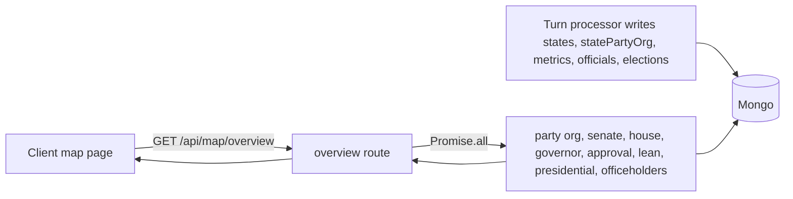

# Map Services

## Summary

The Map Services layer provides data for political map visualizations across all countries. Services compute party control, lean metrics, and approval ratings for display on interactive maps.

This is a developer-facing service document. No player wiki page covers it; players see its output as the map overlays. There is therefore no Player guide link.

**Location:** `src/lib/map/`

**Key files:**

- `houseService.ts` - House/Commons party control by state/region
- `senateService.ts` - Senate seats by state
- `governorService.ts` - Governor party by state
- `presidentialService.ts` - Presidential election results
- `leanService.ts` - Political lean (economic/social) by state
- `partyOrgService.ts` - Party organization strength
- `approvalService.ts` - Government approval ratings
- `officeholderService.ts` - Seated officeholders (portraits, chamber breakdowns) for the atlas
- `rosterService.ts` - Region roster (id, name, seats, grouping, population) derived live from `states`
- `metricsService.ts` - US state indicators (GDP, per capita and policy scores) for the metrics map
- `overviewTypes.ts`, `metricTypes.ts` - Response types for the routes below

## Rules

### House Service

#### `computeHouseMap(db, countryId)`

**Purpose:** Compute party control of House/Commons seats by state/region.

**Returns:**

```typescript
interface MapHouseState {
  leadingParty: string;
  leadColor: string;
  seats: number;
  total: number;
  tooltip: string[];
}
```

**Logic:**

1. Resolve the lower-chamber office type via `getLowerChamberOfficeType(countryId)` (`src/lib/legislature/chamberOfficeType.ts`). US is `house`, UK is `commons`, DE is `bundestag`, JP is `shugiin`, CN is `npcDelegate`, and other countries follow their `legislature.lowerChamber` mapping.
2. Fetch elected officials with that `officeType`
3. Group by state/region
4. Count seats per party, using `seatsHeld ?? 1` per official, with a missing party counted as `"independent"`
5. Determine leading party (most seats)
6. Build tooltip with full breakdown

**Ties:** when the runner-up has the same seat count as the leader (`runnerUp === topSeats`), the state is a tied delegation. `leadingParty` is `""`, `leadColor` is `VACANT_COLOR` (`#334155`) and the first tooltip line reads `Tied delegation: A and B at N seats` (a comma list for three or more parties). A tie is rendered neutral rather than giving an arbitrary party the state.

**Country Handling:**

- UK still has a dedicated Commons region builder (`buildCommonsUK`) after the office-type lookup. It walks every region in `UK_REGIONS` (`src/lib/constants/uk.ts`) and returns an entry even with no MPs: `leadingParty` `""`, `seats` 0, `total` the region's `constituencies`, tooltip "No MPs elected yet".
- Every other country uses the generic `buildHouseOrCommons` path, which only emits states that have at least one seated official.
- Senate (`officeType: "senate"`) and governor (`officeType: "governor"`) maps are still US-office-key queries; they do not go through the chamber-office helper

**Tooltip Format:**

```
Party Name: X / total seats
Lead: +Y
Party1: N seats
Party2: N seats
...
```

The `Lead` line is omitted when there is no runner-up. UK tooltips start with the region name and say `MPs` instead of `seats`.

**Color Mapping** (`DEFAULT_COLORS` and `partyColor` in `src/lib/map/houseService.ts`; the same table is duplicated in `senateService.ts`, `governorService.ts`, `presidentialService.ts` and `partyOrgService.ts`, so a change must be made in all five). A vacant seat uses `VACANT_COLOR` `#334155`.

```typescript
DEFAULT_COLORS = {
  democrat: "#3B82F6", // Blue
  republican: "#EF4444", // Red
  independent: "#9CA3AF", // Gray
  LAB: "#E4003B", // Labour Red
  CON: "#0087DC", // Conservative Blue
  LD: "#FAA61A", // LibDem Orange
  SNP: "#FFF95D", // SNP Yellow
  PC: "#3F8428", // Plaid Cymru Green
  GREEN: "#02A95B", // Green
  REF: "#12B6CF", // Reform UK Cyan
};
```

### Senate Service

#### `computeSenateMap(db, countryId)`

**Purpose:** Compute Senate seat holders by state.

**Returns:**

```typescript
interface MapSenateState {
  seat1: MapSenateSeat | null;
  seat2: MapSenateSeat | null;
}

interface MapSenateSeat {
  party: string;
  color: string;
  name: string;
}
```

**Logic:**

1. Fetch all elected officials with `officeType = "senate"` (also used for JP, BR and NG in the overview route)
2. Sort by state, then senate class (`sort({ state: 1, senateClass: 1 })`)
3. Assign `seat1` to the first row of each state and `seat2` to the second, in that sorted order. The code does not read the class value to choose a slot, so a state whose class values are missing or both equal still fills seat1 then seat2.
4. Return per-state breakdown

A seat row with no seated character (`characterName` empty) returns `null` (rendered in the shared vacant colour `#334155`), not "independent". A third row for the same state is ignored.

**Note:** UK does not have an elected upper house (Lords are appointed), so the UK overview does not call this service.

### Lean Service

#### `computeLeanMap(db, countryId)`

**Purpose:** Compute political lean metrics by state/region.

**Returns:**

```typescript
interface MapLeanState {
  economicLean: number;
  socialLean: number;
  displayLean: number;
  color: string;
  label: string;
  tooltip: string[];
  economicColor: string;
  economicLabel: string;
  socialColor: string;
  socialLabel: string;
}
```

**Lean Calculation:**

```typescript
// 1. Cached state values win when both are set
economicLean = state.cachedEconomicLean;
socialLean = state.cachedSocialLean;

// 2. Otherwise compute from demographics if available
const c = calculateStateLean(demo, demographicCategories);
economicLean = c.economicLean;
socialLean = c.socialLean;

// 3. Otherwise fall back to 2020 election data (US path only, else 0)
const margin = ELECTION_2020_MARGIN[stateId];
const lean = margin !== undefined ? marginToLean(margin) : 0;
```

`marginToLean(margin) = clamp(round(-margin / 10, 2 dp), -5, +5)` (`src/lib/data/2020ElectionResults.ts`), so a +40 Biden margin gives -4 and a -40 margin gives +4. Both economic and social lean take the same value in step 3.

**Display Lean:**

```typescript
displayLean = getDisplayLean(economicLean, socialLean);
// Combines economic and social into single political lean
```

`getDisplayLean` (`src/lib/utils/demographics.ts`): if both leans share a sign (zero counts as positive), the result is their mean rounded to 2 decimals; if the signs differ, the result is whichever lean has the larger absolute value (economic wins a tie in magnitude), rounded to 2 decimals.

**Tooltip Format (US):**

```
State Name
Political Lean: label
Economic: +X.XX · Social: +X.XX
From demographics (weighted avg)
```

The last line is fixed text and is shown even when the value came from the cache or the 2020 fallback.

**UK Handling:**

- Used for UK and DE (`countryId === UK || DE` selects `buildLeanUK`). Every other country, including JP, BR, CN and NG, uses the US builder.
- Uses same calculation but different color hex functions (`getUkEconomicLeanLabelHex` for the combined and economic colours, and for the social colour)
- No 2020 election fallback (uses 0/neutral default)
- The tooltip has only the first three lines, without the "From demographics" footer

### Governor Service

#### `computeGovernorMap(db, countryId)`

**Purpose:** Compute governor party by state.

**Inputs:** `electedOfficials` with `officeType = "governor"` (country-filtered in memory) and `politicalParties`.

**Returns:** `MapGovernorState` keyed by state: `leadingParty`, `leadColor`, `governorName` (`"Vacant"` when no character is seated) and a one-line `tooltip`. Unlike the senate map, a governor row with no `characterName` is still returned, with the row's party colour and the name `"Vacant"`. If two rows exist for one state the later row overwrites the earlier.

### Presidential Service

#### `computePresidentialMap(db, countryId)`

**Purpose:** Compute presidential election results by state.

**Inputs:** the most recently updated national election (`elections` with `state = countryId`, status active, upcoming, completed or resolved, sorted by `updatedAt` descending), its vote tallies (`electionVoteTallies`), candidates (`electionCandidates` with status active or withdrawn), `states`, `politicalParties`, and the live apportionment (`loadApportionment` in `src/lib/elections/apportionment.ts`).

**Returns:** per-state `MapPresidentialState` (`leadingParty`, `leadColor`, `candidateName`, `ev`, `tooltip`), plus optional electoral-vote, candidate name, party and colour maps and `totalElectoralVotes`. With no national election the maps come back empty and the panel assumes 538.

**Two paths**, chosen by whether `totalVotesByUnit` has any unit with a positive vote:

1. *Unit votes present.* For each electoral-vote unit in `evUnits`, the candidate with the most votes in that unit wins that unit's `ev` (units are states, or the Maine and Nebraska congressional splits). Per state, EV is summed by candidate, the candidate with the most EV is shown as the state's leader, and the tooltip lists EV per candidate and then each candidate's vote count and percentage (one decimal). National EV per candidate is the sum over states.
2. *Only national totals.* The national vote share is converted to a projected EV split: for candidates sorted by votes, `ev = round(share * totalElectoralVotes)`, and the last candidate receives whatever remains (`remaining`), floored at 0. States are then handed out in descending EV size to the candidates in descending EV order until each candidate's EV is covered. Tooltips read `(projected from national vote)`. This is a display estimate, not a result.

`totalElectoralVotes` is the sum of `ev` over the live apportionment units: 538 for the current 50-state set and fewer in earlier eras. The panel derives its "to win" threshold from this value.

Candidate colour comes from `candidateParties[candidateId]` (a party `sequentialId` string) looked up in the party colour map; the client cannot resolve those ids itself, so the server returns `presidentialCandidateColors`.

### Party Org Service

#### `computePartyOrgMap(db, countryId)`

**Purpose:** Compute party organization strength by state.

**Inputs:** `statePartyOrg` records for the country and `politicalParties`. Only parties matched by `sequentialId` count; old slug-based party ids are stale data and are ignored.

**Returns:** per region `MapPartyOrgState`: `leadingParty`, `leadingPartyName`, `leadColor`, `organization` and `tooltip`. A region whose top organisation value is 0, or which has no records, is omitted from the result and the client paints it with the vacant colour `#334155`. The tooltip shows the leader and its lead over the runner-up (`organization` difference, 0 decimals), then up to the top four parties with organisation above 0. UK uses a dedicated builder that walks `UK_REGIONS` but applies the same rule.

### Approval Service

#### `computeApprovalMap(db, countryId)`

**Purpose:** Compute government approval ratings by state.

**Inputs:** merged regional metrics (`findMergedRegionMetricsMany`), `states`, electorate groups, and the era context (`getEraContext`), so the heatmap matches the approval shown on the region page under any era preset. Countries with political approval (`isPoliticalApprovalCountry`) use the hybrid political base from `loadPoliticalApprovalBases`, falling back to `BASE_APPROVAL` (50, `src/lib/utils/governmentApproval.ts`) for a region with no base.

**National averages:** for each of ten metric categories (economic, education, healthcare, infrastructure, publicSafety, environment, social, governance, population, mediaInformation) the average of each metric across all regions with a value is passed to `calculateStateApproval` as the comparison point.

**Returns:** per region `MapApprovalState` (`approval`, `color`, `tooltip`). The colour is a linear blend from `#dc2626` at 0 to `#22c55e` at 100 (`approvalToHeatColor` in `src/lib/map/approvalService.ts`); approval is clamped to 0 to 100 for colour only. Each RGB channel is `round(c1 + (c2 - c1) * approval / 100)`. The formula itself is in [Government Approval](./government-approval.md).

### Officeholder, Roster and Metrics Services

- `computeMapOfficeholders(db, countryId, regionIds)` returns seated senate, house and governor holders per region as `MapOfficeholder` (name, office, party, colour, avatar, seats). Vacant seats are excluded (a row needs a `characterId` or `nppId`); multi-seat delegations keep their seat count (`seatsHeld ?? 1`). Portraits come from `characters.avatarUrl` or `npps.avatarUrl`. The party is matched by `sequentialId` or by a case-insensitive name. For the US, rows without a `countryId` count as US. Note this service queries the literal office types `senate`, `house` and `governor`, not the chamber-office helper.
- `buildRegionRoster` (`rosterService.ts`) builds the nation map's region list from the country's live `states`, sorted by name with `localeCompare`; `seats` is `houseDistricts ?? 0`. For the US, `filterPoliticalUsRoster` drops non-political regions (unadmitted territories under early eras, DC) so a 1953 world shows 48 states.
- `loadMapMetrics(db, politicalIds)` (`metricsService.ts`) returns current US state indicators with their own prefix, suffix and decimals. It is US only. Monetary stocks (`gdp`, `capitalStock`) are stored in millions and multiplied by 1,000,000; GDP per capita is `gdp * 1,000,000 / population` and is omitted when population is 0 or GDP is missing. A metric appears in `definitions` only if at least one state has a finite value, so the response never contains invented zeros. Three sources feed it: `states` (stocks), `macroMetrics` (economic, population, governance) and `politicalMetrics` (scores shown as "/ 100").

### Country Safety

All services use country-aware filtering:

```typescript
// Query without countryId filter (older records may not have it)
const allReps = await db
  .collection<ElectedOfficial>("electedOfficials")
  .find({ officeType })
  .toArray();

// Filter results by countryId field
const reps = allReps.filter((r) => r.state && (r.countryId ?? "US") === countryId);
```

**Rationale:** Historical records may lack `countryId` field; filtering in-memory ensures correctness.

### Color System

Colors are defined in `DEFAULT_COLORS` with fallbacks:

```typescript
function partyColor(partyId: string, storedColor?: string): string {
  return DEFAULT_COLORS[partyId] ?? storedColor ?? "#8B5CF6"; // Purple fallback
}
```

**Party-specific colors:**

- US: democrat (blue), republican (red), independent (gray)
- UK: LAB (red), CON (blue), LD (orange), SNP (yellow), etc.

In practice every service builds its colour map keyed by `String(party.sequentialId)` (for example `"12"`), so the `DEFAULT_COLORS` slug keys do not match and the party's stored `color` is what paints the map. The slug table applies only to a row whose party id is literally `independent` (the fallback for a missing party), and to any legacy slug ids. See Known issues.

### Integration Points

#### Map Components

Map services are called from client components:

```typescript
// Client-side fetch
const response = await fetch(`/api/map/overview?countryId=${countryId}`);
const data = await response.json();
```

The client (`src/app/country/[code]/map/CountryMapClient.tsx`) fetches once per mount with an abort signal, shows a loading state, and offers a retry on error.

#### API Routes

Map services are exposed via API routes:

```typescript
GET /api/map/overview?countryId=US
GET /api/map/metrics?countryId=US
GET /api/map/logistics?countryId=US
GET /api/map/resources?countryId=US&resource=oil
```

| Route | Backed by | Notes |
| --- | --- | --- |
| `/api/map/overview` | All services above | Public. Defaults to `US`; unknown country is 400. Each country has its own branch (US adds senate, governor, presidential, officeholders and electoral votes; UK, DE, JP, BR, CN and NG call a subset). Other valid countries return empty overlay maps with only `sectorSpecializations` and `regions`. |
| `/api/map/metrics` | `metricsService.ts` | US only (400 otherwise); `Cache-Control: no-store`. |
| `/api/map/logistics` | `sourcingNetworkLoad`, `CommodityPrice.stateSupply` and `unownedSectors` | Freight capacity vs projected haul TEUs per state, plus open logistics market revenue. `countryId` is required. |
| `/api/map/resources` | `stateResourceCapacity` and active extraction contracts | Needs a valid `resource`; returns capacity and contracted share per state. |

There are no per-chamber routes (`/api/map/house`, `/senate`, `/lean`); chambers are fields of the overview response.

Per-country shape of `/api/map/overview` (`src/app/api/map/overview/route.ts`):

| Country | Fields filled |
| --- | --- |
| US | partyOrg, senate, house, governor, approval, lean, presidential (+ electoral vote maps, `totalElectoralVotes`), `electoralVotesByState`, officeholders, sectorSpecializations, regions |
| UK | partyOrg, `commons` (house is `{}`), approval, lean, sectorSpecializations, regions |
| DE, CN | partyOrg, house, approval, lean, sectorSpecializations, regions |
| JP, NG | partyOrg, house, senate, governor, approval, lean, sectorSpecializations, regions |
| BR | partyOrg, house, senate, approval, lean, sectorSpecializations, regions |
| any other valid country | sectorSpecializations, regions only |

The overview also returns `sectorSpecializations` per state from `states.sectorSpecializations`, with a tooltip that states "Primary: ... (+10pp)" and "Secondary: ... (+5pp)". Those two numbers are hardcoded text in the route; the live effect of a specialization is defined elsewhere (see [Corporations](./corporations.md)) and is not computed by the map.

### Performance Optimizations

#### Parallel Fetching

Services fetch data in parallel:

```typescript
const [parties, allReps] = await Promise.all([
  db.collection<PoliticalParty>("politicalParties").find({ countryId }).toArray(),
  db.collection<ElectedOfficial>("electedOfficials").find({ officeType }).toArray(),
]);
```

#### Map-Based Lookups

Party colors/names are cached in Maps for O(1) lookup:

```typescript
const partyColorMap = new Map(
  parties.map((p) => [String(p.sequentialId), partyColor(String(p.sequentialId), p.color)])
);
```

### Constants

| Constant | Value | Source |
| --- | --- | --- |
| `VACANT_COLOR` | `#334155` | `src/lib/map/houseService.ts`, `partyOrgService.ts` |
| Fallback party colour | `#8B5CF6` | `partyColor` in each service |
| `DEFAULT_COLORS` | 10 entries listed above | five services (duplicated) |
| Approval heat endpoints | `#dc2626` (0), `#22c55e` (100) | `src/lib/map/approvalService.ts` |
| `BASE_APPROVAL` | 50 | `src/lib/utils/governmentApproval.ts` |
| `marginToLean` | `clamp(-margin / 10, -5, 5)` | `src/lib/data/2020ElectionResults.ts` |
| Specialization tooltip bonuses | +10pp primary, +5pp secondary | `src/app/api/map/overview/route.ts` (text only) |

## Data

All map services are read-only. They write nothing.

| Collection | Fields read | Used by |
| --- | --- | --- |
| `electedOfficials` | `officeType`, `state`, `countryId`, `party`, `seatsHeld`, `characterName`, `characterId`, `nppId`, `senateClass` | house, senate, governor, officeholders |
| `politicalParties` | `countryId`, `sequentialId`, `name`, `color` | all party-coloured maps |
| `states` | `_id`, `name`, `countryId`, `cachedEconomicLean`, `cachedSocialLean`, `houseDistricts`, `region`, `population`, `gdp`, `capitalStock`, `outputGap`, working-age and voting-eligible populations, `sectorSpecializations` | lean, approval, roster, metrics, overview |
| `stateDemographics` | demographic shares | lean fallback |
| `statePartyOrg` | `countryId`, `stateId`, `partyId`, `organization` | party organisation |
| `elections`, `electionVoteTallies`, `electionCandidates` | national election, `totalVotesByUnit`, `totalVotes`, `candidateNames`, `candidateParties` | presidential |
| `gameState` | `preset`, `currentYear` | presidential apportionment, approval era |
| `macroMetrics`, `politicalMetrics` | merged regional metrics, score values | approval, metrics map |
| `characters`, `npps` | `avatarUrl` | officeholders |
| `sourcingNetworkLoad`, `commodityPrices`, `unownedSectors` | freight load, state supply, logistics revenue | logistics route |
| `stateResourceCapacity`, `extractionContracts` | capacity, contract `share` | resources route |

Everything returned is public: the overview, logistics and resources routes need no login and the metrics route is described in code as having no player-specific fields. Officeholder names and portraits are therefore public.

## Configuration

Map services have no `gameConfig` fields or feature flags of their own. Behaviour changes with:

| Setting | Default and source | Effect on maps |
| --- | --- | --- |
| World preset and current year | `gameState.preset`, `gameState.currentYear` | Roster, electoral votes (which states are political and how many EV), and approval era rules |
| Country office config | `getCountryOfficeConfig` in `src/lib/constants/countryOfficesClient.ts` | Which `officeType` is the lower chamber |
| Country list | `COUNTRY_CONFIGS` in `src/lib/constants/countries.ts` | Valid `countryId` values; unknown ids are 400 |
| `UK_REGIONS` | `src/lib/constants/uk.ts` | Region set and constituency counts for UK Commons and party organisation |
| Political approval countries | `isPoliticalApprovalCountry` in `src/lib/politicalLegislation/politicalApprovalProvider.ts` | Whether the heatmap uses the hybrid political base |
| Cached lean | `states.cachedEconomicLean`, `cachedSocialLean` | Overrides demographic lean when both set |

Colours and the `VACANT_COLOR` are code constants, not settings.

## Timing

Map services run per request, not in the turn processor. They read whatever the last completed turn wrote (`states`, `statePartyOrg`, regional metrics, `electedOfficials`, `elections`), so a map is at most one turn stale. The overview route runs its services in parallel with `Promise.all`; the individual services do not depend on each other. No result is cached server side, except that `/api/map/metrics` explicitly sets `no-store`. If any one service throws, the whole overview request fails with an error and the client shows a retry prompt.



## Worked trace

Input: a US state "GA" with a mixed delegation, a cached lean and a computed approval.

**House.** Three officials with `seatsHeld` unset (each 1) for party "1" and two for party "2", plus one party "2" official with `seatsHeld` 3. Party "1" total is 3. Party "2" total is 2 + 3 = 5. `total` is 8. Sorted: party 2 (5), party 1 (3). Runner-up 3 is not equal to 5, so not tied. `leadingParty` "2", `seats` 5, `total` 8. Tooltip: `Republican: 5 / 8 seats`, `Lead: +2`, `Republican: 5`, `Democratic: 3` (names from `politicalParties`). If party 1 had 5 as well, the result would be `leadingParty` `""` and `#334155`.

**Lean.** If `cachedEconomicLean` is 2 and `cachedSocialLean` is -1, both are set, so they win over demographics. Signs differ, so `displayLean` is the lean with the larger absolute value, economic (|2| >= |-1|), giving 2. With no cache and no demographics, the US path reads a 2020 margin of +10: `marginToLean(10) = round(-10 / 10, 2 dp) = -1`, so both leans are -1, same sign, and `displayLean = (-1 + -1) / 2 = -1`. With economic 1.5 and social 0.5 (same sign) the result is `round(1.0 * 100) / 100 = 1`.

**Approval colour.** Approval 62.5 gives `t = 0.625`. Red `220`: `round(220 + (34 - 220) * 0.625) = round(103.75) = 104 = 0x68`. Green: `round(38 + (197 - 38) * 0.625) = round(137.375) = 137 = 0x89`. Blue: `round(38 + (94 - 38) * 0.625) = 73 = 0x49`. The colour returned is `#688949`, the tooltip line is `Government Approval: 62.5%`. An approval of 120 would colour as 100 but the tooltip would still say 120.0%.

**Presidential, fallback path.** National totals of 5,000,000 / 3,000,000 / 2,000,000 with `totalElectoralVotes` 538. Shares 0.5, 0.3, 0.2. First candidate `round(269) = 269`, second `round(161.4) = 161`, last gets `538 - 269 - 161 = 108`. The 269 EV candidate then receives the largest states in turn until their EV reaches 269, and so on.

## Edge cases and limits

- Older `electedOfficials` rows may lack `countryId`; they are treated as US (`(r.countryId ?? "US")`). Services therefore load every row of an office type and filter in memory.
- Vacant seats render in `#334155`, never as independents (senate) and tied delegations render the same way (house).
- Governor rows with no seated character are still returned, named "Vacant", in the row's party colour.
- Lean uses cached values first, so a state with cached lean ignores fresh demographics until the cache is refreshed. A cache is used only when both economic and social values are set.
- The 2020 election lean fallback applies on the US builder only (every country except UK and DE) and yields 0 for any id without a 2020 margin, so non-US countries without cache or demographics show neutral.
- Era gates: US Alaska and Hawaii are excluded from the roster and electoral votes until admitted. DC is excluded from the roster and from `electoralVotesByState` in the overview test.
- The metrics map refuses non-US countries.
- A country with no national election (for example parliamentary systems) has an empty presidential map.
- A region with no `statePartyOrg` rows, or with all organisation at 0, is absent from the party organisation map.
- Approval is computed only for regions that have a metrics document and a matching state; others are absent.
- The roster is sorted by name only, so two states with the same name keep database order.
- Each service loads every row of its office type across all countries before filtering, which grows with world count; there is no limit.

## Invariants

| Invariant | Enforcement |
| --- | --- |
| A tied house delegation never names a leader | `src/lib/map/houseService.test.ts` |
| Vacant seats are excluded from officeholders and multi-seat counts are kept | `src/lib/map/officeholderService.test.ts` |
| Roster is derived from live states and drops non-political US regions | `src/lib/map/rosterService.test.ts` |
| Metrics never invent zeros, divide by zero or mix another state's values | `src/lib/map/metricsService.test.ts` |
| Candidate colours are resolved from party `sequentialId`, not names | `src/lib/map/presidentialService.test.ts` |
| Party org map reports the display name separately from the party id | `src/lib/map/partyOrgService.test.ts` |
| Unknown country on overview is 400; metrics are US only | `src/app/api/map/overview/route.test.ts`, `src/app/api/map/metrics/route.test.ts` |
| The sum of projected presidential EV equals `totalElectoralVotes` | Not enforced; the last candidate absorbs rounding and is floored at 0 |
| `DEFAULT_COLORS` stays identical across the five copies | Not enforced |
| Services never write | Not enforced by a test; true by inspection (no write calls) |

## Failure and recovery

- **Map stuck on loading or error.** Any single service failing fails the whole overview call. The client shows an error with a retry button. A repeated failure points to bad data in one collection; the route's error report names the failing call.
- **Wrong or missing colours.** Almost always a party record with no `color`, giving the `#8B5CF6` purple fallback, or an ID mismatch between `electedOfficials.party` and `politicalParties.sequentialId`. Repair is a data fix to the party record or the official's party id.
- **Stale organisation or lean.** Maps show the last completed turn. A stale lean usually means `cachedEconomicLean` and `cachedSocialLean` were not refreshed; repair is a targeted data fix that refreshes or clears the cached values so the demographic calculation takes over.
- **Seats missing for a country.** `electedOfficials` rows without a `state` are dropped silently. After a reseed or a mid-game transfer, a region with no seated officials simply does not appear (except UK Commons, which returns zero-seat entries).
- **After a world reset.** Services read whatever is seeded; nothing in the map layer needs repair, only the underlying collections.
- **Slow overview.** The route fetches all rows of each office type then filters; a world with many officials slows these. No server cache exists to purge.

## Connections

- **Driven by:** elections and seat changes (`electedOfficials`, `elections`), party organisation (`statePartyOrg`), regional metrics and approval ([Government Approval](./government-approval.md), [National Metrics](./national-metrics.md)), demographics ([Demographics](./demographics.md)), and era presets (`getEraContext`).
- **Affects:** nothing in the simulation. Map services are read-only views; they feed the map components and the region pages.
- **Related code:**
  - **Demographics:** `src/lib/utils/demographics.ts` - Lean calculations
  - **Politics Utils:** `src/lib/utils/politics.ts` - Color/label helpers
  - **Countries Config:** `src/lib/constants/countries.ts` - Country definitions
  - **UK Constants:** `src/lib/constants/uk.ts` - UK region definitions

## Tests

| File | Covers |
| --- | --- |
| `src/lib/map/houseService.test.ts` | Tied delegation renders neutral |
| `src/lib/map/officeholderService.test.ts` | Portrait batching, vacancies, multi-seat counts |
| `src/lib/map/rosterService.test.ts` | Roster mapping, defaults, US political filter |
| `src/lib/map/metricsService.test.ts` | Unit conversion, no invented data, batching |
| `src/lib/map/presidentialService.test.ts` | Candidate colours from party ids |
| `src/lib/map/partyOrgService.test.ts` | Display name field |
| `src/app/api/map/overview/route.test.ts` | NG shape, US officeholders and electoral votes, invalid country |
| `src/app/api/map/metrics/route.test.ts` | Scope, no shared caching |

Gaps: no tests for `senateService.ts`, `governorService.ts`, `leanService.ts` or `approvalService.ts`; no test of the unit-vote or projected-vote paths of the presidential map beyond colours; no tests for the logistics and resources routes; the UK Commons builder and UK lean builder are untested.

## Known issues and history

- `DEFAULT_COLORS` is duplicated in five services and keyed by slugs (`democrat`, `LAB` and so on). Because the colour maps are built from `String(sequentialId)`, those keys rarely match and the stored party `color` decides the colour. Consolidating to one table, or dropping the dead table, is open.
- The senate seat slots are filled by order, not by class (see Senate Service).
- The `From demographics (weighted avg)` tooltip line on the US lean map is shown even when the value came from the cache or the 2020 fallback.
- The presidential fallback path is a projection and hands out whole states in size order, which can disagree with how a state would actually vote.
- The `+10pp` and `+5pp` specialization tooltip text is a literal in the route and can drift from the real bonuses.
- Senate vacancy rendering was unified so every vacant seat uses the same dark colour (issue #913 referenced in `senateService.ts`).
- The tied-delegation neutral rendering and the roster-from-live-states design are current behaviour; this page does not record earlier dated versions.

Last checked: 2026-10-29, version 1.18.0
