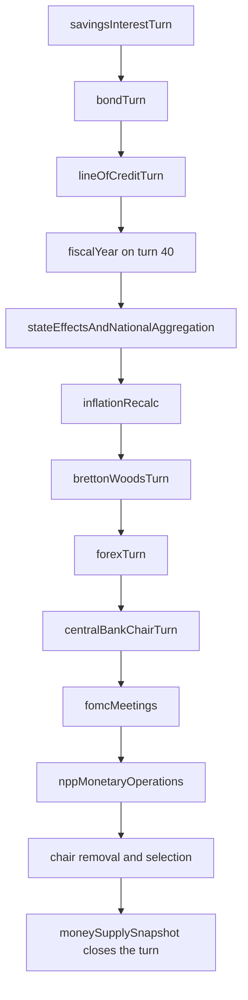

# Monetary System (as shipped)

## Summary

Player guides: [Central Banks](https://www.ahousedividedgame.com/wiki/central-banks), [The FOMC](https://www.ahousedividedgame.com/wiki/fomc), [Currency Exchange](https://www.ahousedividedgame.com/wiki/currency-exchange), [Savings Interest](https://www.ahousedividedgame.com/wiki/savings-interest) and [Line of Credit](https://www.ahousedividedgame.com/wiki/line-of-credit).

Money in A House Divided runs on four connected systems: a central bank per currency that sets a prime rate (by committee in the US, by a single chair or the government elsewhere), a forex market where every active currency floats against an internal anchor, savings that pay a real (inflation adjusted) rate, and a line of credit whose price is that same prime rate plus a credit spread. This page describes what is in the code today, with the real constants and the files they live in.

One turn is one real hour (`MS_PER_TURN = 60 * 60 * 1000`) and a game year is 48 turns (`TURNS_PER_YEAR = 48`), both in `src/lib/constants/calendar.ts` and re-exported from `src/lib/constants/turnTime.ts`. Every rate and accrual below is expressed against that clock.

The prime rate a chair or committee sets is not a dial in isolation. It feeds the macro target that moves the currency's exchange rate, sets the savings yield through the real rate formula, and sets the base cost of every line of credit in that currency. Savings deposits become the lending pool that limits how much credit exists, and forex trade fees become the reserve stack that decides which currency is the leading exchange currency and therefore trades calmest. A hike tightens credit, strengthens the currency, pays savers more in real terms and shrinks the borrowing pool through the debt-to-income cap. Money supply aggregates and quantitative easing are on [Money Supply and QE](./money-supply-and-quantitative-easing.md).

## Rules

### Which bank backs which currency

Each currency has exactly one bank behind it. The mapping is explicit, not derived: `COUNTRY_CURRENCY_MAP` gives every country its home currency, and `CURRENCY_ANCHOR_COUNTRY` names the single country whose `exchangeRates` document and central bank are authoritative for that currency (both in `src/lib/constants/currencyCodes.ts`, re-exported by `src/lib/constants/currencies.ts`). Scotland and Wales are sterlingized: they use GBP with the UK as anchor. The Soviet ruble (SUR) is anchored on RU and shared by BLR, UKR and BAL. EUR is anchored on DE, and IE keeps its own IEP so a 1953 Bretton Woods par with sterling can exist without colliding with the DM/EUR rate.

The URL slug `/centralbank/[currency]` is resolved by `resolveCentralBankCurrency` in `src/lib/centralBank/currencyRouting.ts`, which also routes to the intorg API when the anchor bank is treaty run (the ECB).

### Who may move the rate

Authority is decided by one pure state machine, `decideGovernance` in `src/lib/monetaryGovernance/rules/machine.ts`. `src/lib/monetaryPolicy/commands/updatePrimeRate.ts` is the single write path: it loads the bank, resolves the actor (admin, government, chair or governor) and the inputs, asks the machine, and writes the result. The machine checks in this order:

1. **Admin** always has authority and skips the delta, cooldown and term limits below.
2. **Government controlled bank**: only the head of government or the finance seat (via `isNationalIssuer`) may act. The chair is told the bank has no operational independence.
3. **Command economy** (`gameConfig.commandEconomyEnabled` and marketization below `COMMAND_CEILING`): nobody sets an independent rate (409).
4. **Seated committee**: if the board has at least one seated governor (`boardCanCarry`), the rate moves only by committee vote. A direct set is refused with `committee-decides`. A board with no seated governors is dead, so the chair sets the rate directly.
5. **Chair**: the seated chair may act unless `chairControlsLocked` is set by an administrator.
6. **Exchange-rate regime** (the impossible trinity): a currency that is pegged or in an intervention band with an open capital account has no independent policy rate, and the change is refused (`rateChangeRefusal` in `src/lib/currency/exchangeRateRegime.ts`). Admins skip this gate.

Who may be a government setter, the finance seat or a Senate confirmer follows from [Elections](./elections.md) and [Cabinet](./cabinet.md).

### Prime rate limits

Non-admin changes obey these limits, all in `src/lib/db/types/centralBank.ts` unless noted:

| Constant | Value | Meaning |
| --- | --- | --- |
| `PRIME_RATE_STEP` | 0.25 | Rates snap to a quarter-point grid |
| `PRIME_RATE_CEILING` | 25 | Ceiling; the floor is 0 |
| `MAX_RATE_CHANGE_DELTA` | 0.75 | Largest hike per adjustment, and the threshold above which a cut is "aggressive" |
| `NPP_CHAIR_HIGH_INFLATION_HIKE_DELTA` | 3 | Hike cap once inflation is at least 5 points over target (the gap constant `NPP_CHAIR_HIGH_INFLATION_GAP = 5` is file-local) |
| `MAX_RATE_CUT_DELTA` | 1.75 | Largest cut per adjustment |
| `AGGRESSIVE_CUT_SCRUTINY` | 10 | Added to `chairInfamy` for a cut deeper than 0.75 |
| `RATE_CHANGE_COOLDOWN_TURNS` | 6 | One change every 6 turns |
| `RATE_CHANGES_PER_TERM` | 16 | Executed hikes and cuts per term; holds are free |
| `INTERFERENCE_SCRUTINY` | 12 | Added to `chairInfamy` when the government sets the rate (`src/lib/centralBank/credibility.ts`) |
| `RATE_HISTORY_MAX` | 96 | Entries kept in `rateHistory` |

`maxHikeDeltaFor(inflation - target)` returns 3 instead of 0.75 once inflation is at least 5 points over target, for chairs, government setters and the committee alike. The same function feeds the rate UI (`src/lib/centralBank/rateLimits.ts`), so server and screen cannot drift. A cut deeper than 0.75 adds 10 to `chairInfamy` (capped at 100) unless the government set the rate, in which case the 12 point interference charge applies instead. Why the asymmetry: cutting fast is a political risk for the chair, while a slow hike is the safer default.

Every change appends to `rateHistory` with the previous rate, the new rate, who changed it and the reason. The requested rate is snapped to the grid and compared with the stored rate snapped the same way, so an off-grid stored rate never blocks the next valid move; a request equal to the current rate is refused as `already-at-rate`.

### Independence of the bank

`src/lib/centralBank/governance.ts` encodes the historical case. The Bank of England had no operational independence until `BOE_INDEPENDENCE_YEAR = 1997`, so a UK world whose era start year is before 1997 opens with the Treasury setting Bank Rate. The default keys on the era start year, not the live year: a 1991 world that plays past 1997 does not flip on its own, because transferring monetary power is a statute. Parliament passes a `central_bank_independence` provision, and an explicit `bank.governmentControlled` written by legislation always wins.

A country on a shared bank cannot legislate here at all: `canLegislateBankIndependence` returns false whenever the country config carries `centralBank.sharedBankId`. An ECB member cannot rewrite a treaty institution, and a sterlingized Scotland cannot legislate over the Bank of England.

### The FOMC committee

Banks that run a committee do so by design only for the US: `FOMC_COMMITTEE_COUNTRY_IDS` is `{"US"}`. Other banks keep the single-chair or government model, because seeding a US-shaped board for them blocked their own legislative rate-setting path (ticket #1195). Constants in `src/lib/db/types/centralBank.ts`:

| Constant | Value |
| --- | --- |
| `FOMC_BOARD_SIZE` | 7 seats |
| `FOMC_TERM_TURNS` | 192 (four game years) |
| `FOMC_MEETING_INTERVAL_TURNS` | 8 (six meetings per game year) |
| `FOMC_PLAYER_VOTE_WINDOW_MS` | 24 hours of wall clock |
| `FOMC_VOTE_WINDOW_TURNS` | 24, the hard turn deadline |
| `FOMC_VACANCY_REMINDER_INTERVAL_TURNS` | 48 |

`src/lib/centralBank/seedFomcBoard.ts` populates a US bank without a board: one technocrat NPP per seat (role `fomcMember`), seat 0 the chair mirrored onto the bank's legacy single chair fields. Alignments alternate hawk, dove, hawk, dove across seats, and term expiries are staggered (seat i of 7 expires `(i + 1) / 7` of a term after the start turn) so roughly one seat opens per window. A sitting player chair keeps seat 0. A government controlled bank gets no committee: the MPC was created by the independence grant, so a pre-1997 Bank of England has no board until legislation seeds one. Vacated seats are not restaffed by the engine; they stay vacant until a President nominates and the Senate confirms.

The voting logic in `src/lib/centralBank/fomc.ts` is pure and deterministic. Each seat forms a view by running the same Taylor rule the autonomous chair uses (`computeNppChairRateTarget` and `computeNppChairRateStep` in `src/lib/nppAutonomy/nppChairAutoRate.ts`), tilted by its alignment. A step smaller than `FOMC_MOVE_THRESHOLD = 0.125` points reads as a hold. The chair proposes a motion; when the chair cannot change the rate (per-term cap, cooldown, command economy) the motion can only be a hold.

`tallyMeeting` requires a strict majority of the **seated** governors: `majorityThreshold(n) = floor(n / 2) + 1`, so 7 seated need 4 and 5 seated need 3. Vacant seats are excluded from the count. A seated governor with no ballot abstains and counts against the motion, so a divided or apathetic board holds. A meeting is `decided` once it has passed or can no longer reach a majority, and it never resolves on the turn it opened. NPP seats auto-vote their preference when the meeting opens; player seats vote live or abstain at the deadline.

Alignment is temperament, not ideology. `CHAIR_ALIGNMENT_POLICY` in `src/lib/centralBank/chairAlignment.ts`:

| Multiplier | Hawk | Dove |
| --- | --- | --- |
| `inflationCoefMult` | 1.5 | 0.6 |
| `growthCoefMult` | 0.5 | 1.5 |
| `targetInflationDelta` | -0.5 | +0.5 |
| `hikeStepMult` | 1.25 | 0.75 |
| `cutStepMult` | 0.75 | 1.25 |

When no alignment is stored, `deriveChairAlignment` reads the technocrat's personality: stubbornness at or above ambition leans hawk, otherwise dove. `oppositeAlignment` flips the temperament when a seat's term expires and it is replaced.

### Nominations

`FomcNomination` (`src/lib/db/types/centralBank.ts`, lifecycle in `src/lib/fomcNominationLifecycle.ts`, collection `fomcNominations`) is a President's nomination of a named nominee to a specific `seatId`, confirmed by the Senate through the same lifecycle as cabinet nominations. It carries `makeChair`, the `occupantType` (a live player seat or an autonomous NPP seat) and the hawk or dove `alignment` the President assigns. On confirmation the nominee is installed into that seat on `fomcBoard`; on rejection the seat is untouched. The older executive path (`CentralBankNomination` plus `ChairSelectionPending`) still exists for chair picks that need the nominee's acceptance, and tracks which nominees declined this cycle so re-selection skips them.

### The rate corridor readout

`src/lib/centralBank/rateCorridor.ts` answers one question at a glance: is the bank ahead of inflation? `corridorVerdict(primeRate, inflation)` takes the delta, and with `NEUTRAL_BAND = 0.5` calls it restrictive above +0.5 points, accommodative below -0.5 and neutral in between. `inflationTrendLabel` reads the last `TREND_WINDOW = 12` observations and reports cooling, rising or steady on a `TREND_THRESHOLD = 0.15` point move. Both are computed, never editorial.

### Reserves and the reserve currency ranking

A bank holds these pools: `reserveBalance` (home currency lending reserves), `forexRevenue` (home currency fee income) and `spreadFeeReserveBalances` (foreign currency accumulated from forex spread fees). `src/lib/centralBank/reservePortfolio.ts` builds the portfolio view, converting each foreign balance to the home currency through the live rate map (`convertCurrencyAmount` goes through the internal anchor: `amount / fromRate * toRate`, and returns 0 if either rate is unusable) and reporting each currency's share of the FX reserve stack, plus home only, foreign only and total views.

`src/lib/centralBank/reserveCurrencyRanking.ts` ranks currencies by how much of them is held in reserves across every central bank. It deliberately counts only `spreadFeeReserveBalances`, not `reserveBalance`: the home lending reserve is a country stuffing its own currency into its own bank, and counting it would let one large domestic balance crown the leading exchange currency regardless of international demand. Totals are valued in the internal anchor (units divided by the rate), and `getLeadingReserveCurrency` returns the number one, or null when no bank holds rankable FX reserves.

Rank pays. `RESERVE_CURRENCY_VOLATILITY_REDUCTIONS = [0.5, 0.25, 0.125]` in `src/lib/constants/currencies.ts` means the leading exchange currency trades 50% calmer, the second 25% calmer, the third 12.5% calmer, and everything else takes the full market jitter.

Chairs can move money between `forexRevenue` and `reserveBalance`, with limits in `src/lib/centralBank/reservePoolTransfer.ts`:

| Constant or rule | Value |
| --- | --- |
| `RESERVE_POOL_TRANSFER_COOLDOWN_TURNS` | `TURNS_PER_DAY` = 24 |
| `RESERVE_POOL_TRANSFER_MAX_FRACTION` | 0.5 of the source pool per action |
| Forex to lending | at most `floor(forexRevenue * 0.5)` |
| Lending to forex | at most half the lending reserves, and never below the point where `(deposits + reserves) * 0.7` still covers outstanding loans |

### Forex

Twenty-eight currencies trade: `FOREX_ACTIVE_CURRENCIES` (`src/lib/constants/currencyCodes.ts`) is USD, GBP, JPY, EUR, IEP, CNY, BRL, NGN, SUR, RUB, DDM, FRF, ITL, ESP, SEK, TRL, GRD, ATS, FIM, PLZ, HUF, ROL, BGL, CSK, YUD, PLN, RON and BGN. Nigeria trades even while the country is still coming soon, because its sovereign bonds already settle in NGN and holders would otherwise be trapped; the same logic keeps the 1979 only countries exchangeable in every era. Which of these currencies have a central bank is a separate, preset aware scope (`src/lib/monetaryPolicy/presetMonetaryScope.ts`).

Rates are quoted as local currency per one internal unit (₳). Higher rate means a weaker currency, which is why `computeStrengthVsReferencePercent` in `src/lib/forex/rateSemantics.ts` returns `(referenceRate / currentRate - 1) * 100` for strength while `computeRawRateVsReferencePercent` returns the plain rate change. Mixing the two is the classic way to read a devaluation as a rally.

**Trading costs** (`src/lib/constants/currencies.ts`):

| Constant | Value | Applies to |
| --- | --- | --- |
| `MARKET_MAKER_SPREAD` | 0.01 (1%) | Instant market trade |
| `LIMIT_ORDER_SPREAD` | 0.0064 (about 0.64%) | Limit order |
| `DIRECT_TRADE_SPREAD` | 0.0036 (about 0.36%) | Direct player to player trade |
| `DIRECT_TRADE_EXPIRY_TURNS` | 24 | Direct offer expiry |
| `SECTOR_FX_SPREAD` | 0.005 (0.5%) | Cross currency sector flows, half the market maker rate |
| `FOREX_SPREAD_STRENGTH_MIN` / `MAX` / `DEFAULT` | 0.5 / 1.5 / 1.0 | Chair dial on the fee when their currency is sold |
| `FOREX_SPREAD_STRENGTH_COOLDOWN_TURNS` | 48 | Wait between dial changes |
| `FOREX_SIZE_FEE_MAX` | 0.2 | Extra fee rate a very large trade approaches |
| `FOREX_SIZE_FEE_HALF_ANCHOR` | 10,000,000,000 (₳) | Trader volume at which the size fee is half its maximum |
| `FOREX_LIQUIDITY_FEE_MIN` / `MAX` | 0.5 / 1.5 | Fee multiplier in a busy or quiet market |
| `FOREX_LIQUIDITY_REFERENCE_VOLUME` | 100,000,000 (₳) | Gross volume that earns a neutral fee |
| `FOREX_MAX_TRADE_FEE` | 0.3 | Ceiling on a player trade's total fee rate |

A higher spread strength means more reserve income and more capital flow friction but less liquidity and less reserve appeal; lower means the opposite. Each spread fee splits three ways (`src/lib/currency/spreadFees.ts`, ratios in `src/lib/constants/currencies.ts`): `SPREAD_FEE_DESTROY_RATIO = 0.25` is destroyed, `SPREAD_FEE_FOREX_REVENUE_RATIO = 0.25` goes to the source bank's `forexRevenue`, and `SPREAD_FEE_RESERVE_RATIO = 0.5` accrues to `spreadFeeReserveBalances[currency]` on the destination bank (the source bank when there is no separate destination).

**How the rate moves each turn.** `src/lib/currency/rateCalculation.ts` runs one pipeline in this order: macro target, drift, volume pressure, cycle pressure, noise, clamp.

1. *Macro target.* `computeMacroTarget` returns `baseRate * max(0.01, m)` with

   `m = 1 - (prime - neutralPrime) * 0.02 + (inflation - targetInflation) * 0.015 + absolutePenalty - (gdpGrowth - baselineGdpGrowth) * 0.01 - (tradeGrowth - baselineTradeGrowth) * 0.005`

   using `PRIME_RATE_SENSITIVITY = 0.02`, `INFLATION_SENSITIVITY = 0.015`, `GDP_GROWTH_SENSITIVITY = 0.01` and `TRADE_GROWTH_SENSITIVITY = 0.005`. The baselines are an era aware monetary baseline resolved by `resolveMonetaryBaseline` from `src/lib/constants/monetaryEra.ts` keyed on the current in-game year (below 1999 only; from 1999 it uses `MONETARY_BASELINES`), plus the country's `ECONOMIC_BASELINES` growth figures. A 1953 world at 1955 is therefore not judged against late 1970s inflation targets.
2. *Absolute inflation term.* The inflation sensitivity measures deviation from each currency's OWN target, so a deliberately high baseline (Italy, Turkey, Sweden in the late 1970s profiles) would otherwise sit at par despite crippling inflation and pay a free real carry. `absolutePenalty = max(0, inflation - 6.0) * 0.015` (`ABSOLUTE_INFLATION_DEPRECIATION_THRESHOLD = 6.0`, `ABSOLUTE_INFLATION_SENSITIVITY = 0.015`). It applies even to currencies with no full economic baseline, which would otherwise be a static peg. Developed markets around 1 to 2% inflation are unaffected.
3. *Drift.* `rate + (target - rate) * DRIFT_SPEED`, with `DRIFT_SPEED = 0.05` (about 91% of a shock closed after 48 turns). After the Bretton Woods exit the drift is multiplied by `BW_FLOATING_DRIFT_MULTIPLIER = 1.5`.
4. *Volume pressure.* Two channels, combined and clamped to `VOLUME_PRESSURE_CAP * VOLUME_DIRECTION_WEIGHT` = ±0.01 per turn. Traded flow: `0.05 * net / (|net| + 1,000,000,000)`, times the breadth factor (`effectiveTraders / 5`, floored at 0.2), weighted by `ORGANIC_VOLUME_DIRECTION_WEIGHT = 0.05`, over a `VOLUME_LOOKBACK_TURNS = 24` window. Central bank intervention keeps the stronger original channel: `clamp(syntheticNet * 0.0001, ±0.05)` weighted by `VOLUME_DIRECTION_WEIGHT = 0.2`. One holder moving a whole fortune reads as breadth 1 and gets only a fifth of the push.
5. *Cycle pressure.* Each currency rolls a directional regime every `CYCLE_PRESSURE_TURNS = 12`, drawn uniformly from five values in `CYCLE_PRESSURE_BY_REGIME`: ±0.0015 per turn for moderate, ±0.0007 for slight, 0 for neutral. A sustained regime settles only about pressure divided by `DRIFT_SPEED` off the macro target (roughly 3% moderate, 1.4% slight), so fundamentals generally win.
6. *Noise.* Uniform jitter of `RATE_NOISE_MAX = 0.004` (±0.4%) per turn, multiplied by the reserve currency multiplier above.
7. *Clamp.* `clampRate` holds the result to `RATE_FLOOR_MULTIPLIER = 0.5` and `RATE_CEILING_MULTIPLIER = 1.5` of the base rate (±50%). Under Bretton Woods the band is `BW_PEGGED_BAND = 0.5` while pegged and widens toward `BW_FLOATING_BAND = 0.8` after the float (`src/lib/monetary/brettonWoods.ts`).

### Era anchored starting rates

Seed rates live in four authored tables in `src/lib/constants/currencies.ts`: `INITIAL_RATES` (2019, the `STARTING_YEAR`), `INITIAL_RATES_1991`, `INITIAL_RATES_1979` and `INITIAL_RATES_1953`. The 1953 table is Bretton Woods par: GBP 0.357 (the $2.80 par), JPY 360.0 (the Dodge Line peg fixed 1949 to 1971). The 1991 table uses IMF IFS annual averages: GBP 0.57, JPY 134.5, CNY 5.32, NGN 9.9, and a DEM to EUR equivalent of 0.85 derived through the fixed 1.95583 DEM per EUR parity. Brazil is deliberately excluded from 1991 (cruzeiro hyperinflation makes a parity meaningless) and keeps the 2019 BRL 5.0 as a divide by zero guard. The 2019 table has USD 1.0, GBP 0.75, JPY 106.0, EUR 0.92, BRL 5.0, CNY 7.2, NGN 1550.

`getInitialRatesForYear(year)` covers everything between. It returns the authored table unchanged at an anchor year, so 1953, 1979, 1991 and 2019 worlds are byte identical, clamps below the first anchor and above the last rather than extrapolating, and otherwise interpolates GEOMETRICALLY between the two surrounding anchors (`exp(log a + (log b - log a) * t)`). Exchange rates compound: straight line interpolation put Nigeria at roughly 450 naira in 1999 against a real rate near 97, while the geometric mean gives about 42. A country present in only one anchor keeps that anchor's rate, since a missing entry means "not authored", not "no currency".

### Savings and the real rate

Savings pay half the REAL prime rate. `savingsApyPercent` in `src/lib/currency/savingsInterest.ts`:

`apy = max(SAVINGS_REAL_RATE_FLOOR_PERCENT, prime - inflation) / 2 + depositBonus`

with `SAVINGS_REAL_RATE_FLOOR_PERCENT = 0.5`, so the floor APY is 0.25% before the bonus. Paying the real rate rather than the nominal prime is what closes the carry trade: a currency with a high nominal prime also has high inflation, so its real spread, and therefore its APY, ends up near everyone else's. The floor is uniform across every currency, so it confers no cross currency advantage and cannot be arbitraged.

`depositBonus` is the central bank pricing adjustment in `src/lib/monetaryPolicy/centralBankPricing.ts`: `CENTRAL_BANK_DEPOSIT_BONUS_PERCENT_POINTS = 0.25` on central-bank-held savings, phased in linearly over `CENTRAL_BANK_PRICING_PHASE_IN_TURNS = 8` turns from `gameConfig.centralBankPricingPhaseIn.startedTurn`. It is 0 until a start turn is stamped.

Accrual is simple, per turn: `balance * (apy / 100) / TURNS_PER_YEAR`, rounded to whole yen for JPY and two decimals otherwise (`roundSavingsAmount`). A prime rate at or below 0 pays nothing. Interest accrues every turn into `currencyBalances.pendingSavingsInterest` but is credited to the balance once every `SAVINGS_CREDIT_INTERVAL_TURNS = TURNS_PER_YEAR / 4 = 12` turns (a game quarter, when `turn % 12 == 0`); `turnsUntilSavingsCredit` drives the countdown players see.

One more guard: `SAVINGS_POOL_SHARE_CAP = 0.25`. Interest accrues only on the lesser of the account's balance and 25% of the whole national pool for that currency (`interestEligibleBalance`), so a single actor cannot become nearly all of a currency's savings and farm the pool's interest. It binds only on accounts above that share. The pool total the turn uses is `centralBanks.nationalSavingsBalance`, written during the accrual pass of the previous turn, so it is one turn stale; when it is zero the full balance is eligible. Every credit, deposit and withdrawal writes a `savingsLedger` row via `src/lib/savings/ledger.ts` with the balance after, so the player's statement is a real ledger, not a recomputation.

### Lines of credit

A LOC is priced off the same prime rate the central bank sets, plus a spread that depends on the borrower, plus the central bank adjustment. `spreadPercentPointsFromComposite` in `src/lib/lineOfCredit/creditMath.ts` maps a 0 to 100 credit composite to `5 - (composite / 100) * 6`: +5 points over prime at the bottom, -1 point under prime at the top. The annual rate is `prime + spread + spreadHike`, where `CENTRAL_BANK_LOC_SPREAD_HIKE_PERCENT_POINTS = 2` is phased in over the same 8 turns as the deposit bonus (`src/lib/lineOfCredit/buildSnapshot.ts`).

The composite is built in three steps (`computeLocBorrowerComposite`):

1. **Base blend.** `incomeScoreFromPerTurnCurrency` annualizes the rolling average of personal inflow over the last 48 turns (salary, dividends and coupons after income tax, not campaign funds) through `100 * (1 - exp(-annual / 2,500,000))`. `netWorthScoreFromInternal` does the same on internal unit wealth with a 4,000,000 scale. `userCreditComposite` is `0.75 * corporate + 0.25 * income` for a CEO with a company rating, otherwise `0.5 * income + 0.5 * netWorth`.
2. **Leverage penalty.** `applyDebtLeveragePenalty` subtracts `min(30, debtToAssets * 38)`.
3. **Prime stress.** `applyPrimeEnvironmentToComposite` subtracts `min(22, max(0, prime - 2.5) * 5) * (1 - 0.65 * netWorthScore / 100)`, with `PRIME_STRESS_BASELINE_PERCENT = 2.5`, so wealth shields up to 65% of the stress.

Interest is simple per turn on principal plus arrears: `computeLocInterestForTurn` charges `(obligation * (prime + spread) / 100) / TURNS_PER_YEAR` and the caller adds it to arrears. Repayment is automatic at `LOC_PER_TURN_PAYMENT_RATE = 0.01625 / 4` (0.40625% of the obligation per turn). The derivation is a real world rule of thumb: roughly 1.625% of principal per month on a modest fixed rate loan, and one game month is four turns. Over about 23 game years a zero interest loan is about 99% repaid. Payments allocate to arrears first, then principal, in a stable currency order.

A borrower can flip a currency's account to interest only mode, which pays arrears alone and leaves principal flat, at the cost of `LOC_IO_SURCHARGE_PERCENT_POINTS = 2.0` extra on the annual rate for that currency. Mode flips are gated by `LOC_PAYMENT_MODE_COOLDOWN_TURNS = 24` (one real day). A payment that cannot be covered sets `drawFrozen` and redirects recurring income to the loan (`src/lib/lineOfCredit/garnishment.ts`).

Three caps bound borrowing, in `src/lib/lineOfCredit/locMath.ts`:

| Cap | Rule |
| --- | --- |
| System wide | One currency exchange may lend at most `LOC_DEPOSIT_FRACTION = 0.7` of its savings deposits plus reserves; `availableForExchangeInternal` subtracts every borrower's outstanding principal and arrears |
| Debt to income | `LOC_DTI_MAX_FRACTION = 0.7` caps the scheduled per turn payment at 70% of per turn income, so the maximum principal is `(0.7 * incomePerTurn) / LOC_PER_TURN_PAYMENT_RATE`; income of zero means a limit of zero |
| Equity | `LOC_NET_WORTH_LIMIT_MULTIPLIER = 1` caps total exposure at current economic equity; net worth already excludes LOC debt, so debt funded bond or stock purchases cannot recursively inflate the ceiling |

### Money supply aggregates

M1, M2, growth annualization and open market operations are on [Money Supply and QE](./money-supply-and-quantitative-easing.md). The links back to this page are that the prime rate prices the sovereign bonds QE trades, and that chair authority decides who may order an operation.

## Data

| Collection | Fields read or written | Shown to players |
| --- | --- | --- |
| `centralBanks` | `primeRate`, `rateHistory` (max 96), `interestRateHistory`, `lastRateChangeTurn`, `rateChangesThisTerm`, `chairCharacterId`, `chairMode`, `chairAlignment`, `chairInfamy`, `chairControlsLocked`, `fomcBoard`, `activeFomcMeeting`, `fomcMeetingHistory` (max 24), `lastFomcMeetingTurn`, `reserveBalance`, `forexRevenue`, `spreadFeeReserveBalances`, `nationalSavingsBalance`, `inflationHistory` | Rate, history, board, scrutiny and reserves on the Central Bank page; `chairControlsLocked` is an admin switch |
| `fomcNominations` | `bankId`, `seatId`, `makeChair`, `nomineeCharacterId` or `nomineeNppId`, `occupantType`, `alignment`, votes, `status` | Senate confirmation panel |
| `exchangeRates` | `rate`, `rateHistory`, `currencyCode`, `monetaryRegime`, `fxRegime`, `capitalControls`, `interventionPolicy` | Rates, charts and regime panel |
| `characters` | `currencyBalances.{personal, savings, savingsHolder, pendingSavingsInterest}`, `lineOfCredit.{balances, arrears, drawFrozen, paymentMode, paymentModeChangedAt, fundingSource}` | Wallet, savings tab and loan screen |
| `savingsLedger` | `characterId`, `countryId`, `currencyCode`, `type`, `amount`, `balanceAfter`, `turn` | Savings statement |
| `savingsAccounts` | `accruedInterest`, `version` | Accrued (uncredited) interest |
| `federalBudget` | `economicFactors.inflationRate`, `economicFactors.gdpGrowth`, `economicFactors.tradeGrowth` (read as macro inputs) | Budget page |
| `gameConfig` / `gameState` | Flags in the next section | No |

## Configuration

Defaults for new worlds are set in `src/lib/seeds/reference/featureFlagDefaults.ts` (`DEFAULT_GAME_STATE_FLAGS` and `FRESH_WORLD_GAME_CONFIG_FLAGS`).

| Setting | Default | Effect |
| --- | --- | --- |
| `gameState.forexEnabled` | true | Off: `forexTurn` is skipped with a recorded reason, so rates do not move |
| `gameState.eraSystemEnabled` | true | Selects era monetary baselines and cost forms |
| `gameState.preset` / `startingYear` | per world | Selects the initial rate table; keys the BoE independence default |
| `gameConfig.lineOfCreditEnabled` | true | Gates the LOC feature |
| `gameConfig.commandEconomyEnabled` | era derived (on for 1953 and 1979 command regimes) | Command economies set no independent rate |
| `gameConfig.privateBankingEnabled` | true | Liquidity injections reach chartered banks; bank-held savings |
| `gameConfig.moneySupplyEnabled` | true | Money supply snapshots and operations |
| `gameConfig.centralBankPricingPhaseIn.startedTurn` | stamped by the engine on the first economy turn | Starts the 8 turn phase-in of the LOC spread hike and the deposit bonus |
| `centralBanks.chairControlsLocked` | unset | Admin lock on chair actions |
| `centralBanks.governmentControlled` | unset (era derived) | Explicit override from legislation |
| `exchangeRates.fxRegime`, `capitalControls`, `monetaryRegime` | float, open, pegged (Bretton Woods era) | Impossible trinity gate; Bretton Woods band and drift |
| Country config `centralBank.sharedBankId` | per country | Shared banks cannot legislate independence |

## Timing

One turn, in order (`src/simulation/phases/turnPhaseRegistry.ts`, `src/simulation/phases/stateEffectsPhase.ts`):

1. `savingsInterestTurn` accrues savings interest at the prime and inflation left by the previous turn. The quarterly credit lands when `turn % 12 == 0`.
2. `lineOfCreditTurn` charges LOC interest at prime plus spread and takes the automatic payment. It needs the same turn's `corporationTurn` currency income when forex is enabled. It runs after `bondTurn`.
3. Inside `stateEffectsAndNationalAggregation`: `inflationRecalc`, `brettonWoodsTurn`, then `forexTurn` (rates, limit orders, spread revenue; skipped when forex is off), then `centralBankChairTurn`, `fomcMeetings` (opens and resolves meetings every 8 turns), `nppMonetaryOperations`, `centralBankChairExecutiveRemoval`, `centralBankChairSelection`.
4. `moneySupplySnapshot` closes the turn.

A prime rate set on turn T first affects forex drift on turn T+1 and savings and LOC interest on turn T+1. Chair and government rate changes are written immediately by `updatePrimeRate` and are subject to the 6 turn cooldown; committee decisions land when `fomcMeetings` resolves a meeting. The sub-hour :30 tick can apply half of the inflation and forex step ahead of the turn, and the turn applies the remainder (`src/lib/turn/subhour/stepFraction.ts`, `computeFractionalRateUpdate`).

## Worked trace

A US world in 2025. The committee carries a hike from 4.00% to 4.75%. Inflation is 3.0% against a 2.0% target. A saver holds 1,000,000 USD in savings in a pool of 10,000,000. A borrower with composite 50 owes 120,000 USD of principal and no arrears. The central bank pricing phase-in has not started (bonus and spread hike are 0).

1. **Governance.** Seven governors are seated, so `majorityThreshold(7) = 4`. Four vote hike, three vote hold or cut, so the motion passes. The proposed delta 0.75 is within `maxHikeDeltaFor(3.0 - 2.0 = 1.0)` = 0.75. New rate `snapToPrimeRateGrid(4.00 + 0.75) = 4.75`, `rateChangesThisTerm` rises by 1, `lastRateChangeTurn` is set.
2. **Savings.** Before: `max(0.5, 4.00 - 3.0) / 2 = 0.50%`. After: `(4.75 - 3.0) / 2 = 0.875%`. Eligible balance `min(1,000,000, 0.25 * 10,000,000 = 2,500,000) = 1,000,000`. Per turn accrual before `1,000,000 * 0.005 / 48 = 104.17`, after `1,000,000 * 0.00875 / 48 = 182.29`. Twelve turns at the new rate credit `12 * 182.29 = 2,187.48`.
3. **Line of credit.** Spread `5 - 0.5 * 6 = 2.0`. Annual rate before `4.00 + 2.0 = 6.00%`, after `6.75%`. Interest per turn before `120,000 * 0.06 / 48 = 150.00`, after `120,000 * 0.0675 / 48 = 168.75`, added to arrears. Payment `(120,000 + 168.75) * 0.0040625` is about 488.19, applied to arrears first (168.75), then 319.44 to principal, leaving about 119,680.56.
4. **Forex.** Using the US baselines (target inflation 2, neutral prime 3, baseline GDP growth 2.5, baseline trade growth 0) and growth at baseline: `m = 1 - (4.75 - 3) * 0.02 + (3.0 - 2.0) * 0.015 = 0.98` (it was `0.995` at 4.00%). With base rate 1.000, the target is 0.980. From a current rate of 1.000 one drift step gives `1.000 + (0.980 - 1.000) * 0.05 = 0.999`, with no volume pressure, a neutral cycle regime and zero noise. The dollar is 0.1% stronger after one turn and keeps closing 5% of the gap per turn.
5. **Trade fee.** A 10,000 market maker trade at spread strength 1.0 pays `10,000 * 0.01 = 100`. Split: 25 destroyed, 25 to the source bank's `forexRevenue`, 50 to `spreadFeeReserveBalances` on the destination bank.

## Edge cases and limits

- Rates snap to 0.25 points; the floor is 0 and the ceiling 25; a request equal to the current rate is refused.
- A government controlled bank (pre-1997 Bank of England by default) has no committee and only the head of government or finance seat can move the rate. Each such change adds 12 to `chairInfamy`.
- A shared bank (ECB, sterlingized Scotland and Wales) cannot legislate independence.
- Only the US runs a committee. A tied or partial vote holds: a motion needs a strict majority of seated governors, and seated governors without a ballot count against it. Vacant seats do not count, so five seated need three votes.
- A board with no seated governors is dead: meetings pause and the chair (or the autonomous setter) sets the rate directly.
- Pegged or banded currencies with an open capital account cannot change the rate; floating with capital controls is allowed but buys nothing.
- Savings real rate floor of 0.5 gives a 0.25% APY floor even in deflation or negative real rates, but a prime rate at or below 0 pays no interest.
- A single actor earns interest only on up to 25% of the national savings pool in a currency.
- LOC: no verified income means a limit of zero; scheduled payments cannot exceed 70% of per turn income; total exposure cannot exceed net worth.
- Forex off (`gameState.forexEnabled` false): `forexTurn` is skipped, so exchange rates do not move.
- Forex rate is clamped between 0.5x and 1.5x of the base (seeded era) rate; the Bretton Woods float widens the band to 0.8.
- A rate with no usable value in a conversion returns 0 rather than NaN (`convertCurrencyAmount`).
- Money supply growth readings are `null` until 12 turns of history exist (see [Money Supply and QE](./money-supply-and-quantitative-easing.md)).

## Invariants

| Invariant | Enforced by |
| --- | --- |
| The stored prime rate is on the 0.25 grid and between 0 and 25 | `handleSetRate` and `resolveMeetingInto` in `src/lib/monetaryGovernance/rules/machine.ts`, tested in `machine.test.ts` |
| A non-admin rate change obeys the delta, cooldown and per-term limits | Same machine; `src/lib/centralBank/rateLimits.test.ts` |
| `rateHistory` never exceeds 96 entries | `governanceShell.ts` slices on append; not separately tested |
| A forex rate stays inside the clamp band around the base rate | `clampRate`, tested in `src/lib/currency/rateCalculation.test.ts` |
| A spread fee splits 25 / 25 / 50 and the three shares sum to the fee | Ratios in `src/lib/constants/currencies.ts`; `src/lib/currency/spreadFees.test.ts` |
| Outstanding LOC never exceeds 70% of deposits plus reserves at the time of a draw | `availableForExchangeInternal` and the reserve transfer cap; `src/lib/lineOfCredit/locMath.test.ts` |
| Savings interest is not paid twice | The accrual update filters on the balance and holder it read, so a concurrent change misses instead of paying on a stale balance; no dedicated test for `savingsInterestTurn` |

## Failure and recovery

- **A stuck FOMC meeting.** A meeting that never reaches a majority is forced to resolve at the turn deadline (`FOMC_VOTE_WINDOW_TURNS = 24`), with non-voters abstaining. If a rate move is blocked at resolution (cooldown, term cap, regime), the meeting records `executionOutcome: "blocked"` with a reason and the rate stays.
- **An empty board.** If every seat is vacant the committee cannot carry motions. The bank falls back to direct chair or autonomous setting; the board refills only when a nomination is confirmed.
- **A wrong or stale rate document.** Exchange rates and inflation read through finite checks, so a non-finite input falls back to a sane default instead of poisoning the rate history. A bad stored rate is repaired with a data heal and the next turn recomputes from the base rate.
- **A mis-seeded bank.** `seedFomcBoards` is idempotent and skips banks that already have a board, so a rerun is safe after a failed seed.
- **Interrupted savings or loan writes.** Accrual and payment writes are filtered on the state they read; a concurrent change makes the write miss and the next turn catches up. Pending interest is kept in `pendingSavingsInterest`, so an interrupted quarterly credit is paid on the next credit turn.
- **Forex skipped.** With forex off the turn records a skipped phase and rates freeze; turning it back on resumes from the last stored rate.

## Connections

Driven by:

- [National Budget](./national-budget.md): the inflation rate and GDP growth feed the Taylor rule (`src/lib/nppAutonomy/nppChairAutoRate.ts`), the savings real rate and the forex macro target (`src/lib/currency/rateCalculation.ts`).
- [Elections](./elections.md) and [Cabinet](./cabinet.md): who sits as head of government, finance seat and Senate confirmer decides who may set the rate or fill an FOMC seat (`src/lib/fomcNominationLifecycle.ts`).
- [Tariffs](./tariffs.md) and trade: trade growth enters the forex target.

Affects:

- [National Budget](./national-budget.md): the prime rate sets the `monetary` inflation term (`src/lib/budget/inflation.ts`) and the coupon on new sovereign bonds, and so the interest cost on debt.
- [Sovereign Bonds](./sovereign-bonds.md): bond prices derive from the prime rate; QE and QT are covered in [Money Supply and QE](./money-supply-and-quantitative-easing.md).
- [Currency Exchange](./currency-exchange.md): the prime rate sets drift, and spread fees fill the reserve stack that ranks reserve currencies.
- Player wealth: savings APY and LOC cost change personal cash flow every turn.

## Tests

| Area | Files (under `src/lib/`) |
| --- | --- |
| Governance machine, execution policy, jurisdiction | `monetaryGovernance/rules/machine.test.ts`, `monetaryGovernance/executionPolicy.test.ts`, `monetaryGovernance/governanceShell.test.ts`, `monetaryGovernance/jurisdiction.test.ts` |
| Committee, alignment, nominations, seeding | `centralBank/fomc.test.ts`, `centralBank/chairAlignment.test.ts`, `centralBank/seedFomcBoard.test.ts`, `turn/fomcMeetingTurn.test.ts` |
| Independence and limits | `centralBank/governance.test.ts`, `centralBank/independence.test.ts`, `centralBank/rateLimits.test.ts`, `centralBank/credibility.test.ts` |
| Corridor, reserves | `centralBank/rateCorridor.test.ts`, `centralBank/reservePortfolio.test.ts`, `centralBank/reserveCurrencyRanking.test.ts`, `centralBank/reservePoolTransfer.test.ts`, `centralBank/reservePoolTransferCommands.test.ts` |
| Forex | `currency/rateCalculation.test.ts`, `currency/rateCalculation.fractional.test.ts`, `currency/spreadFees.test.ts`, `currency/tradeFees.test.ts`, `turn/forexTurn.test.ts`, `constants/currencies.test.ts`, `constants/currencies.eraRate.test.ts` |
| Savings | `currency/savingsInterest.test.ts`, `turn/nppSavingsInterest.test.ts` |
| Lines of credit | `lineOfCredit/creditMath.test.ts`, `lineOfCredit/locMath.test.ts`, `lineOfCredit/locMath.paymentMode.test.ts`, `lineOfCredit/buildSnapshot.test.ts`, `lineOfCredit/garnishment.test.ts`, `turn/lineOfCreditTurn.test.ts` |
| Central bank pricing | `monetaryPolicy/centralBankPricing.test.ts`, `monetaryPolicy/centralBankPricingRollout.test.ts` |

Gaps: there is no test file for `updatePrimeRate.ts` itself (the machine under it is covered), none for `turn/savingsInterestTurn.ts`, and none for `turn/forexLimitOrders.ts`.

## Known issues and history

- The Central Banks and Savings wiki pages say savings and loans work for "the 18 main" tradable currencies. The code has 28 entries in `FOREX_ACTIVE_CURRENCIES`, including the Eastern bloc currencies and their successors. The wiki count is stale.
- The committee exists for the US only (`FOMC_COMMITTEE_COUNTRY_IDS`). The Central Banks wiki table agrees.
- `LOC_DTI_MAX_FRACTION` and `LOC_NET_WORTH_LIMIT_MULTIPLIER` are file-local constants in `locMath.ts`, as is `NPP_CHAIR_HIGH_INFLATION_GAP`, so other code cannot import them.
- The savings pool-share cap reads a pool total that is one turn old.
- 2026-10-29 review corrections to this page: committee majority counts seated governors (not the full board); `rateHistory` keeps 96 entries (not 50); direct rate sets are blocked while a committee is seated; the pool transfer moves `forexRevenue` and `reserveBalance`, not `spreadFeeReserveBalances`; a forex fee is split 25 / 25 / 50, not credited whole to the reserve; traded volume uses the organic channel rather than the intervention channel; the cap on the pool is the stored `nationalSavingsBalance`.

Last checked: 2026-10-29, version 1.18.0
