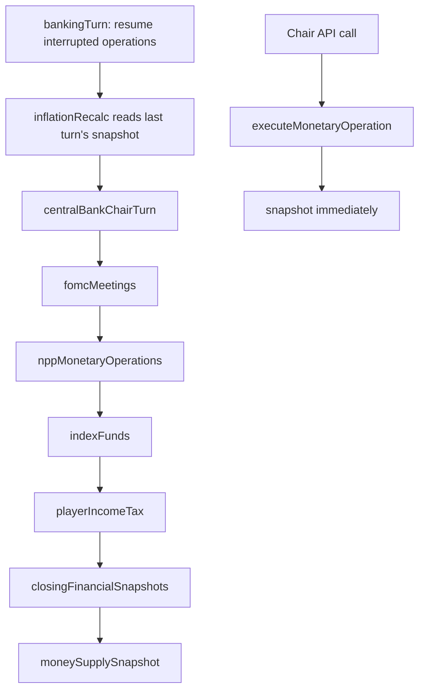

# Money Supply and Quantitative Easing

## Summary

Player guide: [Central Banks](https://www.ahousedividedgame.com/wiki/central-banks) (QE, QT and the Money Supply tab are covered there; there is no separate money supply wiki page).

This page covers the money-supply aggregates (M1/M2), open market operations (QE/QT), treasury advances and liquidity injections, the NPP autonomous monetary-operations policy, and how all of it feeds back into inflation. It is a companion to [Monetary System (as shipped)](./monetary-system-as-shipped.md), which covers the prime rate, FOMC, forex and lines of credit; those systems are not repeated here except where they interact directly with money supply.

The whole feature is gated behind `gameConfig.moneySupplyEnabled` (`isMoneySupplyEnabledFromConfig` in `src/lib/moneySupply/featureFlag.ts`): every entry point below is a no-op when the flag is off.

Why it exists: QE should visibly lift bond prices (lower yields) and create base money without letting a bank that owns the whole float set any price it likes, and measured money growth should be able to push inflation in a bounded way without the measurement itself being fooled by dealer cash moving in and out of the bond market.

## Rules

### M1 and M2

`calculateMoneyAggregates` in `src/lib/moneySupply/rules/calculate.ts` sums per-currency components into two aggregates. Every component is normalized to zero first if it is negative or non-finite (`money()`). `MONEY_ACCOUNTING_VERSION = 3` marks the observation method.

- **M1** = householdLiquid + campaignLiquid + nppLiquid + corporateLiquid + partyLiquid + governmentLiquid + fundLiquid + organizationLiquid.
- **M2** = M1 + householdSavings + externalBroadMoney + bankDeposits + observedBondPoolCash + equityPoolCash.
- **Reported but never in M1 or M2:** `bankReserves`, `centralBankForexRevenue`, `centralBankSpreadReserves`, `bankVaultCash`, `creditOutstanding`, `sovereignBondsOutstanding`, `centralBankBondHoldings`, the estimated household money (below) and `excludedBondPoolCash`. This avoids double counting base money against deposits.

**Bond pool boundary (version 3, issue #2021).** The bond market pool is a dealer, not an end holder. Its cash mixes conserved legs (secondary trades, corporate underwriting and coupons) with legs that have no M2 counterparty at all: sovereign maturities and coupons credit the pool without debiting the treasury, sovereign underwriting debits it without crediting one, and the pool's target inflow and sweep mint and burn toward a target. Counting the raw pool balance turned every 48-turn sovereign maturity wave into explosive money creation followed by near-total destruction (one world read +6.36 million percent, then -99.9%). So observed M2 keeps only the QE-parked portion:

`observedBondPoolCash = min(poolCash, max(0, qeIn - qtOut))` and `excludedBondPoolCash = poolCash - observedBondPoolCash`

where `qeIn` and `qtOut` are `bondMarketPools.lifetime.qeIn` and `.qtOut`. Every pool-only leg leaves observed M2 unchanged and QE/QT still move it once. Pools without flow counters read as pure settlement inventory. Equity pool cash (`equityMarketPools.cashLocal`) counts as institutional M2, not M1.

### Where each component comes from

`snapshotMoneySupply` in `src/lib/moneySupply/snapshot.ts` is the single place that walks every collection and buckets balances by currency:

| Component | Source |
| --- | --- |
| `householdLiquid` / `householdSavings` | `characters.currencyBalances.personal` / `.savings` (or legacy `cashOnHand` / `savingsOnHand`), NPP `currencyBalances.savings`, and `producerEconomyAccounts` of kind `households` |
| `campaignLiquid` | `characters.currencyBalances.campaign` (or legacy `character.funds`) |
| `nppLiquid` | `npps.funds`, `npps.currencyBalances.personal`, and `npps.nppInvestmentCashAnchor` (booked in USD) |
| `corporateLiquid` | `corporations.liquidCapital` keyed by `liquidCurrencyCode`, other `producerEconomyAccounts`, construction escrow (`corporateSectors.constructionFinancing.escrowLocal`, only with the treasury cash ledger and bank construction finance both on), and funded advertising orders in transit (`productAdvertisingClearing`) |
| `partyLiquid` | `politicalParties.treasury` |
| `governmentLiquid` | `federalBudget.treasuryCashLocal` when the treasury cash ledger is enabled, else `max(0, federalBudget.treasuryBalance)`; `producerEconomyAccounts` of kind `publicBuyer` |
| `fundLiquid` | `indexFunds.cashAnchor`, converted from the internal anchor through the live exchange-rate table |
| `organizationLiquid` | `organizationFunds.balanceLocal` (already native) |
| `bankDeposits` | `corporations.bankCharter.npcDeposits` of active chartered banks (player and NPP savings are already counted from their own balances) |
| `creditOutstanding` | `characters.lineOfCredit.balances` plus `.arrears`, plus `bankCharter.totalLoans` |
| `externalBroadMoney` | `centralBanks.externalBroadMoney`, passed through `effectiveExternalBroadMoney` |
| `bankReserves` | `centralBanks.reserveBalance` (diagnostic only) |
| `bankVaultCash` | `bankCharter.cashReserves` and bank escrows, only with the treasury cash ledger on (diagnostic only) |
| `sovereignBondsOutstanding` / `centralBankBondHoldings` | `bonds.totalIssued` / `bonds.centralBankHoldings * BOND_UNIT_FACE_VALUE`, for active sovereign bonds |
| `bondPoolCash`, `bondPoolQeIn`, `bondPoolQeOut` | `bondMarketPools.cashLocal`, `lifetime.qeIn`, `lifetime.qtOut` |
| `equityPoolCash` | `equityMarketPools.cashLocal` |

`BOND_UNIT_FACE_VALUE` is 1,000 (`src/lib/db/types/bond.ts`).

**Government liquid is deliberately one-sided.** `governmentLiquidFromSpendableCash` and `governmentLiquidFromTreasury` in `src/lib/moneySupply/rules/assemble.ts` take `max(0, value)`. `federalBudget.treasuryBalance` is signed cash on hand: positive is surplus, negative is a cash hole. Cash and bond debt are separate positions, so a negative balance is not the national debt, and taking the absolute value would count a deficit as government deposits. An indebted treasury contributes 0 to M1.

### Household money for the unplayed population

`addHouseholdMoneyFromDemography` derives a household money estimate from population and median income, because the `characters` collection only ever holds players and an NPP-run world has none. Constants in `src/lib/moneySupply/rules/assemble.ts`:

| Constant | Value | Meaning |
| --- | --- | --- |
| `PERSONS_PER_HOUSEHOLD` | 3.2 | Persons per household |
| `HOUSEHOLD_LIQUID_RATIO` | 0.15 | Roughly two months of gross annual household income held as transaction balances |
| `HOUSEHOLD_SAVINGS_RATIO` | 0.6 | A bit over half a year's income as savings |

For each state with population, `households = population / 3.2`, `annualIncome = households * medianIncome`, and the two ratios split that into `estimatedHouseholdLiquid` and `estimatedHouseholdSavings`. Income is read per state where available (`macroMetrics.economic.medianIncome`), falling back to the country's national-scope doc. These estimates are **diagnostic**: they are recorded on the snapshot but excluded from M1 and M2, because a population-income estimate is not a payment-backed stock. The stored `externalBroadMoney` stands in for the unmodeled economy instead.

### External broad money

`externalBroadMoney` on each central bank is the seed-time stand-in for the entire unmodeled broad-money stock. `seedMoneySupplyBaselines` (`src/lib/moneySupply/seed.ts`) initializes only banks where it is missing, and never rewrites an existing stock or its issuance history:

`externalBroadMoney = round(storedGdp * anchorPerGdpUnit * localPerAnchor * broadMoneyToGdp)`

(`seedExternalBroadMoney` in `src/lib/moneySupply/rules/seed.ts`; any negative or non-finite input gives 0). The ratio comes from `broadMoneyToGdpRatio` in `src/lib/seeds/reference/moneySupply.ts`:

| Preset | M2 to GDP ratio |
| --- | --- |
| `1953-default` | Per country table `M2_TO_GDP_1953` (US 0.62, UK 0.58, DE 0.38, IE 0.5, BR 0.28, CN 0.32, RU 0.42, DD 0.4, FR 0.52, IT 0.42, ES 0.4, SE 0.62, TR 0.3, NG 0.25, JP from its economy file); 0.4 if unlisted |
| `1979-default` | 0.55 |
| `1991-default` | 0.65 |
| anything else (2019) | 0.8 |

`effectiveExternalBroadMoney` counts the stored deposits at face value: `max(0, externalBroadMoney)`. There is no scaling by an unmodeled share and `netMoneyCreatedLifetime` is not added on top.

### Growth rate

`annualizedMoneyGrowthPct` in `src/lib/moneySupply/rules/calculate.ts` annualizes geometrically: `((closing / opening) ** (TURNS_PER_YEAR / turnsElapsed) - 1) * 100`. It returns `null`, not `0`, whenever `opening <= 0`, `closing <= 0`, the result is non-finite, or `turnsElapsed < MIN_MONEY_GROWTH_BASE_TURNS = 12` (a game quarter). Annualizing a two-turn bootstrap rebase raises the ratio to the 24th power and produces a meaningless number; `null` lets downstream consumers fall back to GDP growth instead of reading a false "money supply is frozen". No cosmetic clamp is applied: if the components are wrong, the components are fixed.

The opening snapshot is the latest row for the currency with the **same** `accountingVersion` and `turn <= max(0, turn - 12)`. `currentMoneyGrowth` (`src/lib/moneySupply/rules/growthSignal.ts`) accepts a reading only when its `accountingVersion` equals `MONEY_ACCOUNTING_VERSION`, so a method change starts a fresh 12-turn window instead of annualizing the level drop. Euro-area members use `euroMoneyGrowth` (`src/lib/moneySupply/rules/euroGrowth.ts`): it sums the legacy ledger currencies at their locked euro ratios, counts shared ledger currencies once, needs complete simultaneous observations after the latest accession, requires the latest complete turn to be within one turn of now, and then annualizes over a window of at least 12 turns.

### Open market operations: QE and QT

`planOpenMarketOperation` in `src/lib/moneySupply/quantitativeEasing.ts` is the pure planning function. Given a requested unit count it:

1. Clamps requested units to what is available: **QE** is bounded by the sovereign bond's `publicFloat`, **QT** by `centralBankHoldings`.
2. Prices the consideration at `round2(units * BOND_UNIT_FACE_VALUE * max(0.01, marketPrice))`.
3. Reports `moneySupplyDelta`: `+consideration` for QE, `-consideration` for QT.
4. Computes `qeSupportRatio = min(1, max(0, holdingsAfter / totalUnits))` with `totalUnits = max(1, totalIssued / BOND_UNIT_FACE_VALUE)`.

**Price support.** Two functions use the same idea. `applyQePriceSupport(rateDerivedPrice, ratio)` returns `clamp(rateDerivedPrice * (1 + min(0.2, ratio * 0.5)), 0.05, 2)`; the bond turn (`src/lib/turn/bondTurn.ts`) applies it every turn on top of the rate-derived price, so the premium is persistent. At execution, `quotedQeMarketPrice(price, previousRatio, nextRatio)` moves the quote by the change: `clamp(price * (1 + (nextRatio - previousRatio) * 0.5), 0.05, 2)`, so buying more support pushes the price up incrementally. The premium reaches its 20% cap only when the bank holds 40% of the issue.

### Execution: `executeMonetaryOperation`

`src/lib/moneySupply/operations.ts` handles all four `MonetaryOperationType` values (`"qe" | "qt" | "treasury_advance" | "liquidity_injection"`; `MonetaryPolicyDecision` adds `"hold"`; both types in `src/lib/db/types/moneySupply.ts`). QE, QT and treasury advances go through `executeJournaledMonetaryOperation` (`src/lib/moneySupply/monetaryOperationJournal.ts`); liquidity injections go through `executeLiquidityAdvance` (`src/lib/moneySupply/liquidityAdvance.ts`). Both journals work from a receipt written before any money moves, so a retry resumes the original quote instead of computing a new one.

| Operation | What moves | `moneySupplyDelta` |
| --- | --- | --- |
| QE | New cash is minted into `bondMarketPools[currency].cashLocal` (the float seller is paid); `lifetime.qeIn` rises by the consideration; the bond's `publicFloat`, `centralBankHoldings`, `qeSupportRatio` and `marketPrice` update | `+consideration` |
| QT | The pool pays the consideration (`cashLocal` and `lifetime.qtOut` change) and that cash is burned; the bond inventory moves back to the public. Refused with "The bond market cannot absorb a sale of this size right now" when the pool cannot fund it; refunded if the bond changed mid-flight | `-consideration` |
| Treasury advance | Minted and credited to `federalBudget.treasuryBalance`. `debt.principal` is owned by the bond ledger and is not changed | `treasuryAdvanceMoneyDelta(before, amount)`: the advance first cancels a negative balance, then adds spendable cash |
| Liquidity injection | Split by `allocateLiquidityAdvance` (floor of `amount * deposits / totalDeposits`, equal split if none hold deposits) across active chartered banks in the currency when `privateBankingEnabled`; each bank gets `bankCharter.cashReserves`, plus matching `cbMarginDebt` and interest-free `cbLiquidityAdvanceDebt` (it is a loan, not free money). With no bank to take it, `centralBanks.reserveBalance` is buffered instead | 0 either way. Bank vault cash and the central bank reserve are outside M2 |

QE and QT require an eligible sovereign bond (`issuerType: "sovereign"`, same country, not matured, not defaulted). After a completed operation the bank record gets `netMoneyCreatedLifetime` incremented, `lastMonetaryOperationTurn` set, and the record pushed onto `monetaryOperations` (last 100). The increment is `moneySupplyDelta` for QE and QT, the full `amount` for a treasury advance, and the amount actually delivered for a liquidity injection (0 for the reserve fallback).

An operation ID (8 to 128 characters of `[a-zA-Z0-9_-]`) identifies a command. Reusing an ID with different inputs is rejected, and an ID cannot be shared between the two receipt collections. A bank carries one in-flight command at a time (`pendingLiquidityOperationId`), which also enforces the cooldown atomically.

### Caps and cooldowns

From `src/lib/moneySupply/operations.ts`:

| Constant | Value | Applies to |
| --- | --- | --- |
| `MONETARY_OPERATION_COOLDOWN_TURNS` | 6 | Every operation, per bank |
| `DIRECT_ADVANCE_GDP_CAP` | 0.01 (1% of GDP) | Manual treasury advance |
| `LIQUIDITY_INJECTION_GDP_CAP` | 0.03 (3% of GDP) | Manual liquidity injection |

### Player and manual action: the monetary-operation API

`POST /api/country/[code]/central-bank/monetary-operation` (`src/app/api/country/[code]/central-bank/monetary-operation/route.ts`) is the human-facing entry point, surfaced in the Money Supply tab (`src/app/centralbank/[currency]/components/CentralBankMoneySupplyTab.tsx`). It:

1. Rejects with 409 if `moneySupplyEnabled` is off.
2. Requires the bank and the country's federal budget to exist (404 otherwise).
3. Authorizes against the monetary policy scope's authority bank (so a shared bank resolves to its own document): admins bypass everything; otherwise the caller must be the seated chair (`chairCharacterId`) and `chairControlsLocked` must not be set, else 403.
4. Checks whether the request is a replay of an existing operation ID; a replay skips the cooldown and cap checks.
5. Enforces the 6-turn cooldown against `lastMonetaryOperationTurn` for non-admins (409).
6. For `treasury_advance` and `liquidity_injection`, enforces the GDP caps for non-admins (400 with the numeric cap when `amount > cap`).
7. Calls `executeMonetaryOperation` (admins bypass the cooldown through `bypassCooldown`), then `snapshotMoneySupply(db, turn)` so the UI sees an up-to-date aggregate immediately.

### Autonomous (NPP) monetary policy

`chooseNppMonetaryOperation` in `src/lib/moneySupply/nppPolicy.ts` is the pure decision function an autonomous (NPP-chaired) central bank uses. Inputs: inflation, target inflation, GDP growth, annualized M2 growth (trusted only when `moneyGrowthReliable`, otherwise `excessMoneyGrowth` is forced to 0), public float, bond holdings, bank reserves, GDP, and treasury balance.

`inflationGap = inflation - targetInflation`; `excessMoneyGrowth = annualizedM2GrowthPct - gdpGrowth` when reliable, else 0. The decision order:

| Step | Condition | Action |
| --- | --- | --- |
| 1 | `inflationGap <= -3`, `gdpGrowth <= -3`, `gdp > 0` and `treasuryBalance <= -0.5 * gdp` | Treasury advance of `max(1, floor(gdp * 0.001))` |
| 2 | (`inflationGap > 1` or `excessMoneyGrowth > 6`) and holdings > 0 | QT of `max(1, floor(holdings * 0.1))` units |
| 3 | Same tightening condition, no holdings | Hold, with a rationale that rate policy must do the work |
| 4 | `inflationGap < -0.5`, `gdpGrowth < 1.5` and public float > 0 | QE of `max(1, floor(publicFloat * 0.01))` units |
| 5 | `gdpGrowth < 0`, `inflationGap <= 0`, `gdp > 0` and `bankReserves < gdp * 0.005` | Liquidity injection of `max(1, floor(gdp * 0.0025))` |
| 6 | Otherwise | Hold |

The emergency amounts are not subject to the manual 1% and 3% caps; they are their own sizes (0.1% and 0.25% of GDP).

### Turn wiring: `processNppMonetaryOperations`

Runs as the `nppMonetaryOperations` phase in `src/simulation/phases/stateEffectsPhase.ts`, after `centralBankChairTurn` and `fomcMeetings`, before `centralBankChairExecutiveRemoval`. For every bank where it is the country's own bank document (`bank._id === getBankId(countryId)`):

- Skips unless the authority has `chairMode: "npp"` and `chairControlsLocked` is not true. Euro-area members use the union's common authority and common indicators (`aggregateEuroPolicyIndicators`).
- Skips if `turn - bank.lastMonetaryOperationTurn < MONETARY_OPERATION_COOLDOWN_TURNS`.
- Skips a government controlled bank (`isBankGovernmentControlled`): monetary policy is the Treasury's, so there are no autonomous operations.
- Pulls the country's federal budget (skips if none), the sovereign bond with public float or bank holdings that has the latest maturity, and the latest snapshot for the currency (read through `currentMoneyGrowth`).
- Uses `treasuryBalance ?? -(debt.principal)` as the fiscal stress input, inflation falling back to `getInflationTarget`, and GDP growth falling back to 2.
- Feeds `chooseNppMonetaryOperation`, then if not a hold calls `executeMonetaryOperation` with the deterministic ID `npp-{type}-{bankId}-{turn}` and `actorName: "{bankId} Monetary Committee"`.
- A refused operation (cooldown, another command pending, no bond units) is logged and skipped so the sweep continues; an unexpected error fails the phase.
- Writes `centralBanks.lastMonetaryPolicyEvaluation` (decision, rationale and inputs) whether or not an operation ran, for every bank that passed the checks above.

### Feedback into inflation

Money-supply growth is one of twelve additive pressure terms (plus the target base) in `calculateInflationWithBreakdown` (`src/lib/budget/inflation.ts`). `recalculateInflationPerTurn` (`src/lib/turn/inflationRecalc.ts`) reads the latest `moneySupplySnapshots` row per currency with `turn < currentTurn` into `moneyGrowthByCurrency` (through `currentMoneyGrowth`), then passes `moneySupplyGrowthPct = finiteOr(growth, gdpGrowth)`. A `null` reading falls back to GDP growth, which is a zero monetary impulse. With the feature off, the calculation also uses GDP growth.

`moneySupply = clamp(-1.5, 2.5, (moneySupplyGrowthPct - gdpGrowth) * moneyGrowthCoeff)`

The coefficient is era dependent: 0.08 while pegged (`PEGGED_MONEY_GROWTH_COEFF` in `src/lib/budget/inflation.ts`) and 0.15 after the Bretton Woods exit (`BW_POST_EXIT_MONEY_COEFF` in `src/lib/monetary/brettonWoods.ts`), chosen from each currency's stored `monetaryRegime`. Excess M2 growth over real GDP growth contributes up to +2.5 points of inflation; a money supply contracting faster than GDP contributes down to -1.5. Money supply is a real but bounded driver, comparable in size to several of the other cost-push terms, not larger.

### Market liquidity follows M2

The bond market pool's cash target is a share of observed M2 (`BOND_POOL_M2_SHARE = 0.05` in `src/lib/bonds/marketPool.ts`), calibrated once and then scaled only between observations on the same accounting version (`calibratedPoolTarget` in `src/lib/moneySupply/rules/poolTarget.ts`), so a method change does not reprice an existing pool.

## Data

| Collection | Fields | Access | Shown to players |
| --- | --- | --- | --- |
| `moneySupplySnapshots` | `_id` (`"{turn}:{currencyCode}"`), `turn`, `accountingVersion`, `countryId`, `bankId`, `currencyCode`, every component and aggregate (`m1`, `m2`, `observedBondPoolCash`, `excludedBondPoolCash`), `annualizedM2GrowthPct`, `netMoneyCreatedLifetime`, `createdAt` | Written each turn and after each manual operation (upsert) | M1, M2 and growth on the Money Supply tab |
| `centralBanks` | `externalBroadMoney`, `netMoneyCreatedLifetime`, `monetaryOperations` (last 100), `lastMonetaryOperationTurn`, `lastMonetaryPolicyEvaluation`, `reserveBalance`, `chairMode`, `chairCharacterId`, `chairControlsLocked`, `pendingLiquidityOperationId` | Read and written | Operation history and last evaluation |
| `monetaryOperationCommands` | `command`, `status` (`planning`, `admitted`, `refunding`, `applied`, `rejected`), `result`, `cash` and `asset` plans, `recoveryPending` | QE, QT and advance receipts | No |
| `bankLiquidityOperations` | `command`, `status`, `recipients`, `fallback`, `result` | Liquidity receipts | No |
| `bonds` | `publicFloat`, `centralBankHoldings`, `qeSupportRatio`, `marketPrice`, `totalIssued`, `maturityTurn` | Read and updated by QE and QT | Bond price and holdings |
| `bondMarketPools` | `cashLocal`, `lifetime.qeIn`, `lifetime.qtOut`, `targetCashLocal`, `liquidityTargetLocal`, `m2Local`, `poolAccountingVersion` | Written by QE, QT and the pool turn | No |
| `equityMarketPools` | `cashLocal` | Read | No |
| `federalBudget` | `treasuryBalance`, `treasuryCashLocal`, `gdp`, `economicFactors.{inflationRate, gdpGrowth}`, `debt.principal` | Read; `treasuryBalance` credited by advances | Budget page |
| `corporations` | `bankCharter.{status, currency, npcDeposits, totalLoans, totalDeposits, cashReserves, cbMarginDebt, cbLiquidityAdvanceDebt}`, `liquidCapital`, `liquidCurrencyCode` | Read; charter fields credited by injections | Bank balance sheet |
| `characters`, `npps`, `politicalParties`, `indexFunds`, `organizationFunds`, `producerEconomyAccounts`, `corporateSectors`, `productAdvertisingClearing`, `exchangeRates`, `states`, `macroMetrics` | Balances and rates listed in the component table | Read only | Own balances |
| `actionAuditLog`, `ledgerEntries` | One row per operation when the audit log or shadow ledger is on | Written | No |

## Configuration

Defaults for new worlds are in `src/lib/seeds/reference/featureFlagDefaults.ts`.

| Setting | Default | Effect |
| --- | --- | --- |
| `gameConfig.moneySupplyEnabled` | true | Off: snapshots return 0 rows, operations and the API are refused (409), NPP policy returns, inflation uses GDP growth |
| `gameConfig.treasuryCashLedgerEnabled` | true | Government liquid reads `treasuryCashLocal`; bank vault cash and escrows are recorded as raw audit stock |
| `gameConfig.privateBankingEnabled` | true | Liquidity injections go to chartered banks instead of the reserve fallback |
| `gameConfig.bankConstructionFinanceEnabled` | true | With the treasury cash ledger and private banking, construction escrow counts as corporate liquid |
| `gameConfig.ledgerShadow` | on (reference default) | Writes balanced `ledgerEntries` for QE, QT and advances |
| `gameConfig.auditLog` | per world | Writes an `actionAuditLog` row per operation |
| `gameState.preset` | per world | Picks the M2 to GDP seed ratio and the home currency per country |
| `gameState.euroMonetaryUnion` | set at accession | Euro members use the common authority and euro growth |
| `centralBanks.chairMode` / `chairControlsLocked` | per bank | Who may act: an NPP chair acts automatically, a locked chair cannot act |
| `exchangeRates.monetaryRegime` | pegged | Picks the money-to-inflation coefficient |
| Constants | See Rules | `MIN_MONEY_GROWTH_BASE_TURNS`, `MONETARY_OPERATION_COOLDOWN_TURNS`, the GDP caps, the household ratios, `BOND_POOL_M2_SHARE` |

## Timing

1. `bankingTurn` (`src/lib/turn/bankingTurn.ts`) first resumes any interrupted operation (`resumeMonetaryOperations`, `resumeLiquidityAdvances`).
2. `inflationRecalc` (stateEffects phase, `src/lib/turn/inflationRecalc.ts`) reads the latest `moneySupplySnapshots` row with `turn < currentTurn`, so the inflation term uses the previous turn's growth reading.
3. `centralBankChairTurn`, then `fomcMeetings`, then `nppMonetaryOperations` run later in the same phase (`src/simulation/phases/stateEffectsPhase.ts`). Autonomous banks act here; a manual player operation can happen any time through the API route and snapshots immediately. The NPP policy reads the latest snapshot at or before the current turn.
4. `moneySupplySnapshot` is a separate registry phase after `stateEffectsAndNationalAggregation`, `indexFunds`, `playerIncomeTax` and `closingFinancialSnapshots` (`src/simulation/phases/turnPhaseRegistry.ts`), writing the turn's aggregates after every value-affecting phase. It also runs on demand from `seedForex.ts` at world setup (turn 0).
5. The bond market pool turn (`src/lib/bonds/marketPoolTurn.ts`) reads the latest snapshot's M2 to size the pool's cash target.

So an operation executed on turn T first reaches inflation on turn T+1 or later, through the snapshot growth reading, and only once 12 turns of same-version history exist.

For each currency with a central bank, `snapshotMoneySupply` writes one row. Countries without a central bank (Warsaw Pact and non-aligned command economies excluded from forex) still accumulate real components keyed by their own currency, so a second pass over `federalBudget` writes a synthetic snapshot (`bankId = countryId`, `netMoneyCreatedLifetime: 0`) for any currency not already covered. Without this pass those currencies would silently get zero snapshot rows, the same bug class previously fixed in `inflationRecalc.ts`'s "unbanked" handling. UKR, BLR and BAL share the Soviet ruble, which RU's bank already writes.

## Worked trace

A sovereign bond has 10,000,000 face issued (`totalUnits = 10,000,000 / 1,000 = 10,000`), a public float of 6,000 units, no bank holdings, and a market price of 0.97. An autonomous bank (or a chair within the cooldown) orders QE of 1,000 units.

1. **Plan.** `units = min(1,000, floor(6,000)) = 1,000`. `consideration = round2(1,000 * 1,000 * 0.97) = 970,000.00`. Holdings after 1,000, float after 5,000. `qeSupportRatio = min(1, 1,000 / 10,000) = 0.10`. `moneySupplyDelta = +970,000`.
2. **Price.** Support is `min(0.2, 0.10 * 0.5) = 5%`. At execution the quote moves by the change in ratio: `0.97 * (1 + (0.10 - 0) * 0.5) = 1.0185`. On later turns the bond turn recomputes the price as the rate-derived price times 1.05.
3. **Money moves.** 970,000 is minted into the bond pool's `cashLocal` and `lifetime.qeIn` rises by 970,000. `netMoneyCreatedLifetime` and the bank's operation history are updated; `lastMonetaryOperationTurn` starts the 6-turn cooldown.
4. **Snapshot.** Suppose the pool held 4,000,000 of cash before and `qeIn - qtOut` was 0. Now `poolCash = 4,970,000` and `qeFunded = 970,000`, so `observedBondPoolCash = 970,000` and `excludedBondPoolCash = 4,000,000`. M2 rises by exactly 970,000.
5. **Growth.** Suppose M2 was 50,000,000 twelve turns ago and is 51,000,000 now. `(51 / 50) ** (48 / 12) - 1 = 1.02 ** 4 - 1 = 0.08243`, so `annualizedM2GrowthPct = 8.24`.
6. **Inflation.** With GDP growth 2.0, excess growth is 6.24 points. Pegged coefficient 0.08 gives `6.24 * 0.08 = +0.50` points; after the Bretton Woods exit 0.15 gives `+0.94`. Both are inside the `[-1.5, 2.5]` clamp and are then smoothed with the rest of the inflation terms.
7. **Policy reaction.** An autonomous bank now sees `excessMoneyGrowth = 6.24 > 6`. With holdings of 1,000 units it chooses QT of `max(1, floor(1,000 * 0.1)) = 100` units, after its cooldown.

## Edge cases and limits

- Feature off: `moneySupplyEnabled` false makes every entry point a no-op and the API returns 409.
- Growth is `null`, not 0, when the opening or closing aggregate is 0 or less, fewer than 12 turns have elapsed, or the opening row has a different accounting version. Inflation then falls back to GDP growth, a zero impulse.
- QE units are limited to the bond's `publicFloat`; QT units to `centralBankHoldings`. An empty float or empty holdings plans zero units, which is rejected ("No bond units available for this operation"). An autonomous bank that wants to tighten with no holdings holds instead of acting.
- QT is refused when the bond pool cannot fund the sale. It no longer checks the bank's `externalBroadMoney`.
- Treasury advance: an autonomous bank needs a real slump (inflation at least 3 points under target, GDP growth at or below -3%, treasury at or below -0.5 times GDP); a chair may request one manually within the 1% GDP cap. An advance into a negative balance first cancels the deficit, so the M2 effect is smaller than the amount.
- Liquidity injection with no chartered private bank in the currency, or when no bank has a positive share, falls back to buffering the bank's own `reserveBalance` with `moneySupplyDelta` 0.
- Government liquid is one-sided: an indebted treasury contributes 0 to M1, never a negative.
- Countries with no central bank (command economies outside forex) still get synthetic snapshots keyed by country.
- Non-admin chairs only: cooldown and GDP caps. Admins bypass both. A bank with `chairControlsLocked` set cannot be operated by its chair.
- A government controlled bank runs no autonomous operations.
- Estimated household money is recorded but not counted, so population changes alone never move M2.

## Invariants

| Invariant | Enforced by |
| --- | --- |
| Every component is finite and non-negative before summing | `money()` in `calculate.ts`; `calculate.test.ts` |
| Reserves, credit, bond stocks, vault cash and estimated household money never enter M1 or M2 | `rules/bondPoolBoundary.test.ts` ("keeps reserves, credit and bond stocks out of observed M2"); `snapshot.test.ts`; `accounting.integration.test.ts` |
| Pool-only legs leave observed M2 unchanged; QE and QT move it exactly once | `rules/bondPoolBoundary.test.ts`, `pulseBoundary.integration.test.ts` |
| Observed pool cash never exceeds the cash actually present | `min(poolCash, qeFunded)`; `rules/bondPoolBoundary.test.ts` |
| Growth is only computed between observations of the same accounting version and at least 12 turns apart | `snapshot.ts`, `growthSignal.ts`; `growthSignal.test.ts`, `pulseBoundary.integration.test.ts` |
| One operation ID means one set of inputs; a replay returns the original result | `sameCommand`; `monetaryOperationJournal.test.ts`, `liquidityAdvance.test.ts` (same-ID replay) |
| One in-flight command per bank, and the cooldown is claimed atomically | `pendingLiquidityOperationId` reservation; `monetaryAdmission.integration.test.ts` |
| QE and QT cash is witnessed by a balanced ledger entry, and nothing is published when QT is refused | Shadow ledger when `ledgerShadow` is on; `monetaryPool.ledger.integration.test.ts` |
| A refused QT asset exchange refunds the original market payment | Journal refund path; `monetaryOperationJournal.test.ts` |
| Money-to-inflation term stays inside [-1.5, 2.5] | Clamp in `calculateInflationWithBreakdown`; `transmission.test.ts` |
| `externalBroadMoney` is seeded only when missing, and existing balances and issuance history are preserved | Query filter in `seedMoneySupplyBaselines`; `seed.test.ts` |

## Failure and recovery

- **Interrupted operation.** A crash between planning and delivery leaves a receipt in `planning`, `admitted` or `refunding`. `bankingTurn` runs `resumeMonetaryOperations` and `resumeLiquidityAdvances` first every turn, finishing each command from its original plan and quote, so the next turn completes or refunds it.
- **Stuck reservation.** A bank with `pendingLiquidityOperationId` set refuses other commands. The same recovery pass clears it when the command ends. A rejected command releases its reservation.
- **Bad accounting after a method change.** A new `accountingVersion` starts a fresh growth window: readings are `null` for 12 turns, inflation sees a zero impulse and the pool target keeps its old value instead of repricing.
- **Wrong components.** If a component source is wrong, the snapshot is wrong and so is growth. The fix is to repair the component data (a heal) and let the next snapshot rewrite the row; the snapshot is an upsert per turn and currency, so a rerun overwrites it.
- **A refused autonomous operation** (cooldown, pending command, no units) is logged and skipped; the next cycle evaluates again. Unexpected errors fail the phase so the turn can be resumed.
- **Missing baselines.** `seedMoneySupplyBaselines` runs whenever a bank lacks `externalBroadMoney`; it is idempotent.

## Connections

Driven by:

- [Monetary System (as shipped)](./monetary-system-as-shipped.md): chair authority and prime rate decide who may operate and when (`src/app/api/country/[code]/central-bank/monetary-operation/route.ts`).
- [Sovereign Bonds](./sovereign-bonds.md): QE and QT trade the sovereign bond's `publicFloat` and `centralBankHoldings` (`planOpenMarketOperation`).
- [National Budget](./national-budget.md): treasury cash feeds government liquid, and treasury advances credit `federalBudget.treasuryBalance`.
- Private banking ([Interbank and Bank Resolution](./interbank-and-bank-resolution.md)): bank deposits enter M2 and liquidity injections land in chartered banks (`executeLiquidityAdvance`).

Affects:

- [National Budget](./national-budget.md): the money supply term in `calculateInflationWithBreakdown` (`src/lib/budget/inflation.ts`). A treasury advance raises cash, not `debt.principal`, which the bond ledger owns.
- Bond prices: the support premium changes `bond.marketPrice`, which moves yields for [Sovereign Bonds](./sovereign-bonds.md) holders. Pool cash targets also follow M2.
- [Monetary System (as shipped)](./monetary-system-as-shipped.md): the savings, LOC and forex chains read the prime rate, inflation and (through the inflation term) this page's output.

## Tests

Under `src/lib/moneySupply/`:

| Area | Files |
| --- | --- |
| Aggregates and boundary | `calculate.test.ts`, `assemble.test.ts`, `rules/bondPoolBoundary.test.ts`, `accounting.integration.test.ts`, `pulseBoundary.integration.test.ts` |
| Snapshots and seeding | `snapshot.test.ts`, `seed.test.ts`, `featureFlag.test.ts`, `rules/growthSignal.test.ts`, `rules/euroGrowth.test.ts` |
| QE, QT and price support | `quantitativeEasing.test.ts`, `transmission.test.ts` |
| Execution and recovery | `operations.test.ts`, `operations.integration.test.ts`, `monetaryOperationJournal.test.ts`, `monetaryAdmission.integration.test.ts`, `liquidityAdvance.test.ts`, `monetaryPool.ledger.integration.test.ts` |
| NPP policy | `nppPolicy.test.ts`, `nppPolicy.integration.test.ts` |
| Pool calibration | `rules/poolTarget.test.ts`, `poolCalibration.integration.test.ts` |
| API route and UI | `src/app/api/country/[code]/central-bank/monetary-operation/route.test.ts`, `src/app/centralbank/[currency]/components/CentralBankMoneySupplyTab.test.tsx` |

Snapshot behaviour is covered case by case in `snapshot.test.ts`, including the bank-less command economy pass, the exclusion of demographic estimates and the short-window null. `nppPolicy.test.ts` covers each branch of the decision table. Gap: the autonomous exclusion of government controlled banks is not named in any test title.

## Known issues and history

- `netMoneyCreatedLifetime` mixes meanings: QE and QT add the money delta, a treasury advance adds the whole amount even when part of it only cancelled a deficit, and a liquidity injection adds the delivered amount although the operation record shows `moneySupplyDelta` 0 and the cash sits outside M2. Read it as "base money issued", not "M2 change".
- Liquidity injected into banks is booked as a central bank loan (`cbMarginDebt`) and so is not free money; the reserve fallback is the pre-private-banking behaviour.
- Accounting versions (`src/lib/db/types/moneySupply.ts`): 1 pre-method, 2 comparable-window, 3 bond-pool settlement inventory outside observed M2 (issue #2021). Growth is only comparable within a version.
- 2026-10-29 review corrections to this page: QE and QT move the bond market pool's cash, not `externalBroadMoney`; estimated household money is excluded from M1 and M2; bank deposits come from `npcDeposits`; QT is refused by pool funding, not by a deposit check; treasury advances do not recompute debt or rating; the NPP policy skips government controlled banks and uses euro common policy for euro members; the evaluation is written only after the cooldown and government checks.

Last checked: 2026-10-29, version 1.18.0
