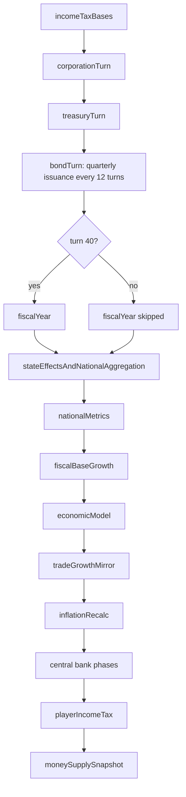

# National Budget & Treasury

## Summary

Player guide: [National Budget](https://www.ahousedividedgame.com/wiki/national-budget)

The federal budget system tracks government revenue, spending, and debt. It integrates with tax policy, regional grants, public enterprises, and sovereign bond issuance. Tax rates and spending commitments change only through enacted legislation (see [Bills and Legislation](./bills-legislation.md) and [Policy System](./policy-system.md)); there is no direct budget edit for players, and the live budget panel shows the result. Fixing a deficit means raising rates, repealing a spending law, or letting growth expand the tax base. The consequences of a deficit are debt principal growth, a possible rating drop at the next fiscal close, higher coupon cost on new bonds, and an inflation push.

**Primary modules:** `src/lib/budget/revenue.ts`, `src/lib/budget/spending.ts`, `src/lib/budget/fiscalYear.ts`, `src/lib/budget/debt.ts`, `src/lib/budget/inflation.ts`, `src/lib/turn/fiscalBaseGrowth.ts`, `src/lib/turn/treasuryTurn.ts`.

**Turn processing in one line:** corporate output refreshes tax bases and revenue during the corporation turn; tax bases grow by a 1/48 slice every turn; treasury cash accrues every turn; fiscal-year processing runs at turn 40 of each 48-turn year; budget API and admin routes can recalculate on demand.

## Rules

### Revenue

Federal revenue is calculated in `calculateFederalRevenue` (`src/lib/budget/revenue.ts`). Each line is a tax base times a rate; **rates are stored as percentages**, so the code divides by 100:

| Line | Formula |
| --- | --- |
| `incomeTax` | `taxableIncome * (wLow * low + wMid * mid + wHigh * high) / 100`, or `taxableIncome * rate / 100` when the three rates are equal (`incomeTaxRevenue` in `src/lib/budget/rules/incomeTaxTiers.ts`; weights are `incomeTaxShares`) |
| `domesticCorporateTax` | `domesticCorporateProfits * domesticCorporateTax / 100` |
| `foreignCorporateTax` | `foreignCorporateProfits * foreignCorporateTax / 100` |
| `payrollTax` | `wagesAndSalaries * payrollTax / 100` |
| `tariffs` | `importValue * tariffs / 100`. With a sourced-import aggregate (money wiring): `max(0, importValue - sourcedImports * 48 * fx) * tariffs / 100 + sourcedTariff * 48 * fx` |
| `salesTax` | `taxableSales * salesTax / 100` |
| Country levies | `solidaritySurcharge` (DE, on income tax), `landValueAddedTax` (CN, on 5% of domestic profits), `urbanMaintenanceTax` (CN, on sales tax), `stampDuty` (CN, on 2% of GDP), `universalSocialCharge` (IE, on wages), `capitalGainsTax` (IE, on 3% of GDP), `exciseDuty` (IE, on 1.5% of GDP), `propertyTax` (IE, on 0.5 x GDP) |
| `lawRevenue` | Sum over active national laws of `gdpRevenueFraction * fiscalBase.gdp`, or the stored `annualRevenueV2` for legacy laws |
| `healthcareIncome`, `other` | Earnings of national corporations (`calculateCountryOwnedBudgetRevenue`), plus `other` |

`other` is `otherRevenueGdpShareBaseline * gdp` once that share is stored (self-healed by `fiscalBaseGrowth` from the current ratio), otherwise the persisted `revenue.other`, defaulting to 200,000,000,000 for legacy budgets that never stored one.

**Laffer cap.** The tax-like lines plus `lawRevenue` form `taxLikeRevenue`. When the era system is on, `applyEraRevenueCap` compresses the part above a knee:

`after = (knee + (share - knee) * 0.4) * gdp` when `share = taxLike / gdp > knee`

with `REVENUE_CAP_KNEE = 0.4` and `REVENUE_CAP_COMPRESS = 0.4`. The command-economy countries BG, CS, DD, HU, PL, RO, YU, UKR, BLR and BAL use `COMMAND_ECONOMY_REVENUE_CAP_KNEE = 0.55` because planned budgets of that era legitimately ran 45 to 70% of national income. `total = taxLikeRevenueAfterCap + healthcareIncome + other`; `revenueCapReduction` records what was clawed back. The cap does not apply to `other` or public enterprise income.

**Fallbacks.** If no tax bases are stored, bases derive from national GDP: income `0.35`, domestic corporate `0.06` (`GDP_DOMESTIC_CORPORATE_FACTOR`), foreign corporate `0.02` (`GDP_FOREIGN_CORPORATE_FACTOR`), wages `0.31`, imports `0.18`, sales `0.55`. National GDP (`calculateNationalGDP`) is the sum of `states.gdp` times 1,000,000 (state GDP is stored in millions), else `federalBudget.gdp`, else the 27,000,000,000,000 default.

**Public enterprise revenue** comes from national corporations (`corporations` with a `countryId` filter).

### Tax bases

Tax bases are stored on the `FederalBudget` document. `processFiscalBaseGrowth` (`src/lib/turn/fiscalBaseGrowth.ts`) grows them every turn by one slice of the annual rate (`perYearDivisor = TURNS_PER_YEAR = 48`). The fiscal-year close does not add another annual growth jump.

| Category | Description | Per-turn growth multiplier |
| --- | --- | --- |
| `taxableIncome` | Personal taxable income | `1 + w / 100 / 48`, `w = min(wageGrowth, ceiling)` |
| `domesticCorporateProfits` | Corporate profits from corps HQ'd in-country | `1 + (gdpGrowth + 1.0) / 100 / 48` (`CAPITAL_RETURNS_PREMIUM = 1.0`) |
| `foreignCorporateProfits` | Corporate profits from foreign-HQ corps operating in-country | Same as domestic |
| `wagesAndSalaries` | Wages subject to payroll tax | Same as taxable income |
| `importValue` | Import value subject to tariffs | `1 + t / 100 / 48`, `t = min(tradeGrowth, ceiling)` |
| `taxableSales` | Consumer spending subject to sales tax | Average of the GDP multiplier and the wage multiplier |

`ceiling = gdpGrowth + max(0, inflation) + TAX_BASE_GROWTH_PREMIUM_CAP`, with `TAX_BASE_GROWTH_PREMIUM_CAP = 2.0` points: a base may outgrow nominal GDP, but only by a bounded premium, which keeps the share-of-GDP equilibrium finite. After growth each base is pulled a fraction `TAX_BASE_GDP_SHARE_GRAVITY_ANNUAL / 48` (`0.08 / 48`) of the way back to `taxBaseGdpShareBaseline * currentGdp`; the baseline is stamped once from the current shares if absent. The growth rates come from the national `macroMetrics` doc (`wageGrowth`, `tradeGrowth`, `gdpGrowth`), with the GDP-weighted regional mean as the GDP fallback. State bases grow on each state's own rates.

### Spending

Federal spending is calculated in `calculateFederalSpending` (`src/lib/budget/spending.ts`):

`total = sum(byCategory) + stateGrants + debtInterest`

- Each active national law (`enactedLaws`, `scope: "national"`, not repealed, latest per type via `keepLatestActiveLawPerType`, era-active) is priced by `calculateEnactedLawAnnualCost`. A law with `isGrant` adds to `stateGrants`; any other adds to `byCategory[budgetCategory || "other"]`.
- If no law books any spending, the seeded `baselineSpendingByCategory` and `baselineStateGrants` are used.
- If laws book spending, `round(gdp * nonLawSpendingGdpShareBaseline)` is added to `byCategory.other`. It is a calibrated share for general government spending the law book leaves out, so later law changes still move total spending.
- Config-derived transfer pools for CN, DE, DD, UK and RU (`CONFIG_DERIVED_TRANSFER_FIELD`) have no grant law, so the distributed `regionalBudgets` grant total is added to `stateGrants` (planned economies charge `min(allocated, enactedBillCosts)`, because an unspent allocation lapses).
- Standing lines: Northern Ireland security (UK), terrorism cost, refugee services and capacity repair after conflict.
- `sectorSubsidies` is always present in `byCategory` (default 0).
- `debtInterest` is passed in by the caller (below).

**Cost per law** (`src/lib/budget/costs.ts`, first match wins):

| Order | Cost type | Formula |
| --- | --- | --- |
| 1 | `costModelV2` | `computeLawCost` on the regional-rollup GDP and population; throws if its base is missing |
| 2 | Era form (era system on, law has a type id) | `resolveEraSpendingCost` from `gdpCostFraction` or `incomeCostFraction`; a `none` cost class is 0. Rows 3 to 6 are the legacy forms, used when the era system is off or the law has no type id |
| 3 | `gdpPerCapitaMultiplier` | `multiplier * GDP` |
| 4 | `annualCostPerCapita` | `perCapitaCost * population * scale` |
| 5 | `annualCostUsd` (legacy name, local currency) | `amount * scale` |
| 6 | `budgetCost` | `(budgetCost / 100) * budgetCapacity`, with `budgetCapacity = revenue.total` |

`scale = getGdpIndexedCostScale(countryId, nationalGdpPerCapita)` ramps linearly from the 1991 anchor `scaleLow` to the modern `scaleHigh` as GDP per capita moves between the two anchor values, stays at `scaleHigh` above, and below the 1991 anchor it shrinks proportionally (`scaleLow * gpc / gpcLow`) so a pre-1991 economy keeps the same share of GDP instead of being charged modern absolute costs. Anchors exist for US, UK, JP, DE, IE, CN, BR and NG (`COST_SCALE_ANCHORS`); other countries use 1. GDP-based and budget-percentage costs are ratio-based and are not scaled.

### Debt, credit rating and interest

Credit rating and interest rates are calculated in `src/lib/budget/debt.ts`. `getDebtThreshold(ratio)` returns the first row with `ratio <= maxRatio`:

| Rating | Max debt/GDP | Interest rate | GDP penalty | Trust penalty |
| --- | --- | --- | --- | --- |
| AAA | 0.6 | 2% | 0 | 0 |
| AA | 0.8 | 2.5% | 0 | 0 |
| A | 1.0 | 3.5% | 0.1 | 0 |
| BBB | 1.2 | 5% | 0.2 | 0 |
| BB | 1.5 | 7% | 0.3 | 5 |
| B | `EXTREME_DISTRESS_DEBT_TO_GDP` = 2.5 | 10% | 0.5 | 10 |
| CCC | above | 14% | 0.7 | 15 |

The interest rate stored on the budget is `calculateInterestRate(ratio, imfBailoutActive) + getSovereignConfidencePremium(investorConfidence)`:

- With an active IMF bailout the tier rate is capped at `IMF_SOVEREIGN_DEFAULT_RATE = 0.06`.
- The premium is 0 at or above `INVESTOR_CONFIDENCE_BASELINE = 70` and rises linearly to `SOVEREIGN_CONFIDENCE_PREMIUM_MAX = 0.03` at confidence 0: `0.03 * (70 - confidence) / 70`.
- `sovereignRiskAnchor` stays on the document for provenance only and does not rescale current risk.

The ratio is `debt.principal / gdpSmoothed`, where the smoothed GDP is an EMA, `0.7 * previous + 0.3 * current` (`GDP_SMOOTHING_INERTIA = 0.7`), updated at the fiscal close, so one noisy year cannot trip a rating. Beyond 2.5 the sovereign degrades to CCC, the floor the `CreditRating` type supports. No live country is near this band; it bites only in runaway autonomous-world scenarios.

**Debt principal is owned by the bond ledger**, not by this module. Issuance, maturity and default resolution maintain `debt.principal` incrementally (`src/lib/bonds/sovereignPrincipal.ts`). `processAnnualDebt` reads the principal, it does not add the year's deficit to it, and the fiscal-year write deliberately omits `debt.principal`.

**Debt service.** `sovereignStockAnnualService` (`src/lib/budget/rules/sovereignDebtService.ts`) charges existing bonds at their locked coupons and any stock not yet represented by bonds at the marginal rate (`debt.interestRate`); an active IMF program still caps the effective rate. This is `spending.debtInterest`. Charging the whole stock at the current ladder rate repriced a country's entire debt the turn its ratio crossed a band (a 1953 UK on 3% gilts at 180% of GDP jumped to a 10 to 14% coupon on every pound).

**Debt ceiling.** `raisedDebtCeiling`: at fiscal close, if `principal >= 0.95 * ceiling` (`DEBT_CEILING_RAISE_TRIGGER`), the ceiling becomes `round(1.10 * principal)` (`DEBT_CEILING_RAISE_HEADROOM`) when that exceeds the old one, and `ceilingLastRaisedYear` is stamped. For the US a raise also resolves any `debt_ceiling_crisis` flag. `effectiveBorrowingLimit` gives East Germany (DD) at least `DD_MIN_BORROWING_LIMIT_TO_GDP = 0.4` of smoothed GDP. The ceiling does not stop borrowing.

### Sovereign bond integration

Sovereign bonds are issued every `SOVEREIGN_ISSUANCE_INTERVAL_TURNS = 12` turns (`turn > 0 && turn % 12 == 0`, `src/lib/bonds/sovereign.ts`):

`deficitAmount = floor(max(0, -(revenue.total - spending.total)) / 4 / 1000) * 1000`, `issueAmount = deficitAmount + rolloverAmount`

where 1,000 is `BOND_UNIT_FACE_VALUE` and the rollover covers principal maturing in the next quarter, so a surplus country does not drain its float. The deficit is derived from revenue and spending, not read from the cached `surplus`. `applySovereignDebtAdjustment(budget, principalDelta, annualInterestDelta)` then updates the budget:

```
newPrincipal  = max(0, principal + principalDelta)
newDebtInterest = max(0, spending.debtInterest + annualInterestDelta)   // coupon/100 * face for an issue
newSurplus    = revenue.total - (spending.total + annualInterestDelta)
ratio         = newPrincipal / (gdpSmoothed || gdp)
```

and re-derives rating and interest rate. See [Sovereign Bonds](./sovereign-bonds.md) for coupon pricing.

### Treasury cash

`processTreasuryTurn` (`src/lib/turn/treasuryTurn.ts`) moves the signed treasury balance every turn by `(revenue.total - (spending.total - debtInterest)) / 48 - debtServiceThisTurn - enforcement`, rounded to whole units (`treasuryAccrualReceipt` in `src/lib/budget/rules/treasuryAccrual.ts`). `treasuryBalance` is signed cash, positive for surplus cash and negative for a cash hole; it is separate from `debt.principal`. With the funded treasury cash ledger on, spendable cash is `treasuryCashLocal`.

### Tax rate phase-in

An enacted bill that moves a tax rate more than 1 point arrives at `TAX_RATE_PHASE_IN_MAX_STEP_PP = 1` point per turn (`advanceTaxRatePhaseIn`, `src/lib/budget/taxRatePhaseIn.ts`), starting the turn the bill passes. `taxRates` holds the rate being charged; `taxRatePhaseIn` holds the destination and clears itself on arrival.

### Fiscal year processing

Fiscal-year processing runs at **turn 40** of each 48-turn year (October in game time): `isFiscalYearEnd` compares `getTurnInYear(calendarTurn)` to `FISCAL_YEAR_START_TURN_IN_YEAR = 40` (every country's calendar config has `startTurnInYear` 40). The fiscal year number is `currentYear + 1` once the turn in the year is 40 or later. Entry point `processFiscalYear` (`src/lib/budget/fiscalYear.ts`). For every registered country with a valid budget it:

1. Recomputes inflation (`calculateCountryInflation`) and mirrors `gdpGrowth` from the national pipeline.
2. Sets `gdp` to the sum of `states.gdp` times 1,000,000 (fallback: compounding old GDP by growth) and updates `gdpSmoothed`.
3. Recalculates revenue off the already-grown bases.
4. Runs US formula grants (Medicaid, Highway Trust Fund, Education Block, SNAP) and, with regional finance on, the department grant pool.
5. Calls `processAnnualDebt` for rating, ratio and interest rate, then recomputes spending with that interest.
6. Applies an austerity cap if `financialCrisisAusterityUntilTurn` is active, or, under an IMF bailout, scales every spending line down by the same factor until spending equals revenue (`applyAusterityCap`).
7. Raises the debt ceiling if needed and writes `fiscalYear`, `taxRates`, `revenue`, `spending`, `debt.interestRate`, `debtToGdpRatio`, `creditRating` and `surplus`. It does not write `debt.principal`.
8. Settles each state's budget (`processStateFiscalYear`).
9. Applies debt penalties: the public-trust penalty of the tier (BB and worse: -5, -10, -15) through `applyLegacyTrustDelta`. The GDP penalty is **not** applied directly; debt already reduces sector profit margin through `debtToGdpMod` in `sectorCalculations.ts`, which lowers growth through the realized-output pipeline.
10. Saves `federalBudgetSnapshots` (`{countryId}:FY{n}`, upsert) and evaluates the sovereign auction outcome per country.

### Inflation

Inflation is **dynamic**, calculated from economic conditions in `calculateCountryInflation` (`src/lib/budget/inflation.ts`) and, for a pure calculation, `calculateInflationWithBreakdown`. A command economy returns the administered era target instead.

`rawInflation = target + unemployment + gdp + monetary + fiscal + tariff + wage + commodity + forex + savings + housing + policy + moneySupply`

The core terms are two-sided with asymmetric coefficients, because prices are stickier on the way down:

| Component | Formula (above baseline / below baseline) |
| --- | --- |
| **Unemployment** | `(NAIRU - unemployment) * 0.3` when tight, `* 0.2` when slack |
| **GDP** | `(gdpGrowth - 2) * 0.2` hot, `* 0.15` cold; with a measured output gap, `gap * 0.25` above trend or `* 0.2` below, blended by the gap weight |
| **Monetary** | `(neutralPrimeRate - effectivePrimeRate) * 0.8` below neutral or `* 1.2` above, times `transmissionMultiplier(chairInfamy)` |
| **Fiscal** | `deficitPct * 0.15` for a deficit, `* 0.08` for a surplus, `deficitPct = clamp(-surplus / gdp * 100, -30, 50)` |
| **Tariff** | `(tariff - 3) * 0.05` above, `* 0.025` below |
| **Wage** | `(wageGrowth - 2.5) * 0.15` above, `* 0.08` below |
| **Commodity** | `clamp(pressure, -0.15, 0.3) * 10`, the median annualized change in national prices |
| **Forex** | `clamp(pressure, ±0.25) * 8` depreciation, `* 4` appreciation; the deflationary arm shrinks by `4 / (4 + deflationDepth)` |
| **Savings** | `pressure * 1.0` or `* 0.5` |
| **Housing** | `pressure * 0`, term retired |
| **Policy** | Discretionary stance pressure from the active central bank orders |
| **Money supply** | `clamp((moneyGrowth - gdpGrowth) * coeff, -1.5, 2.5)`; see [Money Supply and QE](./money-supply-and-quantitative-easing.md) |

The target and neutral rate are per country and era (`getInflationTarget`, `getNeutralPrimeRate`), falling back to 2.0 and 3.0. `effectivePrimeRate = 0.3 * spot + 0.7 * trailing`, where the trailing average over the last 12 `interestRateHistory` entries weights each entry by `max(1/12, min(1, turnsAgo/12))`, so a rate change takes 12 turns to propagate fully.

Smoothing: `smoothedRaw = 0.35 * previous + 0.65 * rawInflation`; `smoothed = smoothedRaw + 0.08 * (target - smoothedRaw)`; the move from `previous` is clamped to `±1.5` per turn (more upward room when recovering from deep deflation); the final rate is clamped to `[-2.0, 100.0]` and rounded to two decimals.

### Rules summary

| Constant | Value | Source |
| --- | --- | --- |
| Credit ladder (max debt/GDP, rate, GDP penalty, trust penalty) | AAA 0.6, 2%, 0, 0; AA 0.8, 2.5%, 0, 0; A 1.0, 3.5%, 0.1, 0; BBB 1.2, 5%, 0.2, 0; BB 1.5, 7%, 0.3, 5; B 2.5, 10%, 0.5, 10; CCC above, 14%, 0.7, 15 | `src/lib/budget/debt.ts` |
| `EXTREME_DISTRESS_DEBT_TO_GDP` | 2.5 | `src/lib/budget/debt.ts` |
| `GDP_SMOOTHING_INERTIA` | 0.7 | `src/lib/budget/fiscalYear.ts` |
| `BASE_TARGET`, `NAIRU`, `NEUTRAL_RATE` (fallbacks) | 2.0, 5.0, 3.0 | `src/lib/budget/inflation.ts` |
| `UNEMPLOYMENT_COEFF_UP` / `_DOWN` | 0.3 / 0.2 | `src/lib/budget/inflation.ts` |
| `GDP_GROWTH_COEFF_UP` / `_DOWN`, `TREND_GDP_GROWTH` | 0.2 / 0.15, 2.0 | `src/lib/budget/inflation.ts` |
| `OUTPUT_GAP_COEFF_UP` / `_DOWN` | 0.25 / 0.2 | `src/lib/budget/inflation.ts` |
| `MONETARY_COEFF_LOW` / `MONETARY_COEFF_HIGH` | 0.8 / 1.2 | `src/lib/budget/inflation.ts` |
| `FISCAL_COEFF_DEFICIT` / `FISCAL_COEFF_SURPLUS` | 0.15 / 0.08 | `src/lib/budget/inflation.ts` |
| `FISCAL_DEFICIT_PCT_FLOOR` / `_CEILING` | -30 / 50 | `src/lib/budget/inflation.ts` |
| `TARIFF_BASELINE` (`TARIFF_INFLATION_BASELINE`), `TARIFF_COEFF_UP` / `_DOWN` | 3, 0.05 / 0.025 | `src/lib/tariffs/rules/tariffInflationExposure.ts`, `inflation.ts` |
| `WAGE_GROWTH_BASELINE`, `WAGE_COEFF_UP` / `_DOWN` | 2.5, 0.15 / 0.08 | `src/lib/budget/inflation.ts` |
| `COMMODITY_PRESSURE_COEFF_*`, clamps | 10 / 10, [-0.15, 0.3] | `src/lib/budget/inflation.ts` |
| `FOREX_PRESSURE_COEFF_UP` / `_DOWN`, `FOREX_PRESSURE_CLAMP`, half-life | 8 / 4, 0.25, 4.0 | `src/lib/budget/inflation.ts` |
| `SAVINGS_PRESSURE_COEFF_UP` / `_DOWN` | 1.0 / 0.5 | `src/lib/budget/inflation.ts` |
| `HOUSING_PRESSURE_COEFF` | 0 (term retired) | `src/lib/budget/inflation.ts` |
| `MONETARY_LAG_TURNS`, `SPOT_RATE_IMMEDIATE_WEIGHT` | 12, 0.3 | `src/lib/budget/inflation.ts` |
| `INERTIA`, `MEAN_REVERSION_COEFF`, `STEP_ALPHA` | 0.35, 0.08, `1 - (1 - 0.08) * 0.35` | `src/lib/budget/inflation.ts` |
| `MAX_PER_TURN_DELTA`, `DEEP_DEFLATION_RECOVERY_GAP` | 1.5, 4.0 | `src/lib/budget/inflation.ts` |
| `MIN_INFLATION` / `MAX_INFLATION` | -2.0 / 100.0 | `src/lib/budget/inflation.ts` |
| `PEGGED_MONEY_GROWTH_COEFF` | 0.08 (0.15 after Bretton Woods exit) | `src/lib/budget/inflation.ts`, `src/lib/monetary/brettonWoods.ts` |
| `REVENUE_CAP_KNEE` / `_COMPRESS`, command economy knee | 0.4 / 0.4, 0.55 | `src/lib/budget/revenue.ts` |
| `TAX_BASE_GROWTH_PREMIUM_CAP` | 2.0 points | `src/lib/budget/revenue.ts` |
| `TAX_BASE_GDP_SHARE_GRAVITY_ANNUAL` | 0.08 | `src/lib/budget/revenue.ts` |
| `CAPITAL_RETURNS_PREMIUM` | 1.0 | `src/lib/budget/revenue.ts` |
| `TAX_RATE_PHASE_IN_MAX_STEP_PP` | 1 | `src/lib/budget/taxRatePhaseIn.ts` |
| `DEBT_CEILING_RAISE_TRIGGER` / `DEBT_CEILING_RAISE_HEADROOM` | 0.95 / 1.10 | `src/lib/budget/rules/debtCeilingRaise.ts` |
| `DD_MIN_BORROWING_LIMIT_TO_GDP` | 0.4 (East Germany floor) | `src/lib/budget/borrowingLimit.ts` |
| `INVESTOR_CONFIDENCE_BASELINE`, `SOVEREIGN_CONFIDENCE_PREMIUM_MAX` | 70, 0.03 | `src/lib/nationalization/constants.ts` |
| `IMF_SOVEREIGN_DEFAULT_RATE` | 0.06 | `src/lib/sovereignDefault/constants.ts` |
| `SOVEREIGN_ISSUANCE_INTERVAL_TURNS`, `BOND_UNIT_FACE_VALUE` | 12, 1,000 | `src/lib/bonds/sovereign.ts`, `src/lib/db/types/bond.ts` |
| Fiscal year start | turn 40 of 48 (`FISCAL_YEAR_START_TURN_IN_YEAR`) | `src/lib/budget/fiscalYear.ts` |

Why the asymmetric coefficients: prices are stickier on the way down, so a deficit pushes inflation up harder (0.15) than a surplus pulls it down (0.08). The same holds for the monetary term, where the high-rate side is stronger (1.2 vs 0.8) so a rate hike can actually cool an overheated economy.

## Data

The `federalBudget` document (one per country; `_id` is `"federal"` for the US, otherwise the country id):

| Field | Meaning | Written by | Shown to players |
| --- | --- | --- | --- |
| `countryId`, `fiscalYear`, `currencyCode` | Identity and currency | Seed, fiscal year | Yes |
| `revenue` | Per-line amounts, `lawRevenue`, `taxLikeRevenue`, `taxLikeRevenueAfterCap`, `revenueCapReduction`, `other`, `total` | `calculateFederalRevenue` | Yes |
| `taxRates`, `taxRatePhaseIn` | Rates being charged and phase-in targets | Enacted laws, phase-in | Yes |
| `taxBases`, `taxBaseGdpShareBaseline`, `incomeTaxShares` | Bases and their shares | `fiscalBaseGrowth`, income tax refresh | Summary only |
| `economicFactors` | `gdpGrowth`, `wageGrowth`, `inflationRate`, `tradeGrowth`, `lastUpdated` | `fiscalBaseGrowth`, inflation | Yes |
| `spending` | `byCategory`, `stateGrants`, `debtInterest`, `total` | `calculateFederalSpending` | Yes |
| `surplus` | Cache of `revenue.total - spending.total` | Writers listed above | Yes |
| `gdp`, `gdpSmoothed` | National GDP (sum of regional GDP) and EMA | Fiscal year | Yes |
| `debt` | `principal` (bond ledger), `interestRate`, `ceiling`, `ceilingLastRaisedYear` | Bonds, fiscal year | Yes |
| `debtToGdpRatio`, `creditRating` | Derived from principal and smoothed GDP | Fiscal year, bond issuance | Yes |
| `treasuryBalance`, `treasuryCashLocal` | Signed treasury balance; funded spendable cash | Treasury turn, bonds, advances | Yes |
| `baselineSpendingByCategory`, `baselineStateGrants`, `nonLawSpendingGdpShareBaseline`, `otherRevenueGdpShareBaseline` | Seeded envelopes and shares | Seed, calibration, self-heal | No |
| `investorConfidence`, `imfSovereignBailoutActive`, `financialCrisisAusterityUntilTurn`, `sovereignRiskAnchor` | Modifiers read by debt and fiscal year | Other systems | Partly |

Other collections: `enactedLaws` (cost fields: `costModelV2`, `gdpCostFraction`, `incomeCostFraction`, `gdpPerCapitaMultiplier`, `annualCostPerCapita`, `annualCostUsd`, `budgetCost`, `budgetCategory`, `isGrant`), `stateBudgets`, `regionalBudgets`, `states` (`gdp` in millions, `population`), `macroMetrics` (national growth rates), `bonds`, `federalBudgetSnapshots`, `gameState` (`debt_ceiling_crisis` doc).

Interface summary (fields as stored; amounts in the country's currency):

```typescript
interface FederalBudget {
  _id: string;           // "federal" (US) or the country id
  countryId: string;
  fiscalYear: number;
  revenue: { incomeTax; domesticCorporateTax; foreignCorporateTax; payrollTax; tariffs; salesTax;
             healthcareIncome; lawRevenue; taxLikeRevenue; taxLikeRevenueAfterCap;
             revenueCapReduction; other; total: number /* plus country levies */ };
  taxRates: { incomeTax; domesticCorporateTax; foreignCorporateTax; payrollTax; tariffs; salesTax: number };
  taxBases: { taxableIncome; domesticCorporateProfits; foreignCorporateProfits;
              wagesAndSalaries; importValue; taxableSales: number };
  economicFactors: { gdpGrowth; wageGrowth; inflationRate; tradeGrowth: number; lastUpdated: Date };
  spending: { byCategory: Record<string, number>; stateGrants; debtInterest; total: number };
  surplus: number;       // revenue.total - spending.total (negative = deficit)
  gdp: number; gdpSmoothed?: number;
  debt: { principal; interestRate; ceiling; ceilingLastRaisedYear: number };
  debtToGdpRatio: number;
  creditRating: "AAA" | "AA" | "A" | "BBB" | "BB" | "B" | "CCC";
  treasuryBalance: number; treasuryCashLocal?: number;
  currencyCode?: string;
}
```

### Currency storage (v0.2.6)

Every federal and state budget money field is stored in the country's currency. Cross-country aggregation (global GDP, global debt totals) anchor-normalizes by converting each value through the anchor rate map; single-country math stays unit-preserving. The UI renders via `formatAmount(anchorValue, nativeCurrencyCode)` so the wallet preference is a display-time concern only.

| Domain | Stored in |
| --- | --- |
| Federal budget (`revenue.*`, `spending.*`, `taxBases.*`, `debt.*`, `surplus`, `gdp`) | Country's `currencyCode` (stamped on `federalBudget.currencyCode`) |
| State budget (`revenue.*`, `spending.*`, `taxBases.*`, `balance`, `surplus`, `stateGdp`) | Parent country's currency |
| `enactedLaws.annualCostUsd` | Country's currency (legacy field name, not USD since v0.2.6) |
| Sovereign bond face value, coupon, `totalIssued` | `bond.currencyCode` = country's currency (stamped at issuance) |
| `federalBudgetSnapshots.budget.*` history rows | Country's currency at time of write (`budget.currencyCode` stamped on each snapshot) |
| `debtToGdpRatio` | Dimensionless, not scaled |
| Cross-country sums | Computed in ₳ by converting each value through the anchor rate map; displayed via wallet preference |

**Tax-base interop:** the corporation turn writes `taxBases.domesticCorporateProfits`, `taxBases.foreignCorporateProfits` and `taxBases.taxableSales` into the budget after multiplying anchor-denominated operating totals by the country's FX rate, so the budget side always reads country-local even when the source corporations span multiple currencies. Domestic vs foreign classification uses `corp.countryId === sector.countryId`; see [Corporations](./corporations.md) for the rate-selection logic.

**No migration shipped for v0.2.6:** federal and state budgets, historical snapshots (`federalBudgetSnapshots`), and enacted laws were already stored in each country's currency before v0.2.6. Seed data writes `currencyCode` from day one (`src/lib/seeds/reference/budgets.ts`), and the budget helpers produce country-local values without any ₳ roundtrip. For a stored snapshot missing `budget.currencyCode`, the federal-budget GET route falls back to `resolveCountryCurrencyCode(countryId)` at read time, so no stamp migration is required either.

## Configuration

Defaults for new worlds come from `src/lib/seeds/reference/featureFlagDefaults.ts` (`DEFAULT_GAME_STATE_FLAGS`, `FRESH_WORLD_GAME_CONFIG_FLAGS`).

| Setting | Default | Effect |
| --- | --- | --- |
| `gameState.eraSystemEnabled` | true | Turns on the Laffer cap, era cost forms and era-active law filtering; off keeps legacy cost scaling and no cap |
| `gameState.regionalLegislationFinanceEnabled` | true | Regional program settlement and the US department grant pool at fiscal close |
| `gameConfig.commandEconomyEnabled` | era derived (on for 1953 and 1979 command regimes) | Command economies return administered inflation and use planned-economy grant lapsing |
| `gameConfig.interstateMoneyWiringEnabled` | true | Nets the GDP-proxy tariff base against real sourced import flow |
| `gameConfig.treasuryCashLedgerEnabled` | true | Spendable cash tracked in `treasuryCashLocal` |
| `gameConfig.moneySupplyEnabled` | true | Off: inflation's money term uses GDP growth (zero impulse) |
| `federalBudget.imfSovereignBailoutActive` | unset | Caps interest at 6% and applies the austerity cap |
| `federalBudget.financialCrisisAusterityUntilTurn` | unset | Austerity spending until that turn |
| `federalBudget.nonLawSpendingGdpShareBaseline` | calibrated at seed | Non-law spending share |
| `federalBudget.debt.ceiling` | seeded about 10% above opening debt | Raised at fiscal close |
| Country economy files (`src/lib/countries/*/economy.ts`) | per country | `costScaleAnchors`, monetary baselines, economic baselines |

## Timing

Registry phases (`src/simulation/phases/turnPhaseRegistry.ts`) in order:



1. `incomeTaxBases` refreshes income tax shares early in the turn.
2. `corporationTurn` writes corporate tax bases and taxable sales.
3. `treasuryTurn` (alongside `caucusTax`, after the corporation turn so state-owned remittances have settled) applies the per-turn primary balance slice.
4. `bondTurn` handles sovereign bond issuance and coupons (quarterly issuance, every 12 turns).
5. `fiscalYear` (registry key `fiscalYearBoundary`) runs only when `isFiscalYearEnd`, at turn 40 of each 48-turn year; otherwise it is recorded as skipped.
6. `stateEffectsAndNationalAggregation`: `nationalMetrics`, `fiscalBaseGrowth` (1/48 of the annual rate per turn), `economicModel`, `tradeGrowthMirror`, then `inflationRecalc` (so inflation reads this turn's metrics), then the central bank phases.
7. `playerIncomeTax` and `moneySupplySnapshot` close the turn.

Budget updates are therefore split across turn phases and API or admin recalculation paths: the corporation turn writes bases and related inputs as corporate output changes; revenue, spending and surplus are recalculated after bases move; the fiscal-year boundary processes annual debt, grants and snapshots with no second tax-base growth jump; inflation recalculates after national metrics; and bond, debt-ceiling and heal or admin routes update budget debt or recalculate fields on demand.

Inflation computed on turn T reaches the prime-rate decision on the same turn (`centralBankChairTurn`) and the savings and loan accruals on turn T+1.

## Worked trace

A country with GDP 2,000M (all amounts in millions of its currency), the fallback-style bases below, and these rates. Previous smoothed GDP 1,900M, principal 1,000M, stored interest rate 2%, investor confidence at least 70.

**Revenue.** Flat income tax so the weights do not matter.

| Line | Base | Rate | Revenue |
| --- | --- | --- | --- |
| Income tax | 700 | 20% | 140 |
| Domestic corporate | 120 | 20% | 24 |
| Foreign corporate | 40 | 20% | 8 |
| Payroll | 620 | 10% | 62 |
| Tariffs | 360 | 5% | 18 |
| Sales | 1,100 | 8% | 88 |
| Tax-like total | | | 340 |

The era system is off in this example, so no revenue cap applies (the 0.17 share of GDP would be under the 0.40 knee anyway) and laws use the legacy cost forms. With `other = 20` and no healthcare income, `revenue.total = 360`.

**Spending.** Healthcare law `gdpPerCapitaMultiplier = 0.10`: `0.10 * 2,000 = 200`. Defence law `budgetCost = 10`: `(10 / 100) * 360 = 36`. Grant law `gdpPerCapitaMultiplier = 0.02`: `40` to `stateGrants`. Non-law share 0.08: `round(2,000 * 0.08) = 160` added to `other`.

**Debt and rating.** New smoothed GDP `0.7 * 1,900 + 0.3 * 2,000 = 1,930`. Ratio `1,000 / 1,930 = 0.518`, which is AAA at 2%. Debt interest (no coupon book): `1,000 * 0.02 = 20`. `spending.total = 200 + 36 + 160 + 40 + 20 = 456`.

**Surplus.** `360 - 456 = -96`, a deficit of 4.8% of GDP.

**Inflation.** On the next recalculation, with every other term neutral, previous inflation 2.0 and target 2.0: `deficitPct = 4.8`, `fiscal = 4.8 * 0.15 = +0.72`. `raw = 2.0 + 0.72 = 2.72`. Smoothed `0.35 * 2.0 + 0.65 * 2.72 = 2.468`. Mean reversion `0.08 * (2.0 - 2.468) = -0.037`, giving `2.431`. The move of 0.431 is inside the 1.5 limit, so the stored rate is **2.43%**.

**Bonds.** At the next quarterly issuance the annual deficit 96M gives `96 / 4 = 24M`, which is 24,000 units of 1,000 face, so `issueAmount = 24M` plus any rollover. Four such issues in a year take principal to about 1,096M, ratio `1,096 / 1,930 = 0.568`, still AAA. A second such year gives 1,192M, ratio 0.618, and the close moves the country to AA at 2.5%.

**Treasury cash.** Per turn: `(360 - 436) / 48 = -1.583M` primary, minus debt service `20 / 48 = 0.417M`, so the balance falls about 2.0M each turn.

**Tax base growth.** Taxable income 700M with wage growth 3.0, inflation 2.0, GDP growth 2.0 (ceiling `2.0 + 2.0 + 2.0 = 6.0`, not binding): multiplier `1 + 3.0 / 100 / 48 = 1.000625`, giving 700.4375M. Gravity toward its baseline share (0.35 of 2,000M = 700M): `700.4375 + (700 - 700.4375) * (0.08 / 48) = 700.4368M`.

## Edge cases and limits

- Fiscal term: deficit/GDP is clamped to [-30, 50] percentage points before the coefficient, so a runaway debtor cannot inject unbounded inflation.
- Inflation floor -2.0 stops a deflation spiral, because deflation also applies a corporate margin penalty. Ceiling 100 is a hard backstop; mean reversion and the deficit clamp keep normal play far below it.
- Ordinary movement is limited to 1.5 points per turn; recovery from deep deflation (more than 4 points below target, `DEEP_DEFLATION_RECOVERY_GAP`) is allowed a larger upward correction.
- Laffer cap example: a raw tax-like total of 1,000M on GDP 2,000M (share 0.5) becomes `(0.4 + (0.5 - 0.4) * 0.4) * 2,000 = 880M`, a reduction of 120M. Planned economies use the 0.55 knee.
- Debt principal never goes below 0. Debt/GDP above 2.5 degrades to CCC; no live country is near it.
- Debt ceiling: at fiscal close, if principal is at least 95% of the ceiling the ceiling is raised to 110% of principal. East Germany's effective limit is at least 40% of smoothed GDP.
- No budget set: revenue falls back to a default GDP of 27 trillion; missing tax bases derive from GDP factors.
- A budget document missing tax rates or debt is skipped by the fiscal-year pass with a warning; it does not abort the other countries.
- A dissolved country's budget survives for history but is skipped by `fiscalBaseGrowth` and `processFiscalYear`.
- A planned economy's unspent regional transfer allocation lapses, so the centre is charged only what was drawn down.
- Currency: every budget field is stored in the country's own currency; cross-country sums go through the anchor.
- An IMF bailout scales all spending down, including grants and interest, so no deficit is allowed while the program runs.
- Non-finite inputs are replaced by defaults (`finiteOr`), and a non-finite inflation result falls back to the previous turn's rate.

## Invariants

| Invariant | Enforced by |
| --- | --- |
| `surplus === revenue.total - spending.total` within 1 unit at every close | `checkFederalBudgetInvariants` and the end-of-turn reconciliation (`src/lib/budget/budgetInvariants.ts`), `federalSurplus.ts`; `budgetInvariants.test.ts`, `federalSurplus.test.ts` |
| `debt.principal` equals the outstanding sovereign bond stock within 1 unit | Same check; principal is written only by the bond ledger; `budgetInvariants.test.ts` |
| `spending.total = sum(byCategory) + stateGrants + debtInterest` | `normalizeFederalSpending`; `spending.test.ts` |
| `revenue.total = taxLikeRevenueAfterCap + healthcareIncome + other` | `calculateFederalRevenue`; `revenue.test.ts` |
| Inflation stays in [-2, 100] and moves at most 1.5 points per ordinary turn | Clamps in `calculateInflationWithBreakdown`; `inflation.test.ts` |
| A tax rate moves at most 1 point per turn toward its enacted target | `advanceTaxRatePhaseIn`; `taxRatePhaseIn.test.ts` |
| Tax bases stay finite | `sanitizeStateTaxBases` repairs state bases; federal bases rely on the finite guards in `fiscalBaseGrowth`; `sanitizeStateTaxBases.test.ts`, `fiscalBaseGrowth.test.ts` |
| A base cannot outgrow nominal GDP by more than 2 points a year | `TAX_BASE_GROWTH_PREMIUM_CAP`; `taxBaseGrowthPremiumCap.test.ts` |
| One snapshot per country and fiscal year | `replaceOne` upsert on `{countryId}:FY{n}`; `fiscalYear.test.ts` |
| Debt ceiling only ever rises | `raisedDebtCeiling` returns a value only if above the old ceiling; `debtCeilingRaise.test.ts` |

## Failure and recovery

- **Surplus or principal drift.** The cached `surplus` can drift intra-turn when writers interleave; the end-of-turn reconciliation pass derives it again from revenue and spending and reports breaches. A principal that disagrees with the bond stock is reported the same way. Both are repaired by a heal that recomputes from the source fields; display surfaces already derive the surplus rather than read the cache.
- **NaN in a base or rate.** A non-finite base is absorbing, so inputs are finite-checked at each growth step. A state budget with a corrupt base is repaired from regional GDP before growing. A federal base that went non-finite is repaired by a heal or reseed of the budget.
- **Bad inflation result.** `calculateCountryInflation` falls back to the previous turn's rate, so a poisoned input does not spread through the forex and bond systems.
- **Fiscal-year pass failures.** One malformed budget is skipped and logged; snapshot saving and the sovereign auction evaluation run in guarded blocks, so a failure there does not undo the rollover. A missed pass is rerun on the next fiscal turn, or the budget is recalculated through the admin route.
- **Debt spiral.** A country whose ratio keeps climbing is capped by the deficit clamp on the inflation signal, and outside the model by the sovereign default resolution paths and, if active, the IMF facility ([IMF Sovereign Facility](./imf-sovereign-facility.md)).
- **Spending not updating after a law.** `syncFederalBudgetSpending` recomputes spending right after enactment; the fiscal-year pass and a heal route do the same.

## Connections

Driven by:

- [Policy System](./policy-system.md) and [Bills and Legislation](./bills-legislation.md): enacted laws set tax rates and spending (`calculateEnactedLawAnnualCost` in `src/lib/budget/costs.ts`).
- [Corporations](./corporations.md): corporate output writes tax bases (`corporationTurn`).
- [Monetary System (as shipped)](./monetary-system-as-shipped.md): the effective prime rate feeds the monetary inflation term.
- [Money Supply and QE](./money-supply-and-quantitative-easing.md): M2 growth over GDP growth feeds the money supply term; treasury advances credit `treasuryBalance`.
- [Ministerial Orders](./ministerial-orders.md): `policyInflationPressure` from orders adds the policy term.
- [Tariffs](./tariffs.md): the tariff rate enters the cost-push term.

Affects:

- [Sovereign Bonds](./sovereign-bonds.md): deficits set quarterly issuance; the rating sets the rate (`applySovereignDebtAdjustment` in `src/lib/bonds/sovereign.ts`).
- [National Metrics](./national-metrics.md): inflation and GDP effects are written back into the metric set.
- Public trust and corporate growth: at fiscal close `applyDebtPenalties` applies the rating's public trust penalty (BB and worse: -5, -10, -15) in `src/lib/budget/fiscalYear.ts`; the GDP side acts through the sector margin modifier.
- [Monetary System (as shipped)](./monetary-system-as-shipped.md): inflation sets the savings real rate and the chair's Taylor target.

## Tests

Under `src/lib/budget/` unless noted:

| Area | Files |
| --- | --- |
| Revenue | `revenue.test.ts`, `revenue.eraB.test.ts`, `revenue.moneyWiring.test.ts`, `lawRevenue.test.ts`, `otherRevenueGdpShare.test.ts`, `publicEnterpriseRevenue.test.ts`, `playerIncomeTax.test.ts` |
| Tax bases | `taxBaseGrowthPremiumCap.test.ts`, `sanitizeStateTaxBases.test.ts`, `fiscalDivergence.test.ts`, `src/lib/turn/fiscalBaseGrowth.test.ts`, `src/lib/turn/fiscalBaseGrowthSurplus.test.ts` |
| Spending and costs | `spending.test.ts`, `spending.eraB.test.ts`, `costs.test.ts`, `costs.eraB.test.ts`, `costs.v2.test.ts`, `anchorConsistency.test.ts`, `keepLatestActiveLawPerType.test.ts` |
| Debt | `debt.test.ts`, `rules/debtCeilingRaise.test.ts`, `rules/sovereignDebtService.test.ts`, `borrowingLimit.test.ts`, `treasuryBalance.test.ts` |
| Fiscal year | `fiscalYear.test.ts`, `federalBudgetTurnCoherence.test.ts` |
| Inflation | `inflation.test.ts`, `inflationTransmission.test.ts`, `src/lib/turn/inflationRecalc.test.ts` |
| Invariants and phase-in | `budgetInvariants.test.ts`, `federalSurplus.test.ts`, `taxRatePhaseIn.test.ts` |
| Bonds | `src/lib/bonds/sovereign.test.ts` |

The country levies and the Laffer cap are covered in `revenue.test.ts` and `revenue.eraB.test.ts`; the GDP-indexed cost scale in `costs.test.ts`; treasury accrual in `src/lib/turn/treasuryTurn.ledger.integration.test.ts`. Gaps: `applyDebtPenalties` is exercised only through `fiscalYear.test.ts`, and no test pins the per-turn tax-base growth multipliers against the 1/48 slice outside `fiscalBaseGrowth.test.ts`.

## Known issues and history

- **Open: the wage and trade wedge.** Code comments in `revenue.ts` record that `wageGrowth` and `tradeGrowth` run far above `gdpGrowth` in several worlds (the upstream metric engine, not this module). The premium cap and gravity keep the budget arithmetic sound, but the wedge itself is not fixed.
- **Open: debt service spiral for background countries.** Comments in `inflation.ts` note that a country with no active GDP growth engine and a maxed credit ladder pays ever-larger interest on an ever-larger principal. The deficit clamp stops the inflation signal from running away, but the debt-service ratchet needs a fix in the fiscal and debt engine.
- **Housing term retired.** `HOUSING_PRESSURE_COEFF = 0`. A code comment records a deflation spiral on 2026-07-18 (turn 1165) caused by a hardcoded cost-of-living neutral that did not match the seeded data; the term now contributes nothing.
- **Principal ownership.** Since refs #1975 the bond ledger owns `debt.principal`; the old annual re-derivation from treasury balance clobbered same-turn issuance and was removed. `deriveFiscalState` remains only as a legacy helper.
- **Sovereign coupon repricing (#2089).** Outstanding bonds keep their issue coupon; only unbonded stock pays the marginal rate.
- **Currency storage v0.2.6.** Budgets store every money field in the country's currency (see Data).
- **GDP penalty.** `gdpPenalty` in the ladder is informational: it is logged, not applied as a direct growth change. Debt reduces growth through the sector margin modifier instead.
- 2026-10-29 review corrections to this page: the annual debt step no longer adds the deficit to principal; tax rates are percentages in the revenue formula; base growth is a linear per-turn slice with a premium cap and gravity, not `(1 + real)(1 + inflation) - 1`; the effective prime rate blends 30% spot with a trailing average; the neutral rate and target are per country and era; the pre-2000 cost scaling was replaced by the GDP-indexed ramp; the older worked example (principal 1,050 to 1,150) did not match the bond-owned principal.

Last checked: 2026-10-29, version 1.18.0
