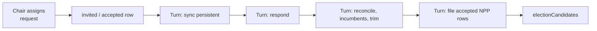

# Party Slate

## Summary

Technical design for the Party Slate: the national and state party board where leadership assigns players or same-party NPPs to the races in each state or region, and the turn pass that turns those assignments into candidacies.

Player guide: [Party Slate](https://www.ahousedividedgame.com/wiki/party-slate). The wiki page [Primaries](https://www.ahousedividedgame.com/wiki/primaries) also mentions slate fill for NPPs.

The Slate is a national-party planning and assignment surface, not a separate election system. It helps party leadership:

- view every eligible race by state or region
- assign players or same-party NPPs to those races
- persist those assignments across cycles until manually changed
- coordinate candidate movement between same-state races

The surfaces live under the national party `Slate` tab and each scoped state or regional party `Slate` tab. Both write the same rows.

Scope. Slate is designed around subnational and legislative races. Presidential races do not use the board: the assignment route refuses them with "Presidential races do not use the slate assignment board." (`src/app/api/country/[code]/parties/[id]/slate/[electionId]/invitations/route.ts`), and the persistence sync skips them (`syncPersistentSlateAssignments` in `src/lib/turn/npp/slateResponses.ts`).

The board renders as a country map for countries with map support, with a selected-state or selected-region race list beneath it. Scoped state or regional party views render the same race list without the national map. Each race card shows the race name, cycle, timing and phase context, assigned candidates, the assignment state, the election phase strip, and embedded primary or general results when available. That status data comes from the shared election display pipeline used on the state and election pages, so Slate keeps no election-summary model of its own.

## Rules

| Rule | Value | Source |
| --- | --- | --- |
| NPP loyalty needed to be Slate-compliant | 40 or more | `SLATE_NPP_LOYALTY_THRESHOLD` in `src/lib/slateAssignments.ts` |
| NPP stubbornness allowed to be Slate-compliant | 70 or less | `SLATE_NPP_STUBBORNNESS_THRESHOLD` in `src/lib/slateAssignments.ts` |
| Missing loyalty or stubbornness | treated as 50 | `src/lib/slateAssignments.ts` |
| State or regional leadership bonus | loyalty requirement minus 5, stubbornness ceiling plus 5 | `STATE_SLATE_ASSIGNMENT_BONUS` in `src/lib/slateAuthority.ts` |
| Candidates one party may hold on one race | 3, players and NPPs sharing the same pool | `SLATE_ASSIGNMENT_CAP` in `src/lib/slateAssignmentCap.ts` |
| Statuses that hold a slot | `invited`, `considering`, `accepted`, `filed` | `LIVE_SLATE_STATUSES` in `src/lib/slateAssignmentCap.ts` |
| Fit score shown to the chair | `round((loyalty * 0.65 + (100 - stubbornness) * 0.35) * 10) / 10` | `computeSlateAssignmentScore` in `src/lib/slateAssignments.ts` |
| Incumbent fit score floor | 80 | `decideNPPSlateResponse` in `src/lib/turn/npp/slateResponse.ts` |
| Player assignment fit score | 100 | `buildCharacterSlateCandidate` in the invitations route |
| Invitation note length | at most 280 characters | `assignSchema` in the invitations route |
| Fit score for a retired or cooling-down NPP | 0 | `decideNPPSlateResponse` |

### Compliance formula

An NPP is Slate-compliant when, with the assigner's bonus applied:

```
loyalty >= 40 - loyaltyRequirementReduction
stubbornness <= 70 + stubbornnessAllowanceBonus
```

The bonus is 5 and 5 when the assigner is a `State / Regional Party Chair` or `State / Regional Party Vice Chair` for the race's own state. National chairs and vice chairs, and admins, get 0 and 0 (`getSlateAcceptanceStatBonus` in `src/lib/slateAuthority.ts`). The assigning role is stored on the row (`assignedByRole`), so the bonus survives later role changes. The same thresholds match the discipline-watch mental model.

### Assignment authority

`resolveSlateAuthority` (`src/lib/slateAuthority.ts`) lets these roles manage Slate rows:

- `National Party Chair` and `National Party Vice Chair`, read from `party.chairId` and `party.viceChairId`
- `State / Regional Party Chair` and `State / Regional Party Vice Chair` for races in their own state, read from the `statePartyOrg` document for that state
- admin override (no bonus, no role label)

Everyone else can view but not modify. Authority checks the seat holder directly, so the acting-chair inheritance in [party-leadership-authority.md](./party-leadership-authority.md) does not apply here. A party whose chair seat is vacant has no national Slate manager unless the vice-chair seat is filled, because the vice-chair is a named role in its own right.

For NPP assignments the route also requires party NPP control (`getPartyNppControlStatus` in `src/lib/parties/antiAbuseGuards.ts`) and returns 403 with the control error otherwise. Default parties and admins always pass. For a player-founded party the check requires the party to be at least 48 hours old (waived during the founding window of 240 hours after world start), the actor to be a current member, and the actor to have held the party for 48 hours.

### Player assignments

When a player is assigned, the row is written as `accepted` immediately with fit score 100, the assignment appears on the board, and the player gets an in-game notification titled "Party slate assignment" naming the assigner and, when applicable, their role label. A player must live in the race's state, belong to the party and not already be filed in another race this cycle; otherwise the route returns 400 or 409.

Slate does not auto-file players. The turn filing pass only handles `candidateType: "npp"` rows (`fileAcceptedSlateRows`), so the player still has to enter the race through the election flow. If they never do, the row stays `accepted` and keeps holding one of the three slots.

### NPP assignments

NPP behaviour is relationship-free and fully deterministic (`decideNPPSlateResponse`, `src/lib/turn/npp/slateResponse.ts`). Order of checks:

1. Retired NPP: declined, reason `retired`.
2. Election cooldown still running for this NPP: declined, reason `cooldown`.
3. Incumbent holding the seat: accepted, fit score at least 80.
4. Not Slate-compliant: declined, reason `low_compliance`.
5. Otherwise accepted.

There is no randomness, so the pre-turn chip is exactly what the turn produces. `processSlateResponses` has one more decline before the resolver runs: if the party is not in the set allowed to field NPP candidates this turn (`nppElectionEligiblePartyKeys`), the row is declined with reason `cooldown`.

At assignment time the route writes the NPP row as `invited`, with `refusalReason` pre-set to `low_compliance` when the NPP fails the compliance test for that assigner. The Slate shows `Likely to Accept` or `Likely to Decline` from that prediction. After the turn, an NPP that enters the race shows `Accepted` (and later `Filed`), and one that fails shows `Declined`.

### Statuses and refusal reasons

Statuses: `invited`, `accepted`, `declined`, `withdrawn`, `filed` (type in `src/lib/db/types/recruitmentSlate.ts`). `considering` is deprecated legacy: the resolver no longer produces it, but `processSlateResponses` still reads any pre-existing `considering` row and resolves it to `accepted` or `declined`. Declined and withdrawn rows release their slot.

Refusal reasons written by the NPP decision: `low_compliance`, `retired`, `cooldown`. Written by the filing pass when an accepted row cannot go on the ballot: `ineligible_region`, `party_restricted`, `npp_unavailable`, `already_slated_elsewhere`, `seat_not_on_ballot`, `slate_full`. Legacy values kept for old rows: `low_relationship`, `low_ambition`, `race_priority_mismatch`, `slot_taken`. `in_other_race` has a display label (`src/lib/slateRefusalReasons.ts`) but nothing writes it. Filing failures are tombstoned as `withdrawn` with the reason so the chair can see why the NPP vanished from the ballot (ticket #1181).

### Persistence

Assignments stay on the board across turns, after election processing and into the next race cycle. `syncPersistentSlateAssignments` hydrates an empty race from the latest slate for the same country, party, state and election type, skipping pairs that cannot have a template. They change only when leadership updates or withdraws them, or when a candidate files.

### Same-state movement

Assigning a candidate to a new same-state race tombstones their other same-state rows as `withdrawn` (ticket #906). A hard delete would leave the old slate empty and the per-turn sync would re-hydrate it. For a compliant NPP, `reconcileSlateMoves` and the filing pass can withdraw them from the old race and file them into the target. A compliant slated NPP is not auto-picked into other races or auto-defended into an incumbent seat the chair has moved them off (`slateSuppressesAutoPick`, `slateSuppressesIncumbentDefense` in `src/lib/turn/npp/slateOverride.ts`). Non-compliant NPPs keep their autonomous behaviour. If another same-party candidate is already in the target race, the Slate NPP still joins and creates a contested primary rather than replacing the existing entrant. The chair also outranks the autopilot: an NPP picked by the generic party fill is withdrawn to make room for a chair's pick while the race has room (ticket #1181).

### Withdrawing

Withdrawing (`.../invitations/[candidateRowId]/route.ts`, DELETE) removes the candidate from the slot rather than leaving a placeholder. Withdrawing a `filed` row also withdraws the live candidate from the election, scrubs the vote tally and archives the campaign, unless the race is completed, resolved or cancelled (409). A candidate withdrawn from one same-state race is free to be assigned to another.

## Data

| Collection | Fields | Read or written | Player-visible |
| --- | --- | --- | --- |
| `recruitmentSlates` | `countryId`, `partyId`, `electionId`, `state`, `electionType`, `priority` (`high`, `defend`, `primary_threat`, `none`), `notes`, `archivedAt`, `createdBy` | Created by `ensureSlate`; `priority` and `notes` edited through the slate PATCH route | Chairs only (the Slate tab) |
| `slateCandidates` | `slateId`, `electionId`, `partyId`, `candidateType`, `candidateId`, `candidateName`, `homeState`, `assignedByCharacterId`, `assignedByRole`, `status`, `fitScore`, `invitationNote`, `refusalReason`, `autoFilled`, `invitedAt`, `respondedAt`, `filedAt` | Written by the invitations routes and by the turn passes | Chairs see all fields; a player sees only the notification |
| `electionCandidates` | `characterId`, `nppId`, `isNPP`, `party`, `status`, `enteredAt` | Read for cap accounting; written when an accepted NPP row files or is trimmed | Yes, the ballot |
| `npps` | `personality.loyalty`, `personality.stubbornness`, `retiredAt`, `homeState`, `electionCooldowns` | Read only | Personality is shown as Slate chips and fit score |
| `statePartyOrg` | `chairId`, `viceChairId` | Read for state authority | Yes |
| `politicalParties` | `chairId`, `viceChairId`, `isDefault` | Read for national authority and NPP control | Yes |
| `notifications` | type `system`, title "Party slate assignment" | Written when a player is assigned | Yes, to the assigned player |

## Configuration

Slate has no `gameConfig` field, era or country preset, or scenario override. All values are code constants.

| Setting | Default | Where set |
| --- | --- | --- |
| `SLATE_NPP_LOYALTY_THRESHOLD`, `SLATE_NPP_STUBBORNNESS_THRESHOLD` | 40, 70 | `src/lib/slateAssignments.ts` |
| `STATE_SLATE_ASSIGNMENT_BONUS` | 5 | `src/lib/slateAuthority.ts` |
| `SLATE_ASSIGNMENT_CAP` | 3 | `src/lib/slateAssignmentCap.ts` |
| NPP control age and tenure | 48 hours each, 240-hour founding window | `src/lib/parties/antiAbuseGuards.ts` |
| Parties allowed to field NPP candidates | computed each turn by `buildNppElectionEligiblePartyKeys` | `src/lib/parties/antiAbuseGuards.ts`, loaded in `src/lib/turn/npp/context.ts` |
| One-party-state constraints on filing | `canFieldExecutiveCandidate`, `canFieldLegislativeCandidate` | `src/lib/turn/onePartyConstraints.ts` |

## Timing

The Slate runs inside the NPP behaviour phase (`src/lib/turn/nppBehavior.ts`), in this order each turn:

1. NPP mortality.
2. Load NPP context.
3. `syncPersistentSlateAssignments`: carry prior-cycle assignments into empty races.
4. `processSlateResponses`: resolve every `invited` or `considering` NPP row to `accepted` or `declined`.
5. `processElectionEntry` (`src/lib/turn/npp/electionEntry.ts`): `reconcileSlateMoves`, then incumbent defenders re-file, then `trimOverCapSlates`, then `fileAcceptedSlateRows` (Phase 1a), then the generic party-pool fallback.
6. Endorsements, then federal and local bill voting.

Responses run before entry so accepted rows are ready to file in the same turn. Slate challengers file after incumbents, so they can still create a same-party primary against the sitting NPP. Both passes are idempotent. Assignments by a chair resolve on the next turn, never immediately; assignments themselves are requests, not turns.



## Worked trace

An NPP has loyalty 37 and stubbornness 72, and is not an incumbent, retired or on cooldown.

| Step | Computation | Result |
| --- | --- | --- |
| Fit score | `round((37 * 0.65 + (100 - 72) * 0.35) * 10) / 10 = round((24.05 + 9.8) * 10) / 10` | 33.9 |
| National chair assigns | needs loyalty 40 or more (37 fails) and stubbornness 70 or less (72 fails) | Row `invited`, `refusalReason: low_compliance`, chip `Likely to Decline` |
| Turn, `decideNPPSlateResponse` | not compliant | `declined`, `low_compliance`, fit 33.9; the slot is released |
| State chair assigns instead | needs loyalty 35 or more (37 passes) and stubbornness 75 or less (72 passes) | Row `invited`, `refusalReason: null`, chip `Likely to Accept` |
| Turn, respond step | compliant | `accepted`, fit 33.9 |
| Turn, filing step | slots used by the party on this race below 3 | `ElectionCandidate` inserted, row becomes `filed` |
| Same NPP as incumbent defending the seat | accepted whatever the stats | fit `max(33.9, 80) = 80` |

An NPP with loyalty 34 fails even under the state bonus (35 needed). Slot accounting for the same race: a state chair has assigned two NPPs and one player (3 slots used). A fourth assignment returns 409 "This race already has 3 assigned candidates. Withdraw one before assigning another." A player who files on their own does not add a slot.

## Edge cases and limits

- **Cap of 3 per party per race.** The route rejects a fourth with a 409. A player who filed their own candidacy does not spend a slot; an active NPP candidacy without a slate row does. The route excludes the candidate being assigned from the count. If a race is already over the cap, `trimOverCapSlates` withdraws the extras from the end of this order: defending incumbents first, then NPPs already on the ballot by how long they have stood, then live rows by oldest invitation. A player's own candidacy is never withdrawn, so a race can stay over the cap if only players remain to trim. Overflow at filing is marked `slate_full`. The trim only runs on races whose primary is still open.
- **Slate locks** when the race is not `upcoming` or `active`, or when the primary has closed (`isPrimaryClosed`). Assigning after the primary would otherwise file straight into the general (409). A filed-row withdrawal is refused on a completed, resolved or cancelled race.
- **Archived slate.** Assigning against an archived slate returns 409, and responses ignore archived slates.
- **Already filed.** A `filed` row cannot be reassigned (409); an existing live row returns "already on the slate" (409).
- **Incumbents always accept** to defend their seat.
- **Retired and cooldown NPPs** always decline regardless of stats.
- **Wrong state or party.** An NPP or player not living in the race's state, belonging to another country or party, or an NPP that retired returns 400.
- **Presidential races** are excluded; they use the regular election flow.
- **Losing the chair seat** does not delete existing rows, because assignments persist until someone with authority changes them. The new holder inherits the board.
- **Worlds without player chairs** behave as if the Slate did not exist: no chair-managed slate means no override, and the sync short-circuits.
- **Special by-elections.** A sitting in-state Commons MP is refused (`seat_not_on_ballot`) on a `special_commons` slate, since that race fills only vacated seats.

## Invariants

| Invariant | Enforced by |
| --- | --- |
| A party holds at most 3 slots on a race through the assignment route and through filing | `src/lib/slateAssignmentCap.test.ts`, route and turn-pass tests; the route check is "courteous" and can undercount rows not yet materialized from a template, so the filing pass is the authority |
| The NPP decision is deterministic and never returns `considering` | `src/lib/turn/npp/slateResponse.test.ts` |
| The pre-turn prediction equals the turn outcome | By sharing `isNppSlateCompliant` and `getSlateAcceptanceStatBonus` between route and resolver; no single test compares them end to end |
| A player's own candidacy is never withdrawn by the trim | `src/lib/turn/npp/slateResponses.test.ts` ("never withdraws a player's own candidacy") |
| A filed slate row and its candidacy count as one slot | `src/lib/slateAssignmentCap.test.ts` |
| A row that cannot file records a reason | `src/lib/turn/npp/slateResponses.test.ts`; not enforced as a database constraint |

## Failure and recovery

| Failure | What it looks like | Repair |
| --- | --- | --- |
| Row insert throws during filing | One NPP is missing from the ballot | The pass isolates the failing row so the rest still file; the row is retried on the next turn |
| NPP vanishes from the Slate tab | A filing failure used to tombstone with no reason | Since ticket #1181 the row keeps a visible `refusalReason`; reassign or pick another candidate |
| Race over the cap from older data | The Slate card reports more than 3 candidates | `trimOverCapSlates` withdraws NPP extras on the next turn |
| Empty slate re-hydrated after a move | NPP reappears in the old race | Fixed by tombstoning rather than deleting (#906); a stale slate can be cleared by withdrawing the row |
| Stale `invited` rows on an archived slate | Never resolve | They are ignored by design; archive state is the cleanup |
| Persistent sync does nothing | A new cycle starts with empty boards | The race has no prior slate of the same country, party, state and type; the chair assigns again |

## Connections

**Driven by**
- [Parties](./parties.md) and [party-building.md](./party-building.md): chair and vice-chair seats, and state party org leadership, decide who can assign (`resolveSlateAuthority`).
- [NPP system](./npp-system.md): loyalty and stubbornness personality traits decide acceptance (`isNppSlateCompliant`).
- [Elections](./elections.md): open primaries and their phase decide which races appear and when the board locks (`isPrimaryClosed`).

**Affects**
- [Elections](./elections.md): accepted NPP rows become `ElectionCandidate` entries during `processElectionEntry`, creating or contesting primaries.
- Player notifications: assigning a player writes a notification (`notifyAssignedPlayer`).
- [Party influence](./party-influence.md): none directly. Slate is a coordination layer and does not spend influence.

## Tests

| File | Covers |
| --- | --- |
| `src/lib/turn/npp/slateResponse.test.ts` | Decline and accept order, incumbent floor, state bonus tipping |
| `src/lib/turn/npp/slateResponses.test.ts` | Response pass, filing pass, cap, displacement, trim, closed primary, by-elections |
| `src/lib/turn/npp/slateOverride.test.ts` | Auto-pick and incumbent-defense suppression |
| `src/lib/slateAssignmentCap.test.ts` | Slot accounting |
| `src/lib/slateRefusalReasons.test.ts` | Reason labels |
| `src/lib/db/recruitmentSlateLookup.test.ts` | Slate and template lookup |
| `src/app/api/country/[code]/parties/[id]/slate/route.test.ts`, `.../slate/[electionId]/route.test.ts` | Board read and priority edits |
| `.../slate/[electionId]/invitations/route.test.ts`, `.../invitations/[candidateRowId]/route.test.ts` | Assign and withdraw |

Gaps: there is no unit test file for `src/lib/slateAssignments.ts` or `src/lib/slateAuthority.ts` themselves (they are covered only through the resolver and route tests), and no end-to-end test that the pre-turn chip always matches the turn result.

## Known issues and history

- `in_other_race` is a defined refusal reason with a label, but no code writes it.
- Four refusal values (`low_relationship`, `low_ambition`, `race_priority_mismatch`, `slot_taken`) and the `considering` status are legacy and kept for old rows.
- The assignment route's cap check can undercount rows that have not yet been carried forward from the previous cycle; the filing pass is authoritative.
- The party-level UK regional geography rule that once produced `ineligible_region` no longer exists; the live producer is a candidate homed outside the race's region.
- Ticket #906: same-state moves tombstone rather than delete. Ticket #1181: filing failures keep a reason and the chair outranks autopilot picks. The per-race cap of 3 replaced an earlier single-slot rule (`slot_taken`).

Last checked: 2026-10-29, version 1.18.0
