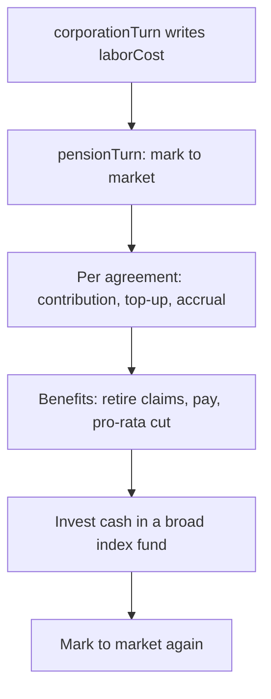

# Occupational Pensions

## Summary

Second-pillar pension funds attached to unions. The state pension (first pillar) is a separate pay-as-you-go budget line (`{cc}.health.socialInsurance.primary`) funded out of tax; this system does not touch it. An occupational pension is bargained into a collective agreement alongside wages: the employer pays a contribution rate into a fund the union holds, covered workers accrue a claim against that fund, and the fund pays benefits to retirees out of its own cash. It ships as part of the A8 union-bargaining work. The bargaining route that sets the rate needs `labourSystemMode` of `"full"` (see [Labour](./labour.md)); the turn-processing pass itself runs whenever an active `CollectiveAgreement` carries a `pensionContributionRate`.

Player guide: [Pensions](https://www.ahousedividedgame.com/wiki/pensions)

Every anchor (₳) that enters a scheme was debited from a real employer's `liquidCapital` and ledgered on both legs. A scheme cannot mint assets. This is deliberately unlike the NPP investable-cash accrual, which is an uninstrumented modelled mint outside the ledger perimeter, a pension scheme that minted its own assets would be a second one of those in a system whose whole point is that the assets are real and can fall short.

## Rules

### Bargaining the rate

`pensionContributionRate` is a term in `BargainingTerms`, set by either party's offer during a bargaining campaign, alongside `wageLevel`, `agreementDurationTurns`, and `noStrikeTurns`. Valid range is `PENSION_CONTRIBUTION_RATE_MIN` (0) to `PENSION_CONTRIBUTION_RATE_MAX` (0.15), up to 15% of the covered wage bill. An omitted or zero rate means no pension was bargained.

Mediation splits the pension question the same way it splits the wage question: leverage-weighted between the two sides' latest offers.

```
unionWeight = 0.35 + (campaign.mandate.leverage / 100) * 0.3
pensionContributionRate = round(employerRate + (unionRate - employerRate) * unionWeight, 4dp)
```

The settled term is written onto the resulting `CollectiveAgreement.pensionContributionRate` (optional field, absent reads as zero) only when the mediated rate is greater than 0.

### The wage bill

`sector.laborCost` is written by the corporation turn as a DAILY figure (per-turn cost times `TURNS_PER_DAY`, same convention as `revenue`). The pension pass is a per-TURN pass, so it divides that figure back down (`coveredWageBillPerTurn`) before charging anything against it. `sector.laborCost` is documented elsewhere as display/analytics telemetry, not normally read back into the economy; the pension pass is an exception and treats an absent or non-finite figure as contributing nothing, the labour system can be off entirely, and inventing a wage bill would charge an employer for workers the economy is not modelling. The same wage-bill figure drives both the contribution and the accrual, so the two are always measured against the same population.

### Step 1: contribution

For each active agreement with `pensionContributionRate > 0`:

```
contribution = coveredWageBill * pensionContributionRate
```

Debited from the employer's liquid capital via `atomicallyDebitCorpLiquidCapital`. If the employer cannot pay, the contribution is simply not made, the claim is **not** forgiven; it still accrues (step 3). Contribution and top-up are ledgered together as one `pension_contribution` financial-tx-log pair (employer debit, scheme credit), only when something was actually moved.

### Step 2: top-up

If the scheme is short of `PENSION_DEFICIT_RATIO` (0.9) funded, the employer is asked for an additional top-up, computed against the position **before** this turn's accrual (so a top-up never bills an employer for a shortfall the same turn's accrual just created):

```
fundingRatio = totalAssets / liabilities   (1 if no liabilities, 0 if no assets)
target = liabilities * PENSION_DEFICIT_RATIO
shortfall = target - assets
topUp = shortfall * PENSION_TOPUP_FRACTION   (0.05, i.e. 5% of the shortfall per turn)
```

`totalAssets` here is cash (`assetsAnchor`) plus this turn's paid contribution plus the marked-to-market value of any invested units (`investedValueAnchor`), never cash alone, or a scheme that had simply invested half its money would read as half funded. The top-up is deliberately partial (5%/turn): closing a deficit in one turn would bankrupt an employer for a slow-moving accounting number; a scheme recovering over roughly a couple of game-years is the intended shape. Also debited via `atomicallyDebitCorpLiquidCapital`; failure increments `shortfalls` and does not forgive the claim.

### Step 3: accrual

Always applied, whether or not the employer could pay steps 1-2:

```
accrual = coveredWageBill * PENSION_ACCRUAL_RATE   (0.08)
```

Added to `scheme.liabilitiesAnchor`. The accrual rate (8%) is set below the contribution ceiling (15%) on purpose: a scheme bargained at the maximum contribution rate builds a surplus rather than running to stand still, so the bargained rate is a real choice with a visible consequence either way. At a contribution rate of 0, a scheme still accrues liabilities it never funds, the correct picture of promising a pension and paying nothing in.

### Funding bands

```
pensionFundingRatio = assets / liabilities   (1 if liabilities <= 0, 0 if assets <= 0)
```

| Band | Condition |
| --- | --- |
| `surplus` | ratio > 1.1 |
| `funded` | 0.9 <= ratio <= 1.1 |
| `deficit` | 0.6 <= ratio < 0.9 (`PENSION_DEFICIT_RATIO`) |
| `critical` | ratio < 0.6 (`PENSION_CRITICAL_RATIO`) |

`describeFundingBand()` supplies one sentence per band for the union dashboard and employer console (e.g. deficit: "The scheme is short. The employer is being asked for a top-up every turn until it recovers.").

### The scheme document

One `PensionScheme` per union, created by `ensurePensionScheme` in the first pension turn pass that finds an active agreement carrying a rate above zero and a measurable wage bill (not at the moment of settlement). A unique index on `unionId` makes a concurrent creation race resolve to one document. A union that never bargained a pension has no scheme document at all, not a row of zeroes. Key fields: `assetsAnchor` (cash), `investedValueAnchor` (marked-to-market fund units, phase 2), `liabilitiesAnchor` (total accrued claims), `benefitsInPaymentAnchor` (the slice of liabilities that has come into payment), and cumulative counters `totalContributionsAnchor`, `totalTopUpsAnchor`, `totalBenefitsPaidAnchor`, `totalBenefitsUnpaidAnchor`, `totalInvestedAnchor`.

### Phase 2, part A: benefits in payment

Runs after the contribution/accrual sweep, via `runPensionBenefitsTurn`, for every scheme with `liabilitiesAnchor > 0` (independent of whether any agreement is still active, a scheme with liabilities and no live agreement is the ordinary end state of a workplace that closed).

Union membership has no individual pensioner: it's modelled in aggregate (a sector's unionization rate, a union's membership pressure), and a player character who retires is deleted outright by `retireCharacter`. So benefits are a flow against the modelled covered workforce as a whole, ledgered with `counterpartyType: "system"` / `counterpartyName: "Pensioners"`, exactly like other payments that leave the instrumented perimeter.

**Retirement (claims coming into payment):**

```
notYetInPayment = liabilities - benefitsInPayment
retirements = notYetInPayment * PENSION_RETIREMENT_RATE   (0.01, i.e. 1%/turn)
```

Runs before the drawdown is computed, so a scheme's first pensioners start drawing the turn they retire rather than a turn later.

**Benefits due:**

```
benefitsDue = (benefitsInPayment + retirements) * PENSION_BENEFIT_DRAWDOWN_RATE   (0.02, i.e. 2%/turn)
```

The stock drains gradually (2%/turn of whatever is in payment) rather than paying out in one shot, so underfunding is a slow, visible problem.

**The pro-rata cut:** benefits are paid from cash only (`scheme.assetsAnchor`), never overdrawn, never borrowed:

```
if cash >= due: paid = due, cutFraction = 0
else: paid = cash, unpaid = due - cash, cutFraction = unpaid / due
```

When cash is short, every pensioner takes the same proportional cut, the model has no basis to pay some in full and others nothing. The unpaid amount is **not** forgiven and **not** carried as separate arrears; it simply stays on the books as liability (it isn't discharged), so the scheme continues to show as underfunded and the employer keeps being asked for a top-up. A guarded update (`assetsAnchor: { $gte: paidAnchor }`) ensures a scheme's cash can never go negative from a benefit payment even under a concurrent write. Paying a benefit discharges the matching liability 1:1 (`liabilitiesAnchor -= paidAnchor`), which is what lets the funding ratio actually improve as a scheme pays down its promise. Ledgered as `pension_benefit`. The stock in payment moves by `retirements - paid` each turn.

### Phase 2, part B: scheme investing

After benefits, `runPensionSchemeInvestments` lets each scheme with cash put a portion into index funds, through the same primitives a player uses (`creditFundPosition`, fund `unitSupply`/`cashAnchor` increments, an `indexFundTransactions` row) under a new holder kind, `"pension_scheme"`. Whole units only, priced at the fund's quoted NAV.

**Fail closed:** if index funds are disabled (`isIndexFundsEnabled()`, true for `indexFundsMode` of `"partial"` or `"full"`), this step does nothing and schemes simply hold cash. Every other pension mechanic (contributions, accrual, benefits, funding ratios read off cash alone) keeps working regardless, investment is optional, never a dependency.

**Fund choice** (`chooseSchemeFund`): only `active`, `kind: "broad"` funds whose mandate mode is not `picked_stocks` are eligible. A scheme prefers its own country's broad index, falling back to the global broad index. Sector funds are explicitly not eligible, concentrating a country's pension assets in the sector its members work in is the exact failure mode occupational schemes are regulated against. A fund quoting a non-positive NAV is skipped.

**Investable cash** (`pensionInvestableCashAnchor`), the tighter of two constraints:

1. Keep `PENSION_LIQUIDITY_BUFFER_TURNS` (8) turns of benefits-due in cash: `buffer = benefitsDue(inPayment) * 8`.
2. Never invest more than `1 - PENSION_CASH_FLOOR_FRACTION` (90%) of cash, so a young scheme with no pensioners yet doesn't go fully illiquid.

Below `PENSION_MIN_INVESTMENT_ANCHOR` (₳1,000), the pass invests nothing (no fund transaction for pocket change). Units bought are `floor(investable / quotedNav)`; cost is derived from whole units at NAV, not from the investable figure, so the ₳ leaving the scheme and the ₳ arriving at the fund always match exactly. A guarded debit (`assetsAnchor: { $gte: costAnchor }`) protects against the benefit pass having moved cash earlier in the same turn. Ledgered as `index_fund_subscribe`.

### Marking to market

`pensionSchemeAssetsAnchor(scheme) = max(0, assetsAnchor) + max(0, investedValueAnchor ?? 0)`. This is the **only** function every funding-ratio, band, and top-up computation is allowed to read through, reading `assetsAnchor` alone once a scheme holds fund units would report a scheme that just invested half its money as half funded.

`refreshSchemeInvestedValues` recomputes `investedValueAnchor` from the live `indexFundPositions` (units × fund's `quotedNav`) and writes it back, only for schemes whose value actually changed. It runs twice per pension turn: once before the contribution/accrual sweep (so a top-up is charged against today's mark, not a stale one) and once after the investment pass (so the union surface never shows already-invested cash as still liquid). A position pointing at a deleted fund values at zero.

### Constants reference

The constants live in `src/lib/pensions/rules.ts`; only the first four rows plus `PENSION_LIQUIDITY_BUFFER_TURNS` are exported, the rest are module-private. The funding-band cut-off of 1.1 (surplus) is a literal in `pensionFundingBand` in the same file; the 0.35 base and 0.3 leverage share in the mediation weight are literals in `src/lib/unions/bargaining.ts`.

| Constant | Value | Meaning |
| --- | --- | --- |
| `PENSION_CONTRIBUTION_RATE_MIN` (`src/lib/pensions/rules.ts`) | 0 | Floor on bargained contribution rate |
| `PENSION_CONTRIBUTION_RATE_MAX` (`src/lib/pensions/rules.ts`) | 0.15 | Ceiling on bargained contribution rate (15% of covered wage bill) |
| `PENSION_ACCRUAL_RATE` (`src/lib/pensions/rules.ts`) | 0.08 | Liability accrued per turn as a share of covered wage bill |
| `PENSION_DEFICIT_RATIO` (`src/lib/pensions/rules.ts`) | 0.9 | Funding ratio below which a top-up is owed |
| `PENSION_CRITICAL_RATIO` (`src/lib/pensions/rules.ts`) | 0.6 | Funding ratio below which the band is "critical" |
| `PENSION_TOPUP_FRACTION` (`src/lib/pensions/rules.ts`) | 0.05 | Share of the shortfall charged as top-up per turn |
| `PENSION_RETIREMENT_RATE` (`src/lib/pensions/rules.ts`) | 0.01 | Share of not-yet-in-payment liability that retires per turn |
| `PENSION_BENEFIT_DRAWDOWN_RATE` (`src/lib/pensions/rules.ts`) | 0.02 | Share of in-payment stock paid out per turn |
| `PENSION_LIQUIDITY_BUFFER_TURNS` (`src/lib/pensions/rules.ts`) | 8 | Turns of benefits-due kept in cash before investing |
| `PENSION_CASH_FLOOR_FRACTION` (`src/lib/pensions/rules.ts`) | 0.1 | Minimum share of cash never invested |
| `PENSION_MIN_INVESTMENT_ANCHOR` (`src/lib/pensions/rules.ts`) | ₳1,000 | Minimum cash before an investment pass bothers |
| `TURNS_PER_DAY` (`src/lib/constants/corporationsClient.ts`) | 24 | Divisor that turns the stored daily `laborCost` into a per-turn wage bill |

### Source files

- `src/lib/pensions/rules.ts`, all constants, funding ratio/band, contribution/accrual/top-up/retirement/benefit-payment/investable-cash pure functions
- `src/lib/pensions/pensionTurn.ts`, `runPensionTurn`, the per-turn phase entry point; `ensurePensionScheme`; wage-bill helpers
- `src/lib/pensions/pensionBenefits.ts`, `runPensionBenefitsTurn`, the pro-rata benefit cut
- `src/lib/pensions/schemeInvesting.ts`, `runPensionSchemeInvestments`, `chooseSchemeFund`
- `src/lib/pensions/schemeAssets.ts`, `loadSchemeInvestedValues`, `refreshSchemeInvestedValues`, collection name constants
- `src/lib/pensions/employerPensionCosts.ts`, `employerPensionCostForTurn`, the financial-statement projection
- `src/lib/db/types/pensionScheme.ts`, `PensionScheme` document shape
- `src/lib/db/types/union.ts`, `CollectiveAgreement.pensionContributionRate`, `BargainingTerms` reference
- `src/lib/unions/bargaining.ts`, `pensionContributionRate` in offers, mediation weighting, validation
- `src/simulation/phases/turnPhaseRegistry.ts`, `pensionTurn` phase registration, runs immediately after `corporationTurn`
- `src/app/api/unions/[id]/route.ts`, union detail API, builds the `pensionScheme` view sent to the dashboard
- `src/components/unions/UnionPensionSchemePanel.tsx`, union dashboard panel
- `src/components/corporation/financials/financialsModel.ts`, the `"pension"` financial-statement line item
- `src/lib/corporations/queries/corporationDetail/incomeStatement.ts`, computes `pensionContributionCost`/`pensionTopUpCost`/`pensionSchemesInDeficit` for the corp financials surface

## Data

| Collection | Fields | Read or written | Player-visible |
| --- | --- | --- | --- |
| `pensionSchemes` | `unionId`, `countryId`, `unionName`, `assetsAnchor`, `investedValueAnchor`, `liabilitiesAnchor`, `benefitsInPaymentAnchor`, `totalContributionsAnchor`, `totalTopUpsAnchor`, `totalInvestedAnchor`, `totalBenefitsPaidAnchor`, `totalBenefitsUnpaidAnchor`, `createdAtTurn`, `lastChargedTurn`, `lastBenefitTurn`, `lastBenefitCutFraction` | Written by the turn pass and read by the union and employer surfaces | Yes, on the union page (not `unionName`, `createdAtTurn` or `lastChargedTurn` as separate items) |
| `collectiveAgreements` | `pensionContributionRate`, `status`, `startsAtTurn`, `expiresAtTurn`, `sectorIds`, `unionId`, `employerCorporationId` | Read by the sweep; `pensionContributionRate` is written at settlement | Rate is part of the agreement terms |
| `corporateSectors` | `laborCost` (daily basis) | Read only | Shown as wage cost elsewhere |
| `corporations` | `liquidCapital`, `liquidCurrencyCode` | Debited for contributions and top-ups | Yes, cash and the Pensions line |
| `unions` | `name`, `countryId` | Read only | Yes |
| `indexFundPositions` | `holderKind: "pension_scheme"`, `pensionSchemeId`, `fundId`, `units` | Written on purchase, read to mark to market | Fund holdings only |
| `indexFunds` | `quotedNav`, `unitSupply`, `cashAnchor`, `status`, `kind`, `scope`, `countryId`, `mandate.mode` | Read to pick a fund and price units; `unitSupply` and `cashAnchor` incremented on purchase | Yes |
| `indexFundTransactions` | a `subscription` row with `holderKind: "pension_scheme"` | Written per purchase | Fund history |
| `financialTxLog` | types `pension_contribution`, `pension_benefit`, `index_fund_subscribe` | Written | Not shown to players |
| `gameConfig` | `labourSystemMode`, `indexFundsMode` | Read | No |

Indexes (migration `2026-08-10-pension-scheme-indexes`): a unique index on `pensionSchemes.unionId`, an index on `pensionSchemes.countryId`, and a sparse index on `collectiveAgreements` over `pensionContributionRate`, `status`, `expiresAtTurn` for the sweep.

### Where it surfaces

- **Union dashboard** (`src/app/unions/[id]/page.tsx`, panel `UnionPensionSchemePanel.tsx`): renders nothing at all when the union has no scheme (no scheme, not an empty one). Shows cash, invested value, total assets, liabilities, benefits in payment, cumulative contributions/top-ups/invested/paid/unpaid, last benefit cut fraction, funding ratio, and band with `describeFundingBand()` copy. Data comes from `GET /api/unions/[id]`, which reads the scheme via `pensionSchemeAssetsAnchor`/`pensionFundingRatio`/`pensionFundingBand`.
- **Employer's financial statement** (`src/components/corporation/financials/financialsModel.ts`, line item `"pension"` / label "Pensions"): sums `pensionContributionCost + pensionTopUpCost` as an expense line, computed by `employerPensionCostForTurn` in `src/lib/corporations/queries/corporationDetail/incomeStatement.ts`. This is a **projection**, recomputed from the same rules the turn uses (not a history read of the ledger), it answers "what is this agreement charging me right now," gated on `labourWagesEnabled`. The statement restates the per-turn figure on its daily basis. An employer too short to pay in the actual turn pass is still shown what it owes, because the claim accrues either way. Also surfaces `pensionSchemesInDeficit`.
- **Turn-phase result** (`turnPhaseRegistry.ts`, `pensionResult`): logs `schemesCharged`, `contributionsAnchor`, `topUpsAnchor`, `accrualsAnchor`, `shortfalls`, `benefitsPaidAnchor`, `benefitsUnpaidAnchor`, `schemesCutting`, `investedAnchor`, `schemesInvesting` per turn, each rounded to two decimals.

## Configuration

| Setting | Default | Effect | Set in |
| --- | --- | --- | --- |
| `gameConfig.labourSystemMode` | `"full"` in the seeded defaults; an absent or unknown value reads as `"off"` | Bargaining (and so a pension rate) needs `"full"` (`isLabourFullMode` in the bargaining route). The employer statement line needs `"wages"` or higher. The turn pass itself does not check the mode. | `src/lib/seeds/reference/featureFlagDefaults.ts`, read in `src/lib/labour/featureFlag.ts` |
| `gameConfig.indexFundsMode` | `"full"` in the seeded defaults; absent reads as `"off"` unless the deprecated `indexFundsEnabled` is true | `"partial"` or `"full"` lets schemes invest; `"off"` leaves them in cash | `src/lib/seeds/reference/featureFlagDefaults.ts`, read in `src/lib/indexFunds/featureFlag.ts` |

There are no era, country or scenario presets for pensions. Every rate in the constants table is a code constant, not a config field.

## Timing

The `pensionTurn` phase runs once per turn, immediately after `corporationTurn` (`src/simulation/phases/turnPhaseRegistry.ts`), because it reads the `laborCost` that phase writes. Bargaining itself happens outside the turn pass, when a campaign settles (`src/lib/unions/bargaining.ts`); the settled rate then takes effect from the next pension pass. Only agreements with `status: "active"`, `startsAtTurn <= turn` and `expiresAtTurn > turn` are charged.

### Order within the turn

1. `refreshSchemeInvestedValues` (mark to market before anything reads a funding ratio)
2. Per active agreement: contribution → top-up → accrual (this order specifically, so a top-up is never billed against a shortfall the same turn's own accrual created)
3. `runPensionBenefitsTurn` (retirements, then benefits due, then the pro-rata cut)
4. `runPensionSchemeInvestments`
5. `refreshSchemeInvestedValues` again

Steps 3 to 5 run even when no agreement carries a rate, so mature schemes keep paying pensions.



## Worked trace

An employer covers sectors whose stored daily `laborCost` totals 24,000,000, so the wage bill per turn is 24,000,000 / 24 = 1,000,000. The agreement rate is 0.06. The scheme starts the turn (after the first mark to market) with cash 1,000,000, invested value 200,000 (16,000 units at NAV 12.50), liabilities 1,500,000 and benefits in payment 300,000. The employer can pay.

| Step | Calculation | Result |
| --- | --- | --- |
| Contribution | 1,000,000 x 0.06 | 60,000 paid |
| Total assets for the test | 1,000,000 + 200,000 + 60,000 | 1,260,000 |
| Funding ratio | 1,260,000 / 1,500,000 | 0.84, below 0.9 |
| Target | 1,500,000 x 0.9 | 1,350,000 |
| Shortfall | 1,350,000 - 1,260,000 | 90,000 |
| Top-up | 90,000 x 0.05 | 4,500 paid |
| Accrual | 1,000,000 x 0.08 | 80,000 |
| Stored after sweep | cash 1,000,000 + 60,000 + 4,500; liabilities 1,500,000 + 80,000 | cash 1,064,500; liabilities 1,580,000 |
| Retirements | (1,580,000 - 300,000) x 0.01 | 12,800 |
| In payment | 300,000 + 12,800 | 312,800 |
| Benefits due | 312,800 x 0.02 | 6,256, cash is enough, so cut 0 |
| Stored after benefits | cash 1,064,500 - 6,256; liabilities 1,580,000 - 6,256; in payment 312,800 - 6,256 | cash 1,058,244; liabilities 1,573,744; in payment 306,544 |
| Buffer | 306,544 x 0.02 x 8 | 49,047.04 |
| Investable | min(1,058,244 - 49,047.04 = 1,009,196.96, 1,058,244 x 0.9 = 952,419.60) | 952,419.60 |
| Units | floor(952,419.60 / 12.50) | 76,193 |
| Cost | 76,193 x 12.50 | 952,412.50 |
| Cash after | 1,058,244 - 952,412.50 | 105,831.50 |
| Invested value after mark | (16,000 + 76,193) x 12.50 | 1,152,412.50 |
| Final ratio | (105,831.50 + 1,152,412.50) / 1,573,744 | 0.7995, still `deficit` |

The employer's cash fell by 64,500. The scheme's total assets grew by 64,500 and fell by the 6,256 paid out, which gives 1,258,244.

## Edge cases and limits

- **No pension bargained.** An omitted or zero rate writes no term on the agreement and no scheme document is created. Nothing accrues.
- **Rate bounds.** Offers are validated to 0 to 0.15. A mediated rate of 0 is not written.
- **Employer cannot pay.** Contribution and top-up debits go through `atomicallyDebitCorpLiquidCapital`, which will not overdraw. A failed debit is counted in `shortfalls`; the accrual still lands, so the liability grows regardless.
- **Labour system off or no wage bill.** An absent or non-finite `sector.laborCost` counts as zero, so nothing is contributed or accrued, and the agreement is skipped without creating a scheme. The page does not invent a wage bill.
- **Zero liabilities.** Funding ratio reads 1 when liabilities are 0 or less, and 0 when assets are 0 or less. No top-up is owed at ratio 1.
- **Cash never goes negative.** Benefit payment and fund purchases use guarded updates on `assetsAnchor`, so a concurrent write cannot overdraw a scheme. If the guard misses, that scheme is skipped for the turn and an error string is recorded.
- **Unpaid benefits are not forgiven.** The unpaid slice stays as liability, which keeps the scheme in deficit and keeps the top-up running.
- **No agreement left.** Benefits keep running for any scheme with liabilities above 0, even when no agreement is active. Contributions and accrual stop when the agreement expires.
- **Index funds off.** Investing is skipped and the scheme holds cash. Only broad `active` funds qualify; sector funds and `picked_stocks` mandates are excluded on purpose to avoid concentration.
- **Small cash.** Under 1,000 anchors investable, no purchase is made. Units are whole; cost is units times NAV.
- **Deleted fund.** A position in a deleted fund is marked at zero.
- **First pension on an existing agreement.** The scheme is created by the first turn pass that charges the agreement, not at settlement.
- **Currency.** Employer debits are in the employer's liquid currency; scheme balances are stored in anchor currency (₳). The pass converts with the employer's FX rate.
- **No redemption path.** A scheme cannot sell fund units to pay benefits, which is why the cash buffer exists.

## Invariants

| Invariant | Enforced by |
| --- | --- |
| A scheme never mints assets: every ₳ in came from an employer debit | Guarded debits in `pensionTurn.ts`; ledger pairs. No test asserts the whole chain end to end |
| Scheme cash never goes negative | Guarded `$gte` updates in `pensionBenefits.ts` and `schemeInvesting.ts`; tests in `pensionPhase2.test.ts` ("skips the scheme rather than overdrawing", "issues no units when the guarded debit misses") |
| Benefits paid never exceed benefits due or cash held | `pensionBenefitPayment`, tested in `rules.test.ts` |
| Benefits in payment never exceed total liabilities | `pensionRetirementsForTurn` only retires the not-yet-in-payment slice, tested in `rules.test.ts` |
| The funding ratio does not change when cash is swapped for fund units at NAV | `pensionSchemeAssetsAnchor`; tested in `rules.test.ts` and `pensionPhase2.test.ts` |
| Fund purchase: the scheme debit equals the fund credit | Cost derived from whole units at NAV; tested in `pensionPhase2.test.ts` |
| One scheme per union | Unique index `unique_pension_scheme_per_union`. Not covered by a unit test |
| Contribution rate stays in 0 to 0.15 | `isValidContributionRate`, used by bargaining validation and the turn pass, tested in `rules.test.ts` |

## Failure and recovery

- **A debit fails for an employer.** The employer is counted in `shortfalls`, the claim still accrues, and the scheme drifts into deficit. This is the intended outcome, not an error. It recovers when the employer has cash again and the top-up resumes.
- **Cash moved under a payment or purchase.** The guarded update misses, the scheme is skipped for that turn, and the error is returned in the phase result. The next turn recomputes from fresh data.
- **Fund price or fund missing.** A fund quoting a non-positive NAV is skipped; positions in a deleted fund are marked at zero. Schemes keep their cash and the funding ratio drops honestly.
- **One scheme or agreement throws.** The error is caught per item and added to the phase result. Other schemes still run.
- **Stale invested value.** `investedValueAnchor` is a cache of the positions. It is rewritten on every pass where it changed, so a missed turn heals on the next run.
- **Corrupted balances (for example a wrong ledger entry).** Repaired by a data heal against the scheme document, then the next turn's mark to market restores the invested leg. The turn pass itself never rewrites cash or liabilities except through its own formulas.

## Connections

**Driven by**
- [Labour](./labour.md): the covered wage bill (`sector.laborCost`, read in `src/lib/pensions/pensionTurn.ts`) sets contribution and accrual; the bargaining path sets the rate (`src/lib/unions/bargaining.ts`).
- [Corporations](./corporations.md): the employer's `liquidCapital` pays contributions and top-ups.
- Index funds: fund NAV marks invested units to market (`src/lib/pensions/schemeAssets.ts`).

**Affects**
- Employer finances: contribution and top-up appear as a Pensions line in the corporation financial statement (`src/lib/corporations/queries/corporationDetail/incomeStatement.ts`).
- Union dashboard: funding ratio and band are shown on the union page (`src/app/api/unions/[id]/route.ts`).
- Index funds: scheme purchases add to a fund's unit supply and cash.

## Tests

| File | Covers |
| --- | --- |
| `src/lib/pensions/rules.test.ts` | Contribution, accrual, top-up, funding ratio and band, retirement, benefit cut, investable cash, mark to market |
| `src/lib/pensions/pensionTurn.test.ts` | `coveredWageBill` and the daily to per-turn conversion |
| `src/lib/pensions/pensionPhase2.test.ts` | Mark to market loader, benefit pass and pro-rata cut, fund choice, scheme investing, ratio after a subscription |
| `src/lib/pensions/employerPensionCosts.test.ts` | The employer statement projection |
| `src/lib/migrations/entries/2026-08-10-pension-scheme-indexes.test.ts` | The index plan |

Gaps: `runPensionTurn` (the agreement sweep, scheme creation and the two-leg ledger writes) has no direct test, `src/lib/unions/bargaining.test.ts` does not assert the mediated pension rate, and nothing tests the union panel or the API view.

## Known issues and history

- The player wiki page says a scheme is created when the settled rate is above zero. In code the scheme is created at the first pension pass that charges the agreement, so a freshly settled agreement has no scheme until the next turn.
- Benefits go to no addressable person, so a cut cannot be traced to a character. This is a modelling choice, recorded in the code comments.
- Schemes have no redemption path for fund units, so a scheme with a large invested share and a falling fund can only be rescued by employer top-ups.
- Shipped in two parts under the A8 work: phase 1 (contribution, top-up, accrual, funding bands) and phase 2 (benefits, pro-rata cut, investing, mark to market). The pension migration is dated 2026-08-10.

Last checked: 2026-10-29, version 1.18.0
