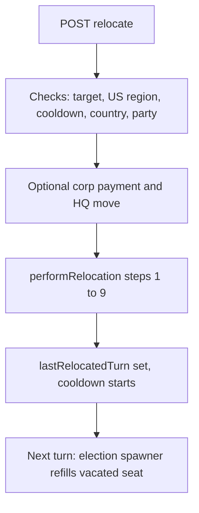

# Relocation

## Summary

Players can change their character's **home state** (or UK region, JP prefecture). Home state controls where you run for most offices, canvass, and most eligibility checks. Relocation is an immediate API action (`POST /api/character/relocate`, rate limited to 10 requests per 60 seconds per user), not a turn-phase process. It never waits for a turn tick. The 72-turn cooldown is measured in turns from `lastRelocatedTurn`.

Player guide: [Relocation](https://www.ahousedividedgame.com/wiki/relocation)

## Rules

### Cooldown

- **72 turns** (72 game-hours, 3 real days) from your last successful relocation before you can move again. `RELOCATION_COOLDOWN_TURNS = 72` in `src/lib/character/relocationCooldown.ts`; `RELOCATION_COOLDOWN_DAYS` is derived (72 / `TURNS_PER_DAY` = 3). The cooldown is shared by every relocation type, including the combined character and corporation move. Players with no `lastRelocatedTurn` fall back to the legacy `lastRelocatedAt` timestamp (72 turns of real time, `MS_PER_TURN`).
- The cooldown is why moves are not free to spam: a reset of influence and donors only costs something if you cannot immediately undo the move.
- The remaining time is shown as hours when under one day (`TURNS_PER_DAY` = 24 turns) and as whole days (rounded up) otherwise.
- A moving character also waits `STATE_LEADERSHIP_RELOCATION_DELAY_TURNS` (24) turns after a move before standing for, or being appointed to, **state** party leadership (`src/lib/parties/leadershipTenure.ts`). A missing `lastRelocatedTurn` counts as eligible.

### What always resets (any relocation)

- **Political influence** to 0
- **Donor base** to 0
- **Group favorability** cleared
- **State/region-party leadership** (chair, vice-chair, treasurer) in the state you left: vacated
- **Any active candidacy** (general/primary, state-party, national-party, committee): withdrawn
- **Current office**: auto-resigned if it is tied to a state or region (governor, House, Senate, state legislature and similar); the seat is vacated in `electedOfficials`. Country-scoped offices (President, Vice President, cabinet and similar, no `state` field) are kept on a same-country move and only resign on a country change. See `officeResignsOnRelocation` in `src/lib/character/officeResignsOnRelocation.ts`.
- **Party membership**: kept only while the destination is inside your party's reach (its live growth frontier). A same-country move outside it makes you Independent and resets party influence. This needs explicit confirmation (the API answers `409` with `partyDepartureRequired` until `confirmPartyDeparture` is sent). Rules live in `src/lib/character/relocationParty.ts`.
- **Party territory guard**: a move that would disconnect your party's territory, or grow a disconnected area without helping reconnect it, is rejected with `PARTY_TERRITORY_WARNING` (`src/lib/parties/relocationTerritory.ts`, answered as `409`).
- **CEO of a corporation**: removed; corp enters CEO vacancy. Exception: National Corporation CEOs keep the seat on a same-country move; a cross-country move still unseats (see CEO and corporation rules below).
- **Career history**: a `"relocated"` entry is appended with `fromState` / `toState` (and `fromCountry` / `toCountry` if the country changed)

### What happens whenever the party is left

Leaving the party happens on every country change and on a confirmed same-country departure (`leaveParty` in `performRelocation`). In both cases the character becomes Independent, party influence goes to 0, and `cleanupPartyPositionsOnSwitch` runs:

- **National party leadership positions** (chair, vice-chair, treasurer): vacated; party `memberCount` decrements
- **National committee membership**: cleared
- **Coalition chair** (if your party leads one): cleared
- **Membership tenure markers** (`partyJoinedAt`, `partyJoinedTurn`, `foundedPartyId`) are removed; an existing `lastPartySwitchAt` is never re-armed, so leaving does not start a new join cooldown.
- On a same-country departure only: **caucus participation** is closed and any national office held is relabelled Independent.

### What only resets on country change

- **National influence** to 0
- **Central-bank chair**: auto-resigned
- **Campaign manager role** (any campaign you manage): cleared
- **Caucus participation**: membership closed, chair/vice-chair seats cleared, chair candidacies withdrawn, `factionId` cleared
- **Prime Minister title** (`governmentFormations` and `parliamentaryGovernments`): cleared
- **Cabinet membership**: removed from `cabinetMembers`
- **Military command**: severed from the old country's chain of command via `severFromChainOfCommand` (step 4c); any command you led is vacated and reported in the relocation summary
- **Every office**, including country-scoped ones, is resigned.

These cross-country cleanup steps run in `src/lib/character/performRelocation.ts` (step 4b).

### What is preserved

Campaign funds, personal cash, savings (all currencies), actions, favorability, infamy, policy positions, earlier career history entries, avatars, bonds, share holdings, and line-of-credit balances/arrears. Money is never currency-converted.

### Blocking conditions

Checked in this order by the route:

- A character with a pending federation residence choice (`federationPendingResidenceId`) is refused with `409`.
- Target state must exist in the target country and differ from your current home state. Otherwise `400` ("Invalid target state or region" or "Already in this state/region").
- If the destination is US, the target must pass `isUsResidentPoliticalRegion`: a state under the active apportionment map, an admitted state, or a territory listed for admission (Alaska, Hawaii). Anything else is rejected with `400` as an unplayable territory. See [Statehood Admission](./statehood-admission.md).
- 72-turn (3-day) cooldown since your last relocation. Otherwise `429`.
- Destination country must be enabled for players (`403`; admins bypass this check; applies only when the country changes).
- Party departure confirmation (`409`) and party territory guard (`409`), see above.

There is **no** block for active candidacies or office-holding: those are handled automatically.

### CEO and corporation rules

- By default, any relocation removes you as CEO if you hold the role; the corporation enters CEO vacancy.
- Exception: National Corporation CEOs have relaxed country-level residency. A same-country relocation does not unseat them; a cross-country move still does. See `src/lib/character/performRelocation.ts` step 3. National corporations are not eligible for the combined move.
- To accept a CEO role, your home state must match the corporation's headquarters state. See [Corporations](./corporations.md).

### Corporate move cost

Corporate move cost is `round(sharePrice x totalShares, converted to anchor currency) x 0.07 x (2 if cross-country else 1)`, with the rounding applied at the end to the whole product, computed by `computeCorpRelocationCost` in `src/lib/corporations/relocationCost.ts`. Imperial CEOs pay 0 (`paymentMethod: "imperial-free"`, valid only for imperial CEOs). The cost can be paid in cash (Liquid Capital) or by issuing a relocation bond with a 336 turn maturity, subject to the leverage cap and the bond cooldown.

### Combined character + corporation relocation

When you click "Relocate here" from a region page as a CEO, the dialog offers three options instead of the usual two:

- **Cancel**: dismiss, no action.
- **Relocate & Abandon Corporation**: standard character relocation; CEO role is auto-vacated as always.
- **Relocate & Move Corporation**: character and corporation HQ move together via `POST /api/character/relocate-with-corp`. You remain CEO.

Cross-country corporate relocations cost **2x the base 7% of market cap** (so 14%). Imperial CEOs' corporations move along with the character at no cost; the dialog still shows the choice, with an info line that the move is free instead of the payment options.

The "Relocate & Move Corporation" button is disabled when a player-owned corp cannot afford the selected payment method (insufficient Liquid Capital, bond cooldown still active, or leverage cap reached). The other two options remain available.

The combined route (`src/app/api/character/relocate-with-corp/route.ts`) refuses the move with `409` while primary-underwriting cash is settling, while a relocation bond is waiting to be published for a different target or payment method, or while secured construction is unresolved. It refuses with `400` when the destination is a command economy and the corp is private. A cross-country move into a different currency converts the corp's treasury and sectors first.

When a HQ moves via the CEO Office (not the combined flow) and the CEO does not reside at the destination, the CEO is auto-vacated: same semantics as character relocation. The UI warns the player before submission; the action is not blocked.

### Admin and moderator overrides

`PATCH /api/admin/characters/update-country`, `PATCH /api/admin/characters/update-state`, `PATCH /api/moderator/characters/update-country`, and `PATCH /api/moderator/characters/update-state` run the same `performRelocation` pipeline and so never bypass the office, candidacy, CEO or cross-country cleanup. The differences from the player flow: no cooldown check, no country-availability gate, no rate limit, no party-departure confirmation and no territory guard (a same-country admin move never removes party membership, a country change always does). They still write `lastRelocatedTurn`, so they start the cooldown.

### Constants

| Constant | Value | Source |
| --- | --- | --- |
| `RELOCATION_COOLDOWN_TURNS` | 72 | `src/lib/character/relocationCooldown.ts` |
| `STATE_LEADERSHIP_RELOCATION_DELAY_TURNS` | 24 | `src/lib/parties/leadershipTenure.ts` |
| `RELOCATION_COST_FRACTION` | 0.07 (7% of market cap) | `src/lib/constants/corporationsClient.ts` |
| `CROSS_COUNTRY_RELOCATION_MULTIPLIER` | 2 (so 14%) | `src/lib/constants/corporationsClient.ts` |
| `RELOCATION_BOND_MATURITY_TURNS` | 336 | `src/lib/corporations/issueRelocationBond.ts` |
| `TURNS_PER_DAY` | 24 | `src/lib/constants/corporationsClient.ts` |
| Relocate API rate limit | 10 requests per 60 s per user (same for relocate-with-corp) | `src/app/api/character/relocate/route.ts`, `relocate-with-corp/route.ts` |

## Data

| Collection | Fields | Access | Player-visible |
| --- | --- | --- | --- |
| `characters` | `homeState`, `countryId`, `lastRelocatedTurn`, `lastRelocatedAt`, `careerHistory`, `politicalInfluence`, `donorBaseLevel`, `groupFavorability`, `nationalInfluence`, `party`, `partyInfluence`, `currentOffice`, `partyJoinedAt`, `partyJoinedTurn`, `foundedPartyId`, `lastPartySwitchAt` | Read and written | Yes (home, influence, career history, cooldown) |
| `electedOfficials` | `characterId`, `characterName`, `party`, `electedAt` | Vacated on resignation; party set to independent on a domestic departure | Yes (seat becomes vacant) |
| `corporations` | `ceoId`, `ceoVacant`, `headquartersState`, `countryId`, `liquidCapital`, `headquartersRelocationBondFunding` | Written | Yes |
| `statePartyOrg` | `chairId`, `viceChairId`, `treasurerId` | Cleared for the old state | Yes |
| `politicalParties` | `memberCount` | Decremented on leaving | Yes |
| `centralBanks` | `chairCharacterId` and chair fields | Cleared on country change | Yes |
| `campaigns`, `governmentFormations`, `parliamentaryGovernments`, `cabinetMembers` | manager, PM and cabinet links | Cleared on country change | Yes |
| caucus collections, military command chain | memberships and command ids | Closed or severed on country change | Yes |
| candidacy and party-election collections | the character's entries | Withdrawn | Yes |
| `states` | `_id`, `countryId`, `name` | Read | Yes |
| `gameConfig` / country access | `enabledForPlayers` per country | Read | No |

The corporation move also creates a relocation bond record when paid by bond.

## Configuration

| Setting | Default | Effect | Set in |
| --- | --- | --- | --- |
| Country access `enabledForPlayers` | Per country | Blocks cross-country moves to a closed country for non-admins | `getCountryAccess` in `src/lib/countryAccess` |
| US political region set | Active apportionment preset plus admitted states | Decides which US targets are valid | `loadUsPoliticalStateIds` in `src/lib/elections/usPoliticalHome` |
| Party frontier | Computed from live party presence | Decides whether a same-country move keeps party membership | `src/lib/parties/partyFrontier.ts` |
| Forex mode (`isForexEnabled`) | Per world | Controls the currency conversion step of a cross-currency corporate move | `src/lib/currency/featureFlag.ts` |

The constants above are code constants with no `gameConfig` field. There are no era or scenario presets for the cooldown or cost.

## Timing

1. The API route checks target, cooldown, country access, US territory eligibility and party departure.
2. `performRelocation` (`src/lib/character/performRelocation.ts`) runs in order: 1 office resign, 2 withdraw candidacies, 3 CEO resign, 4 central bank chair (country change), 4b country-scoped roles, 4c military chain, 5 state party leadership, 6 party departure cleanup, 7 character update, 8 career history, 9 party presence recount.
3. Nothing is deferred to the turn processor. The seat vacated in step 1 is picked up later by the perpetual-election spawner on its normal turn schedule.

In the combined flow the corporation update (cash debit, or bond issue in a database transaction) runs before `performRelocation`. The two are separate writes, not one transaction.

## Worked trace

A character in Ohio holds a state legislature seat, is a member of a party that operates in Michigan, has political influence 45, donor level 12, national influence 30, a primary candidacy open, and last relocated at turn 100. The current turn is 180. They move to Michigan (same country).

| Check or step | Result |
| --- | --- |
| Cooldown | 100 + 72 - 180 = -8, so not on cooldown |
| Party reach | Michigan is inside the frontier, so `relocationLeavesParty` is false, no confirmation needed |
| Step 1 | State legislature seat is state-bound, so the seat is vacated |
| Step 2 | The primary candidacy is withdrawn |
| Step 3 | No CEO role, nothing happens |
| Step 5 | Any Ohio state-party post held is cleared |
| Step 7 | `homeState` = Michigan, `politicalInfluence` 45 to 0, `donorBaseLevel` 12 to 0, `groupFavorability` cleared, `nationalInfluence` stays 30, `lastRelocatedTurn` = 180 |
| Step 8 | A `relocated` entry with `fromState` Ohio and `toState` Michigan is appended |
| Step 9 | Party presence is recounted for Ohio and Michigan |
| Next move allowed | Turn 180 + 72 = 252. State party leadership allowed from turn 204 |

For a corporate move with the character: a corporation with 2,000,000 shares at a share price of 5.00 in a currency at rate 1 per ₳ has a market cap of 10,000,000. In-country it costs round(10,000,000 x 0.07 x 1) = 700,000; to another country round(10,000,000 x 0.07 x 2) = 1,400,000. A bond to cover the cost matures after 336 turns.

## Edge cases and limits

- Money is never currency-converted for the character; balances stay in their original currency. Only a cross-country corporate move converts the corp's own treasury.
- Admin and moderator moves run the same pipeline; see the override rules above for what is skipped.
- A National Corporation CEO keeps the seat on a same-country move (step 3, `isStateOwned`) but not across countries.
- A failed party guard or missing confirmation aborts before any state changes.
- Active candidacies never block a move; they are withdrawn in step 2.
- A character with a legacy `lastRelocatedAt` and no turn field is judged on real time; a present turn field always wins.
- Admins can clear a character's cooldown by unsetting both fields (the reset-movement admin route).
- Independents are never asked to confirm a party departure.
- The cooldown is not restarted by failed attempts, because the fields are written only in step 7.

## Invariants

| Invariant | Enforced by |
| --- | --- |
| After any move, political influence, donor base and group favorability are 0 or empty | `performRelocation` step 7; tested in `src/lib/character/performRelocation.test.ts` |
| State-bound offices resign on every move; country-scoped ones only on country change | `officeResignsOnRelocation`; tested in `officeResignsOnRelocation.test.ts` and `performRelocation.test.ts` |
| A country change always ends party membership | `leaveParty = countryChanged || ...`; tested in `relocationParty.test.ts` and `performRelocation.test.ts` |
| A relocated character is never CEO of a corporation whose HQ they do not live in | Step 3 plus `findActiveResidentCeoCorporation`; the combined route test covers a stale CEO |
| A cooldown is always 72 turns for player moves | `getRelocationCooldownStatus`; tested in `relocationCooldown.test.ts` |
| A failed party guard changes nothing | The guard throws before `performRelocation`; tested in `src/app/api/character/relocate/partyFrontier.test.ts` |
| All steps of `performRelocation` commit together | Not enforced: they are separate writes without a transaction |

## Failure and recovery

- **A step in `performRelocation` fails midway.** Earlier steps are already written (for example the seat is vacated but the home state is unchanged). The player can retry, because the route has not set the cooldown yet, and each step reads the character fresh. Persistent inconsistencies are repaired by an admin re-running the move through the admin override, which runs the same pipeline.
- **Corporation paid but the character step fails** (combined flow). The corporation has already moved and been charged. The player retries the character move; if the CEO no longer lives at the new HQ, an admin repairs the CEO link.
- **Bond issuance cannot be published.** A frozen bond quote is kept on the corporation and the player must retry the same move and payment method; other targets are refused with `409` until it completes.
- **Cooldown stuck or wrongly applied.** An admin can clear `lastRelocatedAt` and `lastRelocatedTurn` for a user through the admin movement reset.
- **Leftover roles after a country change.** Repaired by re-running the cross-country cleanup through the admin country override.

## Connections

Driven by:

- [Corporations](./corporations.md): HQ state and CEO residency decide whether a move unseats a CEO (`performRelocation` step 3).
- [Statehood Admission](./statehood-admission.md): which US territories are valid destinations (`isUsResidentPoliticalRegion`).
- Party territory: the party frontier and territory guard decide whether membership is kept (`src/lib/parties/relocationTerritory.ts`).

Affects:

- [State-Level Power](./state-level-power.md): vacated state seats and state party leadership (steps 1 and 5).
- Party organisation and territory: party presence is recounted in step 9 (`updatePartyPresence`).
- Elections: candidacies are withdrawn in step 2 (`withdrawAllActiveCandidacies`).
- Party leadership eligibility: `lastRelocatedTurn` feeds the 24-turn state leadership wait.

Related pages:

- [Getting Started](./getting-started.md): Creating a character and first steps
- [Corporations](./corporations.md): Founding, HQ, CEO eligibility
- [State-Level Power](./state-level-power.md): Governor and state offices
- [United Kingdom](./united-kingdom.md): UK regions as home "state"

## Tests

| File | Covers |
| --- | --- |
| `src/lib/character/performRelocation.test.ts` | Resets, party handling, offices, CEO rules, caucus, military chain, career history |
| `src/lib/character/relocationCooldown.test.ts` | Turn and legacy cooldown, labels |
| `src/lib/character/relocationParty.test.ts` | Party departure decision |
| `src/lib/character/officeResignsOnRelocation.test.ts` | Which offices resign |
| `src/lib/character/relocationCampaigns.test.ts` | Active candidacy summary |
| `src/app/api/character/relocate/partyFrontier.test.ts` | Party frontier and confirmed departure through the route |
| `src/app/api/character/relocate-with-corp/route.test.ts` | Combined move: CEO checks, cross-country cost, command economy, imperial |
| `src/app/api/admin/characters/update-state/route.test.ts`, `src/app/api/moderator/characters/update-state/route.test.ts` | Override routes |

Gaps: no direct test of the player route's cooldown `429`, the unplayable-territory `400`, the country-access `403` or the federation `409`; no test of the bond payment path in the combined route; no test that `performRelocation` steps stay consistent after a mid-pipeline failure.

## Known issues and history

- `performRelocation` is not transactional. A failure partway leaves a partly applied move.
- The wiki states that Central Bank chair and national offices resign on a country change; this matches the code. The wiki's "leaving a party" text matches the code.
- Ticket references recorded in code comments: country-scoped offices survive a same-country move (ticket 1057), caucus `factionId` clearing (bug 0552), relocation labels in days (ticket 1117), command-economy block on corporate moves (ticket 1378), and a rule that previews must not vacate a CEO on page load (bug 0813). No dates are recorded.
- The earlier version of this page described the combined dialog for imperial CEOs as a two-button dialog; the code shows the same chooser with a free-move note.

Last checked: 2026-10-29, version 1.18.0
