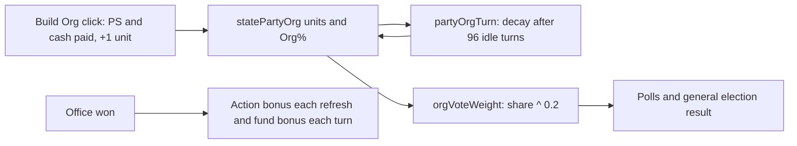

# State-Level Power

## Summary

State-level offices are the stepping stones of political careers and the foundation of party strength. This guide covers how to leverage governors, state senate seats, and state party positions: what each office pays in bonus actions and fund income, how a party builds and loses organization (Org) in a state, how Org turns into vote weight, who leads a state party, and how home state shapes where you can act.

Player guide: [Party Organization](https://www.ahousedividedgame.com/wiki/party-organization), [Party Leadership](https://www.ahousedividedgame.com/wiki/party-leadership) and [Player Progression](https://www.ahousedividedgame.com/wiki/player-progression) (office bonuses). No single wiki page is titled State-Level Power.

## Rules

### State offices

#### Governor

- **Election** - Statewide single-winner race
- **Benefits** - +2 bonus actions/turn (`officeActionBonus.governor` in `src/lib/seeds/reference/gameConfig.ts`), +$15k/hr fund bonus (`OFFICE_FUND_BONUS.governor` in `src/lib/utils/fundGeneration.ts`, matching Senate)
- **Power** - Highest state-level office; strong influence on state politics
- **Government approval** - Governor's party benefits from state approval ratings in elections

#### State Senate

- **Election** - Percentage-based seat allocation across the state
- **Benefits** - +1 bonus action/turn and +$3k/hr fund bonus (`stateSenate` in the same two files); lower than federal offices but a base for growth
- **Power** - State-level legislative influence

#### House of Representatives

- **Election** - District-based races
- **Benefits** - +1 bonus action/turn, +$5k/hr fund bonus (`house`)
- **Value** - Easiest federal office to win; stepping stone to Senate or Governor

The fund figures are in the modern-era dollar scale. In `getTotalFundGeneration` and the distribution function the office bonus is multiplied by the world's era price level and rounded, but unlike the base and donor parts it is not scaled by state GDP.

### State party organization

State party organization (Org) is a party's share of a state's organization bucket, and it scales your candidates' general-election votes:

- **Org pool** - Each state starts with a permanent 100-unit Unaffiliated stake (`ORG_BUCKET_BASELINE_UNITS`). `Org% = party units / (100 + all party units) x 100`.
- **Build Org** - Each successful click adds exactly 1 unit (`ORG_BUILD_UNITS_PER_CLICK`). Requires party presence in the state. Costs Political Strength and money from the officer's tier.
- **Vote effect** - In general elections each candidate's weight is multiplied by `orgShare ^ 0.2` (`ORG_WEIGHT_EXPONENT` in `src/lib/electionEngine/electionFormulaFactors.ts`), where `orgShare` is the party's fraction of all party Org in the state. A 3:1 Org lead is about a 1.25:1 weight edge. A party with 0 Org in a populated state gets weight 0, except for a small personal floor (`PERSONAL_ORG_FLOOR_CAP = 0.1`, scaled by the candidate's own reach and approval). If no party has any Org data in the state the weight is a neutral 1.
- **Decay** - After 96 turns without a Build Org click (`ORG_DECAY_GRACE_TURNS`) a party's units in that state decay 1% per turn (`ORG_UNIT_DECAY_RATE = 0.01`). Constants are in `src/lib/constants/partyOrg.ts`.

Worked example: a state has 100 Unaffiliated units, Party A has 60 and Party B has 20. A's Org is 60/180 = 33.3%, B's is 11.1%. Among parties, A's share is 0.75 and B's 0.25, so A's vote weight factor is 0.75^0.2 = 0.944 and B's is 0.25^0.2 = 0.758, a 1.25:1 edge even though A has 3x B's units.

The older Org cap and momentum model (base cap 15, momentum -10 to +10) is no longer in the game.

#### Building party Org

- Only the state chair, vice chair, the state campaigner, the national chair or vice chair, a national campaigner, or an admin can click Build Org (`canSpendOnStateParty` in `src/lib/parties/access.ts`); treasurers cannot. See [Party Building](./party-building.md) and [Party Leadership Authority](./party-leadership-authority.md).
- Winning offices keeps presence in a state (a player or elected official is required to build) and raises fund income, which pays for Build Org.
- A thin treasury can part-fund a click once it covers the minimum quarter-price floor; below that the click is refused and costs nothing.

Price of one click (`src/lib/politicalStrength/buildOrgFunding.ts`, `strengthConstants.ts`):

```
effectivePsCost = min(BUILD_ORG_BASE_PS_COST + pressure, PRESSURE_LADDER_MAX_COST)
cashPrice = round(rate * ORG_BUILD_TREASURY_FRACTION * effectivePsCost * sizeMultiplier)
refused if treasury / cashPrice < ORG_BUILD_MIN_FUNDED_FRACTION
paid = min(cashPrice, treasury)
```

`rate` is the country's `treasuryPsRate` for the paying tier (US: 37,500 state, 75,000 national). `sizeMultiplier` follows the square root of the state's population, normalized so the country's average state is 1, clamped to 0.5 to 2. Pressure rises by 1 per spend in that party and state and falls by 3 per turn.

### State party leadership

Each state party has three elected positions:

| Position   | Role                                                                        |
| ---------- | --------------------------------------------------------------------------- |
| Chair      | Primary party leader in the state; can influence NPPs using party resources |
| Vice Chair | Assists Chair; can also influence same-party NPPs                           |
| Treasurer  | Manages state party treasury                                                |

#### Why it matters

- **NPP influence** - Chairs/VCs can direct NPP endorsements and withdrawals
- **Tax rates** - Leadership sets party tax rates, whole numbers from 0 to 33% (`MAX_TAX_RATE = 33` in `src/lib/api/schemas/settings.ts`; `calculateTaxAmount` in `src/lib/utils/fundGeneration.ts` returns 0 above 33). The tax route accepts the state chair, vice chair, treasurer, national chair or an admin. An unoccupied state taxes NPP income at `DEFAULT_NPP_STATE_TAX_RATE = 5`%
- **Treasury** - Controls state party funds for transfers and operations
- **Party GOTV** - Party resources passively boost turnout in aligned demographics

A character who relocates must wait `STATE_LEADERSHIP_RELOCATION_DELAY_TURNS` (24) turns before standing for, or being appointed to, state party leadership (`src/lib/parties/leadershipTenure.ts`). See [Relocation](./relocation.md).

### State demographics

Each state has a granular electorate assembled from census-backed dimensions such as age, education, income, geography, race and ethnicity, religion, and occupation. Country-specific seeds adapt the dimensions and weights to each country rather than reusing a fixed set of 12 US archetypes. See [Demographics and Targeting](./demographics-targeting.md) and [Granular Electorate as Shipped](./granular-electorate-as-shipped.md).

### Equivalent regional offices

The regional executive pattern is country-aware. It appears as a US Governor, German Minister-President, Japanese regional Governor, Chinese Governor, and as a UK First Minister in Scotland, Wales, or Northern Ireland. London uses a Mayor. English UK regions outside London have no devolved executive office.

### Geographic strategy

- **Home state advantage** - You can only enter elections in your home state (the `isHomeState` comparison in `src/lib/elections/entryEligibility.ts`). The exceptions are nationwide executive races such as President, open to any character of that country, and the Russian Duma national list for party members.
- **State adjacency** - Support and Attack on another character use a distance multiplier of 1.25 when that character's home is a neighboring state and 1.5 when it is not, against 1.0 for the same home state (`ACTION_COST_MULTIPLIERS` in `src/lib/states/adjacency.ts`, applied in `src/lib/influence/simpleInfluence.ts`). It multiplies the external premium (1.25 for Support, 1.5 for Attack, in `src/lib/influence/rules.ts`) that already applies to the matching self action, so a Support on a distant state costs `floor(selfActions x 1.25 x 1.5)`. Barnstorm, Campaign and Advertise do not take the distance multiplier. The rule uses the US adjacency map.
- **Pick your state wisely** - Some states are more competitive; swing states offer the most opportunity

### Path to power

1. **Win state party chair** - Gives you NPP influence and party resource access
2. **Win a House seat** - Easiest federal office; builds your fund income
3. **Build org strength** - Your party's org directly helps all your party's candidates
4. **Run for Governor or Senate** - Leverage your established base

### Constants

| Constant | Value | Source |
| --- | --- | --- |
| `officeActionBonus` governor, stateSenate, house | 2, 1, 1 (a gameConfig field) | `src/lib/seeds/reference/gameConfig.ts` |
| `OFFICE_FUND_BONUS` governor, stateSenate, house, senate | 15,000; 3,000; 5,000; 15,000 | `src/lib/utils/fundGeneration.ts` |
| `CYCLE_TURNS` governor, stateSenate, house, senate | 192, 192, 96, 288 | `src/lib/constants/partyOrg.ts` |
| `ORG_BUCKET_BASELINE_UNITS` | 100 | `src/lib/constants/partyOrg.ts` |
| `ORG_BUILD_UNITS_PER_CLICK` | 1 | `src/lib/constants/partyOrg.ts` |
| `ORG_DECAY_GRACE_TURNS` | 96 | `src/lib/constants/partyOrg.ts` |
| `ORG_UNIT_DECAY_RATE` | 0.01 per turn | `src/lib/constants/partyOrg.ts` |
| `DEFAULT_NPP_STATE_TAX_RATE` | 5 | `src/lib/constants/partyOrg.ts` |
| `ORG_WEIGHT_EXPONENT` | 0.2 | `src/lib/electionEngine/electionFormulaFactors.ts` |
| `PERSONAL_ORG_FLOOR_CAP` | 0.1 | `src/lib/electionEngine/electionFormulaFactors.ts` |
| `BUILD_ORG_BASE_PS_COST` | 1 | `src/lib/politicalStrength/strengthConstants.ts` |
| `PRESSURE_LADDER_INCREMENT`, `PRESSURE_LADDER_MAX_COST`, `PRESSURE_DECAY_PER_TURN` | 1, 8, 3 | `src/lib/politicalStrength/strengthConstants.ts` |
| `ORG_BUILD_TREASURY_FRACTION` | 0.075 | `src/lib/politicalStrength/strengthConstants.ts` |
| `ORG_BUILD_MIN_FUNDED_FRACTION` | 0.25 | `src/lib/politicalStrength/strengthConstants.ts` |
| `ORG_BUILD_SIZE_MULTIPLIER_MIN`, `_MAX` | 0.5, 2.0 | `src/lib/politicalStrength/strengthConstants.ts` |
| US `treasuryPsRate` | national 75,000; state 37,500 | `src/lib/countries/us/economy.ts` |
| `MAX_TAX_RATE` | 33 | `src/lib/api/schemas/settings.ts`, `src/lib/utils/fundGeneration.ts` |
| `ACTION_COST_MULTIPLIERS` | 1.0, 1.25, 1.5 | `src/lib/states/adjacency.ts` |
| `EXTERNAL_BOOST_PREMIUM`, `EXTERNAL_ATTACK_PREMIUM` | 1.25, 1.5 | `src/lib/influence/rules.ts` |
| `STATE_LEADERSHIP_RELOCATION_DELAY_TURNS` | 24 | `src/lib/parties/leadershipTenure.ts` |

## Data

| Collection | Fields | Access | Player-visible |
| --- | --- | --- | --- |
| `statePartyOrg` | `organization` (cached Org%), `organizationUnits`, `lastOrganizationBuildTurn`, `chairId`, `viceChairId`, `treasurerId`, `campaignerId`, `treasury`, `stateTaxRate`, `politicalStrength` | Build Org and decay write units and Org%; tax route writes `stateTaxRate` | Yes |
| `partyStrengthPressure` | `value` per party and region | Incremented on each spend, decays each turn | Cost shown in the Build Org panel |
| `politicalParties` | `treasury`, national leadership, `campaignerIds` | Read for the national tier and authorization | Yes |
| `characters` | `currentOffice`, `homeState`, `actions`, funds | Office bonuses read; fund generation credits funds | Yes |
| `electedOfficials` | seat holders by office and state | Read for seat-based action bonuses | Yes |
| `gameConfig` | `officeActionBonus` | Read each action refresh | No |
| `partyHistory` | per-party-per-turn `organization` | Written for charts | Yes (charts) |

## Configuration

| Setting | Default | Effect | Set in |
| --- | --- | --- | --- |
| `gameConfig.officeActionBonus` | House 1, Senate 2, State Senate 1, Governor 2, President 4, Vice President 2, plus other countries' offices | Bonus actions per refresh for each office | `src/lib/seeds/reference/gameConfig.ts` (resolved by `src/lib/actions/officeActionBonus.ts`) |
| Era price level | Per world and era | Scales the dollar fund bonuses | `getTotalFundGeneration` and the distribution function in `src/lib/utils/fundGeneration.ts` |
| Country `treasuryPsRate` | Per country (US 75,000 national, 37,500 state) | Cash price of Build Org in local currency | Each country's `economy.ts` through `TREASURY_PS_RATE_BY_COUNTRY` |

Org constants, the vote exponent and the tax cap are code constants and are not read from `gameConfig`.

## Timing

- Office action bonuses are added when actions refresh each turn (`src/lib/turn/actionRefresh.ts`, reading `officeActionBonus`). Office fund bonuses are added in the hourly fund generation using `OFFICE_FUND_BONUS`.
- Election cycles (`CYCLE_TURNS` in `src/lib/constants/partyOrg.ts`): governor 192 turns, state senate 192, House 96, Senate 288.
- Org decay is computed by the organization bucket rules (`src/lib/parties/rules/organizationBucket.ts`) after the grace period, run each turn by `processPartyOrgTurn` as the `partyOrgTurn` phase in `src/simulation/phases/turnPhaseRegistry.ts`. Build Org is immediate when clicked.
- Org vote weight is applied when a general election resolves and when polls are calculated (`orgVoteWeight`).



## Worked trace

A US state has 100 Unaffiliated units. Party A has 60 units and Party B has 20. The state has a size multiplier of 1.2 and the A state chair clicks Build Org with pressure 2 from earlier clicks, a state treasury of 3,000 and the 37,500 state rate.

| Step | Calculation | Result |
| --- | --- | --- |
| Effective PS cost | min(1 + 2, 8) | 3 |
| Cash price | round(37,500 x 0.075 x 3 x 1.2) = round(10,125.0) | 10,125 |
| Funded fraction | 3,000 / 10,125 | 0.296, at or above 0.25, so the click is allowed |
| Cash paid | min(10,125, 3,000) | 3,000 |
| Pressure afterwards | 2 + 1 | 3 |
| New units | 60 + 1 | 61 |
| Org% for A | 61 / (100 + 61 + 20) x 100 = 61 / 181 | 33.70% (before the click it was 60 / 180 = 33.33%) |
| Org% for B | 20 / 181 | 11.05% (before: 11.11%) |
| Party shares | A 61 / 81, B 20 / 81 | 0.7531, 0.2469 |
| Vote weight | 0.7531^0.2, 0.2469^0.2 | 0.9449, 0.7560 |

The ratio of weights is 0.9449 / 0.7560, which is 1.25. With a treasury of 2,000 the fraction would be 0.198, below 0.25, so the click would be refused before any Political Strength is spent.

If Party A then makes no click for 96 turns, decay begins: on the next turn its 61 units become 61 x 0.99 = 60.39.

## Edge cases and limits

- Office bonuses end when the seat is lost or resigned, including by [Relocation](./relocation.md), which vacates state-bound seats.
- A newly admitted state starts with the seeded party organisation; see [Statehood Admission](./statehood-admission.md).
- Org share is relative: adding units for one party lowers every other share without removing any of their units.
- Tax rates above 33 are rejected; a rate of 0 collects nothing.
- The distance multiplier is US-only and the action cost is rounded down with `Math.floor` in `priceExternalBoost`.
- Build Org without party presence in the state is refused, even for a national officer.
- A refused click (no presence, wrong role, treasury under a quarter of the price) charges neither Political Strength nor cash and does not raise pressure.
- Pressure is stored with a hard cap of 8, so a heavy builder's cost recovers within a few turns of stopping.
- Legacy rows without unit balances are converted from their old Org percentage the first time they are touched, so deploying the bucket model never causes an immediate decay cliff.
- Decay never applies to the Unaffiliated stake.
- A cabinet appointment overwrites `currentOffice`; the seat bonus is recovered from `electedOfficials` and the cabinet bonus stacks on top.

## Invariants

| Invariant | Enforced by |
| --- | --- |
| The Unaffiliated stake is always 100 units in the denominator | `deriveOrganizationShares`; tested in `src/lib/parties/rules/organizationBucket.test.ts` |
| Every successful click adds exactly one unit | `applyOrganizationBuild` and `buildOrganizationBucket`; tested in the same file and `buildOrganizationBucket.test.ts` |
| Concurrent clicks do not lose a unit | Atomic per-document update in `buildOrganizationBucket`; tested in `buildOrganizationBucket.test.ts` |
| Org units never go negative | `roundUnits` and `nonNegative` clamps; tested in `organizationBucket.test.ts` |
| A refused Build Org click costs nothing | Funding is resolved before spending (`buildOrgFunding.test.ts` tests the refusal rule; the call order itself is not tested) |
| Tax rate is an integer from 0 to 33 | `taxRateSchema` in `settings.ts` |
| Org percentages across parties plus Unaffiliated sum to 100 | By construction in `deriveOrganizationShares`; the cached `organization` field is rounded to four decimals, so the sum can differ slightly. Not enforced by a runtime check |
| Office action bonus matches the configured map | Not enforced beyond `officeActionBonus.test.ts` |

## Failure and recovery

- **Cached Org% disagrees with unit balances.** The cached `organization` is always derivable from `organizationUnits`. The next Build Org click or decay turn recomputes every share in the region, which repairs it. A heal can also re-derive it.
- **Legacy rows missing unit balances.** Bootstrapped from the old percentage at the next click or decay pass, with a conditional write so concurrent attempts are harmless.
- **A decay pass fails.** The turn phase is retried the next turn; decay is proportional to current units and the grace clock lives on the row, so a missed turn only delays decay.
- **Pressure runaway.** The stored value is capped at 8 and decays by 3 per turn, so no repair is needed.
- **Wrong or missing leadership post.** Repaired by an admin reassigning the post; the relocation pipeline clears state posts automatically when a leader moves away.
- **Missing office bonus after a seat change.** The next action refresh recomputes the bonus from `currentOffice` and `electedOfficials`.

## Connections

Driven by:

- [Elections](./elections.md): winning a state office grants action and fund bonuses (`actionRefresh.ts`, `fundGeneration.ts`).
- [Party Building](./party-building.md): Build Org clicks raise Org share.
- [Relocation](./relocation.md): leaving a state vacates its seats and party posts and delays state leadership.

Affects:

- [Elections](./elections.md): Org share scales vote weight (`orgVoteWeight`).
- [Government Approval](./government-approval.md): governor's party benefits from state approval.
- [Relocation](./relocation.md): home state decides where a character may enter races.

Related pages:

- [Government Approval](./government-approval.md) - How approval affects elections
- [Demographics & Targeting](./demographics-targeting.md) - State demographic profiles
- [Political Parties](./parties.md) - Party system mechanics
- [Election Mechanics](./elections.md) - How state elections work
- [Relocation](./relocation.md) - Moving home state resets state leadership and seats

## Tests

| File | Covers |
| --- | --- |
| `src/lib/parties/rules/organizationBucket.test.ts` | Unit bucket, shares, build and decay |
| `src/lib/parties/commands/buildOrganizationBucket.test.ts` | Atomic build write |
| `src/lib/turn/partyOrg/turnProcessing.test.ts` | The per-turn decay pass |
| `src/lib/politicalStrength/buildOrgFunding.test.ts` | Cash price, size multiplier, funded fraction |
| `src/lib/politicalStrength/orgBuildStateSize.test.ts` | State size multiplier |
| `src/lib/turn/politicalStrength/computeBuildOrgPreview.test.ts` | The click preview |
| `src/lib/electionEngine/electionFormulaFactors.test.ts` | Org vote weight and personal floor |
| `src/lib/actions/officeActionBonus.test.ts`, `src/lib/turn/actionRefresh.test.ts` | Office action bonuses |
| `src/lib/utils/fundGeneration.test.ts` | Fund generation and tax amounts |
| `src/lib/states/adjacency.test.ts`, `src/lib/influence/rules.test.ts`, `src/lib/influence/simpleInfluence.test.ts` | Distance multiplier and external boost pricing |
| `src/lib/elections/entryEligibility.test.ts` | Home-state entry rule |
| `src/lib/parties/leadershipTenure.test.ts` | Tenure and relocation delay |

Gaps: no test pins the office fund bonus values to the numbers on this page, and the state party tax route authorization is not covered by a named test here.

## Known issues and history

- The distance multiplier uses only the US adjacency map, so non-US countries have no neighbor discount.
- The older Org cap and momentum model (base cap 15, momentum -10 to +10) was removed in favor of the unit bucket.
- Build Org gained a cash cost in addition to Political Strength on 2026-09-02, with the per-state size multiplier and the quarter-price soft floor (recorded in `buildOrgFunding.ts`).
- The previous text of this page described the distance multiplier as the whole Support and Attack price; in code it multiplies the external premium (1.25 and 1.5).
- Ticket references in code comments: Pressure stored cap (ticket 945), personal Org floor (0671), zero-reach vote floor (1034). No dates are recorded.

Last checked: 2026-10-29, version 1.18.0
