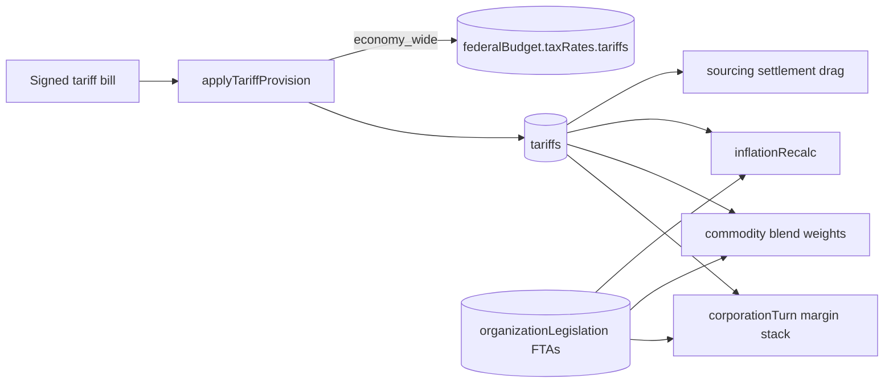

# Tariffs

## Summary

Tariffs are trade barriers enacted via legislation that impose costs on corporations operating outside their home country. They affect profit margins, market capture, commodity pricing, the federal budget's headline tariff rate and country inflation.

- **Scope:** national trade policy, set by the country in which the bill passes
- **Target:** foreign corporations operating in the tariff-imposing country (plus a smaller friction malus on domestic corporations)
- **Effects:** margin penalty, domestic malus, market capture modifier, commodity blend weight shift, inflation input, trade-flow drag
- **Enactment:** via `tariff` provisions in the legislation system

Player guide: [Tariffs](https://www.ahousedividedgame.com/wiki/tariffs)

**Entry point:** `src/lib/tariffs/tariffEffects.ts`. The pure curves (rate in, effect out) are in `src/lib/tariffs/rules/tariffCurves.ts`.

## Rules

### Scope types

| Scope            | Description                                | Target                             |
| ---------------- | ------------------------------------------ | ---------------------------------- |
| `economy_wide`   | Blanket tariff on all foreign corporations | All foreign corps in country       |
| `sector`         | Targeted tariff on specific sector type    | e.g., all foreign steel producers  |
| `origin_country` | Country-specific tariff                    | Corps from specific origin country |
| `corporation`    | Entity-specific tariff                     | Single named corporation           |

### Constants

| Constant | Value | Source |
| --- | --- | --- |
| Effective rate cap | 100 (sum of applicable tariffs) | `getEffectiveTariffRate` in `src/lib/tariffs/tariffEffects.ts` |
| Foreign margin share (`FOREIGN_TARIFF_MARGIN_SHARE`) | 0.5, so penalty is `-rate / 2` percentage points | `src/lib/tariffs/rules/tariffCurves.ts` |
| Domestic malus at full rate (`DOMESTIC_TARIFF_MALUS_AT_FULL`) | 10 percentage points at a 100% combined rate | `src/lib/tariffs/rules/tariffCurves.ts` |
| Blend base weights | global 0.5, national 0.25, local 0.25 (`TARIFF_BLEND_BASE_GLOBAL_WEIGHT`, `TARIFF_BLEND_BASE_NATIONAL_WEIGHT`, `TARIFF_BLEND_LOCAL_WEIGHT`) | `src/lib/tariffs/rules/tariffCurves.ts` |
| Blend shift at full rate (`TARIFF_BLEND_SHIFT_AT_FULL`) | 0.25 moved from global to national | `src/lib/tariffs/rules/tariffCurves.ts` |
| Split capture swing (`SPLIT_CAPTURE_SWING_AT_FULL`) | 0.5, so domestic `1 + 0.5 x T/100`, foreign `1 - 0.5 x T/100`, T clamped to 0..100 | `src/lib/tariffs/rules/tariffCurves.ts` |
| Sector tariff sentiment pulse | +0.07 domestic, -0.07 foreign | `fireTariffProvisionSentiment` in `src/lib/tariffs/tariffEffects.ts` |
| Tariff shield cap (`TECH_SHIELD_CAP`) | 0.6 (foreign modifier multiplied by `1 - tariffShield`) | `src/lib/constants/techTree/effects.ts` |
| Inflation baseline (`TARIFF_INFLATION_BASELINE`) | 3 | `src/lib/tariffs/rules/tariffInflationExposure.ts` |
| Inflation cost-push coefficients (`TARIFF_COEFF_UP`, `TARIFF_COEFF_DOWN`) | 0.05 above baseline, 0.025 below | `src/lib/budget/inflation.ts` |

### Composite key

Tariffs use a five-field upsert key to prevent duplicates:

```typescript
{
  (countryId, scopeType, targetSectorType, targetOriginCountryId, targetCorporationId);
}
```

Re-enacting the same provision updates the existing tariff rather than creating a duplicate (`tariffProvisionFilter`).

### FTA override layer

Free trade agreements zero out all tariff layers between the partnered countries. When two countries are bound by an active FTA (`organizationLegislation` doc, `type: "free_trade_agreement"`, `status: "active"`), every `C(n,2)` pair among the FTA's `parties` is treated as tariff-free between those two countries, which overrides `economy_wide`, `sector`, `origin_country`, and `corporation` scopes alike. Members of the European Community also get common-market pairs through `organizationMemberships` (`loadActiveFtaPairs`).

```typescript
// src/lib/tariffs/ftaOverrides.ts
export function isFtaActive(pairs: FtaPairSet, a: string, b: string): boolean {
  if (a === b) return true; // domestic, treated as fully integrated
  return pairs.has(ftaPairKey(a, b));
}
```

`getEffectiveTariffRate()` takes an optional `activeFtaPairs` set and short-circuits to 0 before summing any tariff layer when the sector country and the corp HQ country are FTA partners. The same FTA coverage also proportionally neutralizes the domestic malus, the commodity blend weights, and the country-level inflation-pressure input (`computeCountryTariffPressure`), so a tariff neutralized by an FTA does not still drive consumer-price inflation or blend weighting. Coverage shares come from `buildFtaCoverageLookup` (`byCountryEconomyWide`, `bySectorType`, `corpHqByCorpId`).

### Territorial invariant

Only tariffs where `tariff.countryId === sectorCountryId` are consulted. A tariff imposed by the US on Chinese corps only applies to sectors operating in the US, not to Chinese sectors operating in third countries.

### Effective tariff rate

The effective rate is the sum of all applicable tariffs for a (sector country, sector type, corporation) triple:

```typescript
// getEffectiveTariffRate()
if (sectorCountryId === corpHqCountryId) return 0; // Domestic corps pay no tariff
if (activeFtaPairs && isFtaActive(activeFtaPairs, sectorCountryId, corpHqCountryId)) return 0;

for (const t of tariffs) {
  if (t.countryId !== sectorCountryId) continue;
  if (rate === 0) continue;
  if (t.scopeType === "economy_wide") total += rate;
  else if (t.scopeType === "sector" && sectorPolicyTargetMatches(t.targetSectorType, sectorType)) total += rate;
  else if (t.scopeType === "origin_country" && t.targetOriginCountryId === corpHqCountryId) total += rate;
  else if (t.scopeType === "corporation" && corpId != null && t.targetCorporationId?.toString() === corpId.toString()) total += rate;
}
return Math.min(100, total); // non-finite totals return 0
```

**Stacking:** multiple tariffs stack additively. A 20% economy-wide + 15% sector tariff = 35% effective rate. Sector matching uses `sectorPolicyTargetMatches()` (`src/lib/constants/corporations.ts`), so a `manufacturing` target also covers `manufacturing_vehicles` and `media` also covers `media_entertainment`. The same sector alias applies in the domestic malus and blend weights.

### Margin modifiers

**Foreign corporations** pay **half** the effective tariff rate as a margin penalty, not the full rate:

```typescript
// getForeignTariffMarginModifier() -> foreignMarginModifierForRate()
if (rate === 0) return 0;
// Halved: a 40% tariff gives -20pp margin penalty, not -40pp.
// Full 1:1 ratio made tariffs too punitive for foreign corps operating
// in the tariff country, effectively killing their margins.
return -rate / 2;
```

Example: 25% tariff gives -12.5pp. The foreign modifier is then multiplied by `(1 - techEffects.tariffShield)` in the margin stack (`src/lib/turn/corporation/sectorTurn/marginStack.ts`), so a corporation with the tariff-shield tech effect pays proportionally less. The domestic malus is not shielded.

**Domestic corporations** pay a smaller supply-chain friction malus from economy-wide and sector tariffs only:

```typescript
// getDomesticTariffMalus() -> domesticMalusForRate()
let total = 0;
for (const t of tariffs) {
  if (t.countryId !== sectorCountryId) continue;
  if (t.scopeType === "economy_wide") total += t.rate * (1 - economyWideFtaShare);
  else if (t.scopeType === "sector" && sectorPolicyTargetMatches(t.targetSectorType, sectorType)) total += t.rate * (1 - sectorFtaShare);
}
const T = Math.min(100, total);
return -(T / 100) * 10; // -0 to -10pp
```

Rationale: broad tariffs create domestic supply-chain friction, but targeted origin-country and corporation-specific tariffs are too narrow to affect domestic costs. With FTA coverage each contributing layer is scaled by `(1 - partner-exposure share)`.

| Tariff Rate | Domestic Malus |
| ----------- | -------------- |
| 0%          | 0pp            |
| 25%         | -2.5pp         |
| 50%         | -5pp           |
| 100%        | -10pp          |

### Commodity blend weights

Commodity margin calculation blends three price sources: global, national, and local (state-level). Tariffs shift weight from **global to national**, not to local; the local weight is fixed:

```typescript
// getTariffBlendWeights() -> blendWeightsForRate()
// blendRate accumulates: economy_wide and sector (scaled by 1 - FTA share, sector alias-aware),
// origin_country and corporation only when allSectorKeys has the presence key
const T = Math.min(100, blendRate);
const tariffEffect = T / 100;
const localWeight = 0.25; // fixed
const nationalWeight = 0.25 + tariffEffect * 0.25; // 0.25 -> 0.50
const globalWeight = 0.5 - tariffEffect * 0.25; // 0.50 -> 0.25
```

| Tariff Rate | Global Weight | National Weight | Local Weight |
| ----------- | -------------- | ---------------- | ------------- |
| 0%          | 0.50           | 0.25              | 0.25          |
| 25%         | 0.4375         | 0.3125            | 0.25          |
| 50%         | 0.375          | 0.375             | 0.25          |
| 100%        | 0.25           | 0.50              | 0.25          |

Tariffs make national commodity markets more relevant to margin calculation, reflecting that import costs push buyers toward domestically-priced goods. Presence keys are `${sectorCountryId}:${originCountryId}:${sectorType}` (origin scope) and `${sectorCountryId}:corp:${corpId}:${sectorType}` (corporation scope). FTA coverage scales the broad scopes down by `(1 - partner-exposure share)` and zeroes out narrow scopes targeting an FTA partner.

### Market capture (split attacks)

```typescript
// getSplitCaptureMultiplier() -> splitCaptureMultiplierForRate()
const T = Math.max(0, Math.min(100, effectiveTariffRate));
if (isDomesticSplittingForeign) return 1.0 + (T / 100) * 0.5; // 1.0 -> 1.5x
return 1.0 - (T / 100) * 0.5; // 1.0 -> 0.5x
```

| Tariff Rate | Domestic Attacker | Foreign Attacker |
| ----------- | ----------------- | ---------------- |
| 0%          | 1.0x              | 1.0x             |
| 25%         | 1.125x            | 0.875x           |
| 50%         | 1.25x             | 0.75x            |
| 100%        | 1.5x              | 0.5x             |

Domestic corps gain market share as foreign competitors are priced out.

### Inflation and trade flow

- **Inflation input.** The preferred input is measured: `tariffInflationExposure` (`src/lib/tariffs/rules/tariffInflationExposure.ts`) takes settled import duty on household purchases. `tariffRate = 3 + ((deliveredTariffPaid - importValue x 3 / 100) / absorptionValue) x 100`, so only duty above the 3% baseline moves prices. It is used only when the current turn's sourcing pass produced exact-turn active delivered rows (`available`); shadow-simulated or missing rows return neutral exposure (the baseline). When no measured rate is passed, `computeCountryTariffPressure` (`tariffEffects.ts`) collapses the tariff layers instead: economy-wide counts in full times `(1 - FTA share)`; sector, origin and corporation tariffs count `rate x share of in-country sector revenue they touch`. The inflation step then adds `(tariffRate - 3) x 0.05` above baseline or `x 0.025` below (`src/lib/budget/inflation.ts`).
- **Trade-flow drag.** `importerTariffOnFlow` (`src/lib/trade/tariffDrag.ts`) returns the combined economy-wide, sector and origin-country rate on a country-to-country flow as a fraction capped at 1, 0 under an FTA; corporation-scoped tariffs are ignored. It is used by the commodity sourcing settlement (`src/lib/turn/commodity/sourcingSettlement.ts`) and trade affinity (`src/lib/trade/tradeAffinity.ts`).

### Enactment

Tariffs are enacted via legislation (`applyTariffProvision`, an upsert):

```typescript
await db.collection<Tariff>("tariffs").updateOne(
  tariffProvisionFilter(countryId, provision),
  {
    $set: { rate: provision.rate, sourceBillId, updatedAt: now },
    $setOnInsert: { createdAt: now },
  },
  { upsert: true }
);
```

Setting a rate of 0 through a new bill has the same effect as repealing the tariff, because zero-rate rows are skipped in every calculation. There is no separate repeal provision. The most recent bill for the same key wins.

**Economy-wide budget sync:** when an `economy_wide` tariff is enacted and the national budget's `taxRates.tariffs` differs, `applyTariffProvision` sets it to the new rate and recalculates federal revenue (`calculateFederalRevenue` in `src/lib/budget/revenue.ts`), writing `taxRates`, `revenue` and `surplus` on the `federalBudget` document. When `gameConfig.interstateMoneyWiringEnabled` is true the recalculation nets against the latest sourced import aggregates. Other scopes reach the budget only through corporate margins on later turns.

**Sentiment:** only `sector` tariffs fire sentiment pulses, `+0.07` domestic and `-0.07` foreign (`fireTariffProvisionSentiment`), and only when the rate changed. Withdrawing an FTA fires `-0.07` foreign pulses for each signed sector tariff (`fireFtaRescissionSentiment`).

## Data

### `tariffs` (read and written; player-visible on the policy pages)

| Field                   | Type      | Description                                               |
| ----------------------- | --------- | --------------------------------------------------------- |
| `_id`                   | ObjectId  | Document ID                                               |
| `countryId`             | CountryId | Country imposing tariff                                   |
| `scopeType`             | string    | `economy_wide`, `sector`, `origin_country`, `corporation` |
| `targetSectorType`      | string?   | For sector scope                                          |
| `targetOriginCountryId` | string?   | For origin_country scope                                  |
| `targetCorporationId`   | ObjectId? | For corporation scope                                     |
| `rate`                  | number    | Tariff rate (0-100); 0 means nullified but kept for audit |
| `sourceBillId`          | ObjectId  | Enacting legislation                                      |
| `createdAt`             | Date      | Creation timestamp                                        |
| `updatedAt`             | Date      | Last update                                               |

Other collections touched:

| Collection | How | Player-visible |
| --- | --- | --- |
| `bills` | Read: signed bills with a `tariff` provision are replayed by `reconcileSignedTariffBills` | Yes |
| `organizationLegislation` | Read: active `free_trade_agreement` documents and their `parties` | Yes |
| `organizationMemberships` | Read: `organizationId: "EU"` members for the common market | Yes |
| `federalBudget` | Written: `taxRates.tariffs`, `revenue`, `surplus` after an economy-wide change | Yes |
| `corporateSectors`, `corporations` | Read: HQ country, sector type and revenue for margin, blend and inflation | Yes |
| `gameConfig` | Read: `interstateMoneyWiringEnabled` | No |

The `Tariff` type is in `src/lib/db/types/tariff.ts`; the provision type (`TariffProvision`) is in `src/lib/db/types/legislation.ts`.

## Configuration

| Setting | Default | Where set |
| --- | --- | --- |
| Curve constants (0.5 foreign share, 10pp domestic, 0.25 blend shift, 0.5 capture swing) | see Constants | `src/lib/tariffs/rules/tariffCurves.ts` |
| Inflation baseline 3, coefficients 0.05 and 0.025 | see Constants | `src/lib/tariffs/rules/tariffInflationExposure.ts`, `src/lib/budget/inflation.ts` |
| Baseline economy-wide tariff | seeded from each national budget's `taxRates.tariffs` for US, UK, JP and DE when no economy-wide tariff exists | `ensureBaselineEconomyWideTariffs` in `src/lib/tariffs/reconcileTariffs.ts`, with fixed baseline source bill ids per country |
| `gameConfig.interstateMoneyWiringEnabled` | off unless set | `src/lib/db/types/gameConfig.ts`; makes the budget recalculation use sourced import aggregates |
| `gameConfig.freightSettlementMode` (`shadow` or `active`) | `shadow` unless set | `src/lib/db/types/gameConfig.ts`; with the market system mode at "clearing" or above, `active` makes the sourcing pass produce measured tariff exposure for inflation |
| Tech tree `tariffShield` effect | 0 | `src/lib/constants/techTree/effects.ts` (capped at 0.6) |
| Active FTAs and EU membership | none | organization legislation and membership documents |

Era and country variants: baseline tariffs are seeded only for US, UK, JP and DE; other countries start with no tariff document and gain them only through bills. No era flag changes the tariff formulas.

## Timing

- **Enactment** runs when a signed bill's provisions are applied (`src/lib/legislationEffects.ts` calls `applyTariffProvision`). Signed tariff bills are also replayed idempotently by `src/lib/tariffs/reconcileTariffs.ts` at the start of corporation lookup building (`src/lib/turn/corporation/buildLookups.ts`) and when the policy records list is read (`src/lib/policy/nationalPolicyRecordsList.ts`); replays do not re-fire sentiment.
- **Margin penalty, domestic malus and blend weights** are evaluated every turn per sector in the corporation phase margin stack (`src/lib/turn/corporation/sectorTurn/marginStack.ts`), using tariffs and FTA pairs preloaded once per turn (`src/lib/turn/corporation/buildLookups.ts`).
- **Inflation pressure** is computed in the inflation steps (`src/lib/budget/inflation.ts`, `src/lib/turn/inflationRecalc.ts`, `src/lib/budget/fiscalYear.ts`).
- **Split capture** is not a turn step. It is evaluated when a player runs a sector split attack through the region economy routes.
- A tariff or FTA change takes effect from the next corporation turn; nothing is retroactive.



## Worked trace

Country US. Tariffs in force: economy-wide 20, `manufacturing` sector 10, origin-country CN 15. A Chinese-HQ corporation (assume tariff shield 0.2) runs a US `manufacturing` sector; a US-HQ competitor runs the same sector type. No FTA.

1. **Effective rate (CN corp).** Domestic check fails (US vs CN). Sum: 20 + 10 + 15 = 45, under the cap of 100.
2. **Foreign margin modifier.** `-45 / 2 = -22.5` pp. Shield: `-22.5 x (1 - 0.2) = -18.0` pp in the margin stack.
3. **Domestic malus (US corp).** Only economy-wide and sector layers: `20 + 10 = 30`, so `-(30 / 100) x 10 = -3.0` pp. Origin-country tariffs add nothing.
4. **Blend weights** for US manufacturing, with a CN corporation present (presence key exists): blend rate `20 + 10 + 15 = 45`, effect 0.45. Global `0.5 - 0.45 x 0.25 = 0.3875`, national `0.25 + 0.1125 = 0.3625`, local 0.25 (sum 1.0).
5. **Split capture** at effective 45: domestic attacker `1 + 0.45 x 0.5 = 1.225x`; foreign attacker `1 - 0.225 = 0.775x`.
6. **Budget sync.** The economy-wide 20 is written to `federalBudget.taxRates.tariffs` and revenue is recalculated.
7. **Sentiment.** The sector tariff, if its rate changed, fires `+0.07` for domestic and `-0.07` for foreign `manufacturing` corps.
8. **Inflation (measured).** Household absorption 1,000, imports 200, delivered duty 14: `net = (14 - 200 x 3 / 100) / 1000 x 100 = 0.8`, so `tariffRate = 3.8`. Cost-push `= (3.8 - 3) x 0.05 = 0.04` percentage points.
9. **With a CN-US FTA:** step 1 returns 0 immediately, so steps 2 and 5 give 1.0x and no penalty; malus, blend and inflation scale by `(1 - partner share)`.

## Edge cases and limits

- **Domestic corps never pay the foreign penalty.** If the sector's country equals the corporation's HQ country the effective rate is 0.
- **Cap.** Effective rate, domestic malus input and blend input are each capped at 100, so stacking beyond 100% has no extra effect. Non-finite rates are treated as 0.
- **Territorial invariant.** A country's tariffs apply only to sectors located in that country.
- **FTA.** A partner pair gets rate 0 for the foreign penalty. Domestic malus, blend weights and inflation pressure scale by the partner share instead of flipping on or off for broad scopes.
- **Narrow scopes and the malus.** `origin_country` and `corporation` tariffs never create a domestic malus.
- **Blend presence keys.** Narrow-scope tariffs only shift blend weights where the targeted entity actually has a cross-border sector of that type (`tariffRulesNeedSectorPresenceKeys`, `buildSectorPresenceKeys`).
- **Zero rate** rows are ignored everywhere but kept (retains the audit trail).
- **Corporation scope and trade flow.** Corporation-scoped tariffs are ignored by the country-level trade drag.
- **Subsidies.** A foreign corporation's tariff penalty and any subsidy it qualifies for are separate terms in the same margin stack and simply add. Neither cancels the other; see [Subsidies](./subsidies.md).
- **Shadow sourcing.** While freight settlement is in shadow mode the inflation input stays at the 3% baseline (neutral), not a measured zero.

## Invariants

- Only the imposing country's tariffs apply to its sectors: tested in `src/lib/tariffs/tariffEffects.test.ts` ("only uses tariffs where countryId matches sector country").
- Effective rate never exceeds 100 and never is NaN: tests "caps effective rate at 100" and "ignores non-finite tariff rates".
- One tariff document per five-field key: enforced by the upsert filter; replay idempotence tested in `reconcileTariffs.test.ts` and the `rateChanged` tests in `tariffEffects.test.ts`. There is no unique index asserted in these files.
- FTA partners pay no tariff and layer shares scale consistently across margin, blend and inflation: `src/lib/tariffs/ftaOverrides.test.ts` and the FTA cases in `tariffEffects.test.ts`.
- Reconciliation must not fire sentiment: "does not fire sentiment pulses itself" in `tariffEffects.test.ts`.
- Budget headline rate equals the economy-wide tariff rate: healed on replay (`applyTariffProvision` syncs when out of step); no standing runtime check beyond that.
- Not enforced: that a repeal bill's zero rate is the only way to remove a tariff; there is no delete path.

## Failure and recovery

- **Tariff document missing or stale after a crash.** `reconcileSignedTariffBills` replays signed tariff bills in enactment order (`enactedAt`, `updatedAt`, `_id`), restoring final rates and source bills without double-applying. A crash between ordered bulk operations can leave a prefix applied; the next scheduled reconciliation repairs it.
- **Missing baseline.** `ensureBaselineEconomyWideTariffs` creates the economy-wide baseline tariff from the national budget's rate before the replay, for US, UK, JP and DE.
- **Budget out of step with the economy-wide tariff.** The replay of an economy-wide provision resyncs `taxRates.tariffs` and recalculates revenue.
- **Pulses pinned negative.** Replays are deliberately side-effect free; pulses fire only from the enactment path gated on `rateChanged`. A concurrent double enactment can double-fire a pulse pair (accepted; pulses expire).
- **Inflation reads unavailable exposure.** Missing, duplicate, wrong-turn or non-finite rows make exposure "unavailable" and the input falls back to the baseline rather than a measured zero.

## Connections

**Driven by:**

- [Legislation System](./bills-legislation.md): `tariff` provisions create or change tariffs (`src/lib/legislationEffects.ts` to `applyTariffProvision`).
- Free trade agreements (organization legislation): active FTAs load as partner pairs (`src/lib/tariffs/ftaOverrides.ts`) and zero or scale tariff layers.
- [Corporations](./corporations.md): HQ country, sector type and corporation id decide which tariffs apply.

**Affects:**

- [Corporations](./corporations.md): margin penalty, domestic malus and market capture in the sector margin stack and split attacks.
- [Commodities](./commodities.md): blend weights shift commodity margin pricing from global toward national.
- [National Budget](./national-budget.md): an economy-wide tariff sets the budget's headline tariff rate and revenue projection (`src/lib/tariffs/tariffEffects.ts`, `src/lib/budget/revenue.ts`).
- Inflation: tariff pressure or measured duty incidence is an input to country inflation (`src/lib/budget/inflation.ts`).
- [Subsidies](./subsidies.md): counterpart policy in the same margin stack.

Key files:

| File                                    | Purpose                                   |
| --------------------------------------- | ----------------------------------------- |
| `src/lib/tariffs/tariffEffects.ts`      | All tariff effect calculations            |
| `src/lib/tariffs/rules/tariffCurves.ts` | Pure curves and constants                 |
| `src/lib/tariffs/rules/tariffInflationExposure.ts` | Measured duty incidence for inflation |
| `src/lib/tariffs/ftaOverrides.ts`       | Free trade agreement pair loading and lookup |
| `src/lib/tariffs/reconcileTariffs.ts`   | Reapplies enacted tariff provisions in bulk |
| `src/lib/trade/tariffDrag.ts`           | Per-flow tariff drag for trade           |
| `src/lib/budget/revenue.ts`             | Federal revenue recalculation after an economy-wide tariff changes the headline rate |
| `src/lib/budget/inflation.ts`           | Cost-push term and fallback pressure     |
| `src/lib/turn/corporation/sectorTurn/marginStack.ts` | Applies foreign penalty, domestic malus and blend weights each turn |
| `src/lib/legislationEffects.ts`         | Routes enacted tariff provisions to `applyTariffProvision` |

Related: [Commodities](./commodities.md) (commodity pricing, blend weights, margin modifiers), [Subsidies](./subsidies.md) (domestic industry support, counterpart to tariffs), [Legislation System](./bills-legislation.md) (bill enactment process).

## Tests

- `src/lib/tariffs/tariffEffects.test.ts`: effective rate (scopes, stacking, cap, territorial, legacy sector alias, non-finite), country pressure with FTA scaling, presence keys, blend weights, foreign modifier, domestic malus with FTA coverage, split capture, `applyTariffProvision` upsert and `rateChanged`.
- `src/lib/tariffs/ftaOverrides.test.ts`: pair keys, FTA zeroing, coverage shares, common-market membership withdrawal.
- `src/lib/tariffs/reconcileTariffs.test.ts`: baseline seeding, enactment-order replay, ordered flush around budget sync, partial-replay repair.
- `src/lib/tariffs/tariffInflationExposure.test.ts` and `src/lib/tariffs/rules/tariffInflationExposure.test.ts`: measured exposure, shadow rows, unavailable rows.
- `src/lib/trade/tariffDrag.test.ts`: per-flow drag.
- `src/components/bills/TariffProvisionEditor.test.tsx` and `tariffProvisionTypes.test.ts`: provision editor.

- `src/lib/constants/techTree/effects.test.ts`: the tariff-shield effect and its cap.

Gaps: the shield multiplication inside the margin stack itself is not tested, and neither is the interaction between `fireTariffProvisionSentiment` and the bill-enactment path.

## Known issues and history

- A code comment on `getForeignTariffMarginModifier` still describes the modifier as "-(effectiveTariffRate) percentage points"; the code halves it (`-rate / 2`).
- Two concurrent enactments of a new sector tariff can double-fire the sentiment pulse pair (accepted in code as negligible given enactment frequency).
- An earlier version of this page said inflation read only the aggregated tariff pressure; it now prefers measured duty incidence from sourcing settlement when available and falls back to pressure otherwise.
- The tariff halving is recorded in code: a 1:1 foreign margin penalty was found too punitive.

Last checked: 2026-10-29, version 1.18.0
