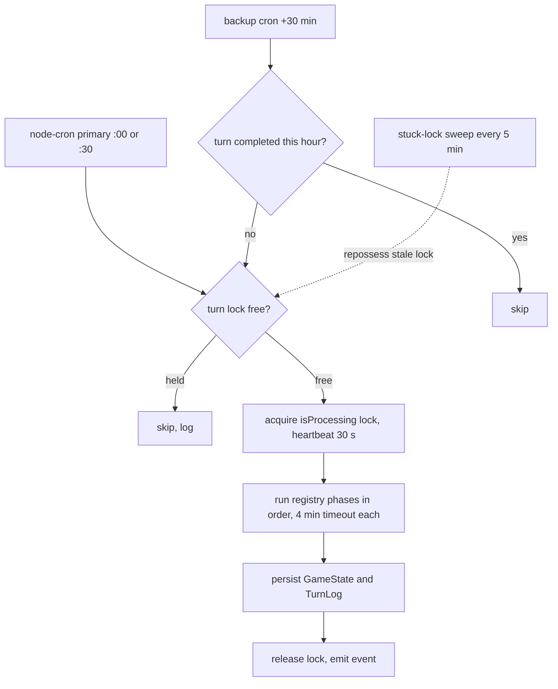

# Technical Architecture

## Summary

A House Divided is one Next.js application that serves the UI, every API route and the hourly turn processor from a single process, backed by MongoDB. There is no separate backend or external scheduler: the turn clock is `node-cron` started inside the web process at boot. This page records the stack, how a turn is scheduled and locked, the phase ordering that is load-bearing, the core collections, and how the pieces fail and recover.

Player guide: none; this is an engineering page. Player-facing turn timing is described in the [Wiki](https://www.ahousedividedgame.com/wiki).

## Rules

### Technology stack

Versions come from `package.json`.

| Layer        | Technology                                    | Version    |
| ------------ | --------------------------------------------- | ---------- |
| Framework    | Next.js (App Router)                          | ^16.4.2    |
| UI           | React                                         | 19.3.1     |
| Language     | TypeScript                                    | 6.0.2      |
| Styling      | Tailwind CSS                                  | ^4         |
| Database     | MongoDB native driver                         | ^7.4.0     |
| Auth         | Custom JWT via `jose`                         | ^6.2.9     |
| Scheduler    | `node-cron`                                   | ^4.6.0     |
| Testing      | Vitest (unit/integration) + Playwright (E2E)  | ^5.0.1 / ^1.64.0 |
| Deployment   | Railway (Nixpacks build, `next start`)        | `railway.toml` |
| File Storage | Cloudflare R2 (prod) / local filesystem (dev) | n/a        |

### Request flow

- **Next.js App Router** handles all UI (React Server Components and client components) and API routes. No separate backend server.
- All game logic lives in API routes (`src/app/api/`). Domain logic is extracted into service modules under `src/lib/`.
- **Client-server communication** is primarily HTTP. The active client hook polls `/api/game/turn/status` and synthesizes turn events; `src/lib/events.ts` provides a lightweight in-process event emitter for turn and theme events, but it is not a durable cross-instance push bus.

### Turn processor

- `processTurn()` in `src/lib/turnSystem.ts` is the single entry point. It is fired in-process by `node-cron` (`src/lib/cron.ts`), scheduled from `instrumentation.ts` at server boot, not by an external cron service.
- Schedule helpers are in `src/lib/cron/turnCronMinute.ts`. The primary schedule is `turnCronSchedule(minute, fastMode)`: `0 * * * *` (hourly) by default, `30 * * * *` when the `TURN_CRON_MINUTE` environment variable is `30`, and `0,30 * * * *` when `GameState.fastMode` is on. Any other `TURN_CRON_MINUTE` value logs a warning and falls back to 0.
- `backupTurnSchedule(minute)` is `(minute + 30) % 60` past the hour. The backup only fires when the primary missed its slot (`shouldFireBackupTurn` in `src/lib/cron/backupFireGuard.ts`): in normal mode it fires only if no turn completed inside the current turn hour (`turnHourBucket`); in fast mode it always fires, because `:00` and `:30` are both real turns.
- `GET /api/cron/turn` (`maxDuration = 800` seconds, `src/app/api/cron/turn/route.ts`) is an HTTP-triggerable fallback guarded by `requireCron()` (`src/lib/api/requireCron.ts`, `Authorization: Bearer ${CRON_SECRET}`).
- The phase list lives in a registry (`src/simulation/phases/turnPhaseRegistry.ts`, names in `src/simulation/phases/turnPhaseNames.ts`), not inlined in `turnSystem.ts`. `BASE_TURN_PHASE_NAMES` has **151 phases**, plus per-country election phases from `COUNTRY_ELECTION_PHASES` (`src/lib/turn/countryPhases.ts`) and per-country bill phases from `COUNTRY_BILL_PHASES`. Each phase runs through the shared turn-phase runtime (`src/simulation/engine/turnPhaseRuntime.ts`); failures are logged (Sentry) and do not halt subsequent phases.
- **Election-resolution ordering is critical:** primaries must resolve before vote accumulation; votes must accumulate before timers advance; timers must advance before elections resolve.
- Server-enforced `lastTurnProcessed` prevents clock drift. `getGameTime()` (`src/lib/time/gameTime.ts`) uses it as `effectiveNow`, not `new Date()`, so election phase display stays correct after batch turns.
- `clearCabinetOnTransition` (`src/lib/cabinetTransition.ts`) clears all cabinet members when a new government takes office; it is called from election resolution, not from the turn loop directly.

### Phase groups

The table groups phases by concern. It is illustrative, not exhaustive (the registry also holds governor/SCOTUS, extraction and prospecting, decolonization, spheres of influence, impeachment, by-elections and ledger-reconciliation phases not shown).

| Section                    | Phases                                                                                                                                                                                                                                                                       | Key constraint                                      |
| -------------------------- | ---------------------------------------------------------------------------------------------------------------------------------------------------------------------------------------------------------------------------------------------------------------------------- | --------------------------------------------------- |
| 1. Resources & finance     | `actionRefresh`, `fundGeneration`, `corporationTurn`, `partyInfluenceTurn`, `lineOfCreditTurn`, `nppFundGeneration`, `savingsInterestTurn`, `bondTurn`, `commodityPrices`, `recomputeSharePrices`, portfolio/corp/exchange/investor/wealth snapshots, `financialSuspectScan` | Share-price recompute must precede market snapshots |
| 2. Demographics            | `turnoutDecay` -> `partyGOTV` -> `partyOrgTurn`                                                                                                                                                                                                                              | Sequential (decay before GOTV)                      |
| 3. Party elections         | `statePartyElections`, `nationalPartyElections`, `nationalCommitteeElections`, `partyActionGeneration`, `emptyPartyCleanup`                                                                                                                                                  | Parallel election processors, then cleanup          |
| 4. NPP & coalitions        | `coalitionDisbandVotes`, `nppBehavior`                                                                                                                                                                                                                                       | NPP behavior runs after party processing            |
| 5. Bills & cabinets        | `billLifecycle`, country bill lifecycles from `COUNTRY_BILL_PHASES`, `stateBillTimers`, `cabinetNominations`                                                                                                                                                                 | Parallel-safe                                       |
| 6. Campaigns & actions     | `campaignTurn`, `nppActionProcessing`, `activityLogging`                                                                                                                                                                                                                     | Activity summary after action phases                |
| 7. Election resolution     | `candidatePartySweep` -> `primaryResolution` -> `voteAccumulation` -> `campaignSpendReset` -> `electionTimers` -> `primarySnapshots` -> `electionResolution` -> `clearResolvedSupport` -> `leadershipVacate`                                                                 | **Strictly sequential; ordering is load-bearing**   |
| 8. Parliamentary govt      | `parliamentaryGovernmentFormation`, `parliamentaryGovernmentPhases`, `parliamentaryVacancyWatcher`                                                                                                                                                                           | After election resolution                           |
| 9. Election coverage       | `perpetualElections`, country election phases from `COUNTRY_ELECTION_PHASES`, `leadershipElections`, `staleCandidateCleanup`, `presidentialSuccession`                                                                                                                       | Parallel-safe coverage before succession            |
| 10. Fiscal year            | `fiscalYear` (turn 40 of 48, October)                                                                                                                                                                                                                                        | Conditional                                         |
| 11. Effects & regional ops | `policyEffects`, `demographicEffects`, `policyReactionDecay`, `archetypeApprovalDecay`, `unownedSectorGrowth`, `metricDecay`, `subsidyBudget`, `regionalBudgetProcessing`, `jpRegionalBudgetProcessing`, `deRegionalBudgetProcessing`, `crisisTurn`, `ministerialOrders`     | Parallel-safe state/regional updates                |
| 12. National aggregation   | `gdpGrowth`, `nationalMetrics`, `tradeGrowthMirror`, `inflationRecalc`, `forexTurn`, `centralBankChairTurn`, `centralBankChairSelection`                                                                                                                                     | Ordered; forex is gated by `GameState.forexEnabled` |
| 13. History & health       | `metricHistory`, `approvalSnapshot`, `interestRateSnapshot`, `partyHistorySnapshot`, `gameHealthSnapshot`, `suspiciousDetection`                                                                                                                                             | After metrics and central-bank updates              |
| 14. Persistence            | `GameState` update, `TurnLog` insert, in-process event emit                                                                                                                                                                                                                  | **Critical, not wrapped in try/catch**              |

### Multi-country support

- 29 country configs in `COUNTRY_CONFIGS` (`src/lib/constants/countries.ts`): US, UK, DE, JP, IE, SCO, WAL, BR, CN, NG, HU, PL, RO, YU, BG, BLR, CS, UKR, BAL, RU, FR, IT, ES, SE, TR, GR, AT, FI and DD. Raw string literals (`"US"`, `"UK"`) are banned by the custom ESLint rule `local/no-country-literals` (`eslint.config.*`); use `CountryId` and `COUNTRY_CONFIGS`.
- Each country has its own legislature type, election schedule and regional structure, driven by per-country config rather than hardcoded branching.
- UK: House of Commons, 650 seats in the modern map (625 in the 1953 preset), with a 240-turn (5 game year) regular cycle (`CYCLE_TURNS.commons` in `src/lib/constants/partyOrg.ts`); constituency MPs are stored in `electedOfficials`. See [UK Elections](./uk-elections.md).
- JP: National Diet (Shugiin 465 seats and Sangiin 248 seats); full bill lifecycle via `jpBillLifecycle`; snap elections supported.
- Germany: Bundestag and Bundesrat labels, Chancellor executive, EUR/ECB currency mapping, DAX exchange and DE regional budget processing.

### Communication and notifications

- Notifications are stored in the `notifications` collection and surfaced on the next page load. There are 146 types (`NOTIFICATION_TYPES` in `src/lib/db/types/notifications.ts`). The UI offers a paginated list, type filter, search, bulk delete, mark-all-read, URL-based filters and date grouping.
- Hero banners are served through `/api/images/hero/[slug]`, which answers with a 307 redirect to the hosted image (no server-side proxying). The slug set (`HERO_URLS` in `src/app/api/images/hero/[slug]/route.ts`) covers government and institution banners per country plus one banner per commodity sector. Component: `<HeroImage>` (`src/components/HeroImage.tsx`).
- Client toasts use `useToast()` from `@/contexts/ToastContext`: `showToast("Message", "success" | "error" | "info")`.

### Security and fairness

- All game logic is validated server-side; client actions are verified before execution.
- Rate limiting applies to sensitive endpoints (elections, Congress, feedback).
- Admin routes require `requireAdmin()`; cron routes require `requireCron()`.

### Notable API routes

| Route                                                | Method              | Purpose                                                                                     |
| ---------------------------------------------------- | ------------------- | ------------------------------------------------------------------------------------------- |
| `/api/cron/turn`                                     | GET                 | Turn processor HTTP fallback (primary is in-process `node-cron`)                            |
| `/api/cron/fog-update`                               | GET                 | Campaign fog-of-war visibility update                                                       |
| `/api/auth/me`                                       | GET                 | Current user and character                                                                  |
| `/api/elections`                                     | GET                 | All elections (filter by type/state/status)                                                 |
| `/api/elections/[id]`                                | GET                 | Single election with candidates and tally                                                   |
| `/api/elections/[id]/state/[stateId]/county-results` | GET                 | County-level vote distribution                                                              |
| `/api/elections/[id]/state/[stateId]/cd-results`     | GET                 | Congressional district seat assignments                                                     |
| `/api/country/[code]/legislature/members`            | GET                 | Chamber composition by country                                                              |
| `/api/country/[code]/legislature/bills`              | GET/POST            | Bills list for the country's legislature; propose a bill (member/admin)                     |
| `/api/country/[code]/legislature/leaders`            | GET                 | Presiding officer, head of government and opposition leader                                 |
| `/api/whitehouse/cabinet`                            | GET                 | All cabinet positions with member and nomination data                                       |
| `/api/whitehouse/cabinet/nominations`                | POST                | President nominates a character                                                             |
| `/api/whitehouse/cabinet/nominations/[id]/vote`      | POST                | Senator votes on a nomination                                                               |
| `/api/whitehouse/cabinet/fire`                       | POST                | President fires a cabinet member                                                            |
| `/api/campaigns/[id]`                                | GET                 | Campaign detail (owner/party/public access tiers)                                           |
| `/api/campaigns/mine`                                | GET                 | Current user's campaign                                                                     |
| `/api/news`                                          | GET/POST            | News feed and post creation                                                                 |
| `/api/country/[code]/approval`                       | GET                 | National government approval, per country                                                   |
| `/api/country/[code]/budget/federal`                 | GET                 | Federal budget data, per country                                                            |
| `/api/images/hero/[slug]`                            | GET                 | Hero banner redirect (307 to the image URL)                                                 |
| `/api/roadmap`                                       | GET                 | Public roadmap data for wiki page                                                           |
| `/api/admin/seed`                                    | GET/POST            | Universal game seeder (admin only)                                                          |
| `/api/admin/roadmap`                                 | GET/POST/PUT/DELETE | Roadmap item management (admin only)                                                        |
| `/api/admin/roadmap/categories`                      | GET/POST/PUT/DELETE | Roadmap category management (admin only)                                                    |
| `/api/admin/law-types`                               | POST                | Create custom legislation type (admin only)                                                 |
| `/api/performance`                                   | GET                 | Game performance metrics                                                                    |

## Data

The high-level core collections the application reads and writes. Player-visible data is surfaced through API routes; `users`, `adminLogs`, `actionLogs` and `gameConfig` are internal.

### Core

| Collection                     | Purpose                                                                 | Player-visible |
| ------------------------------ | ----------------------------------------------------------------------- | -------------- |
| `users`                        | Auth credentials, ban status, fingerprints                              | No             |
| `characters`                   | Player stats, funds, actions, office, policy positions, bio             | Yes            |
| `npps`                         | AI politicians with personality traits, cooldowns, influence state      | Yes            |
| `elections`                    | Active/upcoming/completed races (all types)                             | Yes            |
| `electionCandidates`           | Per-candidate rows; status active/withdrawn                             | Yes            |
| `electionVoteTallies`          | General-phase vote totals, turn snapshots, seats estimate               | Yes            |
| `primarySnapshots`             | Hourly primary standings for trend display                              | Yes            |
| `electedOfficials`             | Current office holders (players and NPPs); canonical post-election source | Yes          |
| `politicalParties`             | Party data, treasury, action pool, leadership IDs                       | Yes            |
| `statePartyOrg`                | Per-state-party org level, treasury, leadership, tax rate               | Yes            |
| `statePartyElections`          | Leadership elections for Chair/VC/Treasurer                             | Yes            |
| `statePartyVotes`              | Votes cast in state party leadership elections                          | Partly         |
| `statePartyElectionCandidates` | Candidates in state party leadership elections                          | Yes            |

### Legislation

| Collection             | Purpose                                                                    |
| ---------------------- | -------------------------------------------------------------------------- |
| `bills`                | Full bill lifecycle with chamber tallies and timeline timestamps           |
| `billVotes`            | Per-member votes on bills                                                  |
| `legislationTypes`     | Policy domains, legislation types, policy options (economic/social scores) |
| `committeeAssignments` | Committee positions (Chair, Ranking Member) per legislation type           |
| `statePolicies`        | Base policy per legislation type for nation and each state                 |

### Elections and leadership

| Collection                    | Purpose                                                                        |
| ----------------------------- | ------------------------------------------------------------------------------ |
| `speakerElections`            | Speaker election state (12h voting window; `_id: "current"`)                   |
| `speakerNominations`          | Active House Speaker candidacies and votes                                     |
| `houseLeadershipElections`    | Majority/Minority Leader elections (`_id: majority_leader \| minority_leader`) |
| `houseLeadershipNominations`  | Candidacies and votes for House Majority/Minority Leader                       |
| `senateLeadershipElections`   | Pro Tempore/Majority/Minority Leader elections                                 |
| `senateLeadershipNominations` | Candidacies and votes for Senate leadership                                    |

### Cabinet

| Collection           | Purpose                                                                    |
| -------------------- | -------------------------------------------------------------------------- |
| `cabinetNominations` | Pending and resolved cabinet nominations; status active/confirmed/rejected |
| `cabinetMembers`     | Confirmed cabinet members (position to character mapping)                  |

### Campaigns, geography and metrics

| Collection              | Purpose                                                              |
| ----------------------- | -------------------------------------------------------------------- |
| `campaigns`             | Campaign state: resource allocation, manager assignment              |
| `campaignOperations`    | Log of campaign spending, upgrades, activities                       |
| `countyElectionData`    | County-level partisan lean and population for election visualization |
| `states`                | Population, GDP, lean, house districts                               |
| `stateDemographics`     | Per-state demographic groups, category weights                       |
| `demographicCategories` | Category definitions (race, gender, etc.) and groups                 |
| `stateMetrics`          | 9-category metrics per state                                         |

### Social, NPP and content

| Collection             | Purpose                                              |
| ---------------------- | ---------------------------------------------------- |
| `newsPosts`            | News posts created by players                        |
| `newsReactions`        | Reactions and comments on news posts                 |
| `notifications`        | Per-player notification queue (146 types, paginated) |
| `feedback`             | Bug reports and suggestions (with captured context)  |
| `nppInfluenceAttempts` | Records of influence attempts                        |
| `nppRelationships`     | Player-NPP relationship scores                       |
| `nppEndorsements`      | NPP endorsements of candidates                       |
| `playerEndorsements`   | Player endorsements                                  |

### Admin and system

| Collection          | Purpose                                                                    |
| ------------------- | -------------------------------------------------------------------------- |
| `adminLogs`         | Admin activity audit trail                                                 |
| `actionLogs`        | Records of player action execution                                         |
| `gameConfig`        | Turn config, action costs, office bonuses, starting stats                  |
| `gameState`         | Current turn number, pause state, `lastTurnProcessed`, `isProcessing` lock, `fastMode`, next scheduled turn |
| `roadmapItems`      | Admin-managed roadmap entries with phase, category, status                 |
| `roadmapCategories` | Category/subcategory groupings for roadmap items                           |

The list is not exhaustive; economy, central bank, corporation and trade collections are documented in their own pages. Indexes are managed by versioned migration entries under `src/lib/migrations/entries/` and the index seeder (`src/lib/admin/seed/seedIndexes.ts`).

## Configuration

| Setting | Default | Where set |
| --- | --- | --- |
| `TURN_CRON_MINUTE` | `0` (only `0` or `30` accepted; other values fall back to 0 with a warning) | environment, read by `resolveTurnCronMinute` in `src/lib/cron/turnCronMinute.ts` |
| `GameState.fastMode` | off; when on, the turn schedule is `0,30 * * * *` | `gameState` document, read in `src/lib/cron.ts` |
| `TURN_PHASE_TIMEOUT_MS` | 4 minutes (`DEFAULT_PHASE_TIMEOUT_MS`); clamped to 1 to 30 minutes | environment, `resolvePhaseTimeoutMs` in `src/lib/turn/processingLock.ts` |
| `TURN_LOCK_STALE_MS` | 20 minutes | `src/lib/turn/processingLock.ts` |
| `TURN_LOCK_HEARTBEAT_MS` | 30 seconds | `src/lib/turn/processingLock.ts` |
| `CRON_SECRET` | none; required by `requireCron()` | environment |
| `NODE_OPTIONS` | `--max-old-space-size=3072 --max-semi-space-size=64` | `startCommand` in `railway.toml` |
| Health check | path `/api/health`, timeout 300 s, restart on failure, 5 retries | `railway.toml` |
| `GameState.forexEnabled` | gates the forex phase | `gameState` document |
| Game time cache | 5 seconds (`CACHE_TTL_MS`), invalidated by `sync-date` | `src/lib/time/gameTime.ts` |
| Cron route `maxDuration` | 800 seconds | `src/app/api/cron/turn/route.ts` |

Other in-process schedules registered in `src/lib/cron.ts`: the stuck-lock sweep (`*/5 * * * *`), fog of war, stock-exchange refresh, share-fill recovery, retention, money journal prune and alt scoring, among others.

## Timing

- The primary fires at the top of each turn hour; the backup 30 minutes later; the stuck-lock sweep every 5 minutes. Phase order inside the turn is the registry order in `src/simulation/phases/turnPhaseRegistry.ts`.
- Within a turn, ordering that matters: share-price recompute before market snapshots; the election chain in section 7 strictly in order; parliamentary government after election resolution; `inflationRecalc` after national metrics; history snapshots last; persistence is the final step.
- One game year is 48 turns (`fiscalYear` runs at turn 40 of 48).

## Worked trace

Normal mode, `TURN_CRON_MINUTE` unset (0), one world.

1. 14:00 UTC: `turnCronSchedule(0, false)` is `0 * * * *`, so the primary cron fires. `getGameState()` shows `isActive` and no live lock, the lock is taken and heartbeated every 30 s, and the registry phases run in order.
2. The turn completes at 14:02 and `TurnLog` is written with real time 14:02.
3. 14:30 UTC: `backupTurnSchedule(0)` is `(0 + 30) % 60 = 30`, so `30 * * * *` fires. `shouldFireBackupTurn` computes `turnHourBucket(14:02, 0) = floor(14:02 / 1h) = hour 14` and `turnHourBucket(14:30, 0) = hour 14`. Same bucket, so `alreadyRanThisHour` is true and the backup returns false: no second turn.
4. Alternative, primary missed: no completed turn in hour 14, buckets differ from the latest completed turn (hour 13), so the backup fires and runs the turn at 14:30.
5. With `TURN_CRON_MINUTE=30`: the turn fires at 14:30 and completes at 14:31. `turnHourBucket(14:31, 30) = floor((14:31 - 0:30) / 1h)` is bucket 14; the backup at 15:00 gives `floor((15:00 - 0:30) / 1h)` is also 14, so it skips. The backup is `(30 + 30) % 60 = 0`, i.e. `0 * * * *`.
6. If the process died mid-turn at 14:00 with the last heartbeat at 14:05, the lock is considered stale after `TURN_LOCK_STALE_MS` (20 minutes), i.e. from 14:25; the stuck-lock sweep (every 5 minutes) can then repossess it and the 14:30 backup can run.

## Edge cases and limits

- **Fast mode** makes `:00` and `:30` both real turns; the backup never suppresses itself and the stuck-lock path leaves `:30` to the main cron.
- **Another turn already processing:** `processTurn` logs "Skipping - another turn is already processing" and returns.
- **Only `0` and `30` are valid turn minutes** because every other schedule (market tick `:15/:45`, share-fill sweep `:07/:22/:37/:52`) is placed relative to those two.
- **Gameplay-visible time is `lastTurnProcessed`-based**, not wall clock, so batch catch-up turns do not misplace election phases.
- **Shared lock:** the `gameState` processing lock is also taken by other long operations (for example a forex migration), so lock recovery only repossesses a lock tagged as a turn lock.
- **Phase timeout:** a phase that exceeds its timeout is reported as failed promptly; later work does not overlap it. A permanently hung function needs process recovery.
- Notification and country counts quoted on this page (146, 29) change when types or countries are added.

## Invariants

- At most one turn processes at a time: the `isProcessing` lock on `gameState`, with heartbeat and stale reclaim in `src/lib/turn/processingLock.ts`. Tested in `src/lib/turn/processingLock.test.ts`.
- The backup turn does not double-run a completed turn hour: `src/lib/cron/backupFireGuard.test.ts`.
- Turn minute is 0 or 30: `src/lib/cron/turnCronMinute.test.ts`.
- Phase registry content and ordering: `src/simulation/phases/turnPhaseRegistry.test.ts` and `src/simulation/phases/countryElectionPhaseNames.test.ts`.
- No raw country literals: enforced by the `local/no-country-literals` ESLint rule at lint time.
- Persistence of `GameState` and `TurnLog` is not wrapped in try/catch by design, so a failure there is loud rather than silent.
- Not enforced: that the election-resolution phases stay in their documented order beyond what the registry test pins; the order is a convention of the registry list.

## Failure and recovery

- **Missed primary cron:** the backup fires half an hour later and runs the turn if none completed that hour.
- **Stale or stuck lock:** a turn that stops heart-beating leaves the lock held. After the 20-minute stale window the 5-minute sweep repossesses turn locks only and does not start a turn itself; the next scheduled cron then runs.
- **Crash or memory trip mid-turn:** the process exits cleanly, releasing the lock where it can (the in-flight lock release in `src/lib/turnSystem.ts`). Crash recovery resumes from the last durable phase result (`src/simulation/engine/turnPhaseDurability.test.ts`, `turnPhaseResumeResults.test.ts`); work that crash recovery skips is repaired by the next scheduled reconciliation.
- **Slow phase:** the per-phase timeout reports failure and the turn proceeds; results later phases depended on are dropped for that turn and recomputed on the next.
- **Scheduler silent while the process is alive:** monitored by a cron monitor that raises an alert on missed check-ins; the HTTP fallback route can be fired by an authorized caller.
- **Data drift in a collection:** repaired by a targeted data heal or a re-run of the owning phase; the individual system pages list their heals.

## Connections

**Driven by:**

- The hosting platform start command and environment (`railway.toml`, `instrumentation.ts`).
- `gameState` flags (`isActive`, `fastMode`, `forexEnabled`).

**Affects:**

- Every other system: each runs as a phase or a library called by one. Key pages: [Elections](./elections.md), [Parliamentary Government](./parliamentary-government.md), [Cabinet](./cabinet.md), [UK Elections](./uk-elections.md), [Bills and legislation](./bills-legislation.md), [National Budget](./national-budget.md).
- Notifications and the player UI read the output collections listed under Data.

## Tests

- Scheduling: `src/lib/cron.test.ts`, `src/lib/cron/turnCronMinute.test.ts`, `src/lib/cron/backupFireGuard.test.ts`.
- Lock and turn engine: `src/lib/turn/processingLock.test.ts`, `src/lib/turnSystem.autoPauseDrift.test.ts`, `src/lib/turnSystem.initializeGameState.test.ts`, `src/simulation/engine/turnEngine.test.ts`, `turnPhaseRuntime.test.ts`, `turnPhaseDurability.test.ts`, `turnPhaseResumeResults.test.ts`, `turnCompletion.test.ts`.
- Registry: `src/simulation/phases/turnPhaseRegistry.test.ts`, `countryElectionPhaseNames.test.ts`.
- Integration: `src/app/api/cron/turn/turn.integration.test.ts`, `fullTurnFlow.integration.test.ts`; auth guard `src/lib/api/requireCron.test.ts`.
- Health: `src/app/api/health/route.test.ts`.
- End to end (Playwright, `e2e/`): `smoke.spec.ts`, `critical-flows.spec.ts`, `performance.spec.ts`, `cache-privacy.spec.ts`; requires `npm run dev` and the `E2E_TEST_EMAIL` and `E2E_TEST_PASSWORD` variables.
- Gaps: no test pins the full phase-order table above; the ordering constraints are verified only through the phase tests that cover individual pairs.

## Known issues and history

- An earlier version of this page described the UK Commons cycle as 480 turns; the code value is 240 (`CYCLE_TURNS.commons`).
- An earlier version described a fixed hourly or half-hourly schedule only; `TURN_CRON_MINUTE` now lets two worlds on one host take turns half an hour apart.
- The phase list was moved out of `turnSystem.ts` into the registry; the count is 151 base phases.
- Legislative amendments are still a placeholder; special executive appointments beyond the cabinet and succession systems are planned. All other systems in the earlier status table (authentication, turn system, elections, NPPs, bills, parties, cabinet, Congress leadership, campaigns, demographics, maps, news, admin, achievements, notifications, Discord, multi-country, UK Commons, roadmap, changelog, API validation and hardening, filibuster and veto override, policy effects, executive orders) are shipped.
- The Railway heap and semi-space settings were raised after a turn-time memory watchdog tripped mid-turn; the reasoning is recorded in the comments in `railway.toml`.

Last checked: 2026-10-29, version 1.18.0
