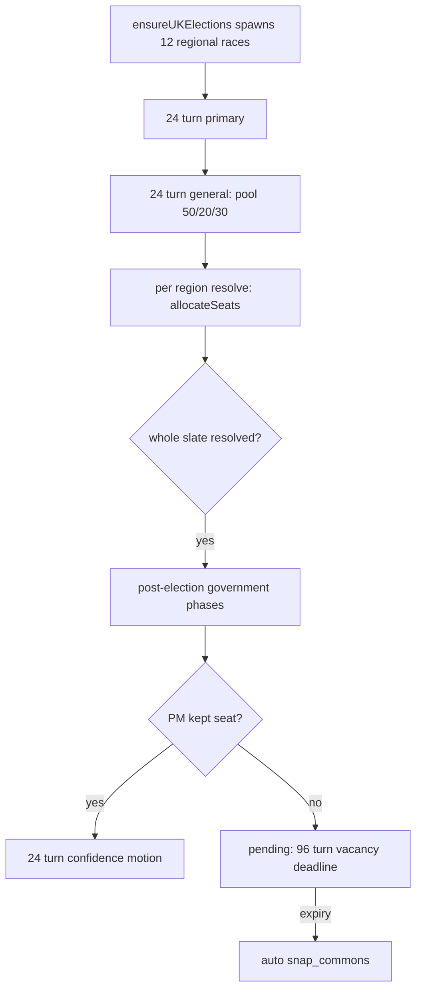

# UK Elections

## Summary

The UK uses 12 NUTS1-style regions for Commons, regional politics, demographics, budgets, and party organization. Older documentation that grouped the country into only England, Scotland, Wales, and Northern Ireland described a retired abstraction. Each region elects a block of Commons seats by proportional allocation (largest remainder on the Hare quota), the Commons then seats a Prime Minister through the parliamentary confidence process, and the model is regional proportional, not a constituency-by-constituency FPTP simulation.

Player guide: [United Kingdom](https://www.ahousedividedgame.com/wiki/uk-overview). General election flow for every country is in [Elections: A Granular Player Guide](https://www.ahousedividedgame.com/wiki/elections-player-guide) and [Snap Elections](https://www.ahousedividedgame.com/wiki/snap-elections).

## Rules

### Commons map

The modern `UK_COMMONS_SEATS` map in `src/lib/constants/states.ts` totals 650 seats (`TOTAL_UK_COMMONS_SEATS`), majority 326:

| Code | Region                   | Seats |
| ---- | ------------------------ | ----: |
| LON  | London                   |    75 |
| SEE  | South East England       |    90 |
| SWE  | South West England       |    58 |
| EAE  | East of England          |    60 |
| EMI  | East Midlands            |    47 |
| WMI  | West Midlands            |    57 |
| YHU  | Yorkshire and the Humber |    54 |
| NWE  | North West England       |    75 |
| NEE  | North East England       |    27 |
| SCO  | Scotland                 |    57 |
| WAL  | Wales                    |    32 |
| NIR  | Northern Ireland         |    18 |

Each era preset has its own map, chosen by `getUkCommonsSeats(preset)` and `getTotalUkCommonsSeats(preset)` in `src/lib/constants/states.ts`:

| Preset           | Map                      | Total | Majority |
| ---------------- | ------------------------ | ----: | -------: |
| `1953-default`   | `UK_COMMONS_SEATS_1953`  |   625 |      313 |
| `1991-default`   | `UK_COMMONS_SEATS_1991`  |   650 |      326 |
| any other preset | `UK_COMMONS_SEATS`       |   650 |      326 |

The 1953 and 1991 regional splits differ from the modern one (for example London has 91 seats in 1953, 81 in 1991 and 75 today). Seat allocation, historical officials, and election scheduling must all use the selected preset instead of assuming the modern map. The live-race healer in `ensureUKElections` (`src/lib/countries/uk/elections/perpetual.ts`) rewrites `totalSeats` on any live race that carries the wrong era's map.

### Constants

| Constant | Value | Source |
| --- | --- | --- |
| Commons election method | `pr_hareQuota` | `src/lib/countries/uk/institutionsFacts.ts` (`electionSystems.lowerChamber`), type in `src/lib/constants/countriesCore.ts` |
| Regular cycle (`CYCLE_TURNS.commons`) | 240 turns (5 game years) | `src/lib/constants/partyOrg.ts` |
| Election window (`commons`, `snap_commons`) | 48 turns: 24 primary, 24 general | `src/lib/constants/electionDurations.ts` |
| Minimum party vote share to take seats (`STANDARD_MULTI_SEAT_MIN_SHARE`) | 0.1 (10%, party-pooled) | `src/lib/turn/election/rules/seatEligibility.ts` |
| Org weight exponent (`ORG_WEIGHT_EXPONENT`) | 0.2 | `src/lib/electionEngine/electionFormulaFactors.ts` |
| General vote pool split (`EARLY_POOL_SHARE`, `RAMP_POOL_SHARE`, `FINAL_POOL_SHARE`) | 0.5, 0.2, 0.3 | `src/lib/electionEngine/voteCalculations.ts` |
| Ramp band (`RAMP_TURNS`) | 8 turns | `src/lib/electionEngine/voteCalculations.ts` |
| Final band (`ELECTION_DAY_TURNS`) | 4 turns | `src/lib/electionEngine/voteCalculations.ts` |
| PM vacancy deadline (`PM_VACANCY_DEADLINE_TURNS`) | 96 turns | `src/lib/constants/turnTime.ts` |
| PM vote duration (`PM_VOTE_DURATION_HOURS`) | 24 | `src/lib/constants/governmentFormation.ts` |
| Snap limit (`SNAP_ELECTION_LIMIT`) | 2 per appointment | `src/lib/turn/snapElection.ts` |
| Snap cooldown (`SNAP_ELECTION_COOLDOWN_TURNS`) | 336 turns | `src/lib/turn/snapElection.ts` |

### Seat allocation

Allocation is `allocateSeats` in `src/lib/turn/election/seatAllocation.ts`, which delegates the proportional step to `largestRemainderSeats` (the same function drives the live seat projection, so projection and result cannot drift apart):

1. Each region resolves one multi-seat `commons` race (or `snap_commons`), using the region's entry in the preset map as `authoritativeSeats`.
2. Candidates from the same party pool their votes. A party needs at least 10% of all votes cast in the region (`minShare`) to enter the pool. Independents are judged one by one.
3. For every pooled candidate: `exact = votes / poolVotes * seats`. Each takes `floor(exact)` seats.
4. Remaining seats go one each to the largest fractional remainders. Pool votes, not total votes, are the denominator, so sub-threshold votes are discarded.
5. Weighted `seatsHeld` records are written for each winner.

Org weight in the vote model: a party's organization in the region is normalized to a share of all organization, then raised to `ORG_WEIGHT_EXPONENT` (`orgVoteWeight`). `weight = share ^ 0.2`, so a 3:1 organization lead is worth about 1.25:1 in vote weight. A state with no organization data at all returns a neutral weight of 1; a party with zero organization in a populated state returns 0.

General vote pool: `turnVoteWeight(totalTurns, turnIndex, totalPool)` spreads the pool over the 24-turn general window. The last 4 turns carry 30%, the 8 turns before that carry 20%, and everything earlier carries 50%. With 24 turns that is 12 early turns at about 4.17% each, 8 ramp turns at 2.5% each, and 4 final turns at 7.5% each.

The UK model is proportional at the regional level. It is not a constituency-by-constituency FPTP simulation.

### Government formation

A party winning seats does not automatically appoint the Prime Minister. The Commons must seat a PM through the parliamentary confidence process. The majority threshold is 326 for a 650-seat chamber and is preset-aware for the 625-seat 1953 chamber.

After a regular election with a sitting PM who kept a seat, the PM is not vacated outright. The game opens a 24-turn confidence motion in their name (`openConfidenceMotionForIncumbent` in `src/lib/turn/parliamentaryGovernment.ts`). If the PM lost their seat, or there was no government, the country goes to the pending state below. A snap election always vacates the PM first (`unformGovernmentAndVacatePM`).

If the government is pending:

- ordinary legislation is frozen (`skipWhenGovPending`);
- PM appointment votes can run;
- a 96-turn vacancy deadline is armed;
- expiry of that deadline triggers a snap Commons election.

A successful no-confidence vote removes the PM and returns the country to the same pending formation flow. See [Parliamentary Government](./parliamentary-government.md), [Ruling-Party Confidence](./ruling-party-confidence.md), and [UK PM No Confidence](./uk-pm-no-confidence.md).

### Regional institutions

Scotland, Wales, and Northern Ireland use their named devolved legislatures. The nine English regions use regional councils. These are separate from Commons seat allocation and have their own seat maps (`UK_REGIONAL_COUNCIL_SEATS` in `src/lib/constants/states.ts`) and election scheduling. See [UK Devolution Policy](./uk-devolution-policy.md).

## Data

| Collection | Role | Player-visible |
| --- | --- | --- |
| `states` | The 12 UK regions (`countryId: "UK"`); read to find which regions need a Commons race | Yes |
| `elections` | One `commons` or `snap_commons` race per region (`electionType`, `state`, `status`, `totalSeats`, start and end turns). Read and written by `ensureUKElections`; `totalSeats` rewritten by the era healer | Yes |
| `electionCandidates` | Candidates per race, pooled by party at allocation | Yes |
| `electionVoteTallies` | General-phase tallies, per-turn snapshots and seat estimate; written by the vote accumulation phase, read by the live projection | Yes |
| `electedOfficials` | Seated MPs with weighted `seatsHeld`, written on resolution; canonical source for who holds a seat | Yes |
| `governmentFormations` | `pmCharacterId`, `majorityThreshold` (326, or 313 in 1953), `cycle`, formation status; refreshed after the result by `updateParliamentaryGovernmentSeats` | Yes |
| `notifications` | Batched election announcements (`sendBatchedElectionAnnouncements`) | Yes |

## Configuration

| Setting | Default | Where set |
| --- | --- | --- |
| Era preset (`ctx.preset`) | World's preset; selects the seat map | game clock stamped at world setup, read through `getCurrentTurnAndCtx` in `src/lib/turn/perpetualElections/engine.ts` |
| Seat maps | modern 650, 1953 625, 1991 650 | `src/lib/constants/states.ts` |
| Commons method and 10% gate | `pr_hareQuota`, 0.1 | `src/lib/countries/uk/institutionsFacts.ts`, `src/lib/turn/election/rules/seatEligibility.ts` |
| Cycle length and window | 240 turns, 24 + 24 | `src/lib/constants/partyOrg.ts`, `src/lib/constants/electionDurations.ts` |
| Snap limit and cooldown | 2 per appointment, 336 turns | `src/lib/turn/snapElection.ts` |
| PM vacancy deadline | 96 turns | `src/lib/constants/turnTime.ts` |
| Canonical schedule anchor | `anchors.ukCommons` | `src/lib/elections/canonicalCycle.ts` |

No feature flag gates the UK Commons election itself.

## Timing

Commons races are spawned by `ensureUKElections` (`src/lib/countries/uk/elections/perpetual.ts`), registered as the `ukElections` entry in `COUNTRY_ELECTION_PHASES` (`src/lib/turn/countryPhases.ts`). Order within a turn, from `src/simulation/phases/turnPhaseRegistry.ts`:

1. Elections resolve (primary, then general, per region).
2. `runPostElectionGovernmentPhases` runs once the whole slate for a cycle has resolved: it fails in-progress bills, cancels any active no-confidence vote, then opens a confidence motion for the sitting PM (if the PM kept a seat) and refreshes seat counts.
3. `parliamentaryGovernmentPhases` refreshes Commons seat totals, resolves expired PM appointment votes (including the post-election confidence motion) and no-confidence votes, and runs the NPP auto-aye pass (`runParliamentaryGovernmentPhases` in `src/lib/turn/countryPhases.ts`).
4. `parliamentaryGovernmentConfidence` ticks the shared confidence gauge for non-UK parliamentary countries. The UK gauge is handled in its own country module.
5. `parliamentaryVacancyWatcher` fires the auto-snap if a pending government has passed its 96-turn deadline. It runs after step 3 on purpose, so a PM seated this turn has their deadline cleared first.

Regular cycle: each regular race ends `UK_COMMONS_CYCLE_PERIOD_HOURS` (240 turns) after the previous canonical date. A snap election resets the clock: the next regular ends 240 turns after the snap ended, and later regulars keep counting from that shifted schedule (`planNextLowerChamberCycle` in `src/lib/elections/snapShift.ts`).

## Worked trace

A 1991 world, South East England (`SEE`, 89 seats in `UK_COMMONS_SEATS_1991`) on a general window of 24 turns. To keep the numbers readable, the allocation steps use a smaller 10-seat region as an illustration of the same function.

1. **Vote pool by turn.** 24 turns: 4 final, `min(8, 24 - 4) = 8` ramp, 12 early. Per turn: early `0.5 / 12 = 4.1667%`, ramp `0.2 / 8 = 2.5%`, final `0.3 / 4 = 7.5%`. Check: `12 x 4.1667 + 8 x 2.5 + 4 x 7.5 = 50 + 20 + 30 = 100%`.
2. **Org weight.** Party A has organization 30 and party B 10 in the region (sum 40). Shares are 0.75 and 0.25; weights `0.75^0.2 = 0.944` and `0.25^0.2 = 0.758`, a ratio of 1.246 for a 3:1 organization lead.
3. **Votes cast** in the 10-seat region total 10,000: A 4,500, B 3,000, C 1,800, D 700.
4. **Gate.** D is at 7%, under the 10% gate (`STANDARD_MULTI_SEAT_MIN_SHARE`). Pool votes are `10,000 - 700 = 9,300`.
5. **Exact seats** `= votes / 9,300 x 10`: A 4.839, B 3.226, C 1.935.
6. **Floors:** 4, 3, 1 = 8 seats. Two spare seats go to the largest remainders, C (0.935) and A (0.839).
7. **Result:** A 5, B 3, C 2, D 0, stored as weighted `seatsHeld` rows on `electedOfficials`.
8. **Government.** Suppose the whole 12-region slate leaves party A with 330 of 650 seats. `majorityThreshold` is 326, so A has a majority. If the sitting PM kept a seat, a 24-turn confidence motion opens in their name; if not, the country goes pending, `PM_VACANCY_DEADLINE_TURNS = 96` starts, and an expiry without a seated PM triggers an auto `snap_commons`.

## Edge cases and limits

- **No party clears 10%.** The gate admits nobody, so the top candidates by votes fill the seats in ranked order (`usedFallback` in `largestRemainderSeats`).
- **Only one party in the pool.** It takes every seat in the region.
- **Zero pool votes.** Nothing can be apportioned, so the leading candidate takes the region's seats rather than leaving them empty.
- **Over-allocation.** If a region would seat more than its authoritative count, allocations are scaled down proportionally. This is a safety net, not a normal path.
- **Wrong-era map.** Live races carrying the modern map in a 1953 world are healed back to the preset map on the next election phase.
- **Short general windows.** If the general window is 4 turns or less the pool is spread evenly. If the early band would be empty, its 50% folds into the ramp band so the weights still sum to the whole pool.
- **Region resolves early.** A single region finishing does not dissolve legislation or open a confidence motion. The government phases wait until every race in that cycle's slate has resolved.
- **Snap limits.** A PM-triggered snap is capped at 2 per appointment with a 336-turn cooldown, and cannot be called while a no-confidence vote is active. The auto-snap from an expired vacancy deadline bypasses the limit and cooldown. See [Snap Elections](./snap-elections.md).
- **Do not use `UK_REGIONS.constituencies`** (display metadata in `src/lib/constants/uk.ts`) for seat allocation.

## Invariants

- Seats seated in a region never exceed the region's authoritative count: enforced by the over-allocation scale-down in `largestRemainderSeats`; the seat total is tested in `src/lib/turn/election/largestRemainderSeats.test.ts` ("conserves the seat total exactly"). The scale-down safety net itself has no dedicated test.
- Projection and result use the same apportionment function: by construction (one function); not separately tested.
- The 10% gate is inclusive at the boundary: `src/lib/turn/election/seatAllocation.test.ts` ("keeps the 10% boundary inclusive and excludes a party below it") and `rules/seatEligibility.test.ts`.
- The vote pool weights sum to the whole pool: by the early-band folding rule; the weights are covered by tests in `src/lib/electionEngine/`, with no UK-specific assertion.
- Live races carry the preset's seat map: runtime healer in `ensureUKElections`. Not tested: `src/lib/constants/states.test.ts` has no UK Commons map assertions.
- Not enforced: that the 12 regional totals equal 650 (625 in 1953) after a hand edit of a map; the totals are separate constants.

## Failure and recovery

- **Wrong-era seat totals on a live race.** Detected and rewritten automatically on the next election phase (see Edge cases). A data heal does the same for resolved races.
- **Missing regional race.** `ensureUKElections` re-spawns any region without an active or upcoming Commons race on its next run, anchored to the canonical schedule; stale or stub races are walked forward to the next cycle.
- **Admin-accelerated timers.** Fast-forwarding a regular cycle does not move the calendar; the next regular stays on the canonical schedule.
- **Government stuck pending.** The 96-turn vacancy watcher fires an auto-snap; if a formation document is inconsistent with the seat result, a rerun of the government phases refreshes seats and `majorityThreshold`.
- **Partial slate.** If one region fails to resolve, the post-election government phases wait for the whole slate; a rerun of the election resolution phase completes it.

## Connections

**Driven by:**

- [Elections](./elections.md): regional organization feeds `orgVoteWeight` in `src/lib/electionEngine/electionFormulaFactors.ts`.
- [Snap Elections](./snap-elections.md): `triggerSnapElection` in `src/lib/turn/snapElection.ts` replaces the regular Commons slate with `snap_commons` races.
- [UK PM No Confidence](./uk-pm-no-confidence.md): a passed motion calls `unformGovernmentAndVacatePM`, which arms the 96-turn clock that can end in a snap election.

**Affects:**

- [Parliamentary Government](./parliamentary-government.md): seat totals and `majorityThreshold` in `governmentFormations` are refreshed from the result (`updateParliamentaryGovernmentSeats`, `src/lib/turn/parliamentaryGovernment.ts`).
- [UK Cabinet](./uk-cabinet.md): a vacated PM clears the cabinet through `clearCabinetOnTransition`.
- [Bills and legislation](./bills-legislation.md): `failInProgressBills` fails Commons bills when a new Commons is elected.

Source map:

- `src/lib/constants/states.ts`: preset-aware Commons and regional-council seat maps
- `src/lib/constants/uk.ts`: region names and display metadata
- `src/lib/constants/countries.ts`: legislature, election method, threshold, and office configuration
- `src/lib/countries/uk/elections/perpetual.ts`: regular and snap race spawning
- `src/lib/turn/perpetualElections.ts`: continuing and snap election coverage
- `src/lib/turn/election/seatAllocation.ts`: multi-seat allocation
- `src/lib/turn/parliamentaryGovernment.ts`: government formation

## Tests

- `src/lib/turn/election/seatAllocation.test.ts`: proportional allocation for the 1991 lower chamber, full-region fill, 10% boundary, regional council seats.
- `src/lib/turn/election/largestRemainderSeats.test.ts`: remainder allocation and fallback.
- `src/lib/turn/election/rules/seatEligibility.test.ts`: the 10% gate for UK Commons.
- `src/lib/turn/snapElection.test.ts` (including the "ensureUKElections - canonical LARP + snap shift" block) and `src/lib/elections/snapShift.test.ts`: snap limits, cooldown, spawning and schedule shift.
- `src/lib/turn/parliamentaryGovernment.test.ts`: government formation after a result.
- `src/lib/countries/uk/elections/commonsCarveUp.test.ts`, `byElectionCarve.test.ts`, `commonsVacancyStatus.test.ts`: seat carving and vacancies.

Gaps: no test pins the 1953 live-race seat healer; the Commons seat maps and their 625 and 650 totals are not asserted in `src/lib/constants/states.test.ts`; the vote-pool weighting has no UK-specific test.

## Known issues and history

- An earlier page grouped the UK into England, Scotland, Wales and Northern Ireland only; the 12-region model replaced it.
- The 1953 and 1991 presets were given their own seat maps after worlds in those eras spawned and allocated on the modern 650-seat split (code comments cite ticket #1058 for 1953; the 1991 map repeats the fix one era over).
- The UK model is regional proportional; a constituency-level FPTP simulation is not implemented.

Last checked: 2026-10-29, version 1.18.0
