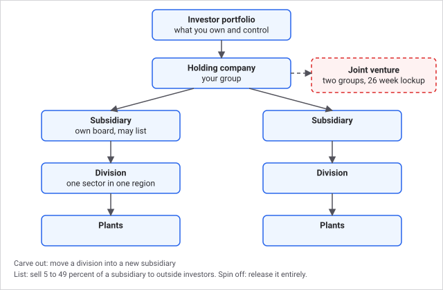
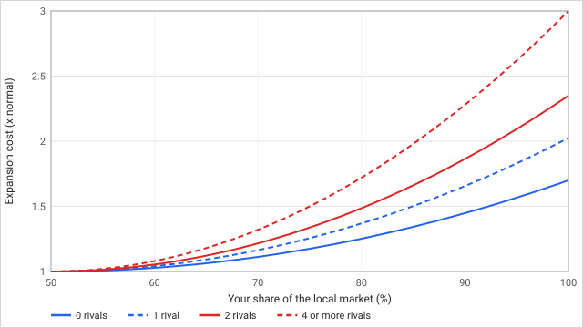
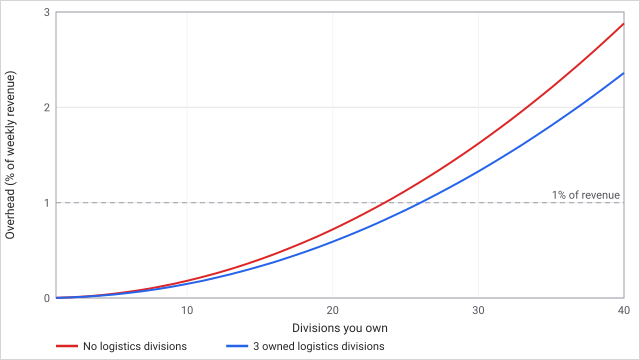
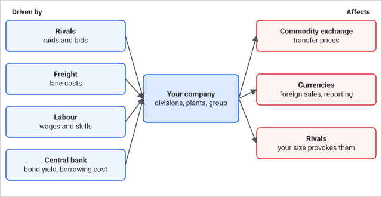

# Your holding company

You play an investor. Your money and your shares sit in a portfolio above your companies, and the companies you control form a group: a holding company with as many subsidiaries as you can build or buy. Losing a company does not end your career. This page covers how the group is built, who controls what, and the money tools you use to grow it.

## How it works

### Companies, divisions and plants

A company opens a **division** the first time it builds a plant of a sector type in a region. Opening costs a $100,000 entry fee, and the founding plant is built at half its strategy's capital cost. Later plants in that region and sector join the division and must run its strategy. **Retooling** moves the whole division to another strategy of the same sector for a quarter of the new strategy's capital cost per block and a third of its build time (at least 4 weeks). A division cannot change sector.

Three costs rise as you grow:

- **Dominance.** Expanding an existing division past 50 percent of a local market multiplies its capital cost, up to 3 times at a 100 percent share with four or more rivals in the market. With no rival it tops out at 1.7 times. Opening a division never pays this.
- **Sprawl.** Overhead is paid on weekly revenue and grows with the square of the division count, not the plant count. See the table below.
- **Construction capacity.** You build at normal speed and price while blocks under construction stay within 40 plus a tenth of the blocks you already run (at most 400). Beyond that, each capacity's worth of excess adds 50 percent to cost (at most 2.5 times) and a full base build time to the lead time (at most 3 times).

Each division has a **reputation** from 0 to 10,000, starting at 2,500. Quality, marketing and brand lift it, a raid knocks it down, and it is earned faster than it is lost. It scales how customers see your quality in every market, by up to plus 15 percent at 10,000 and minus 5 percent at 0, which acts as a price premium and as loyalty.

### Control and the board

More than half of a company's votes gives you control. Exactly half is not control. This keeps one holder in charge and a tie from freezing the company. A board of five seats is elected by share of the vote. The board must approve a loan that takes debt above 60 percent of tangible assets, any single capital project above 25 percent of total assets, mergers and large share issues.

Each quarter the board of your primary company sets one goal, rotating through four types. Meeting it before the quarter ends pays you a management bonus.

### Subsidiaries and listings

- **Carve out** a finished division into a new subsidiary you wholly own. It gets working capital of 5 percent of book value (at least $100,000), takes its trade contracts with it, and you must keep at least one other division.
- **List** 5 to 49 percent of a subsidiary's votes on the stock exchange at 95 percent of its mark, after 13 weeks of results. You keep control. The fee is 2 percent, at least $100,000.
- **Spin off** a subsidiary: your whole stake goes to your own shareholders in proportion, with no cash.
- **Issue shares**, buy them back or pay dividends, within the board's limits and a cash buffer.

Every operating company trades on the stock exchange at a price that follows its fair value. You can buy and sell shares in any of them, including your rivals.

**Activist investors** target companies with at least 5 percent of their votes held outside and 26 weeks of results. They need a grievance: a share price 55 percent or more under its peak for 39 weeks while losing money for 52 weeks, two missed board goals in a row, group pricing that takes at least 3 percent of equity from minority holders, or a dividend that stopped while cash is ample.

You can **concede** (the demand is met in full), **negotiate** (half the demand plus a fee of 0.1 percent of equity) or **fight** (you pay damages of 0.4 percent of equity plus the full demand if you lose). If you do nothing, the board answers after 4 weeks, and ignoring one raises the activist's odds by 10 points. A company sees at most one campaign every 104 weeks.

### Group supply and transfer prices

Companies in one group supply each other first. Each week the engine keeps standing contracts between divisions that use what another makes, settled before the open market. Each supplying division has one **transfer price** setting: 0 is its own cost, 10,000 is the market price (the default, the median ask of other makers) and up to 12,000 is a markup of 20 percent over market. Between 0 and 10,000 it is cost plus that share of the gap to market.

A price away from market takes value from the losing side's minority holders and builds a "squeeze" that fades by 1/52 a week. A squeeze at 3 percent of equity a year can draw an activist. Profit also moves between the tax bills of different states, which saves the group tax and shows in your statements.

### Joint ventures

Two groups can co-own a division as a joint venture. The proposer takes 20 to 80 percent; the larger holder controls it, and an even split leaves it independent. Surplus cash above two months of outflow is paid out as 60 percent each quarter in proportion to stakes. After 26 weeks either partner can buy the other out at fair value plus 10 percent, or leave: the other partner has first refusal at 95 percent of fair value, otherwise outside investors take the stake at 85 percent.

Partners become allies, which rivals remember: a rival asks old partners first to share a project, and a rival skips raids and bids on a friend only while the tie is strong (see [Rivals](rivals.md)).

### Money

- **Loans** from banks, priced by your credit.
- **Corporate bonds** priced off the central bank's ten-year yield plus a credit spread from leverage, interest coverage and size. Minimum issue $250,000, term 26 to 780 weeks, and the market refuses a spread above 12 percentage points. You can buy and sell bonds on the bond list at the market price.
- **Pricing.** Every good can be priced automatically from sell-through, set against the market, or marked up over your own cost (see [The commodity exchange](commodity-exchange.md)).

### Key numbers

| Item | Value |
| --- | --- |
| Division entry fee | $100,000 |
| Founding plant discount | 50 percent |
| Dominance threshold, maximum multiplier | 50 percent share, 3 times (1.7 times with no rival) |
| Division overhead | 0.18 percent of weekly revenue at 10 divisions, 0.72 percent at 20, 1.62 percent at 30 |
| Overhead cut by logistics | 6 percent per owned logistics division, up to 40 percent |
| Construction capacity | 40 blocks plus a tenth of blocks running, at most 400 |
| Control | More than 50 percent of votes |
| Board approval | Debt over 60 percent of tangible assets; project over 25 percent of assets |
| Board bonus | 2 percent of the quarter's operating profit, at least $25,000, never more than the company's cash |
| Listing | 5 to 49 percent at 95 percent of mark, 2 percent fee (at least $100,000) |
| Transfer price | 0 to 12,000 basis points of market (market is 10,000) |
| Joint venture | Stakes 20 to 80 percent, 26 week lockup, buyout at 110 percent of fair, exit at 95 or 85 percent |
| Bonds | $250,000 minimum, 26 to 780 weeks, spread cap 12 percentage points |
| Activist | 5 percent outside votes, 4 weeks to answer, 104 weeks between campaigns |

**Worked example.** You hold a 75 percent share of the steel market in one region, and four rivals also operate there. The next plant there costs 1.5 times its normal capital, because the share is halfway from 50 to 100 percent (a ramp of one quarter) and the full 3 times applies only at 100 percent. If you had been the only maker, the same plant would cost 1.18 times. Separately, at 20 divisions with 3 of them in logistics, overhead is 0.72 percent of revenue times 0.82, about 0.59 percent.

## What you can do

- **Open or retool a division** from the region board or CEO Office divisions panel. The quote shows the entry fee, discount and any dominance or rush surcharge before you submit.
- **Carve out, list, spin off, issue, buy back, pay dividends** from the Command Center, each with a live preview.
- **Set the transfer price** on each supplying division in CEO Office. Leave it at market unless you are deliberately moving profit between states, and expect a challenge if you push far from market in a part-owned company.
- **Answer the board and activists** from the Inbox.
- **Propose or leave a joint venture** from the Command Center or a rival's stock page.
- **Issue and trade bonds** from Markets, bond list.
- **If your last company fails.** Your career continues. With less than $25,000 in cash and no company, you can accept a management contract once every 260 weeks: a $100,000 signing bonus and a seat running an unowned company. Scores after it are marked as assisted.

Tips: to get control back after dilution, buy shares on the exchange until you pass 50 percent; keep your stake above that before approving large share issues; and do not let your debt run past 60 percent of tangible assets if you want to avoid a board vote.

## Connections

**Driven by**
- [The commodity exchange](commodity-exchange.md): input prices set plant margins and the market price a transfer price is measured against.
- [Freight](freight.md): owned logistics divisions take part of the division overhead off.
- [Regions and labour](regions-and-labour.md): where a plant sits sets its input cost; labour sets its output.
- [Governments and market laws](governments.md): the central bank's ten-year yield prices bonds; merger review limits deals.
- [Rivals](rivals.md): raids take plants and reputation; bids and activists target your companies.
- [Currencies](currencies.md): only firms keeping books in the numeraire hold stakes and issue bonds.

**Affects**
- [Regions and labour](regions-and-labour.md): your plants hire from regional pools and compete on wages.
- [Rivals](rivals.md): joint ventures create allies; raids and hostile bids create grudges.
- [The commodity exchange](commodity-exchange.md): group supply is settled before the open market.
- [Freight](freight.md): carriers you own run lanes that rivals use.
- [Governments and market laws](governments.md): your market share can trigger merger review.
- [Currencies](currencies.md): a firm founded abroad keeps books in another currency.

## Status

Live in every scenario and difficulty. Rival behaviour changes with difficulty (see [Rivals](rivals.md)), but the rules on this page are the same everywhere. Merger review thresholds depend on which party is in government (see [Governments and market laws](governments.md)). Cross-currency limits matter only in Ruhr and Rhine.

Last checked: 2026-10-29, version 1.8.0

Technical detail: every constant, formula and source file is in [Exact rules](#exact-rules) at the end of this page.

## Exact rules

### Divisions and building

Source: `crates/cw-sim/src/economy/sectors.rs`, `crates/cw-sim/src/commands.rs`.

- `ENTRY_FEE_CENTS = 10,000,000` ($100,000), paid to the outside legal-services sector. `FOUNDING_BPS = 5,000`.
- `DOMINANCE_THRESHOLD_BPS = 5,000`, `DOMINANCE_MAX_BPS = 30,000`. `dominance_multiplier_bps = 10,000 + (30,000 - 10,000) x ramp / 10,000 x rival_scale / 10,000`, where `excess = (share - 5,000) x 10,000 / 5,000`, `ramp = excess^2 / 10,000`, `rival_scale = 3,500 + 6,500 x min(rivals, 4) / 4`. Opening a division never pays it. Market share is capacity value at reference price over all operating capacity in the cell plus imports local plants are not meeting.
- `FAST_BLOCKS = 40`. Capacity = `min(40 + running_blocks / 10, 400)`. Cost multiplier `rush_bps = 10,000 + min(5,000 x excess / capacity, 15,000)`. Build weeks `base + min(base x excess / capacity, 2 x base)`. `MAX_BLOCKS_PER_ORDER = 255`.
- Retool: cost `capex x blocks / 4`, weeks `max(build_weeks / 3, 4)`, all plants in the division move together and must be operating or mothballed.
- Input cost by management distance: another region of the home state `AWAY_IN_STATE_BPS = 10,250`, another state `AWAY_OUT_OF_STATE_BPS = 10,500`; specialised primary `SPECIALIZED_PRIMARY_BPS = 9,700` and secondary `SPECIALIZED_SECONDARY_BPS = 9,850` (see [Regions and labour](regions-and-labour.md)).

### Sprawl

Source: `crates/cw-sim/src/economy/operations.rs` (`sprawl_rate_bps`). Overhead is `0.18 x d^2` basis points of weekly revenue (`d` is the division count), times `(400 - strength) / 400` for logistics strength (`MAX_LOGISTICS_STRENGTH = 200`, so at most half off), times `(10,000 - min(600 x owned_logistics, 4,000)) / 10,000`, doubled for a firm with a secondary specialised type. It counts divisions, not plants.

### Reputation

Source: `crates/cw-sim/src/economy/structure.rs`. `NEUTRAL_REP = 2,500`. Target is 2,500 plus twice the quality margin over 10,000 (limited to -2,000 to +6,000), plus marketing and brand terms (each up to 3,000). It rises by 1/26 of the gap a week and falls by 1/52. A successful raid costs the defender 300 plus a fifth of the stake taken; a failed one 100.

### Control and board

Source: `crates/cw-sim/src/state.rs` (`controller`, tests `exactly_fifty_percent_is_not_control`), `crates/cw-sim/src/economy/ownership.rs`, `crates/cw-sim/src/economy/governance.rs`. Control is strictly more than 50 percent of votes. `approval_required`: `debt_after x 100 > tangible x 60` or `capex x 100 > assets x 25`. Boards have five seats elected by largest-remainder share of votes.

### Board goals

Source: `crates/cw-sim/src/economy/objectives.rs`. `QUARTER_WEEKS = 13`, `MIN_BONUS_CENTS = 2,500,000`, `BONUS_BPS = 200`. A goal is set in the first week of each quarter (`tick % 13 == 1`), rotating by quarter: new region, average weekly operating profit at least `max(average + average/4, average + $5,000)`, home division share plus 10 points (max 95 percent), new state. Bonus is `max(2 percent of the quarter's operating profit, $25,000)`, capped at the company's cash, moved from the company to the investor.

### Structure

Source: `crates/cw-sim/src/economy/structure.rs`.

| Constant | Value |
| --- | --- |
| `TRANSFER_MARKET_BPS` | 10,000 |
| `TRANSFER_MAX_BPS` | 12,000 |
| `JV_LOCKUP_WEEKS` | 26 |
| `JV_BUYOUT_PREMIUM_BPS` | 11,000 |
| `JV_EXIT_PARTNER_BPS` | 9,500 |
| `JV_EXIT_MARKET_BPS` | 8,500 |
| `SQUEEZE_DECAY_DEN` | 52 |
| `LISTING_DISCOUNT_BPS` | 9,500 |
| `ACTIVIST_COOLDOWN_WEEKS` | 104 |
| `ACTIVIST_RESPONSE_WEEKS` | 4 |
| `MIN_BOND_CENTS` | 25,000,000 |
| `MIN_BOND_WEEKS`, `MAX_BOND_WEEKS` | 26, 780 |
| `MAX_BOND_SPREAD_BPS` | 1,200 |

- Joint venture stakes for the proposer: 2,000 to 8,000 basis points. Carve-out working capital `max(book / 20, $100,000)`. Listing fee `max(2 percent of proceeds, $100,000)`.
- Activist campaigns are scanned quarterly per firm (when `slot % 13 == tick % 13`), need `statement_weeks >= 26` and outside votes of at least 500 basis points. Grievances: price fall of 5,500 basis points or more from peak with 39 weeks weak, 52 weeks losing and game week 78 or later; two missed board goals in a row (primary group); squeeze at 300 basis points or more of equity; a dividend stopped after 3 quarters while cash exceeds twice the weekly outflow buffer. A fight is won with the case's chance, plus 10 points if the player ignored it. Negotiate pays `equity / 1,000`, a won fight `equity x 4 / 1,000`.
- The squeeze accumulates on the losing side's non-controlling holders and fades by 1/52 a week.

### Insolvency recovery

Source: `crates/cw-sim/src/commands.rs` (`AcceptManagementContract`). Available when investor cash is under `2,500,000` cents ($25,000), the investor controls no firm and manages none; signing bonus `10,000,000` cents ($100,000); not again within 260 weeks; marks the score as assisted.

### Edge cases

- A parent holding exactly 50 percent has no control.
- A listing never gives up control (maximum 49 percent).
- A carve-out is refused if it would leave the parent with no other division.
