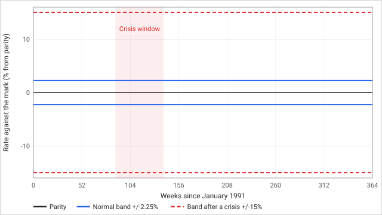
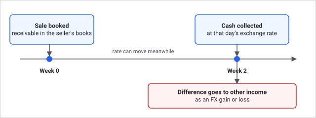

# Currencies

A scenario can span several countries, each with its own money and central bank. When it does, exchange rates move every week, sales paid in another currency are collected late, and some deals are closed to you across a currency line. Ruhr and Rhine, 1991 is the only built-in scenario that uses this. Scenarios with one currency play exactly as if the mechanic did not exist.

## How it works

Every firm keeps its books in the money of its home region. The first currency in the scenario is the **numeraire**: in Ruhr and Rhine that is the Deutsche Mark, which belongs to the anchor country. Your cash as an investor, share quotes on the exchange and the state's accounts are in the numeraire. The engine converts at the current rate wherever money crosses a currency line: market trade, freight, the gateways, taxes, outside loans, share issues, dividends and buybacks.

Each week the rates move:

1. A currency's value drifts toward purchasing power parity (what its money buys relative to the anchor's), tilts with the gap between the country's real interest rate and the anchor's, and takes a random shock.
2. A **pegged** currency is held inside a band around parity. The pegged currencies here (guilder, Belgian and Luxembourg franc, French franc) are pegged to the mark.
3. The farther the underlying rate presses against the band, the likelier a crisis in any week. A crisis widens the band, as happened to the European exchange rate mechanism in 1992 and 1993. It can happen only once per currency.
4. Gateway prices and background wages follow each country's money.

A sale paid in another currency books a receivable and is collected 2 weeks later at the rate on the day it is collected. The difference between the booked value and the money you actually receive is an **FX gain or loss**, booked to other income.

### Key numbers

| Item | Value |
| --- | --- |
| Collection delay on a foreign sale | 2 weeks |
| Peg band, each side of parity | 2.25 percent |
| Peg band after a crisis | 15 percent |
| Crisis window (scripted, Historical path) | Weeks 88 to 140 of the scenario |
| Weekly rate volatility | Mark 0.40 percent, guilder 0.30, Belgian franc 0.40, French franc 0.55 |
| Base weekly crisis chance, per currency | Guilder 0.01 percent, Belgian franc 0.02, French franc 0.03, plus strain |
| Weekly crisis chance inside the window (Historical path) | 40 times the base: guilder 0.4 percent, Belgian franc 0.8, French franc 1.2, plus strain |

**Worked example.** A firm that keeps its books in marks sells goods for 500,000 French francs. At day-one parity that books as a receivable worth 500,000 marks. Over the 2 weeks the franc slips 1 percent against the mark, which is inside the 2.25 percent band. When the money arrives it is worth 495,000 marks, and 5,000 marks are booked as an FX loss. If the franc's peg breaks and the band opens to 15 percent, the same 2-week gap can swing a good deal further, so a bigger sale carries bigger risk.

### Limits

- A firm builds only in regions that use its own money. To operate in another country, found a firm there.
- Contracts, intercompany loans, guarantees, deposits, bank loans, insurance, joint ventures, mergers and raids stay inside one currency.
- Only firms keeping books in the numeraire hold stakes in other firms and issue bonds, because the exchange quotes every share in the numeraire.
- The state rescues, buys reserves and procures only from numeraire firms.

These limits exist so that a deal never needs a hidden exchange rate: each balance sheet stays in one unit.

## What you can do

- **Choose your reporting currency** in Settings. Your net worth and cash show in it. Company figures keep their own currency where it differs. Changing it is only a display choice; it never changes the game.
- **Found a firm in another country** to work in its regions. That firm keeps books in the local currency and cannot hold stakes or issue bonds unless it is in the numeraire.
- **Watch the economy card** in Markets. Its foreign exchange section shows rates, peg bands and strain. FX gain or loss lines appear in a company's financial statements.
- Pricing and costs in a foreign country follow its money, so a strong local currency makes your exports from there dearer.

Tips: sell for the currency you keep books in when you can, and time large foreign sales outside the crisis window if you want to avoid a wide swing.

## Connections

**Driven by**
- [Your holding company](companies.md): where you found firms decides which currency your books use.
- [Freight](freight.md): freight bills across a currency line are converted at the day's rate.
- [Governments and market laws](governments.md): central bank rates and inflation in each country set the rate drift.
- [Scenarios](scenarios.md): which countries, currencies and pegs exist.
- [The commodity exchange](commodity-exchange.md): trade across a currency line creates the receivables that carry FX gain and loss.

**Affects**
- [The commodity exchange](commodity-exchange.md): gateway prices and background wages follow each country's money.
- [Freight](freight.md): freight over a currency line is converted at the day's rate.
- [Your holding company](companies.md): bonds, stakes, joint ventures and mergers are limited by currency.
- [Rivals](rivals.md): raids and bids stay inside a currency, so rivals in another country cannot target you and you cannot target them.
- [Regions and labour](regions-and-labour.md): wages follow the country's money.

## Status

Active only in scenarios with more than one currency. Today that is Ruhr and Rhine, 1991. The crisis window and its pull on the weaker pegs apply on the Historical price path; other paths use the same band and strain rules without the scripted window. Great Lakes 2000, Texas Oil Patch 1981 and Silicon Valley 1995 use the US dollar only.

Last checked: 2026-10-29, version 1.8.0

Technical detail: every constant, formula and source file is in [Exact rules](#exact-rules) at the end of this page.

## Exact rules

Sources: `content/scenarios/ruhr-rhine-1991/currencies.json`, `crates/cw-sim/src/economy/fx.rs`, `docs/rules/CURRENCIES.md` in the game repository.

### Constants

| Constant | Value | Source |
| --- | --- | --- |
| `COLLECTION_WEEKS` | 2 | `fx.rs` |
| `HISTORY_WEEKS` | 104 | `fx.rs` |
| Peg `band_bps` | 225 (guilder, Belgian franc, French franc) | `currencies.json` |
| Peg `widened_band_bps` | 1,500 | `currencies.json` |
| `crisis_window_weeks` | 88 to 140 | `currencies.json` |
| `crisis_hazard_ppm` | guilder 100, Belgian franc 200, French franc 300 | `currencies.json` |
| `volatility_bps` | mark 40, guilder 30, Belgian franc 40, French franc 55 | `currencies.json` |
| `policy_spread_bps` | mark 0, guilder 25, Belgian franc 60, French franc 90 | `currencies.json` |
| `inflation_spread_bps` | mark 0, guilder -20, Belgian franc 30, French franc 25 | `currencies.json` |
| `face_milli` (display only) | mark 1,000, guilder 1,127, Belgian franc 20,630, French franc 3,400 | `currencies.json` |
| Fundamental rate clamp | one third to three times parity | `fx.rs` |

Countries: Germany (DEM), Netherlands (NLG), Belgium and Luxembourg (BEF), France (FRF). Ledger units are re-based so one unit of every currency buys the same on day one; `face_milli` only quotes rates.

### Weekly rate model

Source: `fx.rs`.

1. Inflation for each country is the anchor's plus its spread and a slow random walk. The central bank rate is the anchor's, plus its spread, half the excess inflation and the strain of defending a peg.
2. Purchasing power parity updates by the inflation gap. The fundamental rate drifts by the carry (real rate gap) divided by 52 and 4, plus a random shock scaled by volatility, and reverts toward parity at 1/104 of the gap a week.
3. On the Historical path, inside the crisis window, a currency with a positive policy spread loses `policy_spread_bps x 10` parts per million of drift each week (the 1992 squeeze).
4. A pegged market rate is clamped inside `central x (1 +/- band)`. Strain is how far the fundamental sits outside half the band. Crisis chance in a week is `crisis_hazard_ppm x scripted + strain x 10` parts per million, where `scripted` is 40 inside the window on the Historical path and 1 otherwise. On a crisis the band becomes `widened_band_bps`. Only one crisis per currency (`crisis_week`).
5. Gateway prices and background wages follow the currency and inflation gap.
6. A foreign-currency sale books a receivable collected `COLLECTION_WEEKS` later at the rate then; the difference goes to other income and an FX gain or loss record.

### Restrictions

Enforced in `fx.rs` by `require_same_currency` and `require_numeraire_holder`. A scenario with one currency never sets `world.fx.active`, so none of this runs and saves hash as before.

### Reporting currency

A display choice held by the session, never saved or hashed. Investor cash and net worth show in it (`to_reporting`).

### Edge cases

- The numeraire never moves.
- A float (no peg) has no band and no crisis.
- Amounts convert rounding half to even.
