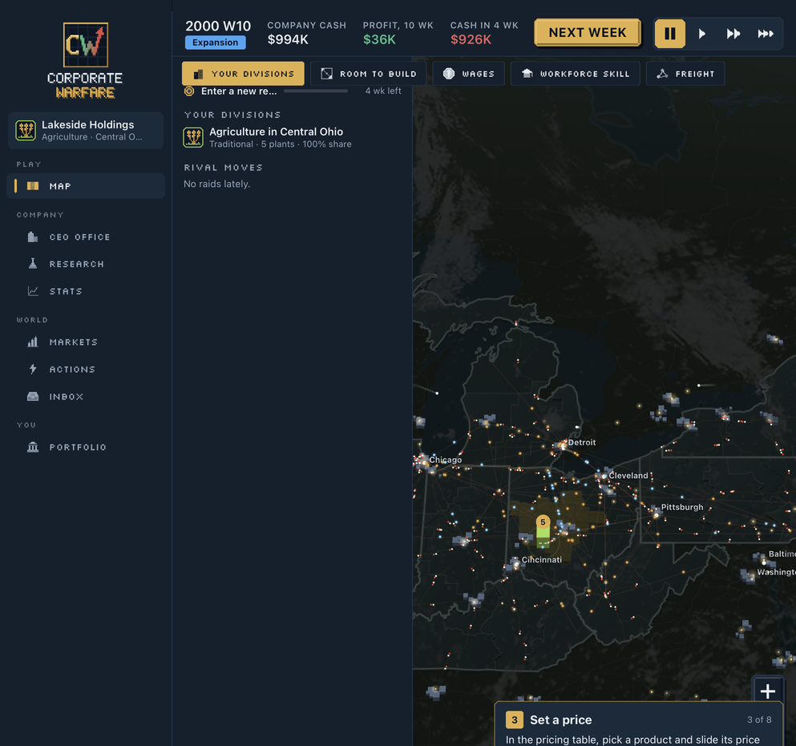
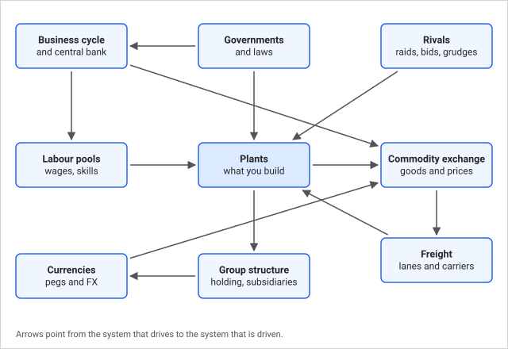

# Corporate Warfare overview

Corporate Warfare is an offline, single-player economic strategy game. You are an investor at the head of a holding company. You build plants, open divisions, float subsidiaries, sign joint ventures, ship goods over a freight network and fight named rival firms for every market, while business cycles, central banks, elections and world commodity prices move under you.

Corporate Warfare 2.0 is a paid game: one purchase in the Lakeside store, yours to keep, with no ads and no subscription needed. It is also included with the Supporter+ and Champion plans. You install and update it through the Lakeside launcher, on Windows and Linux today, with Mac following in the launcher and iPhone, iPad and Android following after store review. Once it is installed it plays fully offline. There is no multiplayer: every rival is run by the game. See [Getting started](getting-started.md) for prices and installing.

## What you do

- **Run a group of companies.** Your companies hold divisions, one per sector in each region, and each division runs plants. You choose what to build, where, and how to price what it makes. See [Your holding company](companies.md) and [Regions and labour](regions-and-labour.md).
- **Play the corporate game.** Carve a division out into a subsidiary, list part of it on the exchange, spin it off, borrow in the bond market, or co-own a division with another group as a joint venture. See [Your holding company](companies.md).
- **Move goods.** Every input your plants need is bought on a commodity exchange that spans the whole map, priced as delivered. Freight runs over trucking, rail, pipeline and lake and sea lanes that you can own, reserve and contest. See [The commodity exchange](commodity-exchange.md) and [Freight](freight.md).
- **Fight rivals.** Dozens of rival firms per scenario, each run by a chief executive with a temperament. They build where there is room, close plants that lose money, raid your divisions with four weeks of warning, bid for your companies and remember who wronged them, all on the same rules you play by. See [Rivals](rivals.md).
- **Play for a goal.** Take over an established company or found your own, pick an ambition and a length, and play for bronze, silver or gold. See [Careers and ambitions](careers.md).
- **Live with the economy.** Booms and busts, a central bank that sets rates, governments that change market laws after an election, and world prices for oil, steel, grain and more that follow history or your game's seed. See [Governments and market laws](governments.md). In Ruhr and Rhine you also deal with several currencies: [Currencies](currencies.md).

The 3D map is the default map on every platform, with a model for every sector's plants, cities that fill with buildings as you zoom in, and trucks, trains and ships on the real roads, railways and sea lanes. One tick is one game week. You can play a week at a time or let the clock run at 1, 2 or 4 weeks a second, and the game pauses when a decision needs you.

## How the systems connect

Plants need workers and inputs. Workers come from regional labour pools (regions and labour). Inputs come from the commodity exchange, priced as delivered, so freight decides who can sell to whom. What you make sells on the same exchange to other plants and to households. The business cycle and the central bank set demand, loan rates and wages. Governments change the rules on tax, mergers, freight and prices. Rivals compete for the same pools, lanes and markets, and your group structure decides how much control, tax and risk you carry.

*Arrows point from the driving system to the driven one.*

## How long a game is and how you score

A career has a start, a goal and an ending. When you start a new game you choose how to start (take over one of three established companies, or found your own), what you play for (Richest, Biggest, Dominant or Survivor) and how long (5, 10 or 20 years). Each goal has bronze, silver and gold, the game tells you every quarter where you stand, and a career can be lost. [Careers and ambitions](careers.md) has the details.

A game started with no career chosen plays as a sandbox, the way every earlier version played. In that mode the game pauses at week 260 (five years) and records a score from 0 to 100, then lets you play on. Saves from every earlier version still open and play on as before.

| Part | Weight | What counts |
| --- | --- | --- |
| Growth | 45 percent | Your personal net worth against the start: 20 if flat, rising to 100 at double |
| Expansion | 25 percent | 20 for each division beyond the first, 10 for each state beyond the first |
| Leadership | 10 percent | 25 for each region and sector where you have the largest capacity |
| Resilience | 10 percent | Share of weeks without past-due bills |
| Conduct | 10 percent | 100 minus 10 per unresolved regulatory breach and 5 per failed worker settlement |

Each part is capped at 100. A score reached after an insolvency recovery contract is marked as assisted (see [Your holding company](companies.md)).

## Scenarios

Four scenarios are playable: [Great Lakes 2000, Texas Oil Patch 1981, Silicon Valley 1995 and Ruhr and Rhine 1991](scenarios.md). Each has its own map, regions, rival firms, starting position and world price history. Start with Great Lakes 2000.

## Where to go next

- [Getting started](getting-started.md): download, install and your first career.
- [Scenarios](scenarios.md): the four starting worlds.
- [Careers and ambitions](careers.md): starts, goals, medals and how a career ends.
- [Your holding company](companies.md), [Regions and labour](regions-and-labour.md), [The commodity exchange](commodity-exchange.md), [Freight](freight.md), [Rivals](rivals.md), [Governments and market laws](governments.md) and [Currencies](currencies.md): how each part of the economy works.
- [Changelog](changelog.md): what changed in each release.

## Status

Corporate Warfare 2.0 is released, and updates arrive through the Lakeside launcher. Saves from every earlier version still open. The [changelog](changelog.md) lists what changed in each release. The source is public on [GitHub](https://github.com/lakesidegamedev/corporate-warfare).

Last checked: 2026-11-14, version 2.0.2

Sources for the numbers above: `crates/cw-sim/src/economy/score.rs` (sandbox score weights and components), `crates/cw-session/src/lib.rs` (the week 260 pause), `CHANGELOG.md` (careers, the 3D map and the store and launcher delivery), `compose/shared/src/jvmShared/kotlin/net/lakesidegames/corporatewarfare/GameStore.kt` (speeds 1, 2 and 4 weeks a second).
