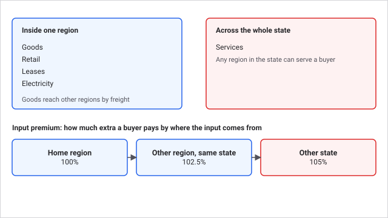
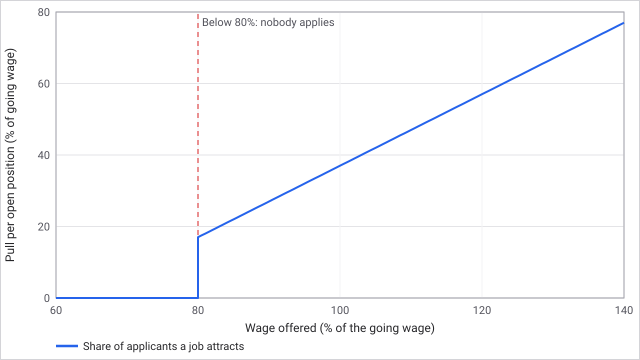
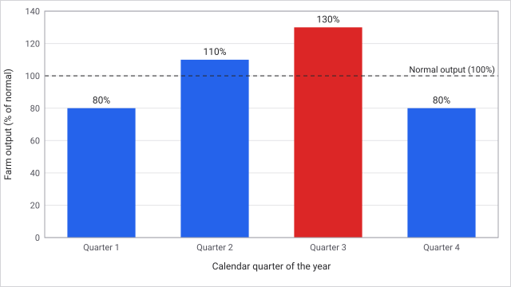

# Regions and labour

The map is divided into economic regions, and each region has its own pools of workers and its own wages. A plant is only as productive as its crew, and the crew you can hire depends on the wage you offer against the local going rate. Where you build also sets what your inputs cost, so choosing a region and a wage are two of the biggest decisions you make.

## How it works

### Regions

A region is built from whole counties or districts around an anchor city. It is the economic unit, with its own labour pool and wages, household demand, land cost, goods markets and freight connections. The state or country above it is the political layer: the power grid, roads, workforce skill and crime, union law and taxes.

Some states specialise in two sector types. A plant of a state's primary specialised type uses 3 percent fewer inputs there, and one of its secondary type 1.5 percent fewer.

Plants managed from outside their company's home region pay more for inputs: 2.5 percent more in another region of the home state, and 5 percent more in another state. This is why a cluster of plants near home is cheaper to run than a thin spread.

Goods, retail, leases and electricity clear in their own region (goods move between regions by [freight](freight.md)). Services that reach customers across a state, such as software, telecoms, advertising and construction, clear statewide, so a plant anywhere in the state can serve any of its regions.

### Labour

Every region has three worker pools by skill tier (low, medium and high). Firms, rivals and background employers hire from the same pools by offering wages.

1. Each week, 2 percent of staffed workers look for a new job, along with everyone unemployed.
2. They go to the offers that pay most above the **reservation wage**, the least they will accept, which is 70 percent of the going wage. An offer below 80 percent of the going wage draws no applicants at all.
3. The **going wage** drifts one sixteenth of the way toward the average wage employers offer each week, and never moves more than 2 percent in a week.
4. A plant runs at the strength of its least-staffed skill tier. Staff you are not using still draw wages.
5. A plant under construction starts hiring 4 weeks before it opens.

Mothballing a plant releases its whole workforce back to the pool. Reopening costs 5 percent of the plant's capital cost (at least $1,000) and rehires through the labour market.

Farms run seasonal crews: output is 80 percent in the first quarter, 110 in the second, 130 in the third and 80 in the fourth, and crews follow it. A government can set a low-skill wage floor and union law, and wages and demand follow the business cycle.

### Key numbers

| Item | Value |
| --- | --- |
| Skill tiers | 3 |
| Workers searching each week | 2 percent of staffed workers, plus the unemployed |
| No applicants below | 80 percent of the going wage |
| Reservation wage | 70 percent of the going wage |
| Going wage drift | 1/16 of the gap a week, at most 2 percent a week |
| Plant hiring starts | 4 weeks before opening |
| Employable share of a pool | 95 percent of its population |
| Input premium, another region in the home state | 2.5 percent |
| Input premium, another state | 5 percent |
| Input saving, state's primary and secondary sector | 3 percent and 1.5 percent |
| Reopening a mothballed plant | 5 percent of capital cost, at least $1,000 |
| Farm output by quarter | 80, 110, 130, 80 percent |
| Base weekly wage by tier (opening index) | $400, $800, $1,400 |

**Worked example.** In a region the going wage for mid-skill workers is $800 a week, so the reservation wage is $560. You offer $880 and a rival offers $800. Your pull on job seekers is 880 - 560 + 56 = $376 per open position, the rival's is 800 - 560 + 56 = $296. With equal openings you attract about 56 percent of the searchers. Had you offered $600 (75 percent of $800), you would draw no one.

**Staffing example.** A plant that needs 100 low, 60 medium and 20 high workers is staffed with 100, 30 and 20. The medium tier is 50 percent staffed, so the plant runs at 50 percent, and you still pay all 150 wages. Raise the medium offer, or build where mid-skill workers are plentiful.

## What you can do

- **Set wage offers** per skill tier with the Set wage offer action in the Command Center. Offer above the going wage to hire fast and below it only if you can stand a thin crew.
- **Staff to the weakest tier.** Look at which tier is short, not the total headcount.
- **Mothball or reopen** a plant from its page. Mothballing stops its wages but also its output; it only saves money if you will not need it for many weeks.
- **Choose where to build** from the region board on the Map: wages, land cost, specialisation and nearby rivals are all shown there.
- **Fund training.** A firm's training budget upgrades at most 0.1 percent of a tier's workforce a week at $500 a worker, and a regional training grant can cover part of it.
- **Handle unions and strikes.** Union law (set by the government) and worker organisation can lead to wage bargaining and strikes in the Inbox.

Tips: hire early for a new plant, because the crew only starts 4 weeks before it opens; do not offer under 80 percent of the going wage, because no one applies; and a state with a specialisation in your sector is cheaper to operate in.

## Connections

**Driven by**
- [Rivals](rivals.md): rivals hire from the same pools and bid wages up.
- [Governments and market laws](governments.md): the wage floor, union law and the business cycle shift wages and demand.
- [Scenarios](scenarios.md): which regions exist and their opening population, wages and specialisation.
- [Your holding company](companies.md): your home region and state set which plants pay an input premium.
- [Freight](freight.md): lane lengths and public terminals depend on where regions sit.
- [Currencies](currencies.md): wages follow each country's money.

**Affects**
- [Governments and market laws](governments.md): regional wages and demand feed the business cycle.
- [The commodity exchange](commodity-exchange.md): regional output and demand set what is for sale where; input premiums feed plant costs.
- [Your holding company](companies.md): where you build sets division costs and raid exposure.
- [Rivals](rivals.md): rivals compete for the same pools and the same local market share.
- [Freight](freight.md): where plants sit sets what must be shipped.

## Status

Live in every scenario and difficulty. The number of regions and their wages, population and specialisation depend on the scenario (see [Scenarios](scenarios.md)). Wage floor and union strength depend on which party is in government.

Last checked: 2026-10-29, version 1.8.0

Technical detail: every constant, formula and source file is in [Exact rules](#exact-rules) at the end of this page.

## Exact rules

### Labour clearing

Source: `crates/cw-sim/src/economy/labour.rs`.

- Three pools per region and tier. Employable cap `population x 9,500 / 10,000`.
- Voluntary search: `staffed x 20` milli-workers accumulated each week (2 percent), whole workers searching, plus the unemployed.
- Weight of an offer: `(wage - reservation + reservation / 10) x open positions`. An offer with `wage x 100 < prevailing x 80` gets no applicants.
- Prevailing wage moves `(target - prevailing) / 16` toward the employment-weighted mean offer, clamped to `prevailing x 98 / 100` and `prevailing x 102 / 100`. Reservation is `prevailing x 70 / 100`.
- `PREHIRE_WEEKS = 4`. Mothballed plants keep no workers.
- Desired crew is `full crew x target / 10,000 x crew_need / 10,000`, rounded up, so a plant run down to its floor keeps at least one worker of every tier its recipe uses. Lowering the production target lays off workers and pays severance.
- Staffing limit of a plant is the minimum over tiers of actual over required staff, at most 100 percent (`crates/cw-sim/src/economy/production.rs`). No substitution across tiers.
- Training: `COST_PER_WORKER_CENTS = 50,000`, at most 0.1 percent of a tier's workforce a week, from the firm's training budget.
- Baseline weekly wages in cents: 40,000, 80,000, 140,000 (`content/initial-balance.json`, `baseline_weekly_wage_cents`).
- Farm seasonal yield `SEASONAL_YIELD_BPS = [8,000, 11,000, 13,000, 8,000]` by quarter; a farm's crew is `min(yield, 10,000)` of full (`production.rs`).

### Regions and state conditions

Source: `crates/cw-sim/src/economy/sectors.rs`, `crates/cw-sim/src/economy/operations.rs`, `crates/cw-sim/src/economy/markets.rs`.

- Input multipliers: `SPECIALIZED_PRIMARY_BPS = 9,700`, `SPECIALIZED_SECONDARY_BPS = 9,850`, `AWAY_IN_STATE_BPS = 10,250`, `AWAY_OUT_OF_STATE_BPS = 10,500`. A plant in the firm's home region is the baseline.
- State conditions in `operations.rs`: power grid reliability under 95 percent, low workforce skill for skilled sectors and low broadband for digital sectors each cut output by up to 4 percent; good skill and broadband save up to 4 percent of inputs. Roads move truck freight cost. Crime costs retail and property plants a shrinkage share of output value.
- `REOPEN_COST_BPS = 500`, minimum 100,000 cents.
- Statewide clearing (`markets.rs`, `statewide`): subscription, service, local service and project service products, except electricity. Goods, retail, leases and electricity clear in their own region.

### Timing and edge cases

Labour clears every week, then payroll is paid, then training. Unused staff still earns wages. Unplaced searchers keep their old job. A background employer takes the residual of each pool.
