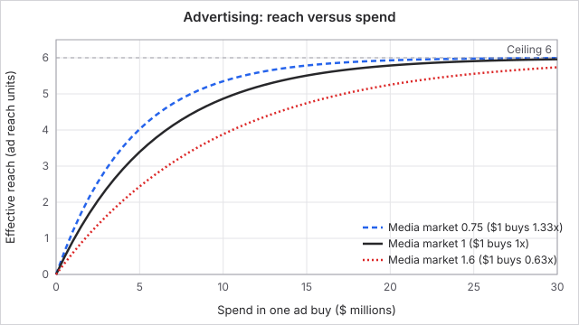
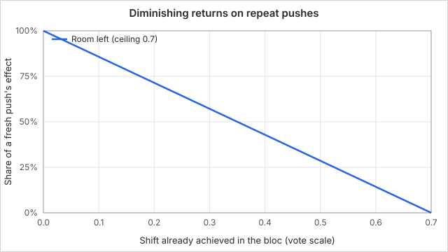
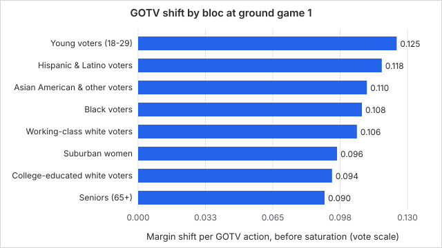
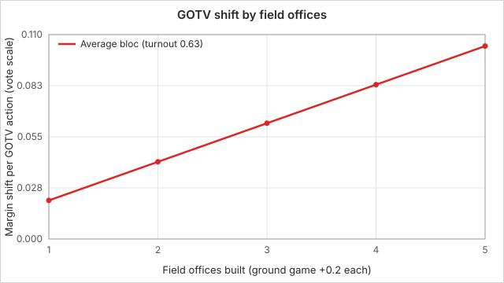
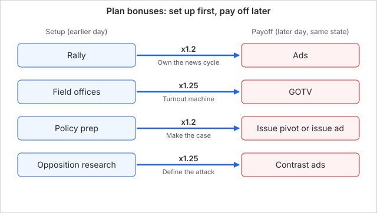
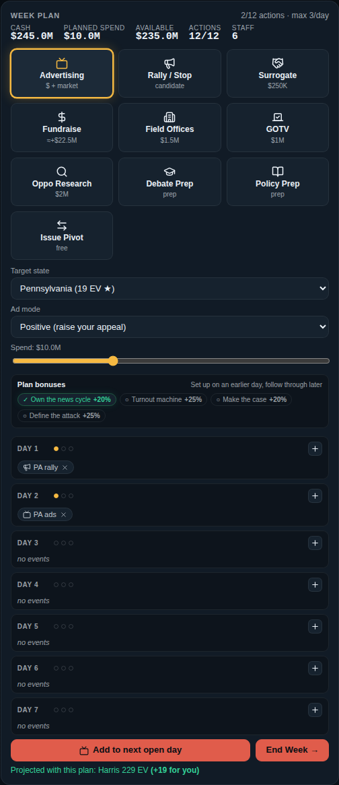
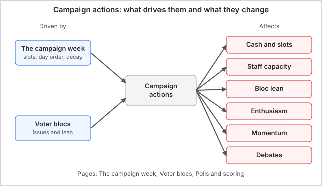

# Campaign actions

Actions are everything you can do with a week: buy ads, hold rallies, raise money, build a ground game, push turnout, attack the opponent, prepare for debates and change your position. Each one costs a slot from your weekly pool, and most also cost cash. Picking the right few per week is the whole game.

These are the actions in a US campaign. Other countries use the same weekly loop with their own tools.

## How it works

You queue actions on the seven days of the week and end the turn. Actions then resolve in day order, one after another (see [The campaign week](the-campaign-week.md)). Three limits apply to every action:

1. **Action slots.** Every action uses one slot from your weekly pool. Your pool and the cap of 3 actions per day are explained in [The campaign week](the-campaign-week.md).
2. **Cash.** Known costs are reserved when you queue the action. You cannot queue anything that would take your planned spending above the cash you have now. Fundraising only pays out when the week resolves, so it cannot fund spending in the same week.
3. **Order.** Some pairs of actions are stronger together (see Plan bonuses below).

An action that cannot be afforded or has no effect does not use a slot. The exception is get out the vote with no field offices: that attempt does use a slot, because the failed push is itself the result.

### Key numbers

| Action | Cash cost | Slot | Target | Notes |
| --- | --- | --- | --- | --- |
| Advertising | $1M to $30M, your choice | 1 | One state | A media market of 0.75 to 1.6 times changes how far the money goes |
| Rally | None | 1 | One state | Gaffe risk is 2% at best, 18% at worst |
| Surrogate stop | $250K | 1 | One state | About a quarter of a rally's effect |
| Fundraising | None (earns cash) | 1 | One state, bigger states raise more | $10M to $34M for a strong fundraiser, by state size |
| Field offices | $1.5M and 1 staff capacity | 1 | One state | Adds 0.2 ground game, maximum 1.0 per state |
| Get out the vote | $1M | 1 | One state with field offices | Does nothing without them |
| Opposition research | $2M | 1 | National | 55% chance to land |
| Debate prep | None | 1 | None | +8 debate readiness |
| Policy prep | None | 1 | None | +8 policy command |
| Issue pivot | None | 1 | One issue | Moves your position on it |

### Advertising

You pick the spend with a slider from $1M to $30M, a state, and a mode:

*The same curve limits every persuasion action, not only ads.*

- **Positive** raises your appeal with the blocs in the state, most with blocs whose issues match your positions.
- **Contrast** attacks the opponent. It moves blocs 60% as far as a positive buy, lowers turnout energy in the state, and dents your own media narrative.
- **Issue** does not move votes directly. It raises how much voters nationally care about the issue you choose, up to +0.12 per buy.

The media market of a state (0.75 in cheap states such as Mississippi and Arkansas, 1.6 in California) divides your spend. $10M in California counts as $6.25M of reach. Returns also fall off steeply as the buy grows: effective reach caps at 6 and you get 81% of it by $10M in a 1.0 market. Two $10M buys do far more than one $20M buy.

### Rally

A rally has no cash cost. It raises state momentum by 6 plus your charisma divided by 20, national momentum by 1.5, and a small amount of local enthusiasm. Each bloc moves a little toward you. The risk is a gaffe: the chance is 18% times (100 minus your energy) divided by 100, never below 2%. A candidate with energy 55 has an 8.1% chance per rally and energy 70 has 5.4%. A gaffe costs you in every bloc in that state and your media narrative.

### Surrogate stop

A surrogate costs $250K and one slot. It adds 2 state momentum and moves blocs about a quarter as far as a rally. In this version it uses a slot just like a rally, so its main use is a state where you do not want to risk a rally gaffe.

### Fundraising

You choose a state, and the haul scales with its electoral votes. The base is $8M plus $120K per point of your fundraising skill, then it is multiplied by your national momentum (up to +50% at momentum 100), by the state size factor (0.6 plus its electoral votes divided by 28, capped at 1.7 for states of about 31 or more), and by a random 0.85 to 1.15. The game shows the estimate before you queue it.

### Field offices and get out the vote

Each field office costs $1.5M and one staff capacity, and adds 0.2 ground game in that state (maximum 1.0, so five offices). Ground game never decays. Staff capacity starts at 6 and does not refill, so you can build six offices in a whole campaign.

Get out the vote (GOTV) costs $1M and shifts blocs toward you in proportion to your ground game there, most for blocs that usually stay home. Without ground game it fails and the $1M is gone. Repeating it in one state fades, because each push is reduced by how far you have already moved those blocs.

### Opposition research

Costs $2M. It has a 55% chance to land a scandal on the opponent: every state's college-educated white voters and suburban women move toward you by up to 0.05 and your media narrative rises. The other 45% it backfires: suburban women everywhere move away from you by 0.03 and your narrative falls. A rapid response director on the opponent's staff cuts your chance, but never below 15%.

### Debate prep, policy prep and issue pivot

Debate prep and policy prep each add 8 to a trait that feeds the next debate. Both relax back toward your normal level by 35% each week, so do them in the week or two before a scheduled debate. Debates are scored head to head, and the winner gains momentum equal to the score gap times 0.6 (maximum 20). A gap of 20 or more is a meltdown for the loser.

An issue pivot is free in cash. You set a new position on an issue from -1 (left) to +1 (right). Blocs that like the new position move toward you and blocs that liked the old one move away. College-educated white voters and suburban women also take a small flip-flop penalty, scaled to how far you moved.

### Plan bonuses

A setup action on an earlier day makes a later payoff action stronger. Both actions must have an explicit day, the setup must come on a strictly earlier day, and it must have actually done something.

| Setup (earlier day) | Payoff (later day) | Bonus |
| --- | --- | --- |
| Rally | Ads in the same state | +20% |
| Field offices | Get out the vote in the same state | +25% |
| Policy prep | Issue pivot or issue ad | +20% |
| Opposition research | Contrast ads | +25% |

Bonuses multiply if more than one applies. The opponent's AI plans do not use days and never get them.

## What you can do

Use the action panel on the planning screen. Pick an action type, then a state (and spend, mode or issue where needed), then press the plus button on the day you want it. Remove it from the day strip before you end the week.

*The week plan panel with a rally on day 1 and ads on day 2, which earns the Own the news cycle bonus.*

- **Spend in the right place.** Ads in a battleground with a 1.0 market give far more reach per dollar than the same ad in a 1.6 market that is already safe. States that lean hard resist persuasion, so you cannot flip California or New York with ad dumps.
- **Mix, do not stack.** Three small ad buys in different states beat one huge buy. Repeated pushes in the same state fade, because every action is scaled down as you approach a ceiling on how far a campaign can move any one bloc.
- **Build the ground early.** Field offices in battlegrounds by week 3 or 4, then GOTV late where the margin is tight.
- **Raise money first.** Fundraise in the biggest state you can, early in the week, so the cash is there next week.
- **Hold oppo for when you trail.** The expected gain is small and 45% of the time it hurts you.

### Worked example

You are Biden in US 2020 on Normal. You have 11 actions and $245M. Your plan for one week:

| Day | Action | Cash reserved |
| --- | --- | --- |
| 1 | Rally in Pennsylvania | $0 |
| 2 | $10M positive ads in Pennsylvania | $10M |
| 3 | Field offices in Wisconsin | $1.5M |
| 4 | Fundraise in California | $0 |
| 5 | GOTV in Wisconsin | $1M |

Ads after the rally in the same state get +20%, and GOTV after the field offices there gets +25%.

The $10M ad in a 1.0 market reaches 4.87 of a possible 6, so it moves a bloc with a fifth of the state's electorate by about 0.40 on the vote scale, roughly 10 points in a toss-up bloc, before the Normal difficulty bonus and the plan bonus.

A second identical buy that same week would move it only about 0.17, because the bloc is already part of the way to its ceiling.

The Californian fundraiser, with Biden's fundraising skill of 78, earns about $17.4M times 1.7 for the state, which is about $29.5M before the random factor, for one slot and no cost. The five actions use 5 of 11 slots and reserve $12.5M of $245M.

## Connections

**Driven by:**

- [The campaign week](the-campaign-week.md): sets your action slots, the 3 per day cap, the order actions resolve in and the weekly decay of momentum and prep.
- [Voter blocs](voter-blocs.md): each bloc's issues and lean decide how much an ad or rally moves it.

**Affects:**

- [Voter blocs](voter-blocs.md): every persuasion action writes a shift into each bloc's lean, and GOTV and rallies raise enthusiasm.
- [Polls and scoring](polls-and-scoring.md): the shifts change each state's margin, the electoral vote projection and your final score.
- [The campaign week](the-campaign-week.md): actions spend cash, slots and staff capacity, and feed the week-in-review.

## Status

The costs and effects here apply to every US election in every mode. Difficulty changes how hard your actions land (Easy 1.55 times, Normal 1.15 times, Hard 1.0 times) and how strong the opponent's are. Event mode does not change actions. Other countries have their own action lists.

Last checked: 2026-10-29, version October 2026 release

## Exact rules

Source files are in the game repo. "Logit" means the log-odds scale the vote model uses, where 0.1 near an even race is about 2.5 points of two-party share.

### Costs and caps

| Constant | Value | Source |
| --- | --- | --- |
| Advertising spend range | $1M to $30M, step $1M | `src/ui/ActionPanel.tsx` |
| Surrogate cost | $250,000 | `src/engine/actionBudget.ts`, `src/engine/actions.ts` |
| Field office cost | $1,500,000 and 1 staff capacity | `src/engine/actionBudget.ts`, `src/engine/actions.ts` |
| GOTV cost | $1,000,000 | `src/engine/actionBudget.ts`, `src/engine/actions.ts` |
| Opposition research cost | $2,000,000 | `src/engine/actionBudget.ts`, `src/engine/actions.ts` |
| Max actions per day | 3 | `src/engine/actionBudget.ts` |
| Days per week | 7 | `src/engine/actionBudget.ts` |
| Starting staff capacity | 6 | `src/engine/setup.ts` |
| Media market cost range | 0.75 to 1.6 | `src/content/states.ts` |

Cash reserved at queue time: `actionCashCost` returns the ad spend, 250,000, 1,500,000, 1,000,000 or 2,000,000 for those five actions and 0 for the rest. `canQueueAction` rejects an action if the day is outside 1 to 7, the queue is at `maxActions`, the day already holds 3, or planned cost plus this cost exceeds current cash.

### Shared persuasion curve (`saturate`)

`saturate(raw) = raw * room * leanResist` where `room = max(0, 1 - |campaignMargin| / 0.7)` and `leanResist = 1 / (1 + |baselineMargin| * 1.8)`. The 0.7 is the ceiling on total campaign shift per bloc. Used by ads, rally, surrogate, GOTV and opposition research. Source: `src/engine/actions.ts`.

### Advertising

- `effectiveMillions = spend / 1,000,000 / mediaMarketCost`.
- `adReach = 6 * (1 - exp(-effectiveMillions / 6)) * adMult`, where `adMult` is the product of hired staff multipliers (1.12 media strategist, 1.05 and 1.04 on two other staff, `src/content/staff.ts`).
- `fundraisingBoost = 0.85 + fundraisingProwess / 400`.
- Per bloc: `responsiveness = 0.4 + alignment * 0.6`. `raw = adReach * 0.06 * responsiveness * fundraisingBoost`, multiplied by `bloc size / state size * number of blocs` for a state-wide buy. Then `saturate`, then a random 0.9 to 1.1, then the difficulty persuasion multiplier and the plan multiplier.
- Contrast ads: shift is `0.6 * raw`, bloc enthusiasm falls by 0.018 (floor 0.78), media narrative falls by 4.
- Issue ads: salience rises by `min(0.12, effectiveMillions * 0.015) * planMultiplier`, capped at 1. No vote shift.
- The actual spend is capped at cash on hand when the action resolves.
- Alignment: for each issue, `weight = bloc issue weight * national salience` and `align = 1 - |candidate position - bloc ideal| / 2`. Alignment is the weight-averaged align, 0.5 if no weights.

### Rally

State momentum `+ (6 + charisma / 20)` signed to your side, clamped to plus or minus 100. National momentum `+1.5`. Per bloc `raw = 0.05 * (0.5 + alignment * 0.5) * (0.9 + charisma / 300)`, saturated, times the persuasion multiplier. Enthusiasm `+0.01` per bloc, capped at 1.25. Gaffe: chance `max(0.02, 0.18 * (100 - energy) / 100)`. On a gaffe each bloc in the state shifts against you by `0.04 + random * 0.05` and media narrative falls by 8. Rally also sets the candidate's map location.

### Surrogate

Needs 250,000 cash or it does nothing. State momentum `+2`. Per bloc `raw = 0.018 * (0.6 + alignment * 0.4)`, saturated, times a random 0.9 to 1.1 and the persuasion multiplier.

### Fundraising

`estimatedFundraise = (8,000,000 + fundraisingProwess * 120,000) * (1 + max(0, nationalMomentum) / 200) * stateSize * fundraiseMult`. `stateSize = 0.6 + min(1.1, electoralVotes / 28)` (1.0 if no state is set). `fundraiseMult` is the staff product (1.15 finance chair). The haul is that estimate times `0.85 + random * 0.3`. Cash arrives during resolution. Biden's skill is 78 and Trump's is 70 (`src/content/candidates.ts`), so base hauls are $17.36M and $16.4M before the other factors. Source: `src/engine/actions.ts`.

### Field offices and GOTV

Field office: needs cash 1,500,000 and staff capacity at least 1. Ground game in the state `+0.2`, capped at 1. Ground game is never decayed. GOTV: if ground game is 0.01 or less the push is wasted and a "fell flat" cause is logged. Otherwise per bloc `raw = saturate(0.12 * ground * (0.5 + (1 - turnoutPropensity))) * persuasionMultiplier` and enthusiasm rises by `0.03 * ground`, capped at 1.3.

### Opposition research

Success chance `max(0.15, 0.55 - opponent oppoShield)`; the only shield in the content is 0.15 from the rapid response director (`src/content/staff.ts`). Success: each college-educated white and suburban women bloc in every state shifts `saturate(0.05) * multiplier`, media narrative `+6`. Backfire: media narrative `-10`, each suburban women bloc shifts against you by `saturate(0.03)` (the backfire does not use the persuasion multiplier).

### Debate prep, policy prep, issue pivot

Debate prep: `debatePrep + 8 + staff bonus`, max 100. Policy prep: `policyKnowledge + 8`, max 100. Both relax toward the candidate's base by 35% of the gap each week (`src/engine/turn.ts`). Debate readiness is `0.4 * debatingSkill + 0.3 * debatePrep + 0.3 * policyKnowledge`. A debate score is `clamp(50 + (readiness - 50) * 0.6 + showing * 1.6 + luck, 0, 100)` with luck uniform in plus or minus 8. Momentum swing is `min(20, gap * 0.6)`; if the gap is 20 or more it is `min(26, swing * 1.4)` and the loser's media narrative falls by 8 (`src/engine/events.ts`).

Issue pivot: new position is clamped to plus or minus 1, and a move under 0.01 does nothing. Each bloc with `issue weight * salience` of at least 0.05 shifts by `(alignAfter - alignBefore) * weight * 0.5 * multiplier`. Flip-flop tax on college-educated white and suburban women blocs: `|move| * 0.04 * 0.3` against you.

### Plan bonuses

Defined in `src/engine/planBonuses.ts`: earned media 1.2 (rally then ads, same state), field machine 1.25 (field offices then GOTV, same state), message discipline 1.2 (policy prep then issue pivot or issue ad, any target), attack line 1.25 (opposition research then contrast ads, any target, or same state if both name one). The setup must have an explicit earlier day than the payoff and must have produced an effect. Multiple bonuses multiply. A recap line "Plan bonus" is logged only when the payoff produced an effect.

### Timing and edge cases

Player actions apply in day order, ties in queue order, then the AI's actions (`src/engine/turn.ts`). `applyAction` returns early if the candidate has no slot left. A slot is spent only if the action logged an effect. Player persuasion is multiplied by `playerEdge` (1.55 Easy, 1.15 Normal, 1.0 Hard, `src/engine/setup.ts`); the AI's by its difficulty `actionPower` (0.45, 0.53, 1.0, `src/engine/ai.ts`).
