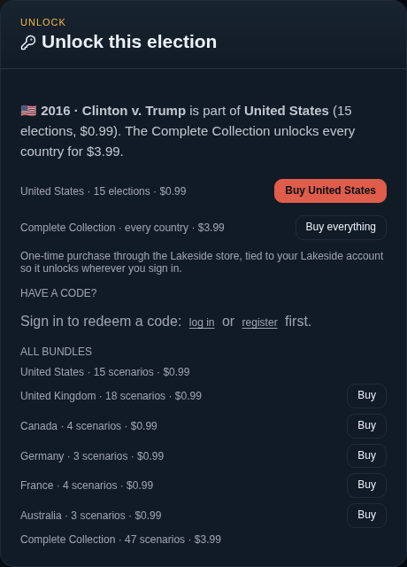
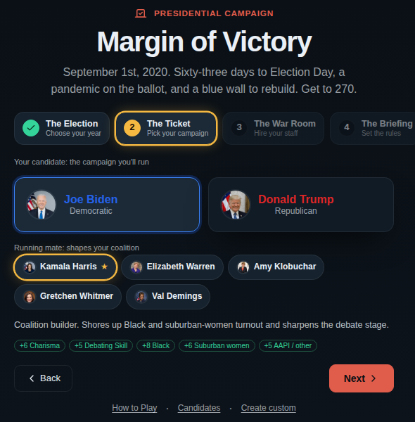
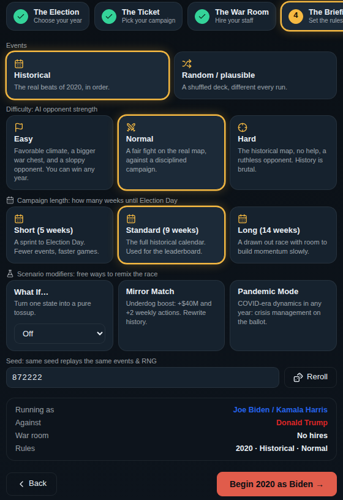
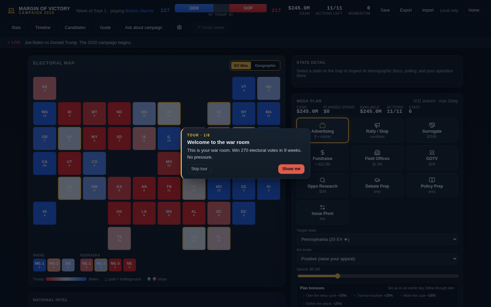

# Getting started

Margin of Victory runs in your browser on desktop and mobile, and you can play your first campaign in a few minutes with nothing to install and nothing to buy. This page covers where to play, what is free, what the setup choices change, and how saves and unlocks work.

## Play

https://lakesidegames.net/games/margin-of-victory/

The old /games/electioneer/ address redirects there. The product page is https://lakesidegames.net/margin-of-victory/. The web game works on phones and computers. Phone and desktop apps are in development and are listed on the download page when they ship: https://lakesidegames.net/download/margin-of-victory/

## What it costs

The store sets the prices, and they can change. At the time of writing:

- **Free for everyone:** the newest election of every country (15 elections in all) and the daily challenge.
- **Country packs:** $0.99 each, for the rest of one country's elections.
- **Complete Collection:** $3.99, for all 131 elections in all 14 countries, including countries added later.
- **Supporter plans:** every Lakeside supporter plan includes the Complete Collection while it is active. Sign in with the same Lakeside account in the game.
- **Earlier purchases:** packs or codes you already have stay yours and keep working.

Until Sunday, November 22, 2026 at 5:00 PM Eastern, every paid pack is free to play for anyone signed in with a Lakeside account. After that, access goes back to what you own or subscribe to, and your saves stay where they are.

You never need to pay to play the free elections. A locked election shows an Unlock prompt where you can buy it, sign in or redeem a code. Purchases follow your Lakeside account across devices. Store: https://lakesidegames.net/store/. See [Elections](elections.md) for the full list.

If you open the game from the Lakeside launcher, you are signed in with the launcher's Lakeside account, so your packs and cloud saves are there without logging in again.

## Your first campaign

1. Pick an election. Every country has a free one. US 2020 is the original campaign and a good place to learn.
2. Choose your side, running mate, difficulty, event mode and campaign length in the setup wizard.
3. Follow the first-launch tutorial. It walks through one week of planning.
4. Plan your week, end the turn, and read the week-in-review to see what moved and why.

### Choosing a difficulty

Difficulty means the same thing in every country. It makes the player stronger and the opponent weaker or stronger. It is also a multiplier on your final score (see [Polls and scoring](polls-and-scoring.md)).

| | Easy | Normal | Hard |
| --- | --- | --- | --- |
| Extra actions per week for you | +5 | +1 | 0 |
| Extra starting cash for you | +$110M | +$25M | $0 |
| How hard your actions land | 1.55 times | 1.15 times | 0.9 times |
| Starting map | A head start sized to the race: almost nothing in a near-tie, a big lift in a landslide | Historical | Historical |
| Opponent strength | Weak: 3 target states, 30% mistake rate, actions at 0.45 | Disciplined: 5 target states, 15% mistakes, actions at 0.53 | Ruthless: 8 target states, 5% mistakes, full strength |
| Score multiplier | 0.7 | 1.0 | 1.5 |

### Other setup choices

- **Side.** The Democratic ticket starts with $220M and the Republican ticket with $180M, before difficulty extras. Your candidate's traits (energy, charisma, fundraising) also differ. In 2020, Biden's energy of 55 gives 10 base actions and Trump's energy of 70 gives 11.
- **Event mode.** Historical fires the real beats of that year in order. Random or plausible deals a shuffled deck of generic debates and events, different every run.
- **Campaign length.** Standard is 9 weeks and is the only length used for the leaderboard. Short is 5 weeks and long is 14.
- **Extras.** What If turns one state into a tossup. Mirror Match gives you the underdog boost of +$40M and +2 weekly actions. Pandemic Mode brings COVID-era issues into any year.

## Saves

Your campaign is saved in your browser as you play, and you can pick it up where you left it. Clearing your browser data removes browser-only saves. Sign in with a Lakeside account and saves also sync to your account, so you can keep cloud saves, appear on leaderboards and use your supporter access on every device. If the connection fails, the game keeps playing and keeps the local save.

## Other ways to play

- **Daily challenge:** one shared election and seed each day, with a daily board, streaks and a result you can share. Everyone plays the same side.
- **Campaign editor:** build your own candidates and scenarios for any country, save them and share them as files.
- **Next election:** after a result, jump to the following election with your party, difficulty and event mode kept.

## Common questions

- *What should I do first each week?* Read the map and the trends screen, queue your setup actions on early days, then your payoffs. [The campaign week](the-campaign-week.md) and [Campaign actions](campaign-actions.md) explain how.
- *Why does my plan stop at three actions on a day?* That is the daily cap.
- *Which bloc should I chase?* See [Voter blocs](voter-blocs.md).

Last checked: 2026-11-14, version 2.0

## Where the numbers come from

Difficulty values are in `src/engine/setup.ts` (player bonuses and action multiplier), `src/engine/ai.ts` (opponent strength) and `src/engine/scoring.ts` (score multiplier). Starting cash and the base action pool are in `src/engine/setup.ts`. Campaign lengths are in `src/ui/SetupScreen.tsx`. Packs are in `src/content/packs.ts` and prices come from the Lakeside catalog at `https://sim.ahousedividedgame.com/api/catalog`.
