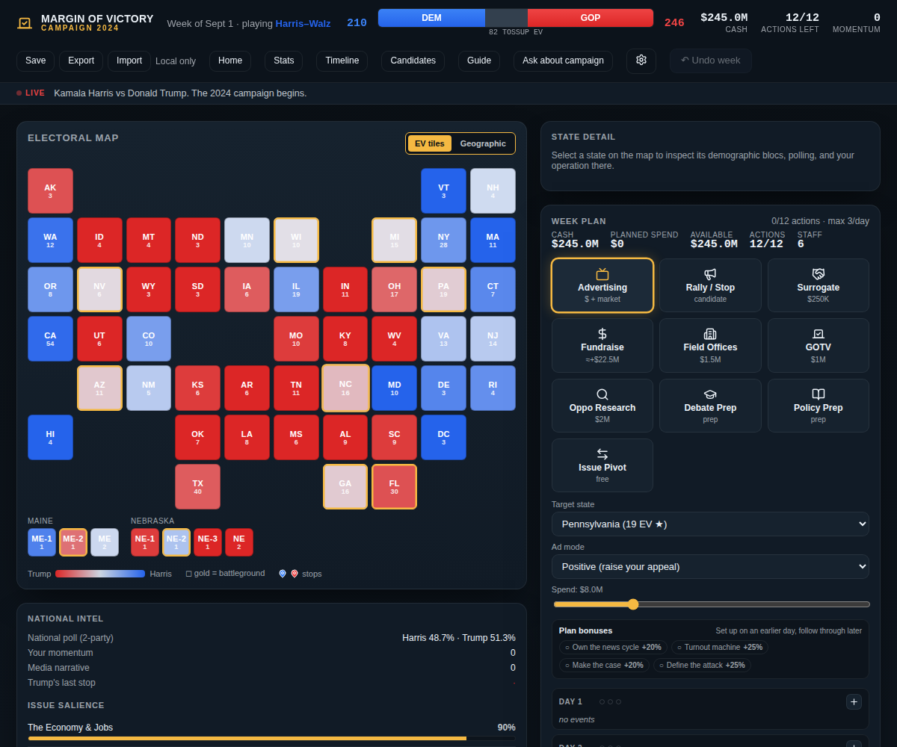
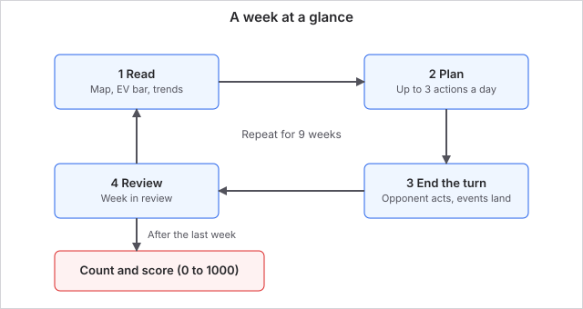

# Margin of Victory overview

Margin of Victory is a single-player, turn-based election campaign game. You are the campaign manager. Each week you read the map, spend a limited budget and a limited number of actions, answer the events that land on your desk, and try to change the result of a real election. It plays in a browser, and the US 2024 and 2020 elections and the daily challenge are free.

There are 49 elections across six countries, from 1951 to 2027: the United States, the United Kingdom, Canada, Germany, France and Australia. Each country uses its own electoral system, so a US race is won state by state in the Electoral College, while a UK race is won seat by seat and a French race goes to a runoff.

Margin of Victory was called Electioneer before September 2026. The old web address still works, and existing purchases and saves carry over.

## What you do

- **Plan the week.** Queue ads, rallies, surrogate stops, fundraising, field offices, get-out-the-vote drives and debate preparation across seven days.
- **Work the map.** Every state or seat is split into voter blocs with their own issues, lean and turnout. Your actions move some blocs and not others.
- **Handle events.** Scandals, debates, breaking news and historical moments arrive each week. Some need an answer; others just happen to you.
- **Beat the opponent.** An AI campaign plays against you with the same tools, paces its money and goes negative when it falls behind.

Every game uses a seed, so the same seed and the same choices replay the same campaign. That is what makes the daily challenge fair: everyone plays the same election on the same seed.

## A week at a glance

A standard campaign is 9 weeks. Every week follows the same loop:

1. **Read.** Check the map, the electoral vote bar and the trends screen.
2. **Plan.** Queue up to 3 actions a day across 7 days, from a weekly pool set by your candidate and difficulty (11 for Biden on Normal in 2020).
3. **End the turn.** The opponent acts and events land. Your plan then plays out in day order.
4. **Review.** The week-in-review shows what moved and why. Then you plan the next week.

After the last week, the votes are counted and you get a score from 0 to 1000. Your first week has no events, so use it to read the map. A good opening is to raise money, build field offices in two or three battlegrounds, and run ads where the polls are within a few points.

## Where to start

- [Getting started](getting-started.md): how to play, what is free and what is not.
- [Elections](elections.md): all 49 campaigns by country.
- [The campaign week](the-campaign-week.md): how a turn works.
- [Campaign actions](campaign-actions.md) and [Voter blocs](voter-blocs.md): the tools and the targets in a US campaign.
- [Polls and scoring](polls-and-scoring.md): how the result is decided and how your score is worked out.

Last checked: 2026-10-29, version October 2026 release
