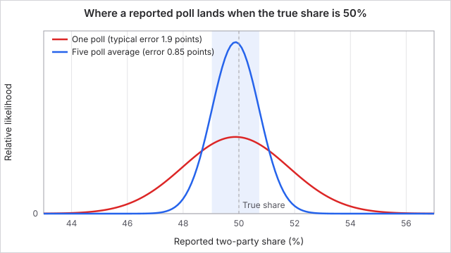
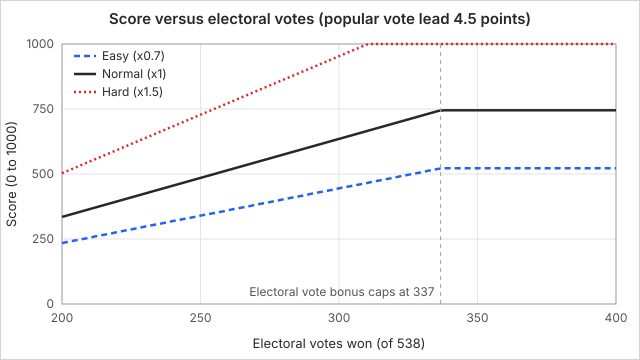
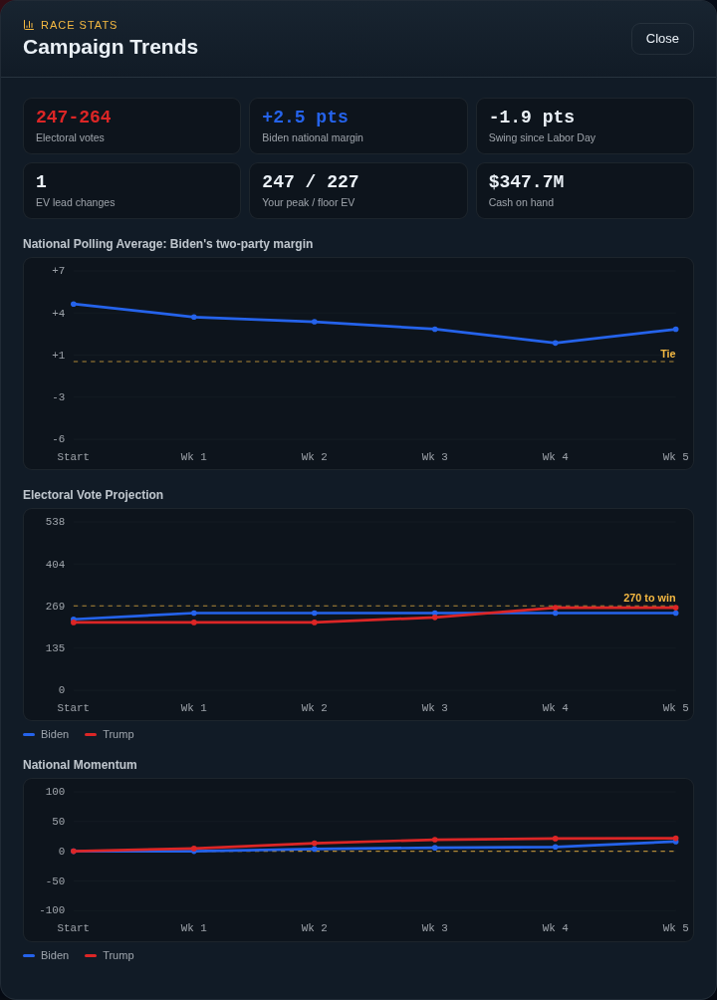
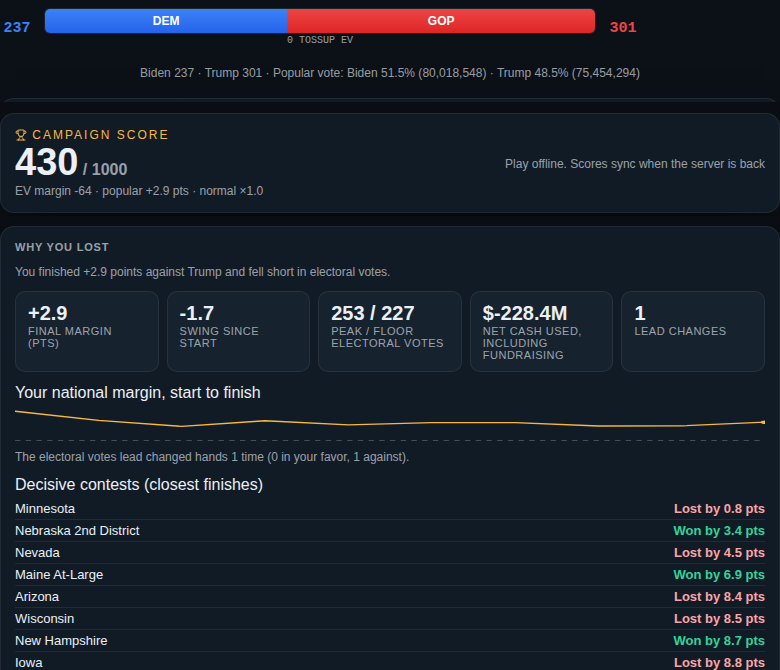
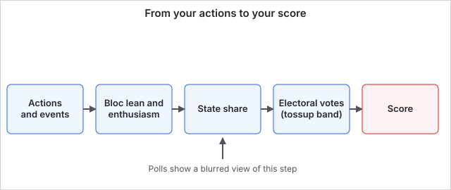

# Polls and scoring

Polls show you a noisy picture of where each state stands. The real count happens on election day, and your score for the campaign comes from that count: how far you cleared 270 electoral votes, and by how many points you won the popular vote. Knowing the difference between the polls and the true count tells you when a lead is safe.

## How it works

Every state is built from voter blocs (see [Voter blocs](voter-blocs.md)). Each bloc has a lean, a size and a turnout weight. A state's true result is the sum of its blocs' votes. Your actions shift each bloc's lean (see [Campaign actions](campaign-actions.md)), and that is what moves the map.

### Polls

The polls you see are not the true count. For each state the game shows five pollsters, each with its own sample size and a small built-in lean (house effect). A reported number is the true two-party share, plus the pollster's house effect, plus random sampling noise. The noise is redrawn every week, so a state's poll line can wobble even when nothing changed. Polls are a guide, not a measurement.

| Pollster | Sample | House effect (toward Democrats) |
| --- | --- | --- |
| Quinnipiac | 1,100 | +0.5 points |
| Marist | 1,000 | -0.4 points |
| Siena/NYT | 900 | +0.2 points |
| Trafalgar | 1,050 | -1.2 points |
| Monmouth | 800 | +0.3 points |

Averaged over the five, the typical error from noise is about 0.85 points, and the house effects cancel to about -0.1 points. The national poll is the state averages weighted by each state's turnout-weighted electorate.

### Electoral votes

A state's winner takes all its electoral votes, with one exception: Maine and Nebraska give 1 vote to each congressional district winner and 2 to the winner of the combined statewide vote. There are 538 in total, and 270 wins. The bar at the top of the screen is a live projection. A state within 3 points of a tie counts as a tossup, shown separately and not added to either side.

If neither side reaches 270, the result is a 269 to 269 tie and no one wins.

### Turnout

Turnout is not a separate roll. Each bloc's votes in a state are its size times its base turnout times its current enthusiasm. Base turnout runs from 0.46 (young voters) to 0.75 (seniors). Enthusiasm starts at 1.0, is raised by rallies and get-out-the-vote, lowered by contrast ads, and relaxes 40% of the way back to 1.0 each week. A bloc that turns out more counts for more in the state total, which is why mobilizing groups that usually stay home pays off.

### Your score

Your score runs from 0 to 1000 and is from your side's point of view, so a loss scores low. It adds three things and then applies a difficulty multiplier:

`score = (500 + electoral margin points + popular vote points) x difficulty multiplier`

The electoral margin points are (your electoral votes minus 270) times 3, limited to between -300 and +200. The popular vote points are your lead in points of the national two-party vote times 10, limited to between -100 and +100. The multiplier is 0.7 on Easy, 1.0 on Normal and 1.5 on Hard. The result is rounded and limited to 0 to 1000.

### Worked example

You win US 2020 as Biden with 306 electoral votes and a national popular vote lead of 4.5 points.

| Difficulty | Electoral points | Popular vote points | Subtotal | Multiplier | Score |
| --- | --- | --- | --- | --- | --- |
| Easy | (306 - 270) x 3 = 108 | 45 | 653 | 0.7 | 457 |
| Normal | 108 | 45 | 653 | 1.0 | 653 |
| Hard | 108 | 45 | 653 | 1.5 | 980 |

The same win scores far higher on Hard, which is why harder settings rank above easier ones on the leaderboards. You hit the electoral cap of 200 points at 337 electoral votes (67 above 270). A 269 to 269 tie scores 500 - 3 + popular points, since you are one vote short.

## What you can do

- **Check the trends screen.** It shows national polling, projected electoral votes and momentum by week, plus a poll line for each state.
- **Target tossups.** Only states within 3 points count as tossups. Spending in them gives the biggest electoral payoff.
- **Do not trust a one-point lead.** Average noise is about 0.85 points, so a lead under 2 points can easily be a loss.
- **Read the results screen.** It explains why you won or lost before it lists the states, and shows your score. From there you can share the result or move on to the next election.
- **Push the popular vote on Hard.** Each point of popular vote margin adds 10 points before the multiplier, so winning big matters even when the electoral vote is safe.

Common questions:

- *Why did I lose a state I led in polls?* Noise, house effects and the last week's events. The polls are a blurred view and the final count is exact.
- *Why does the same ad move one state more than another?* Shifts near an even race count for more than in a lopsided state, because the vote model flattens out at the extremes, and strong leans resist persuasion directly.
- *What does momentum do?* State momentum adds a small, temporary push to that state's margin (0.0017 per point). National momentum makes fundraising easier. Both fade every week.

## Connections

**Driven by:**

- [Voter blocs](voter-blocs.md): each bloc's size, base lean and turnout weight are the raw material of every state result.
- [Campaign actions](campaign-actions.md): ads, rallies, get-out-the-vote, oppo and pivots shift bloc leans and enthusiasm.
- [The campaign week](the-campaign-week.md): each resolution recomputes the polls, and the last resolution ends the campaign and counts the result.
- [Elections](elections.md): the election chosen sets the starting map, and other countries score seats instead of electoral votes.

**Affects:**

- [The campaign week](the-campaign-week.md): your projected electoral votes feed the week-in-review, and under 195 can make low-loyalty staff quit.
- [Campaign actions](campaign-actions.md): polls decide where an action is worth taking, and the opponent's AI chooses its targets from the same projection.

## Status

This page covers the US Electoral College. Other countries use their own result rules (see Exact rules) but the same score formula. Difficulty changes the score multiplier and the starting map for the player. Easy adds a one-time shift in your favour to every bloc, which makes the opening polls friendlier.

Last checked: 2026-10-29, version October 2026 release

## Exact rules

### Constants

| Constant | Value | Source |
| --- | --- | --- |
| Electoral votes to win | 270 of 538 | `src/engine/voteModel.ts`, `src/content/states.ts` |
| Score baseline | 500 | `src/engine/scoring.ts` |
| Electoral points | `unitMargin * (538 / chamberSize) * 3`, clamp -300 to 200 | `src/engine/scoring.ts` |
| Popular points | `popularMargin * 10`, clamp -100 to 100 | `src/engine/scoring.ts` |
| Difficulty multiplier | Easy 0.7, Normal 1.0, Hard 1.5 | `src/engine/scoring.ts` |
| Score range | 0 to 1000, rounded | `src/engine/scoring.ts` |
| Tossup band | 3 points of margin | `src/engine/voteModel.ts` |
| Momentum coupling | 0.0017 per point of state momentum | `src/engine/voteModel.ts` |
| Bloc turnout | 0.46 to 0.75 | `src/content/blocs.ts` |
| Poll noise | normal with sd 0.6 times margin of error | `src/engine/polls.ts` |
| Margin of error | `1.96 * sqrt(0.25 / n)` | `src/engine/polls.ts` |
| Pollster house effects | +0.005, -0.004, +0.002, -0.012, +0.003 | `src/engine/polls.ts` |
| Reported poll bounds | 0.01 to 0.99 | `src/engine/polls.ts` |

### Vote model

For a bloc, the two-party Democratic share is `sigmoid(baselineMargin + campaignMargin + stateMomentum * 0.0017)`. Votes are `size * turnoutPropensity * enthusiasm`. A state's Democratic share is the sum of bloc Democratic votes over the sum of bloc votes. A share of 0.5 or more is a Democratic win. The state margin shown is `|share - 0.5| * 2 * 100` points. Ties in the national count are resolved only when neither side reaches 270 (`winner: "tie"`). Source: `src/engine/voteModel.ts`.

Each state's baseline is solved at game start so that the turnout-weighted blocs reproduce the real prior result of the chosen election, using bisection. Easy difficulty then adds 0.55 to every bloc's baseline in the player's favour (`src/engine/setup.ts`).

Maine and Nebraska have district contests plus an at-large unit worth 2 votes, decided by the combined vote of the districts. Aggregate units add no popular vote, so nothing is counted twice.

### Polls

For each pollster the true state share is read from `tallyContest`, then `reported = clamp(true + houseEffect + normal(0, 0.6 * moe), 0.01, 0.99)`. The random stream is seeded from the game seed, the turn, the state and the pollster, so a poll does not change when you reopen the screen but changes each week. The state average is the mean of the five; the national poll weights state averages by each state's sum of `size * turnout`. Source: `src/engine/polls.ts`.

### Projection

`projectElection` computes the full result and then, for each contest, labels it a tossup if the Democratic margin in points `(share - 0.5) * 200` is within 3. Tossup electoral votes are summed separately. Source: `src/engine/voteModel.ts`.

### Score

`computeScoreFromFacts` in `src/engine/scoring.ts`: `norm = 538 / chamberSize`, `evScore = clamp(unitMargin * norm * 3, -300, 200)`, `popScore = clamp(popularMargin * 10, -100, 100)`, `score = round(clamp((500 + evScore + popScore) * multiplier, 0, 1000))`. The server recomputes the score from the submitted facts for the leaderboards.

US facts: `unitMargin = player electoral votes - 270`, `chamberSize = 538`, `popularMargin = (player popular share - rival share) * 100`.

Other countries (multiparty): `unitMargin = player seats - majority threshold`, normalized by `538 / chamberSize`, and `popularMargin` is the player's vote share minus the strongest rival's. Majority bars used include United Kingdom 2024 at 326 of 650 (`src/content/uk/elections.ts`), Canada 2025 at 172 of 343 (`src/content/countries/canada.ts`), Germany 2025 at 316 of 630 (`src/content/countries/germany.ts`), France at 51 of 100 points (`src/content/countries/france.ts`) and Australia 2025 at 76 of 150 (`src/content/countries/australia.ts`).

### Timing and edge cases

- Polls and the projection are recalculated on screen from current state. A timeline sample (national poll, projected electoral votes, tossup votes, momentum, cash) is stored at the start and after each resolved week (`recordTimelinePoint`, `src/engine/turn.ts`).
- The result is computed once, when the turn counter reaches total turns.
- If the winner is a tie the results screen shows "No one: 269-269".
- The post-mortem on the results screen lists the player's eight biggest self-caused swings by size.
