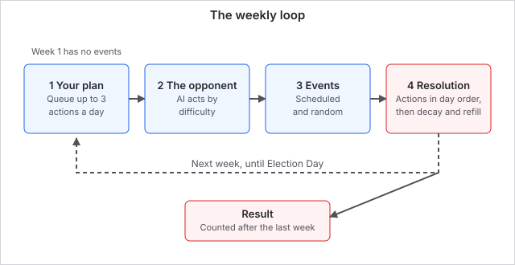
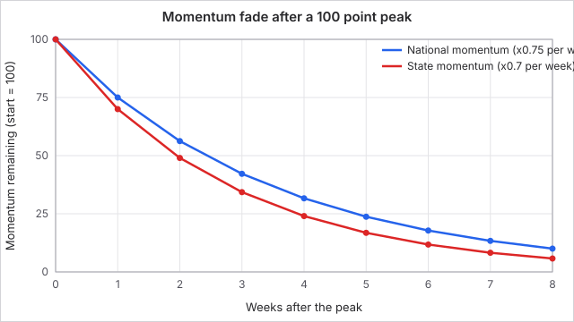
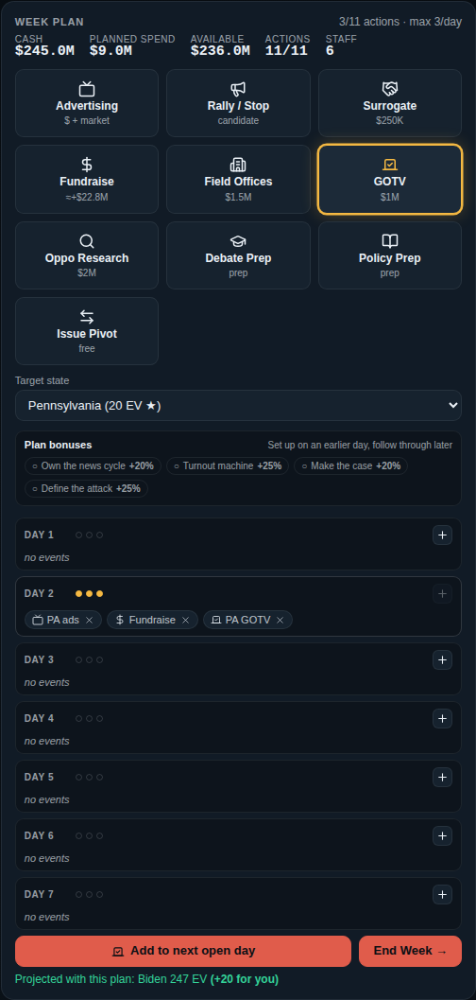
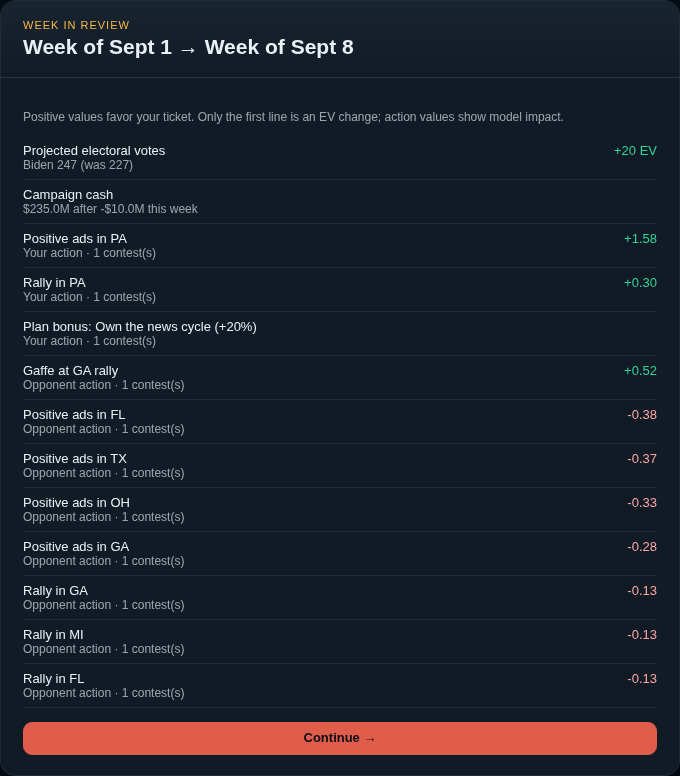

# The campaign week

A campaign runs as a series of weekly turns up to election day. Each week you plan up to a dozen moves, the opponent and the news cycle respond, and the polls update. Knowing what limits your week, and in what order things happen, is what separates a planned campaign from a scramble.

This page describes the US campaign. Other countries use the same weekly loop with their own maps and electoral rules.

## How it works

A standard campaign is 9 weeks. The setup wizard also offers a short 5 week sprint and a long 14 week race. Only the standard length counts for the leaderboard. Each turn has four parts:

1. **Your plan.** Queue actions across the seven days of the week. You can undo anything before you end the turn. The first week has no events, so you can read the map and plan in peace.
2. **The opponent.** The AI campaign acts according to the difficulty: where it targets, how much it spends and how often it makes a mistake.
3. **Events.** Scheduled and random events arrive. Some ask you to decide; others apply on their own. Any event you leave unanswered is resolved for you with a sensible default when you end the turn.
4. **Resolution.** Your actions play out in day order, then the opponent's. Momentum and enthusiasm fade, your action slots refill, and the week-in-review shows what moved and why. After the last week, the result is calculated.

### What limits you

| Limit | Value | Notes |
| --- | --- | --- |
| Weeks in a campaign | 9 standard (5 short, 14 long) | Standard is the leaderboard length |
| Days per week | 7 | Actions resolve day 1 to day 7 |
| Actions per day | 3 | Hard cap |
| Weekly action pool | 7 + energy / 20 (rounded up) + running mate bonus + difficulty bonus | Refills every week |
| Difficulty action bonus | Easy +5, Normal +1, Hard 0 | Player only |
| Starting cash | $220M Democratic, $180M Republican | Plus running mate and difficulty extras |
| Difficulty cash bonus | Easy +$110M, Normal +$25M, Hard 0 | Player only |
| Staff capacity | 6 | Only field offices use it. Never refills |
| Momentum fade | National keeps 75% a week, state keeps 70% | Can turn negative |

*State momentum fades slightly faster than national momentum.*

### Plan bonuses

Actions resolve in order from day 1 to day 7, so order matters. A rally before advertising in the same state gives the ads +20%, field offices before get-out-the-vote in the same state give the push +25%, policy prep before an issue pitch or issue ad gives +20%, and opposition research before contrast ads gives +25%. The full rules are on [Campaign actions](campaign-actions.md).

### Cash

Cash you plan to spend is reserved the moment you queue the action. You cannot queue ads, surrogates, field offices, get-out-the-vote or opposition research beyond what you hold. Fundraising arrives only at resolution, so this week's haul pays for next week. If staff are hired, their weekly salaries come off your cash after resolution and cannot take it below zero.

## What you can do

- **Set your difficulty and length at the start.** Both are chosen in the setup wizard and cannot change mid-campaign.
- **Plan on the day strip.** Each day shows up to three slots. When you reach the pool limit, the plus buttons stop working.
- **Undo freely.** Remove any queued action before you end the turn. Nothing is spent until resolution.
- **Read the week-in-review.** It lists your projected electoral votes before and after, your cash change and each action's effect, with the opponent's moves and events listed after yours.

*Three actions on one day is the cap. The plus button on that day is dimmed.*

Tips: put setup actions on days 1 to 3 and payoffs on days 4 to 7. Do not leave slots empty early in the campaign, because unused slots do not carry over. Keep some cash back for the final weeks, because the opponent also spends more as election day nears.

### Worked example

You are Biden in US 2020 on Normal. Energy 55 gives 3 extra slots (55 divided by 20 is 2.75, rounded up to 3). Your pool is 7 + 3 + 0 (Harris gives no bonus) + 1 (Normal) = 11 actions. You start with $220M + $25M = $245M. You queue three actions on day 2 and try to add a fourth: the game refuses, because 3 per day is the cap, even though you have 8 slots left. You move it to day 3. After seven days you have used 9 of 11 slots and the 2 unused ones are lost when the week ends.

## Connections

**Driven by:**

- [Campaign actions](campaign-actions.md): what you queue spends cash, slots and staff capacity, and creates momentum and enthusiasm that the weekly fade then reduces.
- [Polls and scoring](polls-and-scoring.md): if your projected electoral votes drop under 195, hired staff with low loyalty may quit and cost you their bonus actions.
- [Elections](elections.md): the scenario sets the candidates' energy, running mates, the event deck and the map.

**Affects:**

- [Campaign actions](campaign-actions.md): your pool, the 3 per day cap, resolution order and plan bonuses decide which plans are possible.
- [Polls and scoring](polls-and-scoring.md): each resolution updates the polls, the trends screen and, after the last week, the final result.
- [Voter blocs](voter-blocs.md): each week's end relaxes bloc enthusiasm 40% back toward normal.

## Status

The loop is the same in every US election and every difficulty. Difficulty changes your action pool, starting cash and how hard your actions land; event mode (historical or random) changes only which events arrive. The daily challenge uses the standard length.

Last checked: 2026-10-29, version October 2026 release

## Exact rules

### Constants

| Constant | Value | Source |
| --- | --- | --- |
| Default total turns | 9 | `src/engine/setup.ts` |
| Campaign length options | 5, 9, 14 | `src/ui/SetupScreen.tsx` |
| Base action pool | 7 | `src/engine/setup.ts` |
| Pool energy term | `ceil(baseEnergy / 20)` | `src/engine/setup.ts` |
| Running mate day bonus | +1 for some picks (`candidateDayBonus`) | `src/content/runningMates.ts` |
| Hired staff extra slots | `maxActions` effect on some staff | `src/content/staff.ts` |
| Difficulty action bonus | Easy 5, Normal 1, Hard 0 | `src/engine/setup.ts` |
| Mirror Match modifier | +$40M and +2 actions | `src/engine/setup.ts` |
| Difficulty starting cash bonus | Easy $110M, Normal $25M, Hard $0 | `src/engine/setup.ts` |
| Starting cash | Democratic $220M, Republican $180M, plus running mate `cashBonus` | `src/engine/setup.ts` |
| Starting staff capacity | 6 | `src/engine/setup.ts` |
| Maximum hired staff | 3 | `src/content/staff.ts` |
| State momentum decay | multiply by 0.7, zero if under 0.3 in size | `src/engine/turn.ts` |
| National momentum decay | multiply by 0.75 | `src/engine/turn.ts` |
| Media narrative decay | multiply by 0.8 | `src/engine/turn.ts` |
| Enthusiasm decay | `1 + (enthusiasm - 1) * 0.6` | `src/engine/turn.ts` |
| Prep decay | 35% of the gap to base trait per week | `src/engine/turn.ts` |
| Staff quit threshold | player projected EV under 195 | `src/engine/campaignWeek.ts` |
| Staff quit chance | 22% per staffer with loyalty under 65 | `src/engine/campaignWeek.ts` |
| Plan bonus multipliers | 1.2, 1.25, 1.2, 1.25 | `src/engine/planBonuses.ts` |

Energy is read from the candidate's base trait before running mate bonuses: Biden 2020 is 55, Trump 2020 is 70 (`src/content/candidates.ts`), so the Republican pool is 7 + 4 = 11 before difficulty. The AI does not receive difficulty action bonuses.

### Order within `advanceTurn` (`src/engine/turn.ts`)

1. Leftover player events resolve with a default choice; debates resolve head to head.
2. The AI resolves its own events.
3. Player actions apply in day order (ties by queue order), each checked for plan bonuses against completed earlier actions. Then the AI's actions apply.
4. Decay runs: state momentum, enthusiasm, national momentum, media narrative, prep traits; every candidate's action pool refills to its maximum.
5. The recap is built, queued actions and pending events are cleared and the turn counter advances.
6. If the turn counter has reached total turns, the result is computed and the phase becomes `result`. Otherwise the next week's events are queued.
7. After `advanceTurn`, `advanceCampaignWeek` charges staff salaries (cash floor 0) and applies the staff quit check (`src/engine/campaignWeek.ts`).

### Edge cases

- A player with no actions queued can still end the week; the opponent and events still resolve.
- Cash reserved at queue time is a planning guard only. Ad spend is capped at cash on hand at resolution, and an unaffordable surrogate, field office, GOTV or oppo does nothing and uses no slot.
- A staffer who quits removes their extra action slots from the pool (minimum pool 1).
- Scheduled events are remapped across the campaign length, so short and long games still see every beat (`scheduledTurnMap`, `src/engine/events.ts`).
- The first week is event-free by design (`beginGame`, `src/engine/turn.ts`).
- The same seed with the same choices replays the same campaign (`src/engine/rng.ts`).
